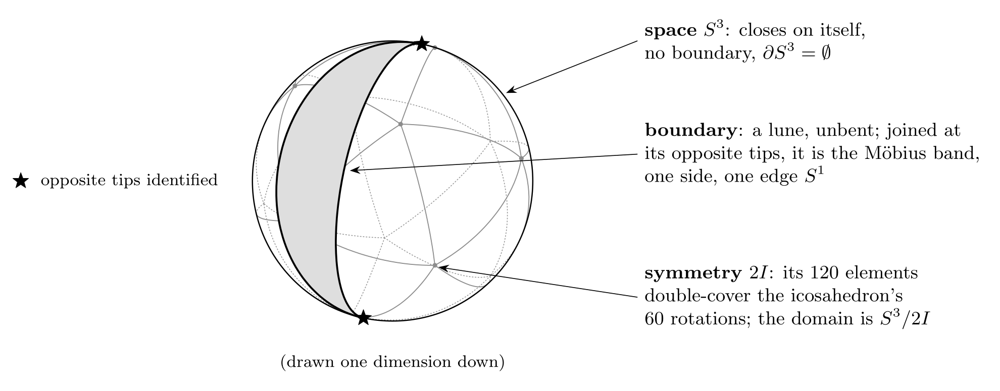
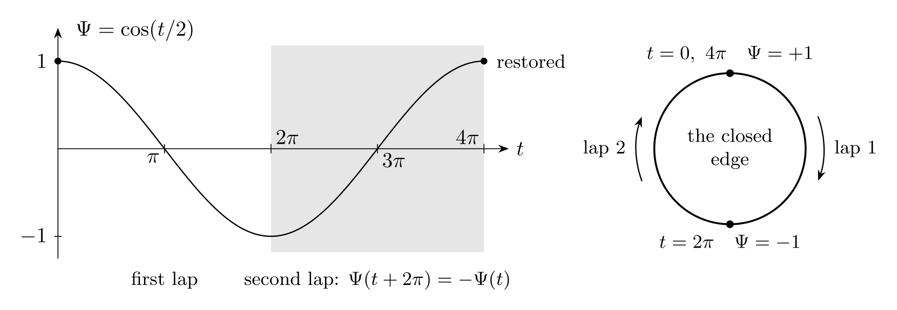
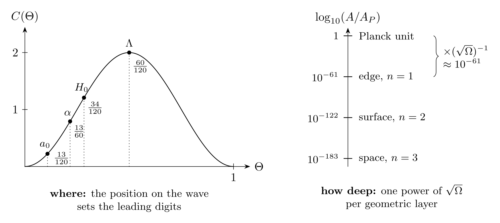
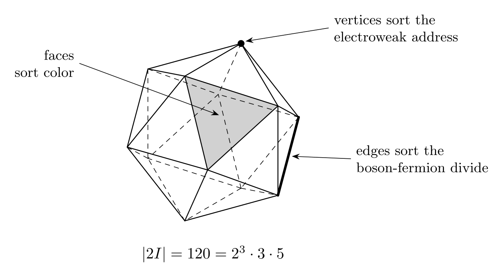
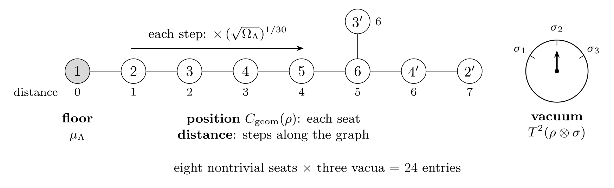
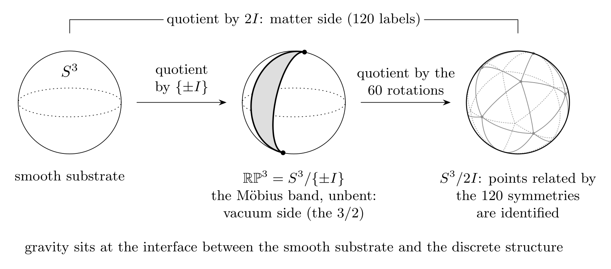

<a id="top"></a>
| **[`framework`](/files/framework/)** | **[`bedrock`](/files/framework/files/bedrock/)** | **[`dynamics`](/files/framework/files/dynamics/)** | **[`working`](/files/framework/files/working/)** | **[`cosmos`](/files/cosmos/)** | **[`spectrum`](/files/spectrum/)** | **[`tools`](/files/tools/)** | **[🌊](/files/tools/files/openwave/)** |

---


---

**Mode Identity Theory (MIT) starts with a simple bet:** fundamental physics is not missing more ingredients. It is missing the boundary conditions that determine the forms those ingredients take and the values they assume. Instead of changing relativity or treating the constants of nature as accidents, MIT asks what follows when form comes before function.

MIT keeps Einstein's field equations and the Standard Model as the local rules of physics while adding a global geometric structure beneath them. In this picture, topology comes first. The wave is fundamental. Matter appears where that wave is sampled, and time is its phase. The observer is part of the realization rather than something standing outside it. Some of what follows is exact mathematics, some is quantitative correspondence, and some remains open research.

What began with an unexpected search query became a philosophical question, then a problem in topology, and eventually a physical framework. The surprise was that once the geometry was fixed, quantities that normally appear unrelated began to emerge as different readings of the same structure: cosmic scales, particle identities, coupling constants, and masses.

Around 300 BC, Euclid proved that only five regular solids close perfectly in ordinary space, formalizing an early observation by Plato. Today, ESA's Euclid telescope is surveying billions of galaxies to measure how the universe expands and how structure grows. MIT makes its own geometric bet:

**one shape, one wave, and the rest is accounting.**

>At its core, MIT is a research program in topology, spectral geometry, and representation theory. The [framework](/files/framework/) lays out the theory's structure, with mathematical foundations in [bedrock](/files/framework/files/bedrock/), frontier research in [dynamics](/files/framework/files/dynamics/), and open questions in [working](/files/framework/files/working/). Its physical applications span [cosmos](/files/cosmos/) and [spectrum](/files/spectrum/), while reference and interactive materials are gathered in [tools](/files/tools/). Testing takes place on [OpenWave](/files/tools/files/openwave/README.md), an independent computational platform.
---

**💬 Frequently Asked Questions**

***What shape is the universe?*** 
- It starts with a three-sphere, $S^3$: a finite space that closes on itself, with no boundary and no outside. By the Poincaré conjecture, it is the only closed three-manifold that is simply connected. The observable domain is the smooth quotient $S^3/2I$. The 120-element binary icosahedral group, $2I$, used to form that quotient also furnishes the discrete representation labels the framework uses to resolve physical states. The underlying space remains fixed. What we interpret as cosmic expansion is a change in the phase and realization of the wave. More of the wave comes into view, and distances appear to grow.

***Why a Möbius band?*** 
- While the three-sphere supplies the space, the Möbius band supplies the boundary structure. Embedded naturally in projective three-space, it is the simplest surface that is both one-sided and bounded by a single edge. Traverse it once and orientation reverses. That reversal becomes the sign flip behind the wave's anti-periodic behavior and its 4π period. The same edge provides a single continuous path on which phase can be carried, giving the theory a natural place for time.

***What is matter, and what are we?*** 
- Matter is the realized form of the wave: stable patterns that become definite when the underlying mode is sampled. In MIT, an observer is simply any bounded system in which that sampling occurs. An atom qualifies because the wave takes on definite values within it; a human is a vastly more complex observer built from the same process. We are not outside the universe looking in. We are part of the structure through which the universe becomes definite.

***How did it begin?*** 
- In this framework, the Big Bang was not the creation of space. Our closed spatial domain was already here. What began was the measurable history of the wave: a standing wave at maximum amplitude that evolves toward greater realization. The early universe was therefore not a smaller version of today's space, but the same underlying domain viewed at an earlier phase of the cycle. A useful analogy is a three-dimensional cymatic pattern gradually coming into definition as energy moves through it.

---

>[](https://www.youtube.com/watch?v=ANzQhGGzoAk)
>
>*Video: [Topology before Matter](https://www.youtube.com/watch?v=ANzQhGGzoAk)*

---

## 📂 Repo Layout

```
mode-identity-theory/
├─ main                           ← you are here
    ├─ framework/                  ← the postulate & derivations
    │   ├─ bedrock/                 ← standalone mathematics papers
    │   │   ├─ first-eigenvalue       ← twisted Möbius Laplacian operator
    │   │   ├─ coexact-gap            ← coexact gap on S³/Γ & the 2I exception
    │   │   ├─ galois-pair            ← E8 filling & the tautological charge
    │   │   └─ surviving-ray          ← spin-3 channel filter & its surviving ray
    │   ├─ dynamics/                ← how the wave content moves & sources geometry
    │   │   └─ standing-wave-branches ← ground states & small-amplitude spectral stability
    │   └─ working/                 ← research in progress: maps & open problems
    ├─ cosmos/                     ← the static three-sphere seen whole
    │   ├─ cosmological-constant      ← the spectral seed behind Λ
    │   ├─ cmb-anomalies              ← low-ℓ suppression as the Molien gap
    │   ├─ dark-energy                ← what evolves is not Λ but perception
    │   ├─ early-galaxies             ← early massive galaxies in a static geometry
    │   ├─ hubble-tension             ← H₀ as an edge mode & the 8.4% lattice step
    │   ├─ black-holes                ← black holes as topological nodes of the wave
    │   └─ euclid-dr1                 ← the falsification gate
    ├─ spectrum/                   ← the near boundary: matter & gauge on S³/2I
    │   ├─ yang-mills                 ← the linearized gauge gap & three vacua
    │   ├─ mass-spectrum              ← fermion masses as position on the lattice
    │   ├─ fine-structure             ← α is the first realized step of Λ
    │   ├─ the-waltz                  ← the gravity between surface & space
    │   └─ the-mirror                 ← curvature duality: gauge gap & zeros
    └─ tools/                      ← interactive, publications, & references
        └─ openwave/                ← MIT's M8 column on OpenWave: every task & its files
```

---

🏟️ **One Shape**

<p align="center"></p>

---

```math
\Large \boxed{S^1 = \partial(\text{Möbius}), \quad \text{Möbius} \hookrightarrow \mathbb{RP}^3 = S^3/\{\pm I\}, \quad \partial S^3 = \emptyset}
```

MIT starts with a finite space that closes on itself, so there is no outer boundary: the three-sphere. If each point is identified with its opposite, the resulting projective three-space admits an unbent Möbius surface with a single continuous edge. The three-sphere supplies the space; the Möbius band supplies the twist and the boundary along which phase is carried.

The observable domain is the smooth quotient $S^3/2I$. The same opposite-point identification forms part of that construction, while the 120-element binary icosahedral group, $2I$, provides the representation structure the framework uses to distinguish physical states. The result remains a smooth manifold.

- So the geometry has three jobs: **$S^3$ supplies the space, the Möbius band supplies the boundary condition, and $2I$ supplies the symmetry structure from which the physics is read.**

---

Ψ **One Wave**

<p align="center"></p>

---

```math
\Large \boxed{\Psi = \cos(t/2), \quad \text{period } 4\pi}
```

The underlying space remains fixed. What changes is the phase of a standing wave carried by the temporal boundary.

The Möbius twist causes the lifted wave to change sign after one circuit and return to itself only after two. As a result, its fundamental phase period is $4\pi$ rather than $2\pi$. The boundary itself also closes only after two circuits, so nothing defined on it is double-valued. The progression of that phase is what the theory identifies as time.

- The cosine wave has a complementary component, $S=\sin(t/2)$, and together they always form a complete whole: $`\Psi^2 + S^2 = 1`$

$\Psi^2$ represents the portion still carried as wave, while $S^2$ represents the portion already realized as modes. As phase advances, weight shifts from the first to the second. That single quantity, $S$, is the variable the framework associates with cosmological observations.

Matter appears where the wave is sampled. Most possible modes cancel. The surviving patterns become the physical states we observe. In that sense, the universe is not built from separate particles placed into space. Particles are stable realizations of a single underlying wave.

---

⚖️ **One Law**

<p align="center"></p>

---

```math
\Large \boxed{\frac{A}{A_P} \approx C(\Theta) \cdot (\sqrt{\Omega})^{-n}}
```

The scaling law asks two questions about any quantity: where is it sampled, and at what geometric scale is it defined?

- **$`A/A_P`$ measures the quantity relative to its natural Planck-scale unit.**

- **$`C(\Theta) = 2\sin^2(\pi\Theta)`$ gives its position on the wave.**

- **$`(\sqrt{\Omega})^{-n}`$ gives the suppression associated with the geometric layer being read.**

The powers of ten come from the hierarchy; the wave position supplies the leading digits. The index $n$ describes the form of the suppression, with one power for each geometric layer crossed. It does not determine the size of the hierarchy itself. The value of $\Omega$ is fixed from an anchor and then read across the rest of the structure.

The wave is not sampled continuously across all possible positions. The golden field, $\mathbb{Q}(\sqrt5)$, is already built into the $2I$ geometry, but the additional step that selects the realized Fibonacci wells remains an open problem. The wells are observed throughout the framework; the rule that chooses them is not yet derived.

---

🔺 **One Identity**

<p align="center"></p>

---

```math
\Large \boxed{|2I| = 120 = 2^3 \cdot 3 \cdot 5}
```

A particle is not identified by a single number. In MIT, each state has an address in the symmetry: a representation seat $\rho$ together with a flat-vacuum label $\sigma$.

The 120-element structure contains three natural stabilizers associated with faces, edges, and vertices. Looking at the same state through each one reveals a different aspect of its identity:

- **Faces sort color.**

- **Edges sort the boson-fermion divide.**

- **Vertices sort the electroweak address.**

The representation theory provides these decompositions, and MIT interprets them as the geometric origin of the Standard Model's quantum numbers. The three flat vacua provide the second part of the address. The framework identifies them with the three particle generations, although which vacuum corresponds to which generation remains an open question.

---

⚛️ **One Formula**

<p align="center"></p>

---

```math
\Large \boxed{m(\rho,\sigma) = \mu_\Lambda \cdot C_{\text{geom}}(\rho) \cdot (\sqrt{\Omega_\Lambda})^{\text{dist}(\rho)/30} \cdot T^2(\rho \otimes \sigma)}
```

The mass formula treats particle masses as different addresses in one geometric spectrum rather than as unrelated input numbers.

It builds a mass from four pieces:

- **The Floor:** $`\mu_\Lambda`$ sets the mass scale from which the spectrum is built.

- **The Position (Kostant sunflower):** $`C_{\text{geom}}(\rho)`$ gives each representation its seat in the geometry.

- **The Distance (McKay elevator):** $`(\sqrt{\Omega_\Lambda})^{\text{dist}(\rho)/30}`$ moves that seat through orders of magnitude according to its distance on the McKay graph.

- **The Vacuum (torsion dial):** $`T^2(\rho \otimes \sigma)`$ adjusts the result according to which flat vacuum the state occupies.

Across the eight nontrivial representation seats and three vacua, the formula produces a 24-entry fermion spectrum. Its proximity to the measured masses is a comparison, not a prediction. The weight of the construction rests instead on the existence of the 24-entry geometric spectrum and on the exact torsion algebra, whose eight irrep-level closed forms a second, non-spectral method reproduces.

---

🪡 **One Interface**

<p align="center"></p>

---

```math
\Large \boxed{\text{Möbius} \hookrightarrow S^3/\{\pm I\} \qquad\Big|\qquad S^3 \to S^3/2I}
```

The framework has two seams, and they do different jobs.

The Möbius embedding provides the vacuum-side geometry. The quotient $S^3 \to S^3/2I$ provides the matter-side representation structure. The first is an unbent surface embedded in the projective quotient $S^3/{\pm I}$. The second is the quotient by the full binary icosahedral symmetry group, whose construction includes that same identification of opposite points as an initial step. The two constructions are related, but they are not the same operation, and the framework does not treat them as interchangeable.

The familiar factor $3/2$ belongs only to the vacuum side of the theory. Its numerator comes from the derived geometry of the Möbius band's unbent covering surface in isotropic $S^3$, while its denominator comes from the de Sitter normalization inherited from general relativity.

- Gravity is not a fourth force waiting for an empty seat on the particle grid. In MIT, gravity lives at the interface between the smooth geometric substrate and the discrete representation structure built upon it. Einstein's field equations remain the local law of gravity. What remains open is the dynamical bridge that specifies exactly how realized wave content sources the geometry.

---

## 🎼 Score

**Standing:** `exact` proved or structural · `anchor-free` numerical, normalization cancels · `anchored (X)` conditional on anchor X, carrying a figure where the quantity is measured · `open` unresolved.

**📐 Structural**

| Observable | Standing | Result | Status |
|---|---|---|---|
| [↗](/files/spectrum/files/the-waltz.md#ii-gravity-as-the-cost-to-dance) $`\Lambda_\text{ref}/\Lambda_\text{top}`$ | `exact` | 3/2 | the ½ imported from GR |
| [↗](/files/cosmos/files/cosmological-constant.md#iii-the-spectral-seed) $`\Lambda_\text{top}`$ eigenvalue | `exact` | $`2/R^2`$ | narrow band, Friedrichs |
| [↗](/files/spectrum/files/yang-mills.md#i-the-geometry) Mass gap | `exact` | $`> 0`$ | linearized, on the compact space |
| [↗](/files/spectrum/files/the-mirror.md#ii-main-theorem) Spectral inaccessibility | `exact` | no single L-function zero pinned | within the stated class |

**🪐 Cosmos**

| Observable | Standing | Result | Status |
|---|---|---|---|
| [↗](/files/cosmos/files/cosmological-constant.md#v-the-open-radius) $`\Lambda_\text{ref}`$ | `anchored (α)` | $`2.2`$ vs $`2.845 \times 10^{-122}`$ (Planck units) | ~23% low; identification open |
| [↗](/files/cosmos/files/cosmological-constant.md#v-the-open-radius) $`\Lambda_\text{ref}`$ (cross-check) | `anchored (m_μ/m_e)` | $`8.1 \times 10^{-54}`$ vs $`1.089 \times 10^{-52}`$ m⁻² | 13.4× low, a miss |
| [↗](/files/cosmos/files/dark-energy.md#iii-w_texteffz---1-at-all-redshifts-fiducial-split) $`w_\text{eff}(z)`$ sign | `exact` | $`> -1`$ at every $`z`$ | Euclid DR1 pending |
| [↗](/files/cosmos/files/dark-energy.md#primary-fit-snbao) $`\Delta\chi^2`$ vs ΛCDM | `anchored (Λ)` | $`+0.11`$ | degenerate with ΛCDM |
| [↗](/files/cosmos/files/dark-energy.md#the-1z1-term) $`(1+z)^1`$ term | `open` | negative for $`s_0 > 0`$ | next-gen BAO pending |
| [↗](/files/cosmos/files/cmb-anomalies.md#iv-the-molien-shell-gap) CMB low-ℓ deficit | `open` | Molien gap, $`\ell \approx 24`$ | sky projection not derived |
| [↗](/files/cosmos/files/hubble-tension.md#the-84-displacement) $`H_0`$ local shift | `open` | $`67.4 \to 73.04`$ (+8.4%) | retrospective; trigger falsified |
| [↗](/files/cosmos/files/early-galaxies.md#the-ratio-from-the-scaling-law) $`a_0/(cH_0)`$ | `anchor-free` | 0.184 vs 0.183 | within 1% |
| [↗](/files/cosmos/files/early-galaxies.md#the-evolutionary-law) $`a_0(z) \propto H(z)`$ | `open` | ~3× by $`z = 2`$ | rising to $`z = 1.44`$; rate open |
| [↗](/files/spectrum/files/the-waltz.md#iv-dark-matter-and-dark-energy-as-geometry) Null dark matter | `open` | no particle sector | direct-detection nulls |

**🌈 Spectrum**

| Observable | Standing | Result | Status |
|---|---|---|---|
| [↗](/files/spectrum/files/yang-mills.md#ii-three-vacua) Flat-vacuum count | `exact` | 3 | vs 3 generations (a reading) |
| [↗](/files/spectrum/files/mass-spectrum.md#1-color-from-faces) Color from $`Z_3`$ | `exact` | singlet / triplet | consistent (a reading) |
| [↗](/files/spectrum/files/mass-spectrum.md#2-domain-from-edges) Domain from $`Z_4`$ | `exact` | integer / half-integer | consistent (a reading) |
| [↗](/files/spectrum/files/mass-spectrum.md#4-weak-isospin-from-the-coxeter-galois-gate) Weak isospin $`T_3`$ | `exact` | 11 evaluations consistent | rule written knowing the answers |
| [↗](/files/spectrum/files/mass-spectrum.md#3-the-eta-sign-gate) Eta sign gate | `exact` | $`\eta > 0 \implies Q \leq 0`$ | all assigned entries pass |
| [↗](/files/spectrum/files/mass-spectrum.md#iii-the-24-entries) Fermion masses | `anchored (m_e, Λ)` | 5 of 8 within ×3 | null $`p = 0.690`$: no evidence |
| [↗](/files/spectrum/files/mass-spectrum.md#iii-the-24-entries) $`m_\mu`$ (muon) | `anchored (m_e, Λ)` | 0.103 vs 0.1057 GeV | ~3% |
| [↗](/files/spectrum/files/mass-spectrum.md#iii-the-24-entries) $`m_t`$ (top quark) | `anchored (m_e, Λ)` | 161.3 vs 172.7 GeV | 7% |
| [↗](/files/spectrum/files/mass-spectrum.md#v-dead-zone-targets-and-exclusions) Rank 16 entry | `open` | ~418 MeV | unobserved |
| [↗](/files/spectrum/files/mass-spectrum.md#v-dead-zone-targets-and-exclusions) Dead zone | `open` | 6 entries, sub-eV to keV | status open |
| [↗](/files/spectrum/files/mass-spectrum.md#the-neutrino-ladder) Neutrino ladder | `open` | 0.87, 7.3, 66.7 meV | ordered like the splittings; proxy only |
| [↗](/files/spectrum/files/mass-spectrum.md#1-mass-sector-floor--mu_lambda) $`\mu_\Lambda`$ mass floor | `anchored (Λ)` | 2.25 meV | derived scale |

**⚛️ Couplings**

| Observable | Standing | Result | Status |
|---|---|---|---|
| [↗](/files/spectrum/files/fine-structure.md#iii-the-formula) $`\alpha`$ | `anchored (Λ)` | 0.00733 vs 0.00730 | 0.4% at $`q^2 = 0`$ |
| [↗](/files/spectrum/files/fine-structure.md#alpha_s-the-strong-coupling) $`\alpha_s`$ | `anchored (Λ)` | 0.1162 vs 0.1180 | 1.5%; ladder conjecture |
| [↗](/files/spectrum/files/fine-structure.md#alpha_w-the-weak-coupling-and-the-plato-twist) $`\alpha_W`$ | `anchored (Λ)` | 0.0339 vs 0.0338 | 0.3%; ladder conjecture |
| [↗](/files/spectrum/files/fine-structure.md#alpha_s--alpha_w-pure-geometry) $`\alpha_s / \alpha_W`$ | `anchor-free` | 3.426 vs 3.490 | 1.8% |
| [↗](/files/spectrum/files/fine-structure.md#the-prediction) Force count | `exact` | 3 rungs | vs 3 forces; conditional on the ladder |
| [↗](/files/spectrum/files/fine-structure.md#the-prediction) Null SUSY | `open` | no gaugino-mediated force | none seen to date |

---

## 🔮 Pre-Registered Euclid Predictions / Falsification

><a href="https://www.esa.int/Science_Exploration/Space_Science/Euclid"></a>
>
>*[ESA Euclid Mission:](https://www.esa.int/Science_Exploration/Space_Science/Euclid) The Euclid space telescope is designed to explore the evolution of the dark Universe. It is creating a 3D-map by observing billions of galaxies across more than a third of the sky. Euclid is revealing how structure has formed over cosmic history – and from this, astronomers can infer the properties of dark energy, dark matter and gravity, to reveal more about their precise nature.*

| Test | MIT says | Field baseline | MIT loses if |
|---|---|---|---|
| [↗](/files/cosmos/files/euclid-dr1.md#i-lambda-epoch-independence) $`\Lambda`$ epoch-independence | $`\Omega_\text{DE}(z)`$ flat across the DR1 bins | ΛCDM: constant; dynamical dark energy: evolves | either reconstruction varies at $`\geq 2\sigma`$ |
| [↗](/files/cosmos/files/euclid-dr1.md#ii-a_0z-evolution) $`a_0(z)`$ evolution | ~2.4× local by $`z = 1.5`$ | ΛCDM: no $`a_0`$; MOND: constant | lensing and kinematics both find no rise, at $`\geq 2\sigma`$; needs a lensing law first |
| [↗](/files/cosmos/files/euclid-dr1.md#iii-w_texteffz-trajectory) $`w_\text{eff}(z)`$ trajectory | $`> -1`$ at every $`z`$ | ΛCDM: $`-1`$; dynamical fits: either side | below $`-1`$ at $`\geq 2\sigma`$ |
| [↗](/files/cosmos/files/euclid-dr1.md#iv-stellar-mass-function-at-z-gtrsim-10) Stellar mass function at $`z \gtrsim 10`$ | massive early galaxies persist | ΛCDM's ceiling at full star-formation efficiency | they fall short of that ceiling at $`\geq 2\sigma`$ |
| [↗](/files/cosmos/files/euclid-dr1.md#v-1z1-coefficient-in-h2z) $`(1+z)^1`$ coefficient in $`H^2(z)`$ | negative, $`\lvert\beta\rvert < 0.012`$ | ΛCDM: zero | positive at $`\geq 2\sigma`$, or off the fitted $`s_0`$ |

---

>[](https://notebook.google.com/notebook/510d4424-8462-44fe-9c96-25a0aedd71d1)
>
>**[Gemini Notebook](https://notebook.google.com/notebook/510d4424-8462-44fe-9c96-25a0aedd71d1)**: a NotebookLM grounded in the framework; ask it anything, or hear the audio overview.

---

*What you hold in your hand is not matter. It is where the wave resolved when you sampled it.*

*The thing is the sample. The identity is the wave Ψ*

---

| **[`↑top`](#top)** | **[`framework`](/files/framework/)** | **[`bedrock`](/files/framework/files/bedrock/)** | **[`dynamics`](/files/framework/files/dynamics/)** | **[`working`](/files/framework/files/working/)** | **[`cosmos`](/files/cosmos/)** | **[`spectrum`](/files/spectrum/)** | **[`tools`](/files/tools/)** | **[🌊](/files/tools/files/openwave/)** |
