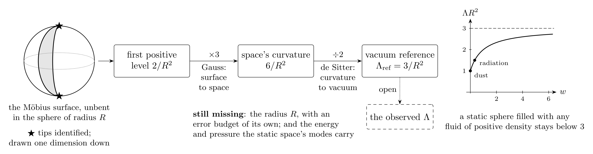
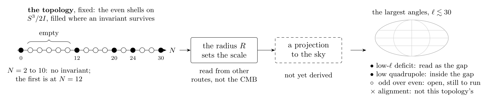
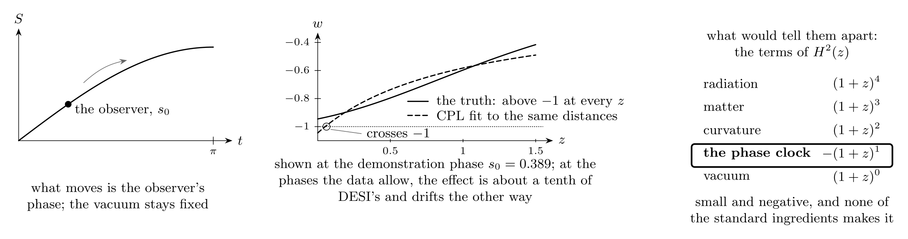
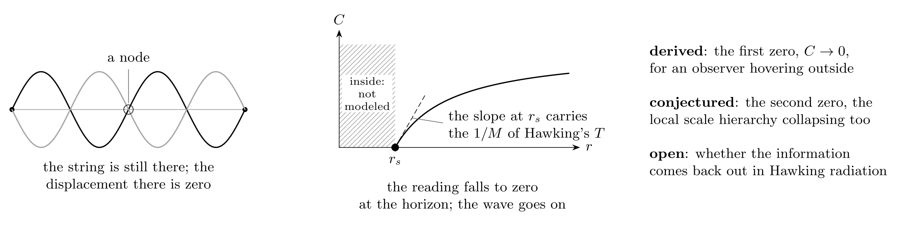

| **[`main`](https://github.com/dmobius3/mode-identity-theory/tree/main/)** | **[`framework`](/files/framework/)** | **[`bedrock`](/files/framework/files/bedrock/)** | **[`dynamics`](/files/framework/files/dynamics/)** | **[`working`](/files/framework/files/working/)** | **[`spectrum`](/files/spectrum/)** | **[`tools`](/files/tools/)** |

---

# 🪐 Κόσμος

The cosmos is the same finite space seen whole: a three-sphere, with no boundary and no outside. MIT is a speculative framework; this page lays out what it says about the universe at large, and each linked paper carries the details and caveats.

Nothing stretches. A Möbius surface lies unbent in the sphere's projective quotient, where each point is identified with its opposite; its single edge carries a standing wave, and the observer's phase along that wave is what we read as cosmic time and as redshift. The sphere's curvature enters as a fixed boundary condition rather than a term in Friedmann's equation, and MIT fits the cosmological data as spatially flat.

What stays fixed is the vacuum. Its geometric seed is the first positive vibration level of the Möbius surface, set by the sphere's radius, which never changes. What moves is the observer's phase, and that one motion can show up three ways: as an apparent phantom crossing in standard dark-energy fits, as an acceleration scale $`a_0`$ that rises with the Hubble rate, and as a small extra term in the squared Hubble rate.

The 120-element group that forms the space leaves an empty stretch in its vibration spectrum, which lines up with the missing large-angle power in the oldest light. The two headline values of the Hubble constant sit two positions apart on its 120-position grid. At a black hole, the wave goes silent for an observer hovering outside. Five predictions are locked in ahead of Euclid's DR1 data.

---

## [Cosmological Constant](files/cosmological-constant.md)

**Geometry, Not Substance.** Einstein put $`\Lambda`$ on the geometric side of his equations in 1917, and MIT keeps it there. The Möbius surface, lying unbent in the projective quotient of a three-sphere of radius $`R`$, where opposite points are identified, hums at $`\Lambda_\text{top} = 2/R^2`$, the first positive level of its vibration spectrum: the twist picks which family of vibrations that level belongs to, and the surface's curvature sets its value. Two standard steps carry that seed into space. The Gauss equation lifts the surface's curvature into the three-sphere, and general relativity's de Sitter relation turns that curvature into a vacuum value, $`\Lambda_\text{ref} = 3/R^2`$. Two things are still missing: the radius itself, and the energy and pressure of the static space's modes, which would show whether $`3/R^2`$ is the constant we measure.

>
>
>*Video: [Einstein's Constant, Resolved](https://www.youtube.com/watch?v=eFzqU8KPfJ4)*

---

## [CMB Anomalies](files/cmb-anomalies.md)

**Topology and the CMB.** Four large-angle oddities in the oldest light have survived COBE, WMAP and Planck: too little power on the largest scales, a low quadrupole, odd multipoles outweighing even ones, and a quadrupole lined up with the octupole. On $`S^3/2I`$, only vibration patterns unchanged by the 120-element group survive, and apart from the constant mode none appears until level $`N = 12`$. That empty stretch, the Molien gap, is MIT's account of the missing large-angle power, and the low quadrupole falls inside the same thinning; where the gap lands on the sky depends on the sphere's radius and on how the space's patterns project onto the sky, which is still being worked out. The odd-over-even preference has no mechanism yet: the mirror route is closed because the space is chiral, and a correlation route is a calculation still to run. For a Gaussian source the alignment isn't this geometry's doing: with the icosahedral symmetry intact, the quadrupole has no preferred direction.

>
>
>*Video: [The Molien Gap: Cosmic Topology and the Low-ℓ Deficit](https://www.youtube.com/watch?v=2CCODLAmshw)*

---

## [Dark Energy](files/dark-energy.md)

**The Phantom in the Template.** DESI's DR2 fits suggest dark energy that changes over time and even crosses $`w = -1`$, the "phantom divide" that simple models struggle to cross. In MIT the vacuum term doesn't move at all; what moves is the observer's phase on the standing wave. Fit that motion with the standard two-parameter templates (CPL, BA and JBP) and they report a phantom crossing anyway, from a model with no phantom fluid in it. At the phases the data allow, the effect is about a tenth the size of DESI's and drifts the other way, so it shows the mechanism rather than explaining DESI's signal. Against Pantheon+ supernovae and DESI DR2 BAO, the static model and flat ΛCDM, the standard cosmological model, fit equally well. What would tell them apart is a small negative $`(1+z)^1`$ term in the squared Hubble rate, $`H^2(z)`$, that none of the standard ingredients produce; whether upcoming surveys can see it depends on the phase.

>
>
>*Video: [Phantom Dark Energy: Template Artifact in Static Space](https://www.youtube.com/watch?v=7l8AbmXyz-0)*

---

## [Early Galaxies](files/early-galaxies.md)

**A Stronger Tide.** In 1983 Milgrom identified $`a_0`$, the acceleration where galaxy dynamics start to depart from Newton, as a fundamental scale, and its closeness to $`cH_0`$, the speed of light times the Hubble rate, has never had a settled explanation. In MIT both are edge modes on the same standing wave, taken to share one normalization, so their ratio is set by where each sits, and it comes out at 0.184, in line with the measured ratio. That ratio holds at every epoch, so $`a_0`$ was larger in the past, rising with the Hubble rate, and the galaxies JWST found too early formed under that stronger tide. MUSE-DARK III has since measured $`a_0`$ rising at intermediate redshift, the predicted direction, though other evolving-scale models and ΛCDM simulations rise too.

>
>
>*Video: [Early Galaxy Masses: Epoch-Dependent Acceleration in Static Space](https://www.youtube.com/watch?v=BuxnEmMGMFE)*

---

## [Hubble Tension](files/hubble-tension.md)

**One Well, Two Seats.** Hubble fixed the velocity-distance relation in 1929, and its two headline measurements disagree: 67.4 km/s/Mpc from the microwave background, 73.04 from the local distance ladder. In MIT they are the same well read from two seats on the 120-position grid. MIT assigns this kind of measurement to every other position, so the local seat sits two positions from the bare well, and that step carries 67.4 to 73.04, an 8.4% gap. The match was found after the fact, not predicted, and the mechanism proposed to produce it, a galactic switch at the radius where gravity falls to Milgrom's acceleration scale, was pre-registered and failed against SPARC rotation curves. The numbers line up; the cause is still open.

>
>
>*Video: [H₀ Local: Hubble Tension as Phase Field](https://www.youtube.com/watch?v=ZICE7beEQh8)*

---

## [Black Holes](files/black-hole.md)

**Black Double Zeros.** In MIT, a black hole is where enough wave content gathers on the surface that the observer's phase reaches the edge of its range, and the sampling amplitude, the factor that lets the wave be read, falls to zero. The wave doesn't stop; the reading does, like a node on a guitar string: the string is still there, the displacement is zero. For an observer hovering outside, that first zero follows from matching the amplitude to general relativity's redshift near the horizon. A second zero, the local scale hierarchy collapsing over the same approach, is the conjecture behind the name. Because the wave persists, the information is still in it; whether it comes back out in Hawking radiation is open. The wave's slope at the horizon reproduces the $`1/M`$ in Hawking's temperature, the rest of the thermodynamics and the merger waveforms still come from standard physics, and the interior isn't modeled yet.

>
>
>*Video: [Black Holes](https://www.youtube.com/watch?v=iByR_Bv5Vng)*

---

## [Euclid DR1: A Pre-Registered Contender Showdown](files/euclid-dr1.md)

**Judgment Day.** A theory is honest only if it says, before the data arrive, what would prove it wrong. On 5 June 2026 MIT locked five predictions against four rivals, flat ΛCDM, evolving dark energy in the w0waCDM form, early dark energy, and MOND, each with a failure line drawn in advance; the first and the fourth were re-registered in September under stricter rules, still before any DR1 data. Euclid's DR1 arrives in two stages, the second on a date ESA calls tentative.

**DR1-Foundation, released 12 November 2026: one test, once Euclid measures it.** The early-galaxy row asks whether the massive early galaxies JWST found, around ten billion solar masses of stars above redshift 10, keep turning up across Euclid's wide survey. Re-registered on 23 September, it scores on the first Euclid measurement of their abundance that meets its rules, from these catalogues or a later release. MIT loses it if those galaxies fall clearly short, at 2σ or more, of the most ΛCDM allows with every available baryon turned into stars, and so far the evidence points that way: JWST's largest contiguous survey puts them well below that limit.

**The full DR1, expected 16 June 2027: the other four.** It adds galaxy clustering and weak lensing. MIT says the dark-energy density stays flat across Euclid's redshift range; that $`a_0`$ rises with the Hubble rate, about 2.4-fold by redshift 1.5, where MOND keeps it constant, though Euclid can't score this one until MIT supplies a lensing law; that dark energy's effective $`w`$ stays above −1 with matter held at its standard share; and that a small negative $`(1+z)^1`$ term sits in $`H^2(z)`$, though DR1 may be too coarse to see it. Four of the five read one Hubble-rate relation, so passing them confirms one idea, not four.

>
>
>*Video: [Staking the Theory - Decoding Euclid DR1](https://www.youtube.com/watch?v=R4d3SBHalw4)*

---

## 🪐 Score

**Standing:** `exact` proved or structural · `anchor-free` numerical, normalization cancels · `anchored (X)` conditional on anchor X, carrying a figure where the quantity is measured · `open` unresolved.

| Observable | Standing | Result | Status |
|---|---|---|---|
| [↗](files/cosmological-constant.md#iii-the-spectral-seed) $`\Lambda_\text{top}`$ eigenvalue | `exact` | $`2/R^2`$ | narrow band, Friedrichs |
| [↗](files/cosmological-constant.md#v-the-open-radius) $`\Lambda_\text{ref}`$ | `anchored (α)` | $`2.2`$ vs $`2.845 \times 10^{-122}`$ (Planck units) | ~23% low; identification open |
| [↗](files/cosmological-constant.md#v-the-open-radius) $`\Lambda_\text{ref}`$ (cross-check) | `anchored (m_μ/m_e)` | $`8.1 \times 10^{-54}`$ vs $`1.089 \times 10^{-52}`$ m⁻² | 13.4× low, a miss |
| [↗](files/dark-energy.md#iii-w_texteffz---1-at-all-redshifts-fiducial-split) $`w_\text{eff}(z)`$ sign | `exact` | $`> -1`$ at every $`z`$ | Euclid DR1 pending |
| [↗](files/dark-energy.md#primary-fit-snbao) $`\Delta\chi^2`$ vs ΛCDM | `anchored (Λ)` | $`+0.11`$ | degenerate with ΛCDM |
| [↗](files/dark-energy.md#the-1z1-term) $`(1+z)^1`$ term | `open` | negative for $`s_0 > 0`$ | next-gen BAO pending |
| [↗](files/cmb-anomalies.md#iv-the-molien-shell-gap) CMB low-ℓ deficit | `open` | Molien gap, $`\ell \approx 24`$ | sky projection not derived |
| [↗](files/hubble-tension.md#the-84-displacement) $`H_0`$ local shift | `open` | $`67.4 \to 73.04`$ (+8.4%) | retrospective; trigger falsified |
| [↗](files/early-galaxies.md#the-ratio-from-the-scaling-law) $`a_0/(cH_0)`$ | `anchor-free` | 0.184 vs 0.183 | within 1% |
| [↗](files/early-galaxies.md#the-evolutionary-law) $`a_0(z) \propto H(z)`$ | `open` | ~3× by $`z = 2`$ | rising to $`z = 1.44`$; rate open |

---

| **[`↑top`](#top)** | **[`main`](https://github.com/dmobius3/mode-identity-theory/tree/main/)** | **[`framework`](/files/framework/)** | **[`bedrock`](/files/framework/files/bedrock/)** | **[`dynamics`](/files/framework/files/dynamics/)** | **[`working`](/files/framework/files/working/)** | **[`spectrum`](/files/spectrum/)** | **[`tools`](/files/tools/)** |
