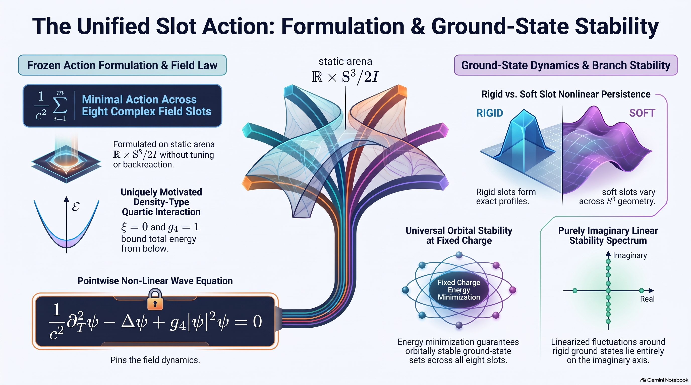

| **[`main`](https://github.com/dmobius3/mode-identity-theory/tree/main/)** | **[`framework`](/files/framework/)** | **[`bedrock`](/files/framework/files/bedrock/)** | **[`working`](/files/framework/files/working/)** | **[`cosmos`](/files/cosmos/)** | **[`spectrum`](/files/spectrum/)** | **[`tools`](/files/tools/)** |

---

# 🌊 Wave Dynamics

Dynamics is one problem with two halves: how the wave content moves, and how that motion sources geometry. The first half now stands on a fixed geometry, as an effective theory rather than the framework's matter action: on $`\mathbb{R} \times S^3/2I`$, fields carrying the eight nontrivial representations of $`2I`$, its McKay slots, move under one common action whose self-interaction is the [Surviving Ray](../bedrock/files/surviving-ray.md)'s density interaction. The paper below proves what that action supports, with OpenWave's adjudicated record beside its theorems, and the tracker under it holds the pages that feed the paper its numbers.

---

## [Standing-Wave Branches](files/standing-wave-branches.md)

**The Standing Waves:** Under that action, every slot has an orbitally stable set of ground states at each nonzero charge, and in five of the slots the set is an exact family whose every member is spectrally stable. In the three soft slots each nondegenerate critical orbit of a reduced quartic carries a branch of standing waves at small amplitude, whose type there the quartic decides. In two of those slots the quartic is the Surviving Ray's top multipole, and its two ends part: the minimum, the coherent orbit, carries the orbitally stable ground states at small charge, and the maximum, the hexagon, a branch spectrally stable at small amplitude, its orbital stability open. Past small amplitude, on OpenWave's adjudicated numerics, two branches born elliptic are classified elliptic at every registered point up to their slots' spectral gaps, three change type at located amplitudes, and four end at the instruments' limits. The action is motivated, not derived, and every result is conditional on it.

>
>
>*Video: [Standing-Wave Branches](https://youtu.be/EkHsHrlqi-U)*

---

### [Slot Action](../working/files/slot-action.md)

**The Action:** One action for all eight slot fields, chosen without using any outcome it would be tested against and frozen before the runs that test it: each field moves by the wave equation of its flat bundle, and its self-interaction is the density quartic, the only common quartic built from the fibre metric alone. It is motivated rather than derived, the effective theory the runs use, and it settles the lowest-level branches of five slots without a run.

### [Slot Ground States](../working/files/slot-ground-states.md)

**The Ground States:** Every slot field has lowest-energy states at each fixed nonzero charge, standing waves whose set is orbitally stable. In the five rigid slots they are exactly the lowest-level family, with the whole linear spectrum about each member on the imaginary axis; in two of the soft slots, at small charge, they form the branch through the coherent orbit.

### [Soft-Slot Branches](../working/files/soft-slot-branches.md)

**The Branches:** In the soft slots every critical orbit of the reduced quartic that is nondegenerate up to its symmetry continues to a branch of standing waves at small amplitude, and the quartic decides the branch's spectrum there: unstable where the slow motion is hyperbolic, stable at a nondegenerate minimum, and spectrally stable at a maximum and at an elliptic saddle with Krein-definite frequencies, once its zero modes are counted exactly. The page classifies the orbits it treats in exact or interval arithmetic, the Surviving Ray's census among them.

### [Hamiltonian–Krein Identification](../working/files/hamiltonian-krein-identification.md)

**The Count:** Along a branch of standing waves, the number of unstable and Krein-negative eigenvalues is $`n(L) - n(D)`$, the stationary operator's negative index less the energy's on the generalized kernel, and it changes only where eigenvalues of the linearization pass through zero. At a regular transversal crossing the symplectic form sorts the crossing directions three ways, and only one of them, a pair passing between real and imaginary, changes the type.

### [Slot Dynamics Census](../working/files/slot-dynamics-census.md)

**The Census:** The status of the branches at every certified critical orbit in one place, under a definition of done fixed before its runs; it closed on 2026-11-10. Past small amplitude, the runs from M8.15 to M8.19 followed nine branches born elliptic to their slots' spectral gaps on two instruments: two end elliptic throughout, three change type at located amplitudes, and four end at the instruments' limits, with no type claimed where they could not read. Every persistence test that ran held, as finite-time evidence, and at two orbits persistence stays untested. These are numerical verdicts, so finite amplitude is still open as mathematics. MIT's own computation of the open items is kept beside the record, outside M8.

### [Slot Relation](../working/files/slot-relation.md)

**The Energies:** What MIT says the energies of stable states across the eight slots obey, the relation the last row of OpenWave's M8 success ladder asks for. It was registered before any derivation, with three declared routes; none yields a relation, so none is filed, and a dynamics can still aim at the ladder's other rows without it.

### [Stress-Tensor Bridge](../working/files/stress-tensor-bridge.md)

**The Sourcing:** The open half: from the realized wave content to a stress tensor with a declared placement, the metric whose Einstein equations it sources. No leg of the bridge is derived and no candidate matter action exists; a [variational route](../working/files/variational-score-to-sample.md) is preferred for building one. Two targets the bridge named are proved, a [volume cap](../working/files/volume-cap.md) and a [propagation theorem](../working/files/propagation-theorem.md), and a [preregistered SN+BAO test](../working/files/nonflat-distance-comparison.md) of a closed effective geometry, keeping the flat fit's $`H(z)`$ and setting today's effective curvature radius equal to the static one, excludes it at 6.13 Gpc, disfavors it at 10.5 Gpc and does not exclude it at 19.7 Gpc, leaving the flat effective description untouched. With the radius fixed, a barotropic perfect fluid with $`\rho_0 + p_0 > 0`$ is not, perturbatively and under the fixed-radius test's ruled readings, a [consistent source](../working/files/fixed-radius-second-order.md) for the static domain. The slot action defines a stress tensor of its own but, as an effective theory, is no candidate; a matter action that carried the slot fields and supplied the missing source would join the two halves.

---

## 🏄‍♂️ Collaboration on OpenWave

The runs these pages cite are filed with [OpenWave](https://github.com/openwave-labs/openwave), an open-source physics simulator, in M8, MIT's column there: each is pre-registered and frozen before it goes, and the maintainer reproduces or adjudicates the result in public review. The column asks whether any reasonable action on $`S^3/2I`$ carries a common finite-amplitude branch or stability structure across the eight slots, and the [M8 roadmap](https://github.com/openwave-labs/openwave/blob/main/openwave/xperiments/m8_mit/research/m8_roadmap.md) is the place to start.

---

| **[`↑top`](#top)** | **[`main`](https://github.com/dmobius3/mode-identity-theory/tree/main/)** | **[`framework`](/files/framework/)** | **[`bedrock`](/files/framework/files/bedrock/)** | **[`working`](/files/framework/files/working/)** | **[`cosmos`](/files/cosmos/)** | **[`spectrum`](/files/spectrum/)** | **[`tools`](/files/tools/)** |
