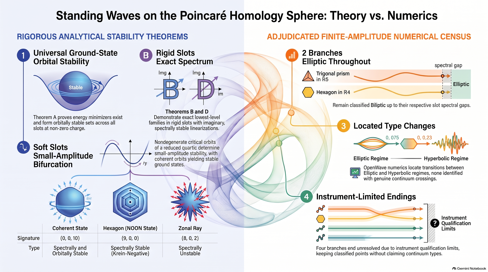
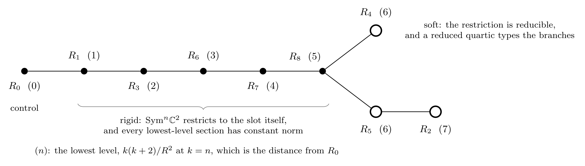
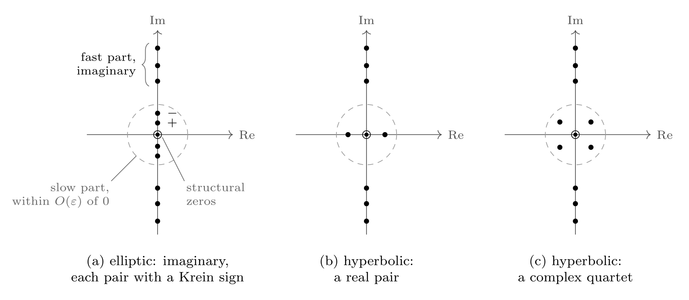
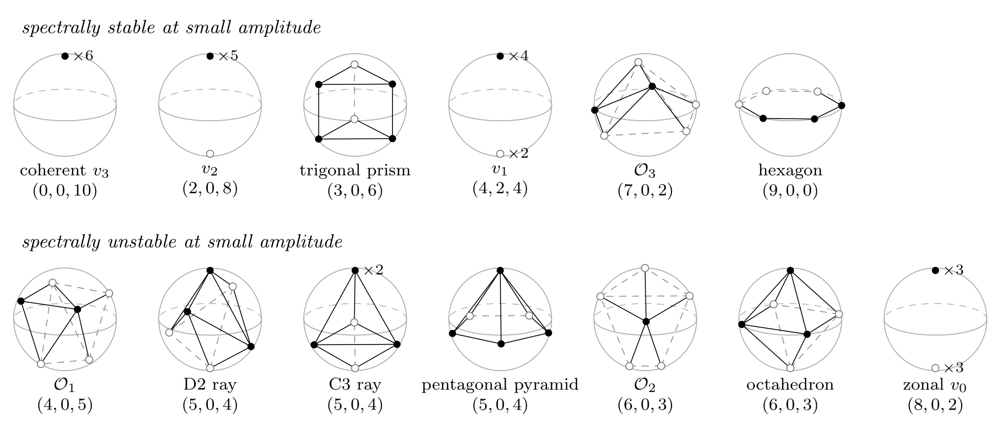
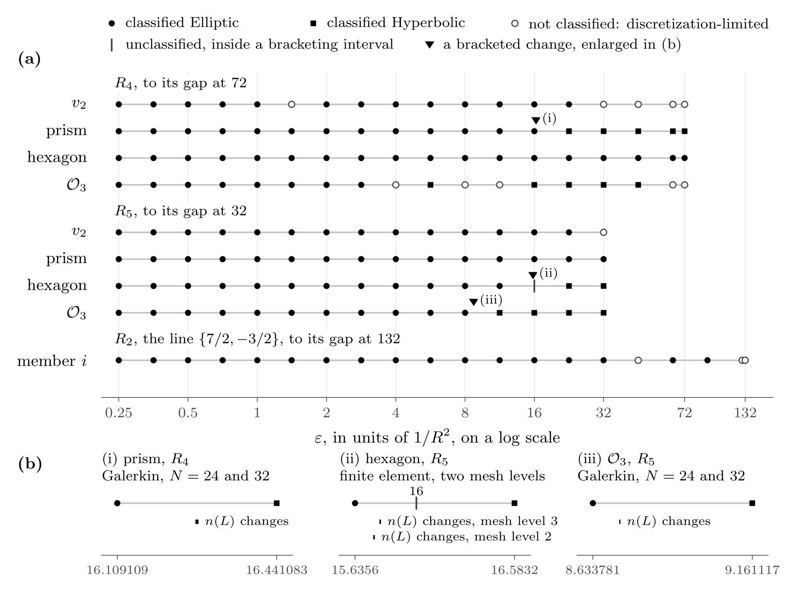

<a id="top"></a>
| **[`<back`](/files/framework/files/dynamics/)** | **[`main`](https://github.com/dmobius3/mode-identity-theory/tree/main/)** | **[`framework`](/files/framework/)** | **[`bedrock`](/files/framework/files/bedrock/)** | **[`dynamics`](/files/framework/files/dynamics/)** | **[`working`](/files/framework/files/working/)** | **[`cosmos`](/files/cosmos/)** | **[`spectrum`](/files/spectrum/)** | **[`tools`](/files/tools/)** |

---

# 🌊 Nonlinear Standing-Wave Branches on the Poincaré Homology Sphere: Ground States and Small-Amplitude Spectral Stability



We study standing waves of the defocusing cubic Klein–Gordon equation on the Poincaré homology sphere $`X = S^3/2I`$, without mass and with minimal curvature coupling, for complex fields that are sections of the flat bundles of the eight nontrivial irreducible representations of the binary icosahedral group $`2I`$. At every nonzero charge each bundle has an orbitally stable set of ground states, and in five of them this set is an explicit family whose every member is spectrally stable. In the other three, each nondegenerate critical orbit of a reduced quartic on the lowest eigenspace carries a branch of standing waves at small amplitude. Its spectral type is determined at every critical orbit found, in exact arithmetic and, at three orbits, in interval arithmetic, the two degenerate ones at second order. In two of these bundles the reduced quartic is an increasing affine function of the top multipole of a spin-3 state. Its minimum, the coherent orbit, carries the ground states at small charge; the hexagon orbit, where it attains its maximum, carries a branch that is spectrally stable at small amplitude with Krein-negative slow eigenvalues, its orbital stability open. The two bundles share every small-amplitude type, at each nondegenerate orbit by an exact scaling at leading order, while their nonlinear frequency shifts differ. At a nondegenerate orbit the next order of the slow spectrum is found in closed form for each nonzero semisimple eigenvalue of the slow matrix, and a Hamiltonian–Krein index identity holds at every standing wave with an $`H^2`$ profile. In pre-registered numerical continuation, reported apart from the theorems, two branches that are elliptic at small amplitude are classified elliptic at every sampled amplitude up to the spectral gap, three changes of type are bracketed, and four branches end with points left unclassified.

*The appendices, with the proofs and computations this page cites, are in the deposited paper, [doi:10.5281/zenodo.24224843](https://doi.org/10.5281/zenodo.24224843).*

## 1. Introduction

This paper studies standing waves $`\psi = e^{i\omega T}\varphi`$ of the defocusing cubic Klein–Gordon equation

```math
\frac{1}{c^2}\,\partial_T^2\psi - \Delta\psi + g_4\,\lvert\psi\rvert^2\psi = 0, \qquad g_4 > 0,
```

on the Poincaré homology sphere $`X = S^3/2I`$, where $`2I \subset SU(2)`$ is the binary icosahedral group. The field $`\psi`$ is a complex section of a flat bundle $`E_\rho = S^3 \times_{2I} V_\rho`$ over $`X`$, and $`\Delta`$ is the Laplacian of its flat connection, for one of the eight nontrivial irreducible representations $`\rho`$ of $`2I`$; we call these representations slots, and the trivial one, whose sections are functions on $`X`$, serves as a control. The spacetime is the static product $`\mathbb{R} \times X`$ with the radius $`R`$ of $`X`$ fixed, the fields do not act back on the metric, and there is no mass term and no coupling to the curvature (§§ 2.1, 2.2). We ask which branches of standing waves the equation has, what can be proved about their stability, and how their linearized spectra change at finite amplitude, up to each slot's spectral gap.

In two of the slots, $`R_4`$ and $`R_5`$, the reduced problem is an increasing affine function of the top multipole $`\hat r_6`$ on $`\mathbb{P}(V_3)`$ (§ 3.1), a quartic whose critical geometry the author's earlier paper describes [Sh]. Its least value, 1/924, is taken exactly on the coherent states, and its greatest, 463/924, on the hexagon orbit of $`v_3 + v_{-3}`$ [Sh, Proposition 7.4, Theorem 7.5]. A census, an audited argument (§ 3.1), finds ten critical orbits within a stated symmetry class, these two among them, and three outside the class are certified by interval arithmetic [Sh, § 7.2].

The analytical results have two ranges. At every nonzero charge, in every slot, the minimizers of the energy at fixed charge form an orbitally stable set of standing waves (Theorem 3.5); the proof is the constrained-minimization argument of Cazenave and Lions [CL], with Shatah's treatment of Klein–Gordon standing waves [Sha]. In the five rigid slots and the control, where every section in the lowest eigenspace has constant norm, that set is the exact lowest-level family, and every member of it is spectrally stable (Theorems 3.6 and 3.7, § 3.3). In the other three, the soft slots, branches are born at small amplitude from the nondegenerate critical orbits of a reduced quartic on the lowest eigenspace (Lemma 3.3, § 3.2), and the small-amplitude spectrum along each is read off that quartic (Theorem 4.2, § 4.1). The small-amplitude types of the two degenerate orbits are determined at second order (Theorem 4.6, § 4.2). At a nondegenerate orbit the next order of the slow spectrum is given in closed form for each nonzero semisimple eigenvalue of the slow matrix (Proposition 4.7, § 4.3).

The two ends of that quartic behave differently. In $`R_4`$ and $`R_5`$ the coherent orbit, the minimum, carries the ground states at small charge, which there form the stationary family of its branch (Proposition 3.8(3)(d)), and its branch is spectrally and orbitally stable at small amplitude (Theorem 4.2(c)). The hexagon, the maximum, carries a branch that is spectrally stable at small amplitude, with Krein-negative slow frequencies, and its orbital stability is open (Theorem 4.2(d)). The two slots share these types, since $`R_5`$'s reduced problem is $`R_4`$'s with every $`q_J - 1`$ scaled by 9/16, but not their nonlinear shifts, which differ at every orbit (Lemma 3.1, Corollary 3.2).

Away from small amplitude the spectrum can still be counted. At every standing wave with an $`H^2`$ profile the Hamiltonian–Krein index theorem [KKS, Pe; KP; LZ] holds in the energy space (Theorem 4.8). Along a branch that is continuously differentiable, and assumed to exist at finite amplitude, the count changes only where eigenvalues pass through zero (Corollary 4.9, § 4.4). Which of those passages changes a branch's type is the subject of a crossing theorem for transversal crossings with a definite crossing form, which this paper cites without restating it [HKI].

Past small amplitude no theorem here decides a soft-slot branch's type. The branches that are elliptic at small amplitude were continued numerically, each to its slot's spectral gap, in runs of OpenWave, an open-source simulation project, each run specified in advance and reviewed by the project's maintainer on a public pull request, with two discretizations: finite elements [OW15] and a Galerkin method in the harmonics of $`S^3`$ [OW16.1].

Two branches are classified Elliptic at every sampled amplitude, among them the hexagon in $`R_4`$; three changes of type are bracketed between samples of each type, among them the hexagon's in $`R_5`$, between 15.6356 and 16.5832; and four branches end with points that neither discretization classifies (§ 5). These are numerical classifications, not theorems, reported as they stood when the study closed on 2026-11-10; its rules and records are on its page [SDC].

In finite dimensions, nonlinear normal modes near an equilibrium of a Hamiltonian system come from the Weinstein–Moser theorem [We, Mo]. Montaldi, Roberts and Stewart proved its equivariant version, with modes that their symmetry alone fixes, independently of the precise nonlinearity, and showed that under nondegeneracy conditions the Floquet exponents of a truncated normal form decide the modes' spectral stability; complex spherical harmonics under $`O(3)`$ are among their examples [MRS1, MRS2]. For partial differential equations, Bambusi and Paleari obtained families of periodic solutions near a completely resonant equilibrium from the nondegenerate zeros of an averaged map, by a Lyapunov–Schmidt decomposition [BP], and on compact Lie groups and the manifolds homogeneous under them, $`S^3`$ and $`S^3/2I`$ among them, Berti and Procesi constructed time-periodic solutions of scalar nonlinear wave and Schrödinger equations by a Nash–Moser scheme [BeP]. On $`S^3`$ itself, in the completely resonant case, which is the coupling $`\xi = 1/6`$ of § 2.2, time-periodic solutions of Klein–Gordon equations come from a variational Lyapunov–Schmidt reduction [BLS], and the stationary states that bifurcate from the first two eigenmodes of the resonant system of the conformal cubic wave equation are characterized variationally, the constrained extremizers orbitally stable and the saddles left open [BHP]. Near the linear limit of trapped Schrödinger equations, at a degenerate eigenvalue of a two-dimensional trap [KKC] and for two-component systems [XKK], a Lyapunov–Schmidt reduction is followed by Krein signatures, eigenvalue counts and eigenvalues expanded from reduced problems. Lemmas 3.3 and 3.4, Theorem 4.2 and Proposition 4.7 are results of this kind for standing waves, which the phase symmetry makes solutions of an elliptic problem, with no small divisors. In $`R_4`$ and $`R_5`$ the reduced quartic has the form of a spin-3 condensate's interaction energy in the single-mode approximation, a sum over pairing channels [SP], as [Sh] sets out.

Orbital stability of Klein–Gordon standing waves on compact manifolds has also been obtained, for an indefinite energy, from the convexity of the least energy in the frequency [YZZ]. The count of § 4.4 has relatives: instability criteria for Schrödinger and Klein–Gordon bound states from counts of negative eigenvalues [Gr]; criteria for the spectral stability of Klein–Gordon standing waves [SS13]; and an index theory for quadratic operator pencils [BJK], which covers the pencil of a steady state in a frame rotating with an abelian symmetry when the gyroscopic term, compressed to the kernel of the stationary operator, vanishes and a reduced matrix there is invertible. Theorem 4.8 needs neither of [BJK]'s conditions, and in $`R_4`$ and $`R_5`$ the first fails wherever the Noether charges of the right translations are nonzero, the coherent branch included. Theorem 4.8's identity is a case of Lin and Zeng's index formula for general linear Hamiltonian systems, which counts nonpositive directions on the generalized eigenspaces, the generalized kernel included, with no nondegeneracy assumed [LZ]: in the energy space every imaginary eigenvalue is isolated, and the energy form on the generalized kernel degenerates only along the kernel, so the nonpositive counts are the negative ones. No earlier study of nonlinear standing waves on $`S^3/2I`$ or its flat bundles was located; that is the result of a search, not a proof of novelty.

Section 2 sets up the model: the bundles, the action and the status of its choices, the symmetries, and what the action settles by itself. Section 3 gives the branch structure: the reduced problem and its critical orbits, branch existence, and the ground states. Section 4 treats linearized spectral stability, from small amplitude to the count. Section 5 reports the numerical continuation at finite amplitude, and Section 6 discusses the results, what stays open, and further physical questions.

## 2. The model

This section fixes the model: the spacetime and the fields, the action and the status of its choices, its symmetries, and what the action settles before any branch is studied.

### 2.1 The spacetime and the fields

Let $`2I \subset SU(2)`$ be the binary icosahedral group, of order 120, acting on the three-sphere $`S^3 \cong SU(2)`$ by left translation, and let $`X = S^3/2I`$, the Poincaré homology sphere [KS], carry the round metric of radius $`R`$. The spacetime is $`\mathbb{R} \times X`$ with the static metric

```math
ds^2 = -c^2\,dT^2 + R^2\,d\Omega_3^2 ,
```

and $`R`$ is held fixed: the fields below are test fields, with no backreaction on the metric. The choice of $`X`$ comes from the author's framework, Mode Identity Theory, in which $`X`$ is the observable domain [PC, § XI, 1f].

For each irreducible unitary representation $`\rho`$ of $`2I`$ on a space $`V_\rho`$, a field in the slot $`\rho`$ is a complex section $`\psi_\rho`$ of the flat bundle

```math
E_\rho = S^3 \times_{2I} V_\rho \longrightarrow X ,
```

pulled back to $`\mathbb{R} \times X`$; equivalently, a map $`\psi_\rho`$ on $`\mathbb{R} \times S^3`$, with $`S^3`$ of radius $`R`$, such that $`\psi_\rho(T, \gamma x) = \rho(\gamma)\,\psi_\rho(T, x)`$ for every $`\gamma \in 2I`$. The eight nontrivial representations, $`R_1, \ldots, R_8`$, are the slots, listed in Table 1; the trivial one, $`R_0`$, whose sections are functions on $`X`$, serves as a control.

| Slot | $`\dim V_\rho`$ | Spin class | $`\mathrm{dist}(\rho)`$ |
|---|---|---|---|
| $`R_1`$ | 2 | half-integer | 1 |
| $`R_2`$ | 2 | half-integer | 7 |
| $`R_3`$ | 3 | integer | 2 |
| $`R_4`$ | 3 | integer | 6 |
| $`R_5`$ | 4 | integer | 6 |
| $`R_6`$ | 4 | half-integer | 3 |
| $`R_7`$ | 5 | integer | 4 |
| $`R_8`$ | 6 | half-integer | 5 |

*Table 1.* The slots [SRel, § II]. The spin class is the action of the central element $`-I`$, and $`\mathrm{dist}(\rho)`$ is the lowest level at which $`\rho`$ occurs, as in the next paragraph.

On sections of $`E_\rho`$, with $`\Delta`$ the Laplacian of the flat connection, $`-\Delta`$ has the levels $`k(k+2)/R^2`$, of multiplicity $`(k+1)\,\mathrm{mult}(\rho, \mathrm{Sym}^k\mathbb{C}^2)`$ with $`\mathrm{Sym}^k\mathbb{C}^2`$ restricted to $`2I`$, and the lowest occupied level is $`k = \mathrm{dist}(\rho)`$ [Ko, Su]. No slot is carried by functions on $`X`$: every slot field lives on a twisted bundle.

In five of the slots, $`R_1, R_3, R_6, R_7`$ and $`R_8`$, and in the control, the restriction of $`\mathrm{Sym}^{\mathrm{dist}(\rho)}\mathbb{C}^2`$ to $`2I`$ is $`\rho`$ itself, and every lowest-level section has constant norm; we call these slots rigid. In the other three, the soft slots, $`R_2`$ at level 7 and $`R_4`$ and $`R_5`$ at level 6, the restriction is reducible, not every lowest-level section has constant norm, and the cubic term $`\lvert\psi\rvert^2\psi`$ of a lowest-level section need not lie in the lowest level [SA, § VI item 6; SGS, § VI].

<p align="center"></p>

*Figure 1.* The slots on the McKay graph of $`2I`$, the affine $`E_8`$ diagram, each with its lowest level from Table 1 in parentheses, which is its distance from the control $`R_0`$ on the graph. Filled nodes are rigid, the control and $`R_1, R_3, R_6, R_7`$ and $`R_8`$: at the lowest level $`n`$, $`\mathrm{Sym}^n\mathbb{C}^2`$ restricts to the slot itself, and every lowest-level section has constant norm. Open nodes are soft, $`R_4`$ and $`R_5`$ at level 6 and $`R_2`$ at level 7: the restriction is reducible, and the branches at small amplitude are read off a reduced quartic (§ 3.1).

The fields are complex scalars on spacetime with an internal $`2I`$ label. The spin class of a slot records only the action of $`-I`$, so the slots of half-integer spin carry no Lorentz spinor index. The action couples each field to no other field and to no dynamics of the metric [SA, § II].

### 2.2 The action

For each $`\rho`$ in $`R_0, \ldots, R_8`$, independently, the action of a section $`\psi`$ of $`E_\rho`$ over $`\mathbb{R} \times X`$ is

```math
\mathcal{S}_\rho[\psi] = -\frac{1}{2c}\int_{\mathbb{R}\times X} d^4x\,\sqrt{-g}\,\left[ g^{\mu\nu}\,(D_\mu\psi)^{\dagger} D_\nu\psi + \frac{g_4}{2}\,\lvert\psi\rvert^4 \right], \qquad g_4 = 1 ,
```

with $`D`$ the covariant derivative of the flat connection on $`E_\rho`$ and $`\lvert\cdot\rvert`$ the norm of the invariant Hermitian form on $`V_\rho`$. Its field equation is

```math
\frac{1}{c^2}\,\partial_T^2\psi \;-\; \Delta\psi \;+\; g_4\,\lvert\psi\rvert^2\psi \;=\; 0 ,
```

with the nonlinearity evaluated pointwise, $`\lvert\psi(x)\rvert^2\psi(x)`$ at each $`x \in X`$; putting the spatial integral of $`\lvert\psi\rvert^2`$ in place of $`\lvert\psi(x)\rvert^2`$ gives a different, nonlocal equation. Standing waves $`\psi = e^{i\omega T}\varphi`$ solve

```math
\left(-\Delta - \frac{\omega^2}{c^2}\right)\varphi \;+\; g_4\,\lvert\varphi\rvert^2\varphi \;=\; 0 ,
```

which at $`R = 1`$ is the equation of [Sh, § 2.5] with its $`\lambda`$ equal to $`\omega^2/c^2`$; [Sh] quotients by right translation, the same structure under inversion [SA, § II, § V].

The action was fixed on 2026-10-04, before any of the numerical runs of § 5, under the rule that no intended outcome, a stable branch among them, may choose any of its elements; each element has its own status [SA, § I, § IV]. The quadratic part is the wave operator of the twisted Laplacian, which the slot bundles themselves supply. Adopted are one complex field for each slot, with no term coupling two slots, the classical setting and the absence of a mass; time is the Killing time $`T`$ of the static metric, by convention. For a nonzero quartic, the defocusing sign $`g_4 > 0`$ keeps the energy bounded below, which $`g_4 < 0`$ does not, and $`g_4 = 1`$ is a normalization. Two choices are motivated rather than derived: the curvature coupling $`\xi = 0`$ and the density quartic $`(g_4/4)\lvert\psi\rvert^4`$.

A scale-free action leaves free a dimensionless coupling $`\xi\,\mathcal{R}\,\lvert\psi\rvert^2`$ to the scalar curvature, and renormalizability requires such a term while leaving $`\xi`$ free [BC]. We take $`\xi = 0`$, minimal coupling, since the slot operator carries no curvature term. The named alternative is $`\xi = 1/6`$, the value at which the action is Weyl invariant and the one that Sonego and Faraoni derive "by applying the equivalence principle to the propagation of scalar waves" [SF], so the choice sits on one side of a published disagreement. On this spacetime $`\xi`$ shifts every level by $`6\xi/R^2`$, and no difference between slots depends on it at zero amplitude. At finite amplitude it matters: $`\xi = 1/6`$ puts the free frequencies on the resonant lattice $`\omega = c(k+1)/R`$, and $`\xi = 0`$ does not. The finite-amplitude results of this paper are results for $`\xi = 0`$ [SA, § IV item 4].

The density quartic is the only local quartic common to all the slots that is built from the invariant fibre metric alone, and it is the density-type interaction of [Sh], which calls it "a hypothesis and not a consequence". A second local quartic, $`\lvert\psi^{T}C_\rho\psi\rvert^2`$ with $`C_\rho`$ the invariant bilinear form, vanishes identically in the quaternionic slots of § 2.3, where $`C_\rho`$ is antisymmetric, so it was never a candidate for an interaction common to all eight [SA, § IX, note of 2026-10-09 on the second quartic].

For any $`g_4 > 0`$ the rescaling $`\tilde\psi = \sqrt{g_4}\,\psi`$ maps the field equation to the one with $`g_4 = 1`$ and multiplies the action, the energy and the charge by $`1/g_4`$, so $`g_4`$ does not affect the classical existence and stability questions studied here [SA, § IV item 8].

### 2.3 Symmetries and conserved quantities

The Killing field $`\partial_T`$, the phase rotations $`\psi \mapsto e^{i\alpha}\psi`$ and the right translations of $`S^3`$, which commute with $`2I`$ and act on $`X`$ by isometries, give the conserved energy and charge

```math
\mathcal{E}_\rho = \int_X dV \left[ \frac{1}{2c^2}\,\lvert\partial_T\psi\rvert^2 + \frac{1}{2}\,\lvert\nabla\psi\rvert^2 + \frac{g_4}{4}\,\lvert\psi\rvert^4 \right],
\qquad
N_\rho = \frac{1}{c^2}\int_X dV\; \mathrm{Im}\left(\psi^{\dagger}\,\partial_T\psi\right),
```

and three conserved Noether charges of right $`SU(2)`$ [SA, § V].

There is more internal symmetry than this. Every irreducible representation of $`2I`$ has a real character, so $`\bar\rho \cong \rho`$, and a unitary $`C`$ with $`C\,\bar\rho(\gamma) = \rho(\gamma)\,C`$ for every $`\gamma \in 2I`$ makes $`\psi \mapsto C\bar\psi`$ an antilinear symmetry of the action, which reverses the sign of $`N_\rho`$. In the real slots and the control, $`R_0, R_3, R_4, R_5`$ and $`R_7`$, $`C\bar C = 1`$ and charge conjugation is a discrete $`\mathbb{Z}_2`$. In the quaternionic slots, $`R_1, R_2, R_6`$ and $`R_8`$, $`C\bar C = -1`$, so $`J\psi = C\bar\psi`$ is a quaternionic structure; with the phase it generates $`Sp(1)`$, which preserves $`\lvert\psi\rvert`$ pointwise and adds two conserved charges [SA, § IX, note of 2026-10-04 on the fibre symmetry].

A stability statement must therefore name the family it is made relative to. In $`R_2`$, a quaternionic soft slot, one $`Sp(1)`$ family holds distinct standing waves, because a standing wave selects one phase generator and the others do not commute with it. Their spectral stability need not agree, so it is assessed member by member (§ 4).

### 2.4 What the action settles by itself

The zero section is a global section of every $`E_\rho`$ and solves the field equation, so it is a background solution in every slot. About it the linearization is the free equation, and on a nontrivial $`E_\rho`$ we have $`-\Delta \ge \mathrm{dist}(\rho)(\mathrm{dist}(\rho)+2)/R^2 \ge 3/R^2`$, so no mode grows. On a nontrivial $`E_\rho`$ the conserved energy is bounded below by $`\tfrac12\int_X \left(\lvert\partial_T\psi\rvert^2/c^2 + (3/R^2)\lvert\psi\rvert^2\right) dV`$, so the zero section is also Lyapunov stable in the energy norm for as long as a solution exists [SA, § VI items 2 and 3].

In the rigid slots, with $`\pi`$ the representation of $`SU(2)`$ on $`\mathrm{Sym}^{\mathrm{dist}(\rho)}\mathbb{C}^2`$ and its restriction to $`2I`$ identified with $`\rho`$, every lowest-level section is the equivariant map $`\psi_v(x) = \pi(x/R)\,v`$ on $`S^3`$, and $`\lvert\psi_v\rvert = \lvert v\rvert`$ everywhere. The nonlinearity then acts on $`\psi_v`$ as multiplication by the constant $`g_4\lvert v\rvert^2`$, so $`\psi = e^{i\omega T}\psi_v`$ solves the field equation exactly, for every $`v`$, with

```math
\frac{\omega^2}{c^2} = \frac{\mathrm{dist}(\rho)\,\big(\mathrm{dist}(\rho)+2\big)}{R^2} + g_4\,\lvert v\rvert^2 :
```

an exact branch that keeps its profile at every amplitude [SA, § VI item 6]. Its stability is taken up in § 3.

The equation has no localized standing wave in flat three-space, with or without a mass. For the flat-space reduced equation with a mass term, put $`\mu = m^2 - \omega^2/c^2`$, and call a profile localized when $`\varphi \in H^1(\mathbb{R}^3)`$ and the integrations by parts behind both identities below hold. Multiplying the equation by $`\bar\varphi`$ and integrating, and the Pohozaev identity in three dimensions, combine to

```math
\mu\int\lvert\varphi\rvert^2 + \frac{g_4}{4}\int\lvert\varphi\rvert^4 = 0,
\qquad
\int\lvert\nabla\varphi\rvert^2 = 3\mu\int\lvert\varphi\rvert^2 .
```

For $`g_4 > 0`$ the first forces $`\varphi = 0`$ when $`\mu \ge 0`$, and the second when $`\mu < 0`$ [SA, § VI item 7; § IX, note of 2026-10-09 on a mass and localized states].

On $`X`$ itself, localized states at the curvature scale are not excluded. At scales $`L \ll R`$ the spacetime is flat to $`O(L^2/R^2)`$, so we infer, without proof, that no localized state of size $`L \ll R`$ exists [SA, § VI item 7; § VII].

## 3. Analytical branch structure

The rigid slots and the soft slots differ from the first step. In a rigid slot the lowest-level family of § 2.4 solves the field equation exactly at every amplitude, and § 3.3 shows that it is the set of ground states at every charge. In a soft slot the cubic term of a lowest-level section need not lie in the lowest level (§ 2.1), and branches are born at small amplitude from the critical orbits of a reduced quartic. Section 3.1 sets up that problem and lists the orbits found, and § 3.2 shows that every nondegenerate orbit carries a branch, as do two degenerate ones. Section 3.3 shows that in $`R_4`$ and $`R_5`$, at sufficiently small charge, the ground states form the stationary family of the coherent branch; in $`R_2`$ that question stays open. The linear spectrum along the soft branches is the subject of § 4.

### 3.1 The soft slots' reduced quartic and its critical orbits

The soft slots are $`R_4`$ and $`R_5`$ at level $`n = 6`$ and $`R_2`$ at level $`n = 7`$, $`n = \mathrm{dist}(\rho)`$ as in § 2.1, with lowest eigenvalue $`\lambda_0 = n(n+2)/R^2`$ ([SSB] writes $`K`$ for the level). In each, the lowest eigenspace $`E_0`$ of $`-\Delta`$ on $`E_\rho`$ has complex dimension $`n + 1`$, and right translations act on it as the spin $`j = n/2`$ representation, so $`E_0 \cong V_j`$ isometrically, $`w \mapsto \psi_w`$. With $`V = 2\pi^2R^3/120`$ the volume of $`X`$, and with the Jensen ratio $`Q(w) = V\int_X\lvert\psi_w\rvert^4 dV/\big(\int_X\lvert\psi_w\rvert^2 dV\big)^2`$, which is 1 exactly when $`\lvert\psi_w\rvert`$ is constant, the reduced quartic is

```math
H(w) = \frac{1}{2}\int_X \lvert\psi_w\rvert^4\, dV = \frac{Q(w)\,\lVert w\rVert^4}{2V} .
```

The stationary symmetry group $`\Gamma`$ is right $`SU(2)`$ together with the fibre group of § 2.3: the phase and charge conjugation in $`R_4`$ and $`R_5`$, and $`Sp(1)`$ in $`R_2`$. It is compact, it acts orthogonally on $`E_0`$, and it leaves $`H`$ invariant [SSB, § I].

At a critical point $`u`$ of $`H`$ on the unit sphere, $`\lVert u\rVert = 1`$ and $`\nabla H(u) = 4H(u)\,u`$. Let $`K_u`$ be the tangent space of the orbit $`\Gamma u`$, which contains $`iu`$; let $`M_u = \mathrm{Hess}\,H(u) - 4H(u)`$, a symmetric real-linear map of $`E_0`$ that vanishes on $`K_u`$; and let $`N_u`$ be the orthogonal complement of $`u`$ and $`K_u`$, which $`M_u`$ preserves. The signature $`(n_-, n_0, n_+)`$ of the orbit is that of $`M_u`$ on $`N_u`$, and the orbit is nondegenerate when $`n_0 = 0`$. The slow matrix is $`S_u = iM_u`$, Hamiltonian for $`\sigma(x, y) = \mathrm{Re}\langle x, iy\rangle`$, and a nonzero frequency cluster $`\pm i\tau`$ of $`S_u`$ is Krein-definite when $`M_u`$ is definite on its real invariant subspace $`\ker(S_u^2 + \tau^2)`$; a simple pair always is [SSB, § I]. These objects carry the small-amplitude spectrum of § 4.

The two level-6 slots are one problem at leading order. **Lemma 3.1** (from [SGS, § IV] and [SSB, § IV]). *Let $`\rho`$ be a soft slot at level $`n`$, $`d = n + 1`$, $`j = n/2`$ and $`r = \dim V_\rho`$. (a) For $`w \ne 0`$ in $`E_0`$,*

```math
Q(w) = 1 + \beta_\rho\,\frac{\lVert (w w^{\dagger})_6 \rVert^2}{\lVert w\rVert^4},
\qquad
\beta_\rho = \frac{d\,(d-r)}{13\,r},
```

*with $`(ww^{\dagger})_6`$ the spin-6 component of $`ww^{\dagger}`$ under conjugation, in the Hilbert–Schmidt norm. (b) Recoupled to the pairing channels, $`Q = \sum_J q_Jf_J`$, with channel fractions $`f_J = \lVert[w \otimes w]_J\rVert^2/\lVert w\rVert^4`$ that sum to 1 and coefficients $`q_J = 1 + 13\beta_\rho\begin{Bmatrix} j & j & 6 \\ j & j & J\end{Bmatrix}`$. (c) $`R_4`$ and $`R_5`$ have the same critical orbits, with the same signatures and the same Krein sign on each nonzero frequency cluster of $`S_u`$, and every nonzero eigenvalue of $`S_u`$ in $`R_5`$ is 9/16 of the corresponding one in $`R_4`$.* So $`\beta_\rho`$ is 28/39 in $`R_4`$, 21/52 in $`R_5`$ and 24/13 in $`R_2`$, and 21/52 is 9/16 of 28/39. For spin 3 the last factor of (a) is the function $`\hat r_6(w)`$ whose critical geometry [Sh, § 7] describes, and $`Q`$ is an increasing affine function of it, so in $`R_4`$ and $`R_5`$ the critical orbits of $`H`$ on the unit sphere are those of $`\hat r_6`$ on $`\mathbb{P}(V_3)`$, and $`R_5`$ is $`R_4`$ with every $`q_J - 1`$ scaled by 9/16. The two slots therefore share their small-amplitude types at every nondegenerate orbit (§ 4.1), with every eigenvalue of the slow matrix $`\widehat S_u`$ of § 4.1 scaled by exactly 9/16; the leading slow eigenvalues of the linearization also carry Theorem 4.2's factor $`1/Q(u)`$ [SSB, §§ III, IV; SDC, § II]. The proof is in Appendix A: among the spins 0 to 7 the group $`2I`$ has invariant vectors only at 0 and 6, so the slot's projector has spin components only there, and Schur orthogonality gives (a).

The scaling relates the two problems' shapes, not their sizes. At a critical point $`u`$ on the unit sphere, $`\nabla H(u) = 4H(u)\,u`$ says that the lowest-level part of $`\lvert\psi_u\rvert^2\psi_u`$ is $`\kappa_u\psi_u`$, with $`\kappa_u = 2H(u) = Q(u)/V`$, and by Lemma 3.3 (§ 3.2) the branch through $`u`$ leaves the lowest level at the rate that scalar sets, $`\varepsilon = g_4\kappa_u\lVert\varphi_\varepsilon\rVert^2\,(1 + O(\varepsilon))`$. **Corollary 3.2** (Corollary 5.5 of [Sh2]). *At every critical orbit of the level-6 problem, $`Q_{R_4}(u) - Q_{R_5}(u) = \tfrac{49}{156}\,\hat r_6(u) > 0`$, so the two slots' nonlinear shifts differ at every orbit.* The difference is $`(28/39 - 21/52)\,\hat r_6(u)`$, by Lemma 3.1(a), and $`\hat r_6 \ge 1/924`$ on the whole of $`\mathbb{P}(V_3)`$ [Sh, Proposition 7.4]. So $`R_4`$ and $`R_5`$ agree about shape and disagree about scale: $`Q_{R_5} - 1 = \tfrac{9}{16}\,(Q_{R_4} - 1)`$ at every point.

In $`R_4`$ and $`R_5`$ the critical set is known within a stated class. A group of symmetries of $`\hat r_6`$, rotations acting together with phases, fixes a locus in $`\mathbb{P}(V_3)`$, and a critical point of $`\hat r_6`$ restricted to that locus is critical on all of $`\mathbb{P}(V_3)`$, by Palais' principle of symmetric criticality [Pa]. The orbit census of [Sh, § 7.2] takes every such locus of projective dimension at most one, six points and seven lines, finds the complete critical set on each line by elimination rather than by a numerical solver, and obtains exactly ten orbits modulo rotation and phase, each with its signature computed exactly from a characteristic polynomial. Exact arithmetic reproduces the ten orbits in value and signature [SSB, § IV]. That they are all the critical orbits of the class rests on the census's elimination, which was specified in advance, reproduced blind by two solvers and graded sound under an adversarial audit [Sh, § 7.2; OW12, §§ 2, 5]. We call a result so graded, but not verified as a theorem, an audited argument.

The class leaves out every orbit whose rotation stabiliser is $`C_2`$, or $`C_3`$ acting on a three-dimensional fixed space, or trivial, since the fixed loci of those groups have projective dimension two or more. Numerical searches of the critical set found three orbits outside it, $`\mathcal{O}_1, \mathcal{O}_2, \mathcal{O}_3`$ in increasing order of value, and [Sh] certifies each with 60-digit interval arithmetic: inside the fixed set of its full isotropy, a Krawczyk inclusion on a box of radius $`10^{-55}`$ holds exactly one critical point, and a Gershgorin test fixes its signature [Sh, § 7.2]. Each is certified again on the full critical-point system, by a Krawczyk box of radius $`10^{-60}`$, with the same signatures, (4, 0, 5), (6, 0, 3) and (7, 0, 2) [SSB, § IV]. $`\mathcal{O}_3`$ is the third outside orbit that the orbit census's numerical probe found, and § 5 follows its branch to finite amplitude. The value of $`\mathcal{O}_2`$ lies in a certified interval that contains 28800/121, and it is not claimed to equal that fraction.

| orbit | representative | $`924\,\hat r_6`$ | $`(n_-, n_0, n_+)`$ |
|---|---|---|---|
| coherent $`v_3`$ | $`v_3`$ | 1 | (0, 0, 10) |
| $`v_2`$ | $`v_2`$ | 36 | (2, 0, 8) |
| trigonal prism | $`v_3 + \sqrt{23/10}\,v_0 + v_{-3}`$ | 8800/43 | (3, 0, 6) |
| $`v_1`$ | $`v_1`$ | 225 | (4, 2, 4) |
| D2 ray | $`v_2 + i\sqrt{6/5}\,v_0 + v_{-2}`$ | 225 | (5, 0, 4) |
| C3 ray | $`v_2 + 2v_{-1}`$ | 1188/5 | (5, 0, 4) |
| pentagonal pyramid | $`\sqrt{12}\,v_3 + \sqrt{13}\,v_{-2}`$ | 1188/5 | (5, 0, 4) |
| octahedron | $`v_2 + v_{-2}`$ | 288 | (6, 0, 3) |
| zonal $`v_0`$ | $`v_0`$ | 400 | (8, 0, 2) |
| hexagon | $`v_3 + v_{-3}`$ | 463 | (9, 0, 0) |
| $`\mathcal{O}_1`$ | interval-certified † | 215.7757925… | (4, 0, 5) |
| $`\mathcal{O}_2`$ | interval-certified † | 238.0165289… | (6, 0, 3) |
| $`\mathcal{O}_3`$ | interval-certified † | 238.3568547… | (7, 0, 2) |

*Table 2.* The thirteen critical orbits in hand in $`R_4`$ and $`R_5`$, at level 6. The first ten rows are the orbit census [Sh, § 7.2], their values and signatures exact [SSB, § IV] and their completeness within its class an audited argument; the last three are the orbits found outside that class, interval-certified [Sh, § 7.2; SSB, § IV]. Representatives are written in orthonormal Condon–Shortley components $`v_m = \lvert 3, m\rangle`$, unnormalized; the signatures are those of $`M_u`$ on $`N_u`$, the same in both slots. † No exact representative is in hand; the entry is [SSB, § IV]'s, whose rows give these values to more digits.

The identity of $`R_4`$ and $`R_5`$ is a leading-order one: at second order the pair Theorem 4.6(c) types at $`v_1`$ is Krein-negative in $`R_4`$ and Krein-positive in $`R_5`$, though imaginary in both (§ 4.2). How the two slots differ at finite amplitude is reported in § 5.

In $`R_2`$, at level 7, $`E_0 \cong V_{7/2}`$, and the fibre's quaternionic structure acts on $`E_0`$ as the quaternionic structure of $`V_{7/2}`$, up to a phase [SSB, § I]. The points examined are the weight states and the interior critical points of the seven cyclic fixed lines, each line spanned by two weights alone. Three of the lines, $`\lbrace 5/2, -5/2\rbrace`$, $`\lbrace 7/2, -7/2\rbrace`$ and $`\lbrace 3/2, -3/2\rbrace`$, are $`Sp(1)`$ orbits of weight states, on which $`Q`$ is constant, and Table 3 lists the weight states with the interior critical points of the other four, and their values of $`Q`$ [SSB, § IV].

| point | representative | $`Q`$ | $`(n_-, n_0, n_+)`$ |
|---|---|---|---|
| weight 7/2 | $`v_{7/2}`$ | 144/143 | (0, 0, 10) |
| weight 5/2 | $`v_{5/2}`$ | 168/143 | (4, 0, 6) |
| weight 3/2 | $`v_{3/2}`$ | 224/143 | (8, 0, 2) |
| weight 1/2 | $`v_{1/2}`$ | 168/143 | (4, 0, 6) |
| line {7/2, −5/2} | $`\sqrt{17/38}\,v_{7/2} + \sqrt{21/38}\,v_{-5/2}`$ | 369/247 | (6, 0, 3) |
| line {7/2, −3/2} | $`\sqrt{3/10}\,v_{7/2} + \sqrt{7/10}\,v_{-3/2}`$ | 22/13 | (9, 0, 0) |
| line {7/2, −1/2} | $`\sqrt{5/12}\,v_{7/2} + \sqrt{7/12}\,v_{-1/2}`$ | 193/143 | (5, 0, 4) |
| line {5/2, −3/2} | $`\sqrt{3/4}\,v_{5/2} + \sqrt{1/4}\,v_{-3/2}`$ | 161/143 | (0, 3, 6) |

*Table 3.* The points examined in $`R_2`$, at level 7 [SSB, § IV], with $`v_m = \lvert 7/2, m\rangle`$. The weight-7/2 orbit is a strict local minimum of $`Q`$ modulo its symmetry family; the point of the line {5/2, −3/2} is degenerate.

It is not known whether either critical set is complete. In $`R_4`$ and $`R_5`$ the set is complete within the census's class, by the audited elimination, and outside it the three orbits of Table 2 are the ones the numerical searches found. In $`R_2`$ only the weight states and the cyclic fixed lines have been examined. An orbit certified later would join the tables [SDC, § II; SSB, § V].

### 3.2 Branch existence

Every nondegenerate critical orbit carries a branch of standing waves at small amplitude. **Lemma 3.3** (Lemma G of [SSB, § II]). *Let $`\Gamma u`$ be a nondegenerate critical orbit and $`\kappa_u = 2H(u)`$. For small $`\varepsilon > 0`$ there are sections $`\varphi_\varepsilon \in H^2`$, smooth in $`\varepsilon`$, with $`\varphi_\varepsilon = (\varepsilon/g_4\kappa_u)^{1/2}\,(u + O(\varepsilon))`$, such that $`e^{i\omega T}\varphi_\varepsilon`$ with $`\omega^2 = c^2(\lambda_0 + \varepsilon)`$ solves the field equation. The isotropy group of $`\varphi_\varepsilon`$ in $`\Gamma`$ is exactly the isotropy group $`\Gamma_u`$ of $`u`$; the small nonzero solutions at that frequency whose lowest-level part points near $`\Gamma u`$ are exactly the members of the stationary family $`\Gamma\varphi_\varepsilon`$; and the stationary operator*

```math
L_\varepsilon = -\Delta - \frac{\omega^2}{c^2} + g_4\left(\lvert\varphi_\varepsilon\rvert^2 + 2\varphi_\varepsilon\,\mathrm{Re}\left(\varphi_\varepsilon^{\dagger}\,\cdot\,\right)\right)
```

*on $`H^2`$ has kernel exactly the tangent space of that family.* How small $`\varepsilon`$ must be is not quantified.

The proof, given in full in Appendix A, is a Lyapunov–Schmidt reduction [GS]. Since $`H^2`$ is an algebra contained in $`L^\infty`$ in three dimensions, the stationary equation is a smooth map from $`H^2`$ to $`L^2`$. With $`\omega^2/c^2 = \lambda_0 + \varepsilon`$ near $`\lambda_0`$ and $`\varphi = w + v`$, $`w \in E_0`$ and $`v`$ orthogonal to $`E_0`$, the operator $`-\Delta - \lambda_0 - \varepsilon`$ is invertible on the complement of $`E_0`$, and the implicit function theorem solves the complementary equation for a unique small $`v(w, \varepsilon)`$, $`\Gamma`$-equivariant and odd in $`w`$. The small solutions are then the critical points of the $`\Gamma`$-invariant reduced function $`f(w, \varepsilon) = -\tfrac{1}{2}\varepsilon\lVert w\rVert^2 + \tfrac{g_4}{2}H(w) + O(\lVert w\rVert^6)`$. After the scaling $`w = (\varepsilon/g_4)^{1/2}y`$, its leading part has the critical orbit through $`\kappa_u^{-1/2}u`$, with Hessian $`\kappa_u^{-1}M_u`$, nondegenerate on the normal space $`\mathbb{R}u \oplus N_u`$; the slice theorem and the implicit function theorem on a slice through that point give the branch, its isotropy and its kernel [SSB, § II].

At a degenerate orbit Lemma 3.3 does not apply, but symmetry can still pin a germ. For a critical point $`u`$ with isotropy group $`\Gamma_u`$, let $`X^u`$ be the closed subspace of sections that $`\Gamma_u`$ fixes, $`E_0^u = E_0 \cap X^u`$, a real subspace, $`\Gamma^u`$ the closed subgroup of $`\Gamma`$ that preserves $`X^u`$, and $`N_u^u`$ the orthogonal complement in $`E_0^u`$ of $`u`$ and the tangent space of $`\Gamma^u u`$. **Lemma 3.4** (Lemma G′ of [SSB, § II]). *If $`M_u`$ is nondegenerate on $`N_u^u`$, in particular if $`N_u^u = 0`$, then for small $`\varepsilon > 0`$ there are sections $`\varphi_\varepsilon \in X^u \cap H^2`$ of Lemma 3.3's form whose standing waves solve the field equation at $`\omega^2 = c^2(\lambda_0 + \varepsilon)`$, with isotropy group exactly $`\Gamma_u`$; the small nonzero solutions in $`X^u`$ at that frequency whose lowest-level part points near $`\Gamma^uu`$ are exactly the members of $`\Gamma^u\varphi_\varepsilon`$.* It claims nothing about solutions outside $`X^u`$, about the kernel of $`L_\varepsilon`$, or about stability. The proof is Lemma 3.3's, run in $`X^u`$, which the field equation preserves (Appendix A).

Both degenerate orbits of the tables meet Lemma 3.4's hypothesis in its simplest form, $`N_u^u = 0`$. In $`R_2`$, the point of the line {5/2, −3/2}, $`\sqrt{3/4}\,v_{5/2} + \sqrt{1/4}\,v_{-3/2}`$ with $`Q = 161/143`$ and signature (0, 3, 6), has an orbit of dimension $`6 = \dim\Gamma`$ and a finite isotropy group. That group contains the quarter-turn about $`z`$ and the half-turn about $`y`$, each with an element of the fibre group, and the point turned by $`\pi/4`$ about $`z`$ is fixed by the quarter-turn about $`x`$ with another, so the group also contains a quarter-turn about an axis perpendicular to $`z`$. The two quarter-turns generate the octahedral group, which no finite subgroup of $`SO(3)`$ properly contains, so the rotation part of $`\Gamma_u`$ is $`O`$. Its fixed space $`E_0^u`$ is the real line through the point, so $`N_u^u = 0`$: the slice is a point, the symmetry pins the germ, and Lemma 3.4 gives a branch with isotropy exactly $`\Gamma_u`$, unique in $`X^u`$ up to $`\Gamma^u`$. The computation is exact, over $`\mathbb{Q}(\sqrt 2, i)`$ [SSB, § II]. In $`R_4`$ and $`R_5`$, at $`v_1`$, with signature (4, 2, 4), the isotropy contains the circle $`R_z(\theta)e^{i\theta}`$, which acts on $`v_m`$ with weight $`1 - m`$, and the half-turn about $`y`$ with charge conjugation, which fixes $`v_1`$ too; so $`E_0^u = \mathbb{R}v_1`$, $`N_u^u = 0`$, and Lemma 3.4 gives the germ [SSB, § III].

The earlier version [Sh2] of [Sh] gives local branch germs of the same kind, for the same equation on the lowest eigenspaces of $`R_4`$ and $`R_5`$: at the six rays of [Sh, § 7.1], the coherent, zonal, octahedral and hexagonal rays, which the symmetry pins, and the pentagonal pyramid and the trigonal prism, and by the same theorem at the weight states $`v_1`$ and $`v_2`$, for sufficiently small amplitude, with no lower bound on it [Sh2, § 8.3]. That theorem is an audited argument, in [Sh2]'s words "not a verified theorem" [Sh2, § 8.3; OW11], and nothing here rests on it: every germ used below comes from Lemma 3.3 or Lemma 3.4.

### 3.3 Ground states and the rigid families

The branches above are solutions; the ground states are sets. The phase space is $`\mathcal{H} = H^1(X; E_\rho) \times L^2(X; E_\rho)`$, of pairs $`(\psi, \dot\psi)`$, the second entry standing for $`\partial_T\psi`$, in which solutions exist globally and conserve $`\mathcal{E}_\rho`$ and $`N_\rho`$ (Appendix B) [SGS, § I], and for a charge $`N_0 \ne 0`$, $`G(N_0)`$ is the set of minimizers of $`\mathcal{E}_\rho`$ on $`\lbrace N_\rho = N_0\rbrace`$. **Theorem 3.5** (Theorem A of [SGS, § III]). *In every slot and in the control, at every charge $`N_0 \ne 0`$, the infimum of the energy is attained; every minimizer is a standing wave $`e^{i\omega T}\psi`$, with $`\omega`$ real and $`(-\Delta - \omega^2/c^2)\psi + g_4\lvert\psi\rvert^2\psi = 0`$, a ground state; and $`G(N_0)`$ is orbitally stable in $`\mathcal{H}`$: data close enough to $`G(N_0)`$ stay within any prescribed distance of it for all time.*

*Proof.* By Lemma B.2 of Appendix B a minimizing sequence has a subsequence converging in $`\mathcal{H}`$ to a minimizer, so the infimum $`e(N_0)`$ is attained. At a minimizer, $`N_0 \ne 0`$ makes $`dN_\rho \ne 0`$, so a Lagrange multiplier $`\omega`$ exists; varying $`\dot\psi`$ gives $`\dot\psi = i\omega\psi`$, and varying $`\psi`$ gives the stationary equation. Orbital stability follows the constrained-minimization argument of Cazenave and Lions [CL], written for the Schrödinger equation on $`\mathbb{R}^N`$, and Shatah's treatment of Klein–Gordon standing waves [Sha], with the Klein–Gordon steps written out [SGS, § III]. If it failed, there would be data converging to $`G(N_0)`$, and times $`T_k`$ at which the solutions, global by Appendix B, sit at a distance at least some $`\delta_0 > 0`$ from it. $`\mathcal{E}_\rho`$ and $`N_\rho`$ are conserved and continuous on $`\mathcal{H}`$, so along the sequence at the $`T_k`$, $`\mathcal{E}_\rho \to e(N_0)`$ and $`N_\rho \to N_0`$; multiplying $`\dot\psi`$ by $`N_0/N_\rho`$ restores the constraint and changes $`\mathcal{E}_\rho`$ and the distance by $`o(1)`$, so by Lemma B.2 a subsequence converges to a point of $`G(N_0)`$, a contradiction. Orbital stability here is a statement about the set $`G(N_0)`$, not about any one branch through it.

In the rigid slots the sets are known exactly, at every charge. **Theorem 3.6** (Theorem B of [SGS, § III]). *In $`R_1, R_3, R_6, R_7, R_8`$ and the control, with $`n = \mathrm{dist}(\rho)`$, $`\lambda_0 = n(n+2)/R^2`$ and $`\psi_v`$ as in § 2.4, let $`m`$ be the unique positive root of $`c^2N_0^2/m^2 = \lambda_0 + g_4m/V`$. Then*

```math
G(N_0) = \left\lbrace \left(\psi_v,\ i\omega\,\psi_v\right) \;:\; \lvert v\rvert^2 = \frac{m}{V} \right\rbrace,
\qquad
\omega = \frac{c^2N_0}{m},
\qquad
\frac{\omega^2}{c^2} = \lambda_0 + g_4\lvert v\rvert^2 ,
```

*the exact lowest-level family of § 2.4 at that frequency. It is orbitally stable as a set at every nonzero charge, and along each direction of $`v`$ it is a branch continuous in the charge.* The proof, in Appendix B, is an equality case. The energy at fixed charge is bounded below by a function of $`m = \int_X\lvert\psi\rvert^2 dV`$ alone, through Cauchy–Schwarz on the charge, the spectral bound and Jensen's inequality, and a lowest-level section of constant norm meets all three with equality. With each member the set contains the profiles that the phase, right translations and the fibre symmetry produce from it, so the claim is about the family as a set.

Their linear spectrum is as explicit. Write a member as $`e^{i\omega T}\psi_v`$, put $`\psi = e^{i\omega T}(\psi_v + \zeta)`$, and linearize the field equation in $`\zeta`$. **Theorem 3.7** (Theorem D of [SGS, § V]). *At every member $`e^{i\omega T}\psi_v`$ of a rigid family, the whole spectrum of the linearization lies on the imaginary axis. The linearization preserves the splitting of $`\zeta`$ into its part in $`E_0`$ and the rest. On $`E_0`$ its eigenvalues are 0, with algebraic multiplicity $`2n + 2`$ and geometric multiplicity $`2n + 1`$; $`\pm 2i\omega`$, each $`n`$ times, from the complex directions orthogonal to $`v`$; and $`\pm i\left(4\omega^2 + 2g_4c^2\lvert v\rvert^2\right)^{1/2}`$, from the direction of $`v`$. Off $`E_0`$ the conserved quadratic form is positive definite, so the spectrum there consists of imaginary eigenvalues, none of them 0.* The kernel is exactly the tangent space at $`v`$ of the sphere $`\lvert v'\rvert = \lvert v\rvert`$, the members of the family at the same charge, and the one further generalized eigenvector at zero is the family's derivative in the charge. So the zero eigenvalue is not semisimple: in a fixed rotating frame the charge direction drifts linearly, and the claim is spectral stability, not bounded linearized evolution about one member at a fixed frequency. The nonlinear stability of the family is Theorem 3.6's; the proof is in Appendix B.

In the soft slots the ground states exist by Theorem 3.5, and the question is what they are. For a ground state at charge $`N_0`$ with frequency $`\omega`$, let $`m = \int_X\lvert\psi\rvert^2 dV`$, $`\varepsilon = \omega^2/c^2 - \lambda_0`$, $`\psi_0`$ the part of $`\psi`$ in $`E_0`$ and $`\psi_\perp = \psi - \psi_0`$, and let $`\lambda_1`$ be the next eigenvalue of $`-\Delta`$ on $`E_\rho`$. In $`R_4`$ and $`R_5`$, $`\mathcal{M}`$ is the coherent orbit, the first row of Table 2, as unit vectors of $`E_0`$, and $`q_6`$ is the value of $`Q`$ there, 1288/1287 in $`R_4`$ and 2289/2288 in $`R_5`$. **Proposition 3.8** (Proposition C of [SGS, § IV]). *(1) In $`R_4`$ and $`R_5`$, no ground state lies entirely in $`E_0`$, at any nonzero charge. (2) In $`R_2`$ the same holds if and only if no unit vector $`w`$ of $`E_0`$ has $`(ww^{\dagger})_6 = 0`$. (3) In $`R_4`$ and $`R_5`$, $`Q`$ takes its least value on the unit sphere of $`E_0`$, $`q_6`$, exactly on $`\mathcal{M}`$, one orbit of the phase and the right translations, and there are $`N_* > 0`$ and $`C`$, depending only on the slot, $`g_4`$, $`c`$ and $`R`$, such that for $`0 < \lvert N_0\rvert \le N_*`$ every ground state at charge $`N_0`$ satisfies: (a) $`\omega`$ has the sign of $`N_0`$, $`g_4m/V \le \varepsilon \le q_6g_4m/V`$ and $`\varepsilon = q_6g_4m/V + O(m^2)`$, so that $`m = (c\lvert N_0\rvert/\sqrt{\lambda_0})(1 + O(N_0))`$ and $`\omega = \mathrm{sgn}(N_0)\,c\sqrt{\lambda_0}\,(1 + O(N_0))`$; (b) $`\lVert(-\Delta)^{\ell/2}\psi_\perp\rVert \le C\lvert N_0\rvert\,\lVert(-\Delta)^{\ell/2}\psi\rVert`$ for $`\ell = 0, 1, 2`$, $`\sup_X\lvert\psi_\perp\rvert \le C\lvert N_0\rvert\,\sup_X\lvert\psi\rvert`$, and $`\lVert\psi_\perp\rVert \ge C^{-1}\lvert N_0\rvert\,\lVert\psi\rVert`$; (c) $`\mathrm{dist}(\psi_0/\lVert\psi_0\rVert, \mathcal{M}) \le C\lvert N_0\rvert`$ in $`E_0`$; (d) $`G(N_0)`$ is the set of $`(\gamma\varphi_\varepsilon, i\omega\,\gamma\varphi_\varepsilon)`$, $`\gamma \in \Gamma`$, with $`\varphi_\varepsilon`$ the branch of Lemma 3.3 through the coherent orbit, $`\omega^2 = c^2(\lambda_0 + \varepsilon)`$, $`\omega`$ of the sign of $`N_0`$, and $`\varepsilon`$ the small solution of $`\mathcal{N}(\varepsilon) = \lvert N_0\rvert`$, the charge along the branch (Lemma A.1). (4) In every soft slot, for a unit vector $`e`$ of $`E_0`$ and $`q = Q(e)`$, every ground state at every charge $`N_0 \ne 0`$ satisfies*

```math
\frac{g_4m}{V} \le \varepsilon \le \frac{q\,g_4m}{V},
\qquad
\frac{V}{m^2}\int_X\left(\lvert\psi\rvert^2 - \frac{m}{V}\right)^2 dV \le q - 1,
\qquad
\frac{\lVert\psi_\perp\rVert^2}{\lVert\psi\rVert^2} \le \frac{(q - 1)\,\varepsilon}{2(\lambda_1 - \lambda_0)} .
```

Items 3 and 4 are proved in Appendix B; items 1 and 2 are short. A lowest-level standing wave must have constant norm (Lemma B.3), and every symmetric-channel coefficient, the only kind that $`w \otimes w`$ meets, exceeds 1: $`(q_6, q_4, q_2, q_0)`$ is (1288/1287, 35/33, 14/9, 7/3) in $`R_4`$ and (2289/2288, 91/88, 21/16, 7/4) in $`R_5`$ (Lemma 3.1(b); Appendix D). So $`Q > 1`$ on all of $`E_0`$ there, no lowest-level section has constant norm, and no ground state lies in $`E_0`$, which is item 1. In $`R_2`$, a unit $`w`$ with $`(ww^{\dagger})_6 = 0`$ has $`Q(w) = 1`$ by Lemma 3.1(a), so $`\psi_w`$ has constant norm, and the standing wave on it at the mass that minimizes Lemma B.1's lower bound meets that bound, a ground state in $`E_0`$; without such a $`w`$, item 1's argument applies, which is item 2. So in $`R_4`$ and $`R_5`$ the ground-state sets at small charge form a branch, continuous in the charge, each one orbit of $`\Gamma`$. $`N_*`$ is not explicit: the bracket of (a) holds at every charge, and the rest of (a) and the upper bound of (b) hold once $`\lvert N_0\rvert \le V\sqrt{\lambda_0}\,(\lambda_1 - \lambda_0)/(2cg_4q_6)`$, but the lower bound of (b), (c) and (d) use a compactness step [SGS, § IV].

Item 4 bounds the profile and the frequency only: it decides no ground-state set, orbit or branch. A coherent $`e`$ gives $`q = q_6`$ in $`R_4`$ and $`R_5`$, and $`q_7 = 144/143`$ in $`R_2`$. The gap $`\lambda_1 - \lambda_0`$ is $`72/R^2`$ in $`R_4`$, $`32/R^2`$ in $`R_5`$ and $`132/R^2`$ in $`R_2`$, so while $`\varepsilon`$ is at most the gap, the part off the lowest level is at most 2.0%, 1.5% and 6.0% of the norm, and its share of $`m`$ at most 0.039%, 0.022% and 0.35%. For larger $`\varepsilon`$ the last bound still holds, and grows linearly in $`\varepsilon`$ [SGS, § IV].

What stays open is the identification beyond those limits. Beyond small charge in $`R_4`$ and $`R_5`$, and at every charge in $`R_2`$, it is open whether the ground states form branches, what their shape is, and whether each set is one orbit. In $`R_2`$ it is also open whether a ground state can lie entirely in the lowest eigenspace, which by Proposition 3.8(2) holds exactly when that eigenspace contains a section of constant norm, a unit vector $`w`$ with $`(ww^{\dagger})_6 = 0`$ and $`Q = 1`$. The smallest $`Q`$ found numerically is the weight-7/2 orbit's 144/143, and its global minimality would settle that question, since $`Q`$ would then exceed 1 on the whole lowest eigenspace; that globality is not proved [SGS, § VII; SSB, § VI].

## 4. Linearized spectral stability

This section linearizes the field equation about the branches of § 3.2, in the frame that rotates with each branch's phase. At small amplitude the slow part of the spectrum is read off the reduced quartic: Theorem 4.2 at every nondegenerate orbit (§ 4.1), Theorem 4.6 at the two degenerate ones, with the first correction behind it (§ 4.2), and Proposition 4.7 one order further (§ 4.3). At any standing wave with an $`H^2`$ profile, a Hamiltonian–Krein count ties the unstable and Krein-negative eigenvalues to the negative directions of the stationary operator, and along a branch, continuously differentiable and assumed to exist, it moves only where eigenvalues pass through zero (§ 4.4).

### 4.1 The small-amplitude spectrum

Fix a branch of Lemma 3.3, with $`\omega_\varepsilon = c(\lambda_0 + \varepsilon)^{1/2}`$ and $`\omega_0 = c\sqrt{\lambda_0}`$. Writing $`\psi = e^{i\omega_\varepsilon T}(\varphi_\varepsilon + \zeta)`$, the linearized equation

```math
\frac{1}{c^2}\left(\partial_T^2\zeta + 2i\omega_\varepsilon\,\partial_T\zeta\right) + L_\varepsilon\zeta = 0
```

is a real-linear system $`\dot x = A_\varepsilon x`$ on $`\mathcal{H}`$, with $`x = (\zeta, \partial_T\zeta)`$. A standing wave is elliptic when the spectrum of $`A_\varepsilon`$ lies on the imaginary axis, and hyperbolic when it does not; a change of type is a passage between the two along a branch, and a branch is born elliptic when it is elliptic at small amplitude. It conserves $`H_2(x) = \lVert\partial_T\zeta\rVert^2/2c^2 + \tfrac{1}{2}\langle L_\varepsilon\zeta, \zeta\rangle = \tfrac{1}{2}B(x, x)`$, the second variation of $`\mathcal{E}_\rho - \omega_\varepsilon N_\rho`$ at the standing wave, and it is Hamiltonian, $`\Omega(A_\varepsilon x, y) = B(x, y)`$, for the symplectic form

```math
\Omega(x_1, x_2) = \frac{1}{c^2}\,\mathrm{Re}\left(\langle\zeta_1, \dot\zeta_2\rangle - \langle\dot\zeta_1, \zeta_2\rangle + 2\omega_\varepsilon\langle\zeta_1, i\zeta_2\rangle\right),
```

which on static vectors is $`(2\omega_\varepsilon/c^2)\,\sigma`$. The kernel of $`A_\varepsilon`$ consists of the static vectors $`(\zeta, 0)`$ with $`L_\varepsilon\zeta = 0`$: by Lemma 3.3, the tangent space of the stationary family, of dimension $`k = \dim K_u`$. In $`R_2`$ it includes the $`Sp(1)`$ directions, which are static solutions but not symmetries of the rotating frame [SSB, § III].

**Lemma 4.1** (Lemma S of [SSB, § III]). *For small $`\varepsilon`$, $`\Omega`$ is nondegenerate on the spectral subspace of $`A_\varepsilon`$ inside a fixed small circle about 0, and so are the generalized kernel and the sum of the generalized eigenspaces of each nonzero cluster $`\lbrace\pm\lambda, \pm\bar\lambda\rbrace`$ within it.* The slow subspace is $`\Omega`$-orthogonal to the fast one, and $`\Omega`$ is weakly nondegenerate on $`\mathcal{H}`$, which gives the first claim. $`A_\varepsilon`$ is $`\Omega`$-skew, so generalized eigenspaces for eigenvalues $`\lambda`$ and $`\mu`$ with $`\lambda + \mu \ne 0`$ are $`\Omega`$-orthogonal, and a subspace orthogonal to its complement in a nondegenerate space is itself nondegenerate.

Theorem 4.2 uses the objects of § 3.1 in the normalization $`2VH = Q\lVert w\rVert^4`$: $`\widehat M_u = 2VM_u`$ and $`\widehat S_u = i\widehat M_u`$. Write $`r_u`$ for the dimension of the $`\sigma`$-radical of $`K_u`$, which always contains $`iu`$. At a nondegenerate orbit $`\ker\widehat S_u = K_u`$, and every radical vector has a partner, so the zero eigenvalue of $`\widehat S_u`$ has multiplicity at least $`k + r_u`$. Hypothesis (Z) is that it has multiplicity exactly $`k + r_u`$, and that the $`\Omega`$-radical of $`\ker A_\varepsilon`$ has dimension $`r_u`$ [SSB, §§ I, III].

**Theorem 4.2** (Theorem R of [SSB, § III]). *Let $`\Gamma u`$ be a nondegenerate critical orbit with branch $`\varphi_\varepsilon`$. There is $`\varepsilon_1 > 0`$ such that for $`0 < \varepsilon < \varepsilon_1`$: (a) the spectrum of $`A_\varepsilon`$ consists of a slow part, $`2d`$ eigenvalues $`\varepsilon(\chi s + o(1))`$, with $`s`$ running over the eigenvalues of $`\widehat S_u`$ and $`\chi = c^2/(8\omega_0 Q(u)) > 0`$, and a fast part on the imaginary axis, bounded away from 0; (b) if $`\widehat S_u`$ has an eigenvalue with positive real part, so does $`A_\varepsilon`$, and the branch is spectrally unstable; (c) if $`n_- = 0`$, the spectrum of $`A_\varepsilon`$ is imaginary, and the stationary family is orbitally stable as a set; (d) if $`n_+ = 0`$, the spectrum of $`A_\varepsilon`$ is imaginary; (e) if the nonzero eigenvalues of $`\widehat S_u`$ are imaginary and Krein-definite and (Z) holds, the spectrum of $`A_\varepsilon`$ is imaginary.* In (c) to (e) the claim is spectral stability at small amplitude, and only (c) also gives orbital stability.

The proof splits the spectrum by a Riesz projection [Ka, ch. III, § 6.4]. At $`\varepsilon = 0`$ the eigenvalue 0 is semisimple, with eigenspace $`E_0 \times \lbrace 0\rbrace`$, and $`H_2`$ is coercive on the spectral complement of that kernel; $`A_\varepsilon - A_0`$ is bounded and of size $`O(\varepsilon)`$. So the projection for a small circle about 0 has rank $`2d`$, the fast part keeps a coercive conserved form and so an imaginary spectrum, and Kato's first-order reduction carries $`A_\varepsilon`$ on the slow part to $`\varepsilon\chi\widehat S_u + o(\varepsilon)`$, with $`B`$ there equal to $`(\varepsilon/4Q(u))\langle\widehat M_u\,\cdot, \cdot\rangle + o(\varepsilon)`$. Item (b) follows by continuity; (c) and (d) from the sign of $`B`$ on the slow part, with the phase mode and its partner split off in (d); and (e) from the partners of the radical, the exact count of zeros under (Z), and a conserved definite form on each Krein-definite cluster. Orbital stability in (c) holds because the family is a compact nondegenerate critical manifold of the conserved functional $`\mathcal{E}_\rho - \omega_\varepsilon N_\rho`$, its Hessian coercive on the normal bundle [SSB, § III]. The proof is given in full in Appendix C.

<p align="center"></p>

*Figure 2.* The shape of the spectrum Theorem 4.2 describes, a schematic, not to scale. For small $`\varepsilon`$ the spectrum of $`A_\varepsilon`$ has a fast part on the imaginary axis, bounded away from 0, and a slow part of $`2d`$ eigenvalues $`\varepsilon(\chi s + o(1))`$ within $`O(\varepsilon)`$ of 0, where the zero eigenvalues forced by symmetry stay. The slow part takes the three forms of Table 4's slow flow: (a) elliptic, on the imaginary axis, each pair with its Krein sign; (b) a real pair; (c) a complex quartet. In (b) and (c) the branch is spectrally unstable, by Theorem 4.2(b); in (a) it is spectrally stable under the hypotheses of Theorem 4.2(c), (d) or (e).

In $`R_2`$ an orbit contains its $`Sp(1)`$ family of distinct standing waves, and Theorem 4.2 applies at each member, whose slow matrix is that of $`u`$ for another complex structure, conjugated by the fibre element. Definiteness, and with it (c) and (d), holds along the whole family, uniformly by compactness, but the type of an indefinite orbit can change along it, so it is assessed member by member, as § 2.3 requires [SSB, § III].

Hypothesis (Z) has two parts. The first, the multiplicity of the zero eigenvalue of $`\widehat S_u`$, is a property of the reduced quartic, computed exactly where it is used (Appendix D); the second, the radical along the branch, follows from the symmetry. Write $`X_1, X_2, X_3`$ for the generators of the right translations acting on sections. **Lemma 4.3** (from [SSB, § IV]). *Let $`\varphi_\varepsilon`$ be a branch in $`R_4`$ or $`R_5`$ from Lemma 3.3 or Lemma 3.4 through $`u`$, along which $`\ker L_\varepsilon`$ is the tangent space of the stationary family, as Lemma 3.3 gives at every nondegenerate orbit. For small $`\varepsilon > 0`$ the $`\Omega`$-radical of $`\ker A_\varepsilon`$ is the $`\sigma`$-radical of that tangent space, and it contains the phase direction $`i\varphi_\varepsilon`$. If $`r_u < k`$, it has dimension $`r_u`$. If $`\Gamma_u`$ contains two elements acting complex-linearly whose rotations have different axes, it is all of $`\ker A_\varepsilon`$, and $`r_u = k`$.* The tangent space is spanned by $`i\varphi_\varepsilon`$ and the $`X_a\varphi_\varepsilon`$. $`\sigma`$ pairs the phase direction with none of them, and on the $`X_a\varphi_\varepsilon`$ it is $`\sigma(X_a\varphi, X_b\varphi) = -\tfrac{1}{2}\epsilon_{abc}J_c(\varphi)`$, with $`J`$ the Noether charges of the right translations, a form of rank 2 when $`J \ne 0`$ and 0 when $`J = 0`$. So the rank of $`\sigma`$ on the tangent space is 0 or 2. Along the branch $`J(\varphi_\varepsilon) = (\varepsilon/g_4\kappa_u)\big(J(u) + O(\varepsilon)\big)`$, and $`r_u < k`$ means $`J(u) \ne 0`$, so the rank is 2 for small $`\varepsilon > 0`$, which gives the first case; in the second, the isotropy group, $`\Gamma_u`$ along the branch by Lemmas 3.3 and 3.4, fixes $`J(\varphi_\varepsilon)`$ under rotations about two axes, so $`J(\varphi_\varepsilon) = 0`$. At $`v_2`$ and $`\mathcal{O}_3`$, $`r_u < k`$, and the prism's isotropy group contains the 3-fold rotation about $`z`$ and, with the phase $`-1`$, the half-turn about $`x`$ [SSB, § IV]. The proof is given in full in Appendix C.

Tables 4 and 5 give the small-amplitude type of every orbit of Tables 2 and 3. Each is computed in exact arithmetic where the orbit has an exact representative: the signature from the characteristic polynomial of $`\widehat M_u`$ by exact root counts, the type from the characteristic polynomial of $`\widehat S_u`$ in $`\nu = s^2`$, with its zero roots removed, elliptic exactly when all the remaining roots are negative reals, and Krein-definiteness from $`\widehat M_u`$ on each cluster's invariant subspace. At the three outside orbits the same steps run in interval arithmetic at their certified points [SSB, § IV]. In $`R_4`$ and $`R_5`$ the coherent orbit, the minimum, gives a spectrally and orbitally stable branch. The branches at $`v_2`$, the prism and $`\mathcal{O}_3`$ meet (e), $`v_2`$ with clusters of both Krein signs and the prism Krein-positive, and the hexagon, the maximum, gives a Krein-negative branch. The other seven nondegenerate orbits give spectrally unstable branches. In $`R_2`$ the weight-7/2 orbit is a strict local minimum along its family, and the line {7/2, −3/2} is a local maximum, Krein-negative and definite along its family. The weight-5/2 and weight-3/2 orbits are elliptic at the point and hyperbolic along the family, so some of their members are unstable, and the weight-1/2 orbit and the lines {7/2, −5/2} and {7/2, −1/2} are spectrally unstable [SSB, § IV; SDC, § III]. Section 4.2 treats the two degenerate orbits.

| orbit | $`(n_-, n_0, n_+)`$ | $`k, r_u`$ | slow flow | type |
|---|---|---|---|---|
| coherent $`v_3`$ | (0, 0, 10) | 3, 1 | elliptic, simple; Krein + | (c): spectrally and orbitally stable |
| $`v_2`$ | (2, 0, 8) | 3, 1 | elliptic, simple; Krein 4+, 1− | (e): spectrally stable |
| trigonal prism | (3, 0, 6) | 4, 4 | elliptic, one double frequency; Krein + | (e): spectrally stable |
| $`v_1`$ † | (4, 2, 4) | degenerate | not decided at first order | Theorem 4.6(c): spectrally stable |
| D2 ray | (5, 0, 4) | 4, 4 | hyperbolic, real pairs | (b): unstable |
| C3 ray | (5, 0, 4) | 4, 2 | hyperbolic, a complex quartet | (b): unstable |
| pentagonal pyramid | (5, 0, 4) | 4, 2 | hyperbolic, a complex quartet | (b): unstable |
| octahedron | (6, 0, 3) | 4, 4 | hyperbolic, real pairs | (b): unstable |
| zonal $`v_0`$ | (8, 0, 2) | 3, 3 | hyperbolic, real pairs | (b): unstable |
| hexagon | (9, 0, 0) | 4, 4 | elliptic, one double frequency; Krein − | (d): spectrally stable |
| $`\mathcal{O}_1`$ | (4, 0, 5) | 4, 2 | hyperbolic, one real pair | (b): spectrally unstable |
| $`\mathcal{O}_2`$ | (6, 0, 3) | 4, 2 | hyperbolic, one real pair | (b): spectrally unstable |
| $`\mathcal{O}_3`$ (the third outside orbit) | (7, 0, 2) | 4, 2 | elliptic, simple | (e): spectrally stable |

*Table 4.* The small-amplitude types in $`R_4`$ and $`R_5`$, the same in both slots [SSB, § IV; Sh, § 7.2]: the signature, the orbit's dimension $`k`$ and the radical's dimension $`r_u`$, the slow flow of $`\widehat S_u`$, with each cluster's Krein sign, the sign of $`\widehat M_u`$ on it, and the stability theorem and item that apply. The rows with exact representatives are exact; the three outside orbits are interval-certified at their certified points. † Type determined at second order by Theorem 4.6 [SSB, § III], as § 4.2 sets out.

<p align="center"></p>

*Figure 3.* The thirteen critical orbits of Table 2 as Majorana constellations, the six points on the sphere that fix a spin-3 state up to phase, each orbit drawn at its representative and labelled with its signature $`(n_-, n_0, n_+)`$. Filled points face the viewer and open ones lie behind; $`\times m`$ marks a point of multiplicity $`m`$. The rows are Table 4's types at small amplitude, the same in $`R_4`$ and $`R_5`$, each row in increasing $`\hat r_6`$: above, the six orbits whose branches are spectrally stable, from the coherent orbit, the minimum, whose branch is orbitally stable too, to the hexagon, the maximum, with $`v_1`$'s type determined at second order (Theorem 4.6); below, the seven whose branches are spectrally unstable (Theorem 4.2(b)). $`\mathcal{O}_1`$ to $`\mathcal{O}_3`$ are drawn at the centres of their certified boxes [Sh, § 7.2].

| point | $`(n_-, n_0, n_+)`$ | $`k, r_u`$ | slow flow at the point | along the family | type |
|---|---|---|---|---|---|
| weight 7/2 | (0, 0, 10) | 5, 1 | elliptic, simple; Krein + | definite | (c): spectrally and orbitally stable, along the family |
| weight 5/2 | (4, 0, 6) | 5, 1 | elliptic | hyperbolic | (b): unstable members |
| weight 3/2 | (8, 0, 2) | 5, 1 | elliptic | hyperbolic | (b): unstable members |
| weight 1/2 | (4, 0, 6) | 5, 1 | hyperbolic | | (b): unstable |
| line {7/2, −5/2} | (6, 0, 3) | 6, 2 | hyperbolic | | (b): unstable |
| line {7/2, −3/2} | (9, 0, 0) | 6, 4 | elliptic; Krein − | definite | (d): spectrally stable along the family |
| line {7/2, −1/2} | (5, 0, 4) | 6, 2 | hyperbolic | | (b): unstable |
| line {5/2, −3/2} † | (0, 3, 6) | degenerate | not decided at first order | | Theorem 4.6(b): spectrally and orbitally stable, along the family |

*Table 5.* The small-amplitude types in $`R_2`$ [SSB, § IV]. All rows are exact. The column "along the family" reads the members whose complex structure is $`j`$, $`k`$, $`(i + j)/\sqrt 2`$ or $`(i + k)/\sqrt 2`$; "definite" holds at every member. † Type determined at second order by Theorem 4.6 [SSB, § III]; see § 4.2.

Theorem 4.2 does not give $`\varepsilon_1`$, and its size is open: whether a run's smallest sampled amplitude lies below it is not known in general [SDC, § IV]. Below $`\varepsilon_1`$ the slow eigenvalues forced by symmetry are exactly zero, and at an orbit meeting (e) every other slow eigenvalue is an imaginary, Krein-definite pair at a distance of order $`\varepsilon`$ from zero, so no slow mode can merge with one of them there. For the $`v_2`$ branch, that the smallest amplitude of OpenWave's M8.15 run [OW15] lies below $`\varepsilon_1`$ is inferred, not derived: at that amplitude, the branch's four slow modes other than the Krein-negative one agree with Theorem 4.2's prediction within 0.80% in $`R_4`$ and 1.22% in $`R_5`$ [SDC, § IV].

### 4.2 The degenerate orbits

At a degenerate orbit Theorem 4.2 leaves the kernel of $`M_u`$ on $`N_u`$ undecided at order $`\varepsilon`$, and the reduced function is needed one order further. In Lemma 3.3's scaling the reduced function is $`(\varepsilon^2/2g_4)\,\tilde f(y, \varepsilon)`$, with $`\tilde f(y, \varepsilon) = H(y) - \lVert y\rVert^2 + \varepsilon\tilde R(y, \varepsilon)`$ [SSB, § II]. **Lemma 4.4** (Lemma F of [SSB, § III]). *The first correction is $`\tilde R(y, 0) = \tilde R_0(y)`$, with*

```math
\tilde R_0(y) = -\big\langle L_0^{-1}P_\perp N(\psi_y),\ P_\perp N(\psi_y)\big\rangle, \qquad N(\psi) = \lvert\psi\rvert^2\psi,
```

*where $`L_0 = -\Delta - \lambda_0`$ is inverted on the complement of $`E_0`$ and $`P_\perp`$ projects onto that complement. In the soft slots, at level $`n`$ and spin $`j = n/2`$,*

```math
\tilde R_0(y) = -\frac{R^2}{s^3V^2}\sum_{J \ne j}\frac{t_J}{(2J+1)\,\mu_J}\,\big\lVert[Y_6(y)\otimes y]_J\big\rVert^2,
```

*where $`s = \dim V_\rho/(2j+1)`$, which is 3/7 in $`R_4`$, 4/7 in $`R_5`$ and 1/4 in $`R_2`$; $`Y_6(y)`$ is the spin-6 part of $`yy^{\dagger}`$ and $`[\,\cdot\,]_J`$ the part of $`V_6 \otimes V_j`$ of spin $`J`$; $`\mu_J = 2J(2J+2) - n(n+2)`$ is the gap of level $`2J`$ over level $`n`$; and the constants $`t_J`$, from the coupling of the slot projector's spin-6 part to spin $`J`$, are given in closed form there.* The nonzero $`t_J`$ fall at levels 10, 14, 16 and 18 in $`R_4`$, at 8, 12, 14, 16 and 18 in $`R_5`$, and at 13, 17 and 19 in $`R_2`$. In $`R_4`$ and $`R_5`$ the closed form reproduces exactly the values fixed in advance by OpenWave's run M8.10: its 36 level norms, its eight values of $`\lambda_4/g^2`$, and its level sets [SSB, § III; OW10]. The proof is in Appendix C.

At a critical point the first correction has a sign unless $`\lvert\psi_u\rvert`$ is constant. **Corollary 4.5** (generalizing the sign argument of [Sh2, § 8.2]). *At a critical point $`u`$ on the unit sphere of a soft slot's $`E_0`$, $`\tilde R_0(u) \le 0`$, with equality only if $`\lvert\psi_u\rvert`$ is constant, that is, only if $`Q(u) = 1`$; so $`\tilde R_0(u) < 0`$ at every critical point in $`R_4`$ and $`R_5`$, and at every point of Table 3 in $`R_2`$.* Since $`\lambda_0`$ is the lowest level of the slot (§ 2.1), $`L_0`$ is positive on the complement of $`E_0`$, so $`\tilde R_0(u) \le 0`$, with equality only where $`P_\perp N(\psi_u) = 0`$. At a critical point on the unit sphere the lowest-level part of $`N(\psi_u)`$ is $`\kappa_u\psi_u`$ (§ 3.1), so $`\lVert P_\perp N(\psi_u)\rVert^2 = \int_X\lvert\psi_u\rvert^6 dV - \big(\int_X\lvert\psi_u\rvert^4 dV\big)^2`$, which the Cauchy–Schwarz inequality makes positive unless $`\lvert\psi_u\rvert^2`$ takes one nonzero value wherever $`\psi_u \ne 0`$, and then $`\lvert\psi_u\rvert`$ is constant by Lemma B.3's argument, that is, $`Q(u) = 1`$. In $`R_4`$ and $`R_5`$, $`Q > 1`$ on all of $`E_0`$ (Lemma 3.1(b); § 3.3), and every value of $`Q`$ in Table 3 exceeds 1. This is the sign argument of [Sh2, § 8.2], which finds the next coefficient of the bifurcation eigenvalue, $`\lambda_4`$, negative at the four symmetry-pinned rays in both slots from the same two facts, no level below the lowest and $`Q > 1`$. OpenWave's M8.10 run gives those eight values as exact results, reproduced blind, and Lemma 4.4's closed form matches them; their four ratios between the two slots are pairwise distinct, so at this order $`R_4`$ and $`R_5`$ stop being proportional [Sh2, § 8.2; OW10].

**Theorem 4.6** (Theorem R′ of [SSB, § III], extended). *Let $`u`$ be a degenerate critical point whose germ comes from Lemma 3.4, with $`E_0^u \subset \mathbb{C}u`$, let $`K' = \ker M_u \cap N_u`$, and let $`\gamma_u`$ be the symmetric form $`\kappa_u^{-2}\big(\mathrm{Hess}\,\tilde R_0(u) - 6\tilde R_0(u)\big)`$ restricted to $`K'`$, taken relative to the metric. (a) At the germ, $`\mathrm{Hess}_y\tilde f(y_\varepsilon, \varepsilon) = \kappa_u^{-1}M_u + \varepsilon D_u + O(\varepsilon^2)`$, where $`y_\varepsilon`$ is the germ in Lemma 3.3's scaling, and $`D_u`$ annihilates $`K_u`$ and is $`\gamma_u`$ on $`K'`$. (b) If $`n_- = 0`$ and $`\gamma_u`$ is positive definite, then for small $`\varepsilon > 0`$, $`L_\varepsilon \ge 0`$ with kernel exactly the tangent space of the stationary family; the spectrum of $`A_\varepsilon`$ is imaginary, and the family is orbitally stable, in $`R_2`$ along the family. (c) If $`\Gamma_u`$ contains a circle acting complex-linearly, and $`K'`$ is a whole isotypic component of it in $`E_0`$, of dimension 2 and nonzero weight, then $`\gamma_u`$ is a multiple of the metric, and that component's pair is imaginary for every small $`\varepsilon`$, at $`\pm i\varepsilon^2(c^2/4\omega_0)\,\gamma_u(1 + O(\varepsilon))`$ when $`\gamma_u \ne 0`$, with the sign of $`\gamma_u`$ as its Krein sign; if Theorem 4.2(e)'s hypotheses hold for $`\widehat S_u`$ on the other components, the spectrum of $`A_\varepsilon`$ is imaginary.* As in Theorem 4.2 the claims are at small amplitude, and only (b) is orbital. Item (a) follows from the germ's radial correction and Lemma 4.4; (b) and (c) then follow as Theorem 4.2(c) and (e) do, in (c) with the circle, which commutes with $`A_\varepsilon`$, splitting off the two-dimensional component [SSB, § III], and the pair's Krein sign is read from $`B`$ on its eigenvectors; Appendix C gives the proof.

At $`R_2`$'s degenerate point, the point of the line {5/2, −3/2}, $`K'`$ has dimension 3, and $`\Gamma_u`$, of order 24, acts on it absolutely irreducibly, so $`\gamma_u`$ is a multiple of the metric. Lemma 4.4's sum runs over levels 13, 17 and 19 and gives $`\gamma_u = (115020/20333173)\,R^2`$, positive, with $`n_- = 0`$, so by (b) the branch is spectrally and orbitally stable at small amplitude, along its family; the computation is exact. In a finite-dimensional model of the slow problem the four eigenvalues that leave zero do so at two orders, $`\varepsilon^2`$ and $`\varepsilon^{3/2}`$, imaginary and Krein-positive. Those rates are diagnostics of the model, not derived asymptotics of the full linearization, and the type does not rest on them [SSB, § III].

At $`v_1`$, in $`R_4`$ and $`R_5`$, the component of weight 4 under the circle $`R_z(\theta)e^{i\theta}`$ is $`\mathbb{C}v_{-3}`$, which is $`K'`$, and the circle commutes with $`M_u`$ and $`i`$, so Theorem 4.6(c) applies: that pair is imaginary for every small $`\varepsilon`$. Its $`\gamma_u`$ is $`-(19919/6697728)\,R^2`$ in $`R_4`$ and $`(224487/41628563)\,R^2`$ in $`R_5`$, both exact, so by (c) the pair is Krein-negative in $`R_4`$ and Krein-positive in $`R_5`$. On the other components $`\widehat S_u`$ has its zero of multiplicity exactly $`4 = k + r_u`$ and four simple negative roots of its slow polynomial, and Lemma 4.3, with $`r_u = 1 < k = 3`$ and the kernel that Theorem 4.6(a) gives for $`\gamma_u \ne 0`$ (Appendix C), keeps the radical's dimension at $`r_u`$ along the branch. So Theorem 4.2(e)'s hypotheses hold there, and the branch is spectrally stable at small amplitude in both slots [SSB, § III].

Neither degenerate branch is followed to finite amplitude. Their new slow pairs, of order $`\varepsilon^2`$ at $`v_1`$, are far smaller than Theorem 4.2(a)'s, so a numerical study of either would need its own tests able to resolve them; the study of § 5 leaves both out, and their behaviour at finite amplitude is open [SDC, § V, step 5; § VIII].

### 4.3 The next order

Theorem 4.2(a) gives the slow eigenvalues at a nondegenerate orbit as $`\varepsilon(\chi s + o(1))`$, and says nothing of the size of the $`o(1)`$ term; Proposition 4.7 gives the next term in closed form. Fix a nondegenerate orbit with its branch. $`\tilde R_0`$ is $`\Gamma`$-invariant, so $`\nabla\tilde R_0(u)`$ lies in $`\mathbb{R}u \oplus N_u`$, where $`M_u`$ is invertible; let $`\hat z \in \mathbb{R}u \oplus N_u`$ solve $`M_u\hat z = \nabla\tilde R_0(u)`$, and put

```math
D_u = \kappa_u^{-2}\big(\mathrm{Hess}\,\tilde R_0(u) - D^3H(u)[\hat z]\big),
```

the part of order $`\varepsilon`$ of the Hessian at the germ. A slow group $`g`$ is a nonzero eigenvalue $`s_g`$ of $`\widehat S_u`$, with $`\mu_0 = \chi s_g`$, together with the slow eigenvalues of $`A_\varepsilon`$ near $`\varepsilon\mu_0`$. **Proposition 4.7** (Proposition N of [SSB, § III]). *For a slow group $`g`$, let*

```math
T_1 = \frac{c^2}{4\omega_0}\, iD_u - \frac{c^2}{2\omega_0^2}\,\mu_0 + \frac{\mu_0^2}{2\omega_0}\, i,
```

*and let $`r_a`$ and $`\ell_a`$ be right and left eigenvectors of $`\widehat S_u`$ for $`s_g`$, with $`\ell_a^{T}r_b = \delta_{ab}`$. (a) If $`s_g`$ is simple, then for small $`\varepsilon > 0`$, $`A_\varepsilon`$ has exactly one eigenvalue near $`\varepsilon\mu_0`$, smooth in $`\varepsilon`$, with $`\lambda_g(\varepsilon) = \varepsilon\mu_0 + \varepsilon^2c_g + O(\varepsilon^3)`$ and $`c_g = \ell^{T}T_1r`$. (b) If $`s_g`$ is semisimple of multiplicity $`m`$, and $`C_{ab} = \ell_a^{T}T_1r_b`$, the $`m`$ slow eigenvalues near $`\varepsilon\mu_0`$ are $`\varepsilon\mu_0 + \varepsilon^2c_a`$ plus remainders, with the $`c_a`$ the eigenvalues of $`C`$, counted algebraically, the remainders $`o(\varepsilon^2)`$ in general and $`O(\varepsilon^3)`$ when $`C`$ is semisimple, and their mean $`\varepsilon\mu_0 + \varepsilon^2\,\mathrm{tr}\,C/m + O(\varepsilon^3)`$.* The zero eigenvalues are not expanded, and no range of $`\varepsilon`$ is claimed in which two terms suffice. The proof reduces the eigenvalue problem to $`E_0`$ by a Schur complement, inserts the Hessian at the germ and the frequency's first shift, and applies the implicit function theorem at a simple eigenvalue, and Rouché's theorem and the argument principle at a semisimple one [SSB, § III]; it is given in full in Appendix C.

Two Euler identities put the radial part of $`\hat z`$ at $`(3\tilde R_0(u)/2\kappa_u)\,u`$. With $`\hat z_{\mathrm{off}} \in N_u`$ the rest of $`\hat z`$,

```math
D_u = \mathsf{G}_u - 3\kappa_u^{-3}\tilde R_0(u)\,M_u - \kappa_u^{-2}D^3H(u)[\hat z_{\mathrm{off}}], \qquad \mathsf{G}_u = \kappa_u^{-2}\big(\mathrm{Hess}\,\tilde R_0(u) - 6\tilde R_0(u)\big),
```

so $`c_g`$ has five parts: the spherical Hessian, $`(c^2/4\omega_0)\,\ell^{T}i\mathsf{G}_ur`$; the amplitude, $`-3\kappa_u^{-2}\tilde R_0(u)\,\mu_0`$, the same relative shift for every group; the germ's off-ray shift, which is 0 when the germ stays on the ray through $`u`$; the frequency, $`-(c^2/2\omega_0^2)\,\mu_0`$; and $`\lambda^2`$, $`(\mu_0^2/2\omega_0)\,\ell^{T}ir`$. On $`K'`$ at a degenerate orbit whose germ is radial, $`D_u = \mathsf{G}_u = \gamma_u`$, Theorem 4.6's form. Five cases are evaluated: the pyramid in $`R_4`$, and the coherent orbit in $`R_4`$ and in $`R_5`$, the weight-7/2 orbit in $`R_2`$ and the octahedron in $`R_4`$, the branches that OpenWave's M8.16 run used as controls [OW16]. At each, $`D_u`$ and the zero multiplicities of $`\widehat S_u`$ are exact, the latter $`k + r_u`$, as (Z) asks [SSB, § III]. The coefficients' values there, and their comparison with the slow eigenvalues that run recorded, are in [SSB, § III].

### 4.4 The count

Away from small amplitude the spectrum is no longer read off the reduced quartic, but it can still be counted, at any standing wave. Take a standing wave $`e^{i\omega_\varepsilon T}\varphi_\varepsilon`$ with $`\varphi_\varepsilon \in H^2`$, at any amplitude, labelled by $`\varepsilon = \omega_\varepsilon^2/c^2 - \lambda_0`$ as in § 4.1; along a branch $`\varepsilon`$ runs over an interval, and the existence of a branch at finite amplitude is assumed, not given. Its linearization is the system of § 4.1, whose forms need no smallness, in the energy space $`\mathcal{H}`$, where $`A_\varepsilon`$ has compact resolvent and $`L_\varepsilon`$, a bounded perturbation of $`-\Delta - \omega_\varepsilon^2/c^2`$, has finitely many negative eigenvalues and a finite-dimensional kernel. Write $`n(L_\varepsilon)`$ for the number of negative eigenvalues of $`L_\varepsilon`$, $`V_0`$ for the generalized kernel of $`A_\varepsilon`$, $`D`$ for the form $`B`$ on $`V_0`$ and $`n(D)`$ for its number of negative directions. Let $`k_r`$ count the positive real eigenvalues of $`A_\varepsilon`$, $`k_c`$ those with positive real and imaginary parts, and $`k_i^-`$ the negative directions of the Hermitian form $`B(\bar v, w)`$ on the generalized eigenspaces of the eigenvalues $`i\tau`$ with $`\tau > 0`$, their Krein-negative directions, all with multiplicity [HKI, § I]. **Theorem 4.8** (Theorem K of [HKI, § II]). *For every standing wave $`e^{i\omega_\varepsilon T}\varphi_\varepsilon`$ with $`\varphi_\varepsilon \in H^2`$,*

```math
K = k_r + 2k_c + 2k_i^- = n(L_\varepsilon) - n(D).
```

This is the Hamiltonian–Krein index theorem [KKS, Pe; KP, ch. 7], here in the energy space $`\mathcal{H}`$, and a case of Lin and Zeng's index formula, which assumes no nondegeneracy [LZ]. The symmetry enters only where $`\ker A_\varepsilon`$ is identified with the tangent space of the stationary family, which the count does not use. The proof is a finite-dimensional reduction: eigenvalues of large modulus are imaginary and Krein-positive, the spectral subspace outside a large disc has no negative direction of $`B`$, by that step and Pontryagin's theorem on invariant subspaces [IKL, ch. III, § 12], and on the finite part $`B`$ adds over the generalized eigenspaces, $`B`$-orthogonally at every $`\varepsilon`$, so the identity holds where $`D`$ is degenerate too [HKI, § II]; it is given in full in Appendix C.

$`K`$ counts the eigenvalues in the open right half-plane, plus twice the Krein-negative directions on the imaginary axis. A Krein collision at nonzero frequency trades a Krein-negative imaginary pair for a quartet, and a collision on the real axis trades a quartet for two real pairs, and neither changes $`K`$. **Corollary 4.9** (from [HKI, § II]). *On an interval of $`\varepsilon`$ on which a branch is continuously differentiable into $`H^2`$, and $`\dim\ker L_\varepsilon`$, $`\dim V_0`$ and the rank of $`D`$ are constant, $`n(L_\varepsilon)`$ and $`n(D)`$ are constant, and so is $`K`$.* So, along such a branch, $`K`$ changes only where eigenvalues of $`A_\varepsilon`$ pass through zero: at a genuine crossing, where an eigenvalue of $`L_\varepsilon`$ passes through zero outside the family's kernel, or where the family's own Jordan structure degenerates, the Vakhitov–Kolokolov mechanism [VK], which is named here and not analysed [HKI, § II]. The proof, in Appendix C, follows the eigenvalues near zero of $`L_\varepsilon`$ and of $`A_\varepsilon`$ by their Riesz projections, whose ranks the constant dimensions fix.

Under further hypotheses, the crossing theorem of [HKI] describes what can happen at a transversal genuine crossing. Its Theorem C assumes a definite crossing form, a regular Jordan structure of the family through the crossing, and nondegenerate energy matrices for the generalized-kernel partners, both the family's and those of the crossing directions, and splits the new kernel directions into three cases: a Krein flip, with no change of type; a change between real and imaginary, the only one of the three that moves pairs between the axes; and directions the family absorbs, which leave $`K`$ unchanged. It classifies no crossing outside those hypotheses: indefinite crossing forms, tangential crossings and degenerations of the family's Jordan structure stay open (§ 6.2). Its Corollary I says what a bracket holding one such crossing, and no other point where eigenvalues pass through zero, can contain [HKI, §§ III, IV]. Identifying a change of type bracketed numerically with a crossing would need that decomposition at the crossing, on the whole kernel with the family's directions included. No computation of § 5 gives it, so none of the changes of type there is identified with a crossing, and which crossing, if any, each bracketing interval holds is open [HKI, § IV].

## 5. Finite amplitude: numerical continuation

Past small amplitude no theorem of § 4 decides a soft-slot branch's type, so the nondegenerate branches that are elliptic at small amplitude were continued numerically, each over a grid of amplitudes from the smallest to its slot's spectral gap, 72 in $`R_4`$, 32 in $`R_5`$ and 132 in $`R_2`$ in units of $`1/R^2`$ [SDC, § II]. The gaps are derived, with Proposition 3.8 (§ 3.3); stopping at the gap is a choice of the study. The runs belong to OpenWave, an open-source simulation project; each was specified in advance and reviewed by the project's maintainer on a public pull request, and we cite the run M8.$`x`$ as [OW$`x`$]. The grid is that of M8.15, $`\varepsilon_k = 0.25 \cdot 2^{k/2}`$, up to the gap, with the gap added where it is off the grid: 18 points in $`R_4`$, 15 in $`R_5`$ and 20 in $`R_2`$ [OW17]. Two discretizations are used: finite elements on one fixed mesh, at mesh levels 2 and 3 [OW15], and a Galerkin method in the harmonics of $`S^3`$, qualified by M8.16.1 and read at the truncations $`N = 16`$, 24 and 32 [OW16.1]. At each sample the classification is a rule fixed in advance and applied to the computed linear spectrum at the tested truncations: Hyperbolic when a group of eigenvalues lies off the imaginary axis by more than its tolerance, outside the gray zone of the cluster at zero, with the generalized kernel as expected, and Elliptic only when nothing is unresolved. Where both discretizations classify a point they must agree in type, $`K`$ and $`k_i^-`$ [OW16, terms; OW17]. We capitalize Elliptic and Hyperbolic for these classifications, which hold at the sampled amplitudes only, not between them and not for the continuum problem.

Within its range the study allows a branch four outcomes: Elliptic throughout; each change of type bracketed, by an interval in which $`n(L)`$ changes and a sample of each type beside it; an unresolved point, documented after it survives an adequate test; or discretization-limited, with the unresolved or untested points named and no type assigned to them, the outcome that the study's rule against repeated attempts, S6, gives a branch whose failures repeat with one cause, or whose remaining points no admitted discretization can settle [SDC, § VI].

In the study's records these outcomes are named elliptic throughout, change of type located, unresolved and instrument-limited; a sample is a registered point there, and a bracketing sample a guard reading. With the Galerkin method a change of type is bracketed when an interval of $`n(L)`$ narrower than $`10^{-3}`$ of its lower end holds it at the deciding truncations, $`N = 24`$ and 32, with a bracketing sample of each type beside it, 1% outside the interval's ends, or 5% where a sample at 1% is not classified; a bracket is an interval, not a crossing point [OW17]. Table 6 gives each branch's outcome when the study closed, on 2026-11-10, as first recorded on its page at `d3083e85`; later runs are tracked there [SDC, Status].

| branch | slot | range | outcome | classified | bracket, or unclassified points |
|---|---|---|---|---|---|
| trigonal prism | $`R_5`$ | to 32 | Elliptic throughout | Elliptic at all 15 points | none |
| hexagon | $`R_4`$ | to 72 | Elliptic throughout | Elliptic at 17 of 18 points with finite elements, and at 32 with the Galerkin method | none |
| trigonal prism | $`R_4`$ | to 72 | change of type bracketed | Elliptic, then Hyperbolic | $`n(L)`$ changes by +2 within [16.271828, 16.278300]; samples Elliptic at 16.109109, Hyperbolic at 16.441083 |
| hexagon | $`R_5`$ | to 32 | change of type bracketed | Elliptic, then Hyperbolic | $`n(L)`$ changes by −2 within [15.7803, 15.7895] at mesh level 3 and [15.7437, 15.7529] at level 2; samples Elliptic at 15.6356, Hyperbolic at 16.5832, at level 3 |
| $`\mathcal{O}_3`$ | $`R_5`$ | to 32 | change of type bracketed | Elliptic to 8, Hyperbolic from 11.31 | $`n(L)`$ changes by −1 within [8.720990, 8.724874]; samples Elliptic at 8.633781, Hyperbolic at 9.161117 |
| $`v_2`$ | $`R_4`$ | to 72 | discretization-limited | Elliptic at 13 of 18 points, to 22.63 | unclassified: 1.41, 32, 45.25, 64, 72 |
| $`v_2`$ | $`R_5`$ | to 32 | discretization-limited | Elliptic at 14 of 15 points, to 22.63 | unclassified: 32 |
| $`\mathcal{O}_3`$ | $`R_4`$ | to 72 | discretization-limited | Elliptic to 2.83, Hyperbolic at 5.66 and from 16 to 45.25 | unclassified: 4, 8, 11.31, 64, 72; the change across 4 not bracketed |
| line {7/2, −3/2}, member $`i`$ | $`R_2`$ | to 132 | discretization-limited | Elliptic at 17 of 20 points | unclassified: 45.25, 128, 132 |

*Table 6.* The nine branches of the numerical study at its close on 2026-11-10 [SDC, § III; OW15; OW15.2; OW17; OW18]. Each range ends at the slot's spectral gap, in units of $`1/R^2`$, and a bracket is an interval between samples of each type.

<p align="center"></p>

*Figure 4.* The numerical study at its close on 2026-11-10, drawn from the committed records alone [OW15.2; OW17; OW18]. (a) One row for each of the study's nine branches, over its range, grouped by slot, on a logarithmic scale of $`\varepsilon`$. A filled circle marks a sample classified Elliptic, a filled square one classified Hyperbolic, and an open circle a sample left unclassified. The gray tick at $`\varepsilon = 16`$ in the hexagon's row in $`R_5`$ is that row's one unclassified grid point, inside its bracketing interval. A triangle marks each bracketed change of type. In $`R_2`$ the last two points, 128 and 132, nearly coincide at this scale. (b) The three bracketed changes at scale, each between its bracketing samples: the prism in $`R_4`$ and $`\mathcal{O}_3`$ in $`R_5`$ with the interval in which $`n(L)`$ changes at $`N = 24`$ and 32 with the Galerkin method, and the hexagon in $`R_5`$ with the intervals of its two finite-element mesh levels, which disagree, and no Galerkin bracket.

Three control branches were computed first, under M8.15's fixed rules, and are not counted among the outcomes: the coherent orbit in $`R_4`$ is classified Elliptic at all 18 points up to 72, the weight-7/2 member with complex structure $`i`$ in $`R_2`$ at all 20 up to 132, and the octahedron in $`R_4`$ Hyperbolic at all 18 up to 72 [SDC, § III]. In $`R_5`$ the coherent orbit is classified Elliptic at four points up to $`\varepsilon = 2`$ with the Galerkin method [OW16.1]; with finite elements, in M8.19, it is classified Elliptic at all 15 points up to 32, recorded separately, and how the study counts those classifications above $`\varepsilon = 2`$ is not settled by its rules [OW19; SDC, § III].

Three changes of type are bracketed, and none is identified with a crossing (§ 4.4). The prism's in $`R_4`$ is bracketed by M8.17, and $`\mathcal{O}_3`$'s in $`R_5`$ by M8.18, at one designed midpoint, 8.720990, to which M8.18 moved the midpoint 8.721638 that the kernel check had rejected [OW17; OW18]. The hexagon's in $`R_5`$ is bracketed by M8.15.2 with finite elements, under the third clause of that run's ceiling, fixed in advance, between the samples at mesh level 3 [OW15.2]. The run's terms require its verdict to be quoted in their words, together with the limit of its continuity check, where `m` is the norm in which the continuation runs [OW15.2; SSB, § VI]:

> A change of type is located between the registered guard readings. Its identification with the genuine index crossing at this step is not established: the crossing subspaces agree after removal of the structural directions, and the full spectral crossing identity remains unresolved. The step's classification crossed a structural-subspace or slowest-pair failure, or a point whose structural count fell below its side's, by a rule whose changed branch has synthetic controls only.
>
> The solution-continuity check does not certify which solution branch the step lies on, least of all where two branches share `m`.

Twelve points, fixed before M8.18's reading at $`N = 40`$, stay unclassified: the $`v_2`$ branch's six, $`\mathcal{O}_3`$'s at 4, 8, 11.31, 64 and 72 in $`R_4`$, and the member $`i`$'s at 45.25. M8.17 classified none of them, and M8.18's reading at $`N = 40`$ stopped at its control gate before reaching any; each closes as discretization-limited, with its cause named [OW18; SDC, § V, step 5]. The member $`i`$'s points 128 and 132 close the same way, where the two finite-element mesh levels disagree, and $`\mathcal{O}_3`$'s change of type in $`R_4`$, across its unclassified point 4, is not bracketed [SDC, §§ IV, V]. Of the line's other members, the second was not qualified for the Galerkin method, and the rest are untested, so their type is open [OW16.1; SDC, § III].

The finite-element mesh breaks the continuous symmetry of right $`SU(2)`$ and lifts the zero modes that symmetry forces off zero. The study's leading explanation of the finite-element failures near zero, an inference, is that a lifted pair can merge with a genuine slow mode; whether the lift caused the failures is open [SDC, § IV]. The Galerkin method keeps the symmetry exactly: truncating by complete levels and working variationally puts the orbit's tangent in the Hessian's kernel. As qualified, it leaves a point unclassified where a tested set's member count changes between truncations or a group does not contract [SDC, § V, steps 3 and 5; OW17]. The qualifications of both discretizations, the remedies tried, and the author's own computations of the unclassified points, which lie outside OpenWave's review, are on the study's page and its records [SDC, §§ IV, V].

Each counted persistence test is one perturbation, drawn and fixed in advance, of size $`\eta = 10^{-3}`$, with finite elements at mesh level 2, followed to a finite time $`T`$; in the words of the test's terms, "a test that Persists is evidence to `T`, not beyond" [OW19]. M8.15's eight counted tests, on the prism and the hexagon in both slots and on the member $`i`$, Persist, and so does the coherent orbit's in $`R_5`$, at $`\varepsilon = 32`$ to $`T = 1000`$. Five elliptic stretches, of the $`v_2`$ branch and $`\mathcal{O}_3`$ in $`R_4`$ and $`R_5`$, end untested, since the level-3 cluster check fails at all 46 of their points, and no persistence is claimed for them either way [OW15; OW19].

So the two level-6 slots, one problem at leading order (§ 3.1), differ at finite amplitude: the prism changes type in $`R_4`$ and is classified Elliptic at every sampled amplitude in $`R_5`$, and the hexagon is classified Elliptic at every sampled amplitude in $`R_4`$ and changes type in $`R_5`$.

## 6. Discussion

This section discusses what in the problem is generic and what the geometry adds (§ 6.1), what stays open (§ 6.2), further physical questions (§ 6.3), and what the paper proves (§ 6.4).

### 6.1 What is generic, and what the geometry adds

The mechanism behind the ground states' stability is generic. Theorem 3.5 holds for a defocusing quartic on any compact manifold of dimension at most three; Theorem 3.6 applies wherever the whole lowest eigenspace consists of sections of constant norm; and Theorem 3.7 needs that property and nothing more [SGS, § VI]. What is specific to $`2I`$ is which slots are rigid, the coherent orbit that minimizes the reduced quartic in $`R_4`$ and $`R_5`$ and carries their ground states at small charge, and the reduced quartic's closed form [SGS, §§ IV, VI].

In the soft slots the geometry supplies the reduced quartic, and in $`R_4`$ and $`R_5`$ its two ends carry the contrast set out in § 1. In $`R_2`$, at level 7, neither end is known globally. The weight-7/2 orbit is a strict local minimum and carries an orbitally stable small-amplitude family by Theorem 4.2(c), but that family is not identified with the fixed-charge ground states; the line {7/2, −3/2} is a local maximum and carries a spectrally stable small-amplitude family by Theorem 4.2(d), its orbital stability open (§§ 3.3, 4.1).

### 6.2 What stays open

The mathematics leaves open orbital stability at the maxima and the saddles, where Theorems 4.2(d), 4.2(e) and 4.6(c) give spectral stability only, and the soft-slot branches past small amplitude, whose continuation, type and stability rest on numerics alone [SDC, § VIII; SSB, §§ V, VI; HKI, § VI]. Also open: the size of $`\varepsilon_1`$ (§ 4.1); the degenerate branches at finite amplitude (§ 4.2); the completeness of both critical sets (§ 3.1); whether $`R_2`$'s lowest eigenspace contains a section of constant norm, and what the ground states are beyond small charge (§ 3.3); and whether a new branch bifurcates at a genuine crossing, with the crossings that [HKI]'s Theorem C leaves aside [HKI, §§ VI, VII].

On the numerical side, the type at every discretization-limited point stays open, and so does persistence beyond each test's time and on the stretches that end untested [SDC, Status; § VIII]. Outside the study, and open: whether branches that are hyperbolic at small amplitude become elliptic again, amplitudes beyond the gap, and branches that start at higher levels [SDC, § II].

The dynamics of the branches is left to a sequel: the response to perturbations over several directions, amplitudes and durations, time integration that keeps the continuous symmetry, and evolution near the bracketed changes of type. That needs a new discretization first, since the Galerkin method was qualified without time integration [SDC, § V, steps 3 and 5].

### 6.3 Further physical questions

Another action, with a different curvature coupling, quartic or mass, or a term coupling two slots, would need its own study [SA, § VIII; SDC, § VII]. Whether the standing waves here bear on physics, through a relation among the energies of stable states across the slots [SRel] or a stress tensor for the framework of § 2.1 [STB], is open.

### 6.4 What the paper establishes

For this action on $`X`$, the paper proves:

- a branch of standing waves at small amplitude at every nondegenerate critical orbit of the reduced quartic, and germs at the two degenerate orbits (Lemmas 3.3 and 3.4);
- in every slot and at every nonzero charge an orbitally stable set of ground states, and in the rigid slots families known exactly, orbitally and spectrally stable (Theorems 3.5, 3.6 and 3.7);
- the small-amplitude spectral type of every orbit of Tables 2 and 3, in exact arithmetic and, at three orbits, in interval arithmetic (Theorems 4.2 and 4.6);
- in $`R_4`$ and $`R_5`$, nonlinear shifts that differ at every orbit, and a first correction of fixed sign (Corollaries 3.2 and 4.5);
- the next order of the slow spectrum at a nondegenerate orbit, for each nonzero semisimple eigenvalue of the slow matrix (Proposition 4.7);
- the Hamiltonian–Krein count at every standing wave with an $`H^2`$ profile, and where it can change along a branch (Theorem 4.8, Corollary 4.9).

Beside these, the numerical study of § 5 classifies the sampled amplitudes it resolves, brackets three changes of type, ends four branches discretization-limited, and finds finite-time persistence where tested.

## Data and code

The scripts behind the derived results' computations are in the folders `slot-ground-states/`, `soft-slot-branches/` and `hamiltonian-krein-identification/` of `files/framework/files/working/files/scripts/`, beside [SGS], [SSB] and [HKI]. The terms, records and run files behind [OW15] to [OW19] are in its folders `soft-slot-dynamics/`, `soft-slot-dynamics-m8-15-2/`, `soft-slot-dynamics-m8-16/`, `soft-slot-dynamics-m8-16-1/`, `soft-slot-dynamics-m8-17/`, `soft-slot-dynamics-m8-18/` and `soft-slot-dynamics-m8-19/`, all in the author's repository at `c7e3f46e`, and OpenWave's reviews are on the pull requests those references name.

## References

- **[Au]** T. Aubin, *Some Nonlinear Problems in Riemannian Geometry*. Springer Monographs in Mathematics, Springer, Berlin, 1998; [doi:10.1007/978-3-662-13006-3](https://doi.org/10.1007/978-3-662-13006-3). Chapter 2, Sobolev spaces, proves the Sobolev imbedding theorem and the Kondrakov theorem.
- **[BC]** L. S. Brown and J. C. Collins, Dimensional renormalization of scalar field theory in curved space-time. *Ann. Phys.* **130** (1980), 215–248; [doi:10.1016/0003-4916(80)90232-8](https://doi.org/10.1016/0003-4916(80)90232-8).
- **[BeP]** M. Berti and M. Procesi, Nonlinear wave and Schrödinger equations on compact Lie groups and homogeneous spaces. *Duke Math. J.* **159** (2011), 479–538; [doi:10.1215/00127094-1433403](https://doi.org/10.1215/00127094-1433403).
- **[BHP]** P. Bizoń, D. Hunik-Kostyra and D. Pelinovsky, Stationary states of the cubic conformal flow on $`\mathbb{S}^3`$. *Discrete Contin. Dyn. Syst.* **40** (2020), 1–32; [doi:10.3934/dcds.2020001](https://doi.org/10.3934/dcds.2020001).
- **[BJK]** J. Bronski, M. A. Johnson and T. Kapitula, An instability index theory for quadratic pencils and applications. *Commun. Math. Phys.* **327** (2014), 521–550; [doi:10.1007/s00220-014-1949-5](https://doi.org/10.1007/s00220-014-1949-5).
- **[BLS]** M. Berti, B. Langella and D. Silimbani, Time-periodic solutions of completely resonant Klein–Gordon equations on $`\mathbb{S}^3`$. *Ann. Inst. H. Poincaré C Anal. Non Linéaire* **42** (2025), 1247–1312; [doi:10.4171/AIHPC/125](https://doi.org/10.4171/AIHPC/125).
- **[BP]** D. Bambusi and S. Paleari, Families of periodic solutions of resonant PDEs. *J. Nonlinear Sci.* **11** (2001), 69–87; [doi:10.1007/s003320010010](https://doi.org/10.1007/s003320010010).
- **[Br]** G. E. Bredon, *Introduction to Compact Transformation Groups*. Pure and Applied Mathematics 46, Academic Press, New York, 1972; [doi:10.1016/S0079-8169(08)X6007-6](https://doi.org/10.1016/S0079-8169(08)X6007-6). Chapter II defines slices and tubes (§ 4) and proves that a tube exists about every orbit of a compact Lie group acting on a completely regular space (§ 5).
- **[CH]** T. Cazenave and A. Haraux, *An Introduction to Semilinear Evolution Equations*, revised edition, translated by Y. Martel. Oxford Lecture Series in Mathematics and its Applications 13, Clarendon Press, Oxford, 1998; [doi:10.1093/oso/9780198502777.001.0001](https://doi.org/10.1093/oso/9780198502777.001.0001). Chapter 4 treats abstract semilinear problems and chapter 6 the Klein–Gordon equation.
- **[CL]** T. Cazenave and P.-L. Lions, Orbital stability of standing waves for some nonlinear Schrödinger equations. *Commun. Math. Phys.* **85** (1982), 549–561; [doi:10.1007/BF01403504](https://doi.org/10.1007/BF01403504).
- **[Gr]** M. Grillakis, Linearized instability for nonlinear Schrödinger and Klein–Gordon equations. *Comm. Pure Appl. Math.* **41** (1988), 747–774; [doi:10.1002/cpa.3160410602](https://doi.org/10.1002/cpa.3160410602).
- **[GS]** M. Golubitsky and D. G. Schaeffer, *Singularities and Groups in Bifurcation Theory*, Volume I. Applied Mathematical Sciences 51, Springer, New York, 1985; [doi:10.1007/978-1-4612-5034-0](https://doi.org/10.1007/978-1-4612-5034-0).
- **[GSS]** M. Grillakis, J. Shatah and W. Strauss, Stability theory of solitary waves in the presence of symmetry, I. *J. Funct. Anal.* **74** (1987), 160–197; [doi:10.1016/0022-1236(87)90044-9](https://doi.org/10.1016/0022-1236(87)90044-9).
- **[HKI]** The Hamiltonian–Krein Identification, a working page in the author's repository at `c7e3f46e`: [`hamiltonian-krein-identification.md`](../../working/files/hamiltonian-krein-identification.md).
- **[IKL]** I. S. Iohvidov, M. G. Krein and H. Langer, *Introduction to the Spectral Theory of Operators in Spaces with an Indefinite Metric*. Akademie-Verlag, Berlin, 1982, Mathematical Research 9; [doi:10.1515/9783112735992](https://doi.org/10.1515/9783112735992).
- **[Ka]** T. Kato, *Perturbation Theory for Linear Operators*. Classics in Mathematics, Springer, Berlin, 1995; [doi:10.1007/978-3-642-66282-9](https://doi.org/10.1007/978-3-642-66282-9).
- **[KKC]** T. Kapitula, P. G. Kevrekidis and R. Carretero-González, Rotating matter waves in Bose–Einstein condensates. *Physica D* **233** (2007), 112–137; [doi:10.1016/j.physd.2007.06.012](https://doi.org/10.1016/j.physd.2007.06.012).
- **[KKS]** T. Kapitula, P. G. Kevrekidis and B. Sandstede, Counting eigenvalues via the Krein signature in infinite-dimensional Hamiltonian systems. *Physica D* **195** (2004), 263–282; [doi:10.1016/j.physd.2004.03.018](https://doi.org/10.1016/j.physd.2004.03.018); with a note under the same title, *Physica D* **201** (2005), 199–201; [doi:10.1016/j.physd.2004.11.015](https://doi.org/10.1016/j.physd.2004.11.015).
- **[Kl]** F. Klein, *Lectures on the Ikosahedron and the Solution of Equations of the Fifth Degree*, translated by G. G. Morrice. Trübner, London, 1888; [scan](https://archive.org/details/cu31924059413439). Part I, chapter II, § 9 builds the invariant forms of a group from its ground forms, and § 13 gives the icosahedron's, of degrees 12, 20 and 30.
- **[Ko]** B. Kostant, The Coxeter element and the branching law for the finite subgroups of SU(2) (2004); [arXiv:math/0411142](https://arxiv.org/abs/math/0411142).
- **[KP]** T. Kapitula and K. Promislow, *Spectral and Dynamical Stability of Nonlinear Waves*. Applied Mathematical Sciences 185, Springer, New York, 2013; [doi:10.1007/978-1-4614-6995-7](https://doi.org/10.1007/978-1-4614-6995-7).
- **[KS]** R. C. Kirby and M. G. Scharlemann, Eight faces of the Poincaré homology 3-sphere. In *Geometric Topology* (Athens, GA, 1977), J. C. Cantrell, ed., Academic Press, New York, 1979, 113–146; [doi:10.1016/B978-0-12-158860-1.50015-0](https://doi.org/10.1016/B978-0-12-158860-1.50015-0).
- **[LZ]** Z. Lin and C. Zeng, Instability, index theorem, and exponential trichotomy for linear Hamiltonian PDEs. *Mem. Amer. Math. Soc.* **275** (2022), no. 1347; [doi:10.1090/memo/1347](https://doi.org/10.1090/memo/1347).
- **[Mo]** J. Moser, Periodic orbits near an equilibrium and a theorem by Alan Weinstein. *Comm. Pure Appl. Math.* **29** (1976), 727–747; [doi:10.1002/cpa.3160290613](https://doi.org/10.1002/cpa.3160290613).
- **[MRS1]** J. A. Montaldi, R. M. Roberts and I. N. Stewart, Periodic solutions near equilibria of symmetric Hamiltonian systems. *Phil. Trans. R. Soc. Lond. A* **325** (1988), 237–293; [doi:10.1098/rsta.1988.0053](https://doi.org/10.1098/rsta.1988.0053).
- **[MRS2]** J. Montaldi, M. Roberts and I. Stewart, Stability of nonlinear normal modes of symmetric Hamiltonian systems. *Nonlinearity* **3** (1990), 731–772; [doi:10.1088/0951-7715/3/3/010](https://doi.org/10.1088/0951-7715/3/3/010).
- **[OW10]** OpenWave M8 track, M8.10: first correction at the level-6 critical rays. Its [method note](https://github.com/openwave-labs/openwave/blob/b0b078678ca75ad31b8813806d6b61a0a386d1e0/openwave/xperiments/m8_mit/research/findings/m8_10_method_note.md), at OpenWave commit b0b07867, 2026.
- **[OW11]** OpenWave M8 track, M8.11: local branch germs at the level-6 critical rays, an audit. Its [task record](https://github.com/openwave-labs/openwave/blob/b0b078678ca75ad31b8813806d6b61a0a386d1e0/openwave/xperiments/m8_mit/research/tasks/m8_11_task_details.md) and [method note](https://github.com/openwave-labs/openwave/blob/b0b078678ca75ad31b8813806d6b61a0a386d1e0/openwave/xperiments/m8_mit/research/findings/m8_11_method_note.md), at OpenWave commit b0b07867, 2026.
- **[OW12]** OpenWave M8 track, M8.12: the reduced Morse census of the level-6 quartic. Its [method note](https://github.com/openwave-labs/openwave/blob/b0b078678ca75ad31b8813806d6b61a0a386d1e0/openwave/xperiments/m8_mit/research/findings/m8_12_method_note.md), at OpenWave commit b0b07867, 2026.
- **[OW15]** OpenWave M8 track, M8.15: the continuation and persistence run on the soft-slot branches, adjudicated on OpenWave [#620](https://github.com/openwave-labs/openwave/pull/620). Its record, a page in the author's repository at `c7e3f46e`: [`RECORD.md`](../../working/files/scripts/soft-slot-dynamics/RECORD.md).
- **[OW15.2]** OpenWave M8 track, M8.15.2: the location of two index changes through the structural-subspace failure, adjudicated on OpenWave [#632](https://github.com/openwave-labs/openwave/pull/632#pullrequestreview-5511519208). Its record, a page in the author's repository at `c7e3f46e`: [`RECORD.md`](../../working/files/scripts/soft-slot-dynamics-m8-15-2/RECORD.md).
- **[OW16]** OpenWave M8 track, M8.16: a qualification of the harmonic Galerkin instrument at a pyramid control and five other controls, adjudicated not qualified on OpenWave [#640](https://github.com/openwave-labs/openwave/pull/640#pullrequestreview-5575251218). Its terms and record, pages in the author's repository at `c7e3f46e`: [`m8_16_task_details.md`](../../working/files/scripts/soft-slot-dynamics-m8-16/run/m8_16_task_details.md) and [`RECORD.md`](../../working/files/scripts/soft-slot-dynamics-m8-16/RECORD.md).
- **[OW16.1]** OpenWave M8 track, M8.16.1: a second qualification of the harmonic Galerkin instrument, qualified with nine branches, adjudicated on OpenWave [#653](https://github.com/openwave-labs/openwave/pull/653#pullrequestreview-5646373760). Its record, a page in the author's repository at `c7e3f46e`: [`RECORD.md`](../../working/files/scripts/soft-slot-dynamics-m8-16-1/RECORD.md).
- **[OW17]** OpenWave M8 track, M8.17: the slot dynamics census run, on the nine branches M8.16.1 qualified, adjudicated on OpenWave [#676](https://github.com/openwave-labs/openwave/pull/676#pullrequestreview-5691493287). Its terms and record, pages in the author's repository at `c7e3f46e`: [`m8_16_task_details.md`](../../working/files/scripts/soft-slot-dynamics-m8-17/run/m8_16_task_details.md) and [`RECORD.md`](../../working/files/scripts/soft-slot-dynamics-m8-17/RECORD.md).
- **[OW18]** OpenWave M8 track, M8.18: the two remedies after M8.17, adjudicated on OpenWave [#692](https://github.com/openwave-labs/openwave/pull/692#pullrequestreview-5730646319). Its record, a page in the author's repository at `c7e3f46e`: [`RECORD.md`](../../working/files/scripts/soft-slot-dynamics-m8-18/RECORD.md).
- **[OW19]** OpenWave M8 track, M8.19: the census's persistence tests, adjudicated on OpenWave [#705](https://github.com/openwave-labs/openwave/pull/705#pullrequestreview-5849541157). Its terms and record, pages in the author's repository at `c7e3f46e`: [`m8_19_task_details.md`](../../working/files/scripts/soft-slot-dynamics-m8-19/run/m8_19_task_details.md) and [`RECORD.md`](../../working/files/scripts/soft-slot-dynamics-m8-19/RECORD.md).
- **[Pa]** R. S. Palais, The principle of symmetric criticality. *Commun. Math. Phys.* **69** (1979), 19–30; [doi:10.1007/BF01941322](https://doi.org/10.1007/BF01941322).
- **[PC]** The Projective Carrier, a working page in the author's repository at `c7e3f46e`: [`projective-carrier.md`](../../working/files/projective-carrier.md).
- **[Pe]** D. E. Pelinovsky, Inertia law for spectral stability of solitary waves in coupled nonlinear Schrödinger equations. *Proc. R. Soc. A* **461** (2005), 783–812; [doi:10.1098/rspa.2004.1345](https://doi.org/10.1098/rspa.2004.1345).
- **[SA]** The Slot Action, a working page in the author's repository at `c7e3f46e`: [`slot-action.md`](../../working/files/slot-action.md).
- **[SDC]** The Slot Dynamics Census, a working page in the author's repository at `c7e3f46e`: [`slot-dynamics-census.md`](../../working/files/slot-dynamics-census.md).
- **[SF]** S. Sonego and V. Faraoni, Coupling to the curvature for a scalar field from the equivalence principle. *Class. Quantum Grav.* **10** (1993), 1185–1187; [doi:10.1088/0264-9381/10/6/015](https://doi.org/10.1088/0264-9381/10/6/015).
- **[SGS]** The Slot Ground States, a working page in the author's repository at `c7e3f46e`: [`slot-ground-states.md`](../../working/files/slot-ground-states.md).
- **[Sh]** B. Shatto, The Surviving Ray: the spin-3 coupling point that $`S^3/2I`$ selects, and its critical geometry, version 3. *Zenodo* (2026), [doi:10.5281/zenodo.24170496](https://doi.org/10.5281/zenodo.24170496).
- **[Sh2]** B. Shatto, The Surviving Ray: the spin-3 coupling point that $`S^3/2I`$ selects, and its critical geometry, version 2. *Zenodo* (2026), [doi:10.5281/zenodo.24145098](https://doi.org/10.5281/zenodo.24145098). Its statements are cited as the deposited PDF numbers them; the repository page at that version numbers its Corollaries 5.3 to 5.5 as 5.4 to 5.6, and the first version's PDF numbers the shifts corollary 5.6 as well.
- **[Sha]** J. Shatah, Stable standing waves of nonlinear Klein-Gordon equations. *Commun. Math. Phys.* **91** (1983), 313–327; [doi:10.1007/BF01208779](https://doi.org/10.1007/BF01208779).
- **[SP]** L. Santos and T. Pfau, Spin-3 chromium Bose–Einstein condensates. *Phys. Rev. Lett.* **96** (2006), 190404; [doi:10.1103/PhysRevLett.96.190404](https://doi.org/10.1103/PhysRevLett.96.190404).
- **[SRel]** The Slot Relation, a working page in the author's repository at `c7e3f46e`: [`slot-relation.md`](../../working/files/slot-relation.md).
- **[SS13]** M. Stanislavova and A. Stefanov, Spectral stability analysis for special solutions of second order in time PDEs: the higher dimensional case. *Physica D* **262** (2013), 1–13; [doi:10.1016/j.physd.2013.06.014](https://doi.org/10.1016/j.physd.2013.06.014).
- **[SSB]** The Soft-Slot Branches, a working page in the author's repository at `c7e3f46e`: [`soft-slot-branches.md`](../../working/files/soft-slot-branches.md).
- **[STB]** The Stress-Tensor Bridge, a working page in the author's repository at `c7e3f46e`: [`stress-tensor-bridge.md`](../../working/files/stress-tensor-bridge.md).
- **[Su]** R. Suter, Quantum affine Cartan matrices, Poincaré series of binary polyhedral groups, and reflection representations. *Manuscripta Math.* **122** (2007), 1–21; [doi:10.1007/s00229-006-0055-1](https://doi.org/10.1007/s00229-006-0055-1).
- **[VK]** N. G. Vakhitov and A. A. Kolokolov, Stationary solutions of the wave equation in a medium with nonlinearity saturation. *Radiophys. Quantum Electron.* **16** (1973), 783–789; [doi:10.1007/BF01031343](https://doi.org/10.1007/BF01031343).
- **[We]** A. Weinstein, Normal modes for nonlinear Hamiltonian systems. *Invent. Math.* **20** (1973), 47–57; [doi:10.1007/BF01405263](https://doi.org/10.1007/BF01405263).
- **[XKK]** H. Xu, P. G. Kevrekidis and T. Kapitula, Existence, stability, and dynamics of harmonically trapped one-dimensional multi-component solitary waves: the near-linear limit. *J. Math. Phys.* **58** (2017), 061901; [doi:10.1063/1.4983999](https://doi.org/10.1063/1.4983999).
- **[YZZ]** B. Yan, X. Zhao and Z. Zhou, Orbital stability of standing waves for semilinear wave equations with indefinite energy. *J. Math. Anal. Appl.* **344** (2008), 981–998; [doi:10.1016/j.jmaa.2008.03.056](https://doi.org/10.1016/j.jmaa.2008.03.056).

## Citation

```
Shatto, B. (2026).
Nonlinear Standing-Wave Branches on the Poincaré Homology Sphere: Ground States and Small-Amplitude Spectral Stability.
Zenodo.
https://doi.org/10.5281/zenodo.24224843
```

---

## Adjudicated numerical census

[](https://github.com/openwave-labs/openwave/blob/c8aff9191eda1174d9b228c74507bb6cf4c8d101/openwave/xperiments/m8_mit/research/findings/m8_17_method_note.md)

The finite-amplitude record of Section 5 was made on the OpenWave M8 track, in runs each pre-registered and adjudicated by the project's maintainer on a public pull request. On it the branches born elliptic were followed numerically, each along a ladder of registered amplitudes from the smallest to its slot's spectral gap, on two instruments, a finite-element discretization [OW15] and a harmonic Galerkin one, which OpenWave's M8.16.1 run qualified [OW16.1]. When the census closed, on 2026-11-10, two branches ended Elliptic throughout, three changes of type were located, none identified with a crossing, and four branches ended instrument-limited, their classified types kept and no type claimed at their open points. These are adjudicated numerical verdicts, not theorems: a type is read at the registered points, not between them and not in the continuum.

The M8.17 [method note](https://github.com/openwave-labs/openwave/blob/c8aff9191eda1174d9b228c74507bb6cf4c8d101/openwave/xperiments/m8_mit/research/findings/m8_17_method_note.md) documents the census run, from 2026-10-27 to 2026-10-28, and points to its record; that run left five branches not settled. The endings at the close also rest on runs before and after it: M8.15 and M8.15.2, on the finite-element instrument, and M8.18, the census's two remedies; the persistence tests are M8.15's and M8.19's. The references [OW15] to [OW19] name each run's record and the pull request that adjudicated it. The census's rules are on its page [SDC], with MIT's own computation of the open items, which is outside M8 and changes none of the census's closures.

---

| **[`<back`](/files/framework/files/dynamics/)** | **[`↑top`](#top)** | **[`main`](https://github.com/dmobius3/mode-identity-theory/tree/main/)** | **[`framework`](/files/framework/)** | **[`bedrock`](/files/framework/files/bedrock/)** | **[`dynamics`](/files/framework/files/dynamics/)** | **[`working`](/files/framework/files/working/)** | **[`cosmos`](/files/cosmos/)** | **[`spectrum`](/files/spectrum/)** | **[`tools`](/files/tools/)** |
