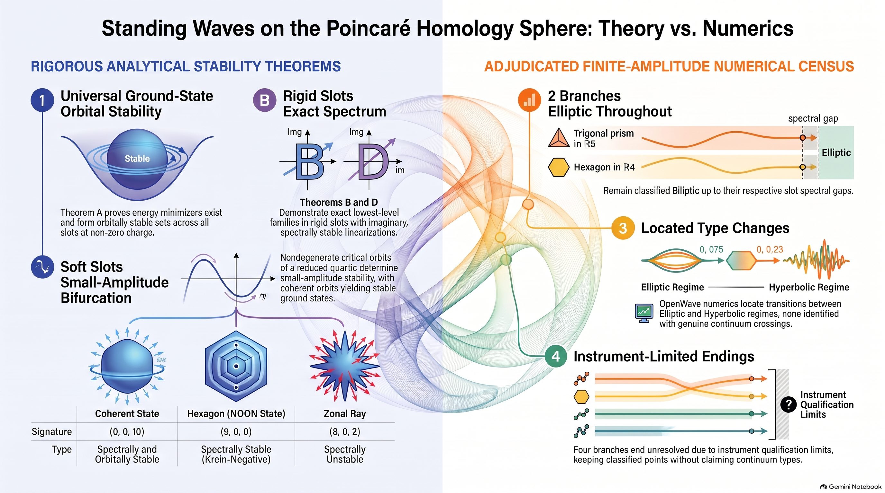
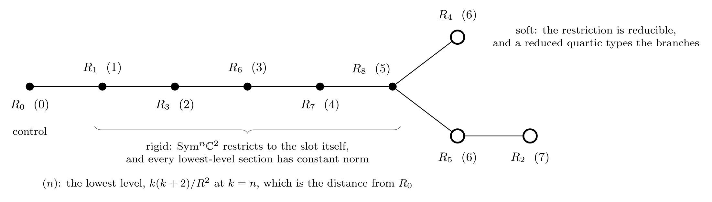
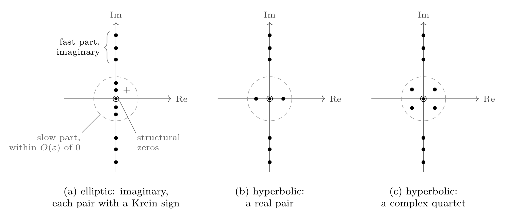
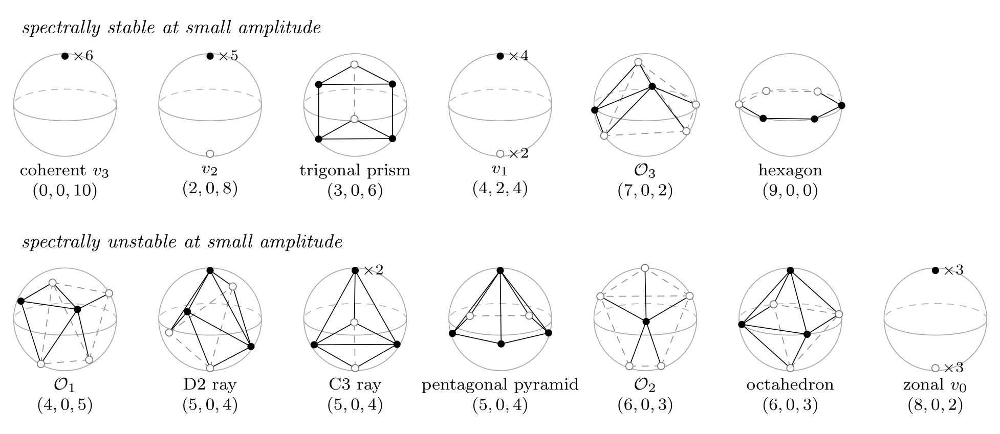
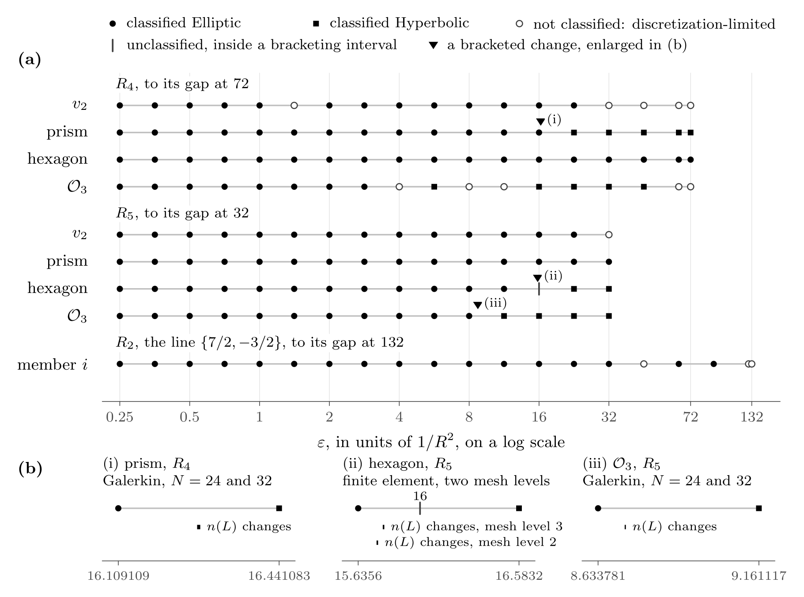

<a id="top"></a>
| **[`main`](https://github.com/dmobius3/mode-identity-theory/tree/main/)** | **[`framework`](/files/framework/)** | **[`bedrock`](/files/framework/files/bedrock/)** | **[`dynamics`](/files/framework/files/dynamics/)** | **[`working`](/files/framework/files/working/)** | **[`cosmos`](/files/cosmos/)** | **[`spectrum`](/files/spectrum/)** | **[`tools`](/files/tools/)** |

---

# 🌊 Nonlinear Standing-Wave Branches on the Poincaré Homology Sphere: Ground States and Small-Amplitude Spectral Stability



This paper studies standing waves of classical complex test fields on the Poincaré homology sphere $`S^3/2I`$, one in each of eight slots, the nontrivial irreducible representations of $`2I`$, on a static arena of fixed radius. The fields share one action, frozen before the finite-amplitude runs reported here, with no target outcome choosing it: the twisted wave operator, the defocusing density quartic, no mass and curvature coupling $`\xi = 0`$. The action is motivated, not derived, its density interaction a hypothesis, and every result is conditional on that action on that geometry. At every nonzero charge each slot has an orbitally stable set of ground states, in five of them an exact family whose every member is spectrally stable. In the three soft slots each nondegenerate critical orbit of a reduced quartic carries a small-amplitude branch, typed by its signature and slow matrix. In two of them that quartic is the Surviving Ray's top multipole, whose critical orbits within a stated class are known by an audited census, with three more interval-certified. Its minimum, the coherent orbit, carries the orbitally stable ground states at small charge; its maximum, the hexagon, the NOON state up to a rotation, unique by an audited argument, carries a branch spectrally stable and Krein-negative at small amplitude, its orbital stability open. The two slots share every small-amplitude type, by an exact scaling at leading order, while their nonlinear shifts differ. Degenerate orbits are typed at second order, the slow spectrum's next order is found in closed form, and a Hamiltonian–Krein count holds along branches assumed to exist. On pre-registered numerics adjudicated in the OpenWave project and reported apart from the theorems, two branches born elliptic are classified Elliptic at every registered point up to their slots' spectral gaps, three changes of type are located, none identified with a crossing, and four branches end instrument-limited. Persistence tests give finite-time evidence only. No physical matter action, particle state or gravity source is claimed.

## 1. Introduction

This paper studies the standing waves of one nonlinear wave equation on the Poincaré homology sphere $`X = S^3/2I`$, with $`2I \subset SU(2)`$ the binary icosahedral group. Its fields are classical complex fields, one in each of eight slots, the nontrivial irreducible representations $`\rho`$ of $`2I`$, with the trivial one as a control, each a section of the flat bundle $`E_\rho = S^3 \times_{2I} V_\rho`$ over $`X`$, on the static arena $`\mathbb{R} \times X`$ with the curvature radius $`R`$ held fixed: they are test fields, with no backreaction on the metric (§ 2.1). The paper asks which branches of standing waves the equation carries, what can be proved about their stability, and how their linearized spectra change at finite amplitude, up to each slot's spectral gap. The arena comes from a framework, Mode Identity Theory (MIT), in which $`X`$ is the observable domain [PC, § XI, 1f]; that reading motivates the model and is evidence for nothing in the paper.

The equation comes from one action common to the eight slots, selected and frozen on 2026-10-04, before any of the finite-amplitude runs this paper reports, with no target outcome choosing any of its elements: the wave operator of the twisted Laplacian, the defocusing density quartic, no mass, and minimal curvature coupling, $`\xi = 0`$ (§ 2.2). The selection is motivated, not derived. Minimal coupling takes one side of a published disagreement, with $`\xi = 1/6`$ the named alternative, and at finite amplitude the choice matters, so the finite-amplitude results are results for $`\xi = 0`$. The density interaction is, in the words of the Surviving Ray, the paper this one follows, "a hypothesis and not a consequence" [Sh]. So every result below is a result about this action on this geometry, not a claim that nature uses it.

The action meets the Surviving Ray [Sh] in two of the slots. There, for a block state at level 6 with the density-type interaction $`\lvert\psi\rvert^2\psi`$, binary-icosahedral symmetry restricts the four-dimensional family of equivariant cubic self-maps of spin 3 to two channels, one of them radial, so that modulo the radial direction the surviving interaction is a single projective ray, and the Surviving Ray describes the critical geometry of its quartic, the top multipole $`\hat r_6`$ on $`\mathbb{P}(V_3)`$. Its least value, 1/924, is taken exactly on the coherent states, and its greatest, 463/924, exactly on the hexagon orbit, the NOON state up to a rotation, its uniqueness an audited argument [Sh, Proposition 7.4, Theorem 7.5]; between them, a census finds the critical orbits within a stated class, an audited argument, and three orbits outside it are interval-certified [Sh, § 7.2]. Here that quartic is the reduced problem of the soft slots $`R_4`$ and $`R_5`$ (§ 3.1). The paper does not say that the geometry selects the action: the action is frozen and motivated (§ 2.2). The Surviving Ray's second version also gave local branch germs, an audited argument and not a verified theorem [Sh2, § 8.3]; the branches here rest on Lemmas G and G′ (§ 3.2), not on those germs.

The analytical results have two ranges. At every nonzero charge, in every slot, the minimizers of the energy at fixed charge form an orbitally stable set of standing waves (Theorem A); the proof is the constrained-minimization argument of Cazenave and Lions [CL], with Shatah's treatment of Klein–Gordon standing waves [Sha]. In the five rigid slots and the control, where every lowest-level section has constant norm, that set is the exact lowest-level family, and every member of it is spectrally stable (Theorems B and D, § 3.3). In the three soft slots the branches are born at small amplitude from the nondegenerate critical orbits of a reduced quartic on the lowest level (Lemma G, § 3.2), and along each the small-amplitude spectrum is read off that quartic (Theorem R, § 4.1); the small-amplitude spectral types of the two degenerate orbits are determined at second order (Theorem R′, § 4.2), and the slow spectrum's next order is given in closed form (Proposition N, § 4.3).

The two ends of the Surviving Ray's geometry part here. In $`R_4`$ and $`R_5`$ the coherent orbit, the minimum, carries the ground states at small charge, which there form the stationary family of its branch (§ 3.3), and its branch is spectrally and orbitally stable at small amplitude (Theorem R(c)). The hexagon, the maximum, carries a branch that is spectrally stable at small amplitude, its slow frequencies Krein-negative (Theorem R(d)), and its orbital stability is open, since Theorem R(d) gives spectral stability only (§ 4.1). The two slots share these types, since $`R_5`$'s reduced problem is $`R_4`$'s with every $`q_J - 1`$ scaled by 9/16, but not their nonlinear shifts, which differ at every orbit (§ 3.1). At finite amplitude, on OpenWave's adjudicated record, the hexagon is classified Elliptic at every registered point of $`R_4`$'s window, and in $`R_5`$'s a change of type is located between guard readings at 15.6356 and 16.5832 (§ 5); these are numerical verdicts, not theorems.

Away from small amplitude the spectrum can still be counted. On a branch along which the symmetry acts exactly, its existence at finite amplitude assumed, the Hamiltonian–Krein index theorem [KKS, Pe; KP] holds in the slot action's energy space, and the count changes only where eigenvalues pass through zero (Theorem K, § 4.4); which of those passages changes a branch's type is the subject of a crossing theorem, for transversal crossings with a definite crossing form, that this paper cites and does not restate [HKI].

Past small amplitude no theorem here decides a soft-slot branch's type. The M8 program of OpenWave, an open-source simulation project, followed the branches born elliptic numerically, each to its slot's spectral gap, in runs each pre-registered and adjudicated by the project's maintainer on a public pull request, on two instruments, a finite-element discretization [OW15] and a harmonic Galerkin one, which OpenWave's M8.16.1 run qualified [OW16.1]. On that record two branches end Elliptic throughout, classified Elliptic at every registered point of their windows; three changes of type are located, each between guard readings of each type and none identified with a crossing; and four branches end instrument-limited, their classified types kept and no type claimed at their open points (§ 5). These are adjudicated numerical verdicts, not theorems, reported as they stood when the census of those runs closed, on 2026-11-10; the census's rules, the runs' records and MIT's own computation of the open items are on its page [SDC].

Persistence enters only as a bounded record: in the persistence terms' words, "a test that Persists is evidence to `T`, not beyond" [OW19] (§ 5). The paper claims no physical matter action, particle state, step of the framework's stress-tensor bridge or gravity source, derives no law of the kind the slot relation registers for the energies of stable states across the eight slots, and fills no criterion of OpenWave's model register (§ 6.3). The dynamics of the branches, beyond those bounded tests, is left to a sequel (§ 6.2).

Derived results, each at its grade, and OpenWave's adjudicated record are kept apart throughout, with what stays open stated beside each. Section 2 fixes the model: the arena, the action and the status of its choices, its symmetries, and what the action settles by itself. Section 3 gives the analytical branch structure: the reduced problem and its critical orbits, the two level-6 slots' shifts, branch existence, and the ground states and rigid families. Section 4 treats linearized spectral stability, from small amplitude to the count. Section 5 reports OpenWave's adjudicated record at finite amplitude, and Section 6 reads the results together.

## 2. The frozen slot action

This section fixes the model: the arena and the fields, the action and the status of its choices, its symmetries, and what the action settles before any branch is studied; a different action would need its own study.

### 2.1 The arena and the fields

Let $`2I \subset SU(2)`$ be the binary icosahedral group, of order 120, acting on the three-sphere $`S^3 \cong SU(2)`$ by left translation, and let $`X = S^3/2I`$, the Poincaré homology sphere [KS], carry the round metric of radius $`R`$. The arena is $`\mathbb{R} \times X`$ with the static metric

```math
ds^2 = -c^2\,dT^2 + R^2\,d\Omega_3^2 ,
```

and $`R`$ is held fixed: the fields below are test fields, with no backreaction on the metric. In the framework that motivates the model, $`X`$ is the observable domain [PC, § XI, 1f]; that reading motivates the choice of arena and is evidence for nothing below.

For each irreducible unitary representation $`\rho`$ of $`2I`$ on a space $`V_\rho`$, a field in the slot $`\rho`$ is a complex section $`\psi_\rho`$ of the flat bundle

```math
E_\rho = S^3 \times_{2I} V_\rho \longrightarrow X ,
```

pulled back to $`\mathbb{R} \times X`$; equivalently, a map $`\psi_\rho`$ on $`\mathbb{R} \times S^3`$, with $`S^3`$ of radius $`R`$, such that $`\psi_\rho(T, \gamma x) = \rho(\gamma)\,\psi_\rho(T, x)`$ for every $`\gamma \in 2I`$. The eight nontrivial representations, $`R_1, \ldots, R_8`$, are the slots, listed in Table 1; the trivial one, $`R_0`$, whose sections are functions on $`X`$, serves as a control.

| Slot | $`\dim V_\rho`$ | Spin class | $`\mathrm{dist}(\rho)`$ |
|---|---|---|---|
| $`R_1`$ | 2 | half-integer | 1 |
| $`R_2`$ | 2 | half-integer | 7 |
| $`R_3`$ | 3 | integer | 2 |
| $`R_4`$ | 3 | integer | 6 |
| $`R_5`$ | 4 | integer | 6 |
| $`R_6`$ | 4 | half-integer | 3 |
| $`R_7`$ | 5 | integer | 4 |
| $`R_8`$ | 6 | half-integer | 5 |

*Table 1.* The slots [SRel, § II]. The spin class is the action of the central element $`-I`$, and $`\mathrm{dist}(\rho)`$ is the lowest level at which $`\rho`$ occurs, as in the next paragraph.

On sections of $`E_\rho`$, with $`\Delta`$ the Laplacian of the flat connection, $`-\Delta`$ has the levels $`k(k+2)/R^2`$, of multiplicity $`(k+1)\,\mathrm{mult}(\rho, \mathrm{Sym}^k\mathbb{C}^2)`$ with $`\mathrm{Sym}^k\mathbb{C}^2`$ restricted to $`2I`$, and the lowest occupied level is $`k = \mathrm{dist}(\rho)`$ [Ko, Su]. No slot is carried by functions on $`X`$: every slot field lives on a twisted bundle.

In five of the slots, $`R_1, R_3, R_6, R_7`$ and $`R_8`$, and in the control, the restriction of $`\mathrm{Sym}^{\mathrm{dist}(\rho)}\mathbb{C}^2`$ to $`2I`$ is $`\rho`$ itself, and every lowest-level section has constant norm; we call these slots rigid. In the other three, the soft slots, $`R_2`$ at level 7 and $`R_4`$ and $`R_5`$ at level 6, the restriction is reducible, not every lowest-level section has constant norm, and the cubic term $`\lvert\psi\rvert^2\psi`$ of a lowest-level section need not lie in the lowest level [SA, § VI item 6; SGS, § VI].

<p align="center"></p>

*Figure 1.* The slots on the McKay graph of $`2I`$, the affine $`E_8`$ diagram, each with its lowest level from Table 1 in parentheses, which is its distance from the control $`R_0`$ on the graph. Filled nodes are rigid, the control and $`R_1, R_3, R_6, R_7`$ and $`R_8`$: at the lowest level $`n`$, $`\mathrm{Sym}^n\mathbb{C}^2`$ restricts to the slot itself, and every lowest-level section has constant norm. Open nodes are soft, $`R_4`$ and $`R_5`$ at level 6 and $`R_2`$ at level 7: the restriction is reducible, and the branches at small amplitude are read off a reduced quartic (§ 3.1).

These fields do not model physical matter: they are complex spacetime-scalar test fields carrying an internal $`2I`$ label. The slots of half-integer spin carry no Lorentz spinor index and no fermionic statistics, since their spin class records only the action of $`-I`$, and no spin-statistics relation is derived here. The action couples the fields to nothing else: to no other field, and to no dynamics of the metric [SA, § II].

### 2.2 The action

For each $`\rho`$ in $`R_0, \ldots, R_8`$, independently, the action of a section $`\psi`$ of $`E_\rho`$ over $`\mathbb{R} \times X`$ is

```math
\mathcal{S}_\rho[\psi] = -\frac{1}{2c}\int_{\mathbb{R}\times X} d^4x\,\sqrt{-g}\,\left[ g^{\mu\nu}\,(D_\mu\psi)^{\dagger} D_\nu\psi + \frac{g_4}{2}\,\lvert\psi\rvert^4 \right], \qquad g_4 = 1 ,
```

with $`D`$ the covariant derivative of the flat connection on $`E_\rho`$ and $`\lvert\cdot\rvert`$ the norm of the invariant Hermitian form on $`V_\rho`$. Its field equation is

```math
\frac{1}{c^2}\,\partial_T^2\psi \;-\; \Delta\psi \;+\; g_4\,\lvert\psi\rvert^2\psi \;=\; 0 ,
```

with the nonlinearity evaluated pointwise, $`\lvert\psi(x)\rvert^2\psi(x)`$ at each $`x \in X`$; putting the spatial integral of $`\lvert\psi\rvert^2`$ in place of $`\lvert\psi(x)\rvert^2`$ gives a different, nonlocal law. Standing waves $`\psi = e^{i\omega T}\varphi`$ solve

```math
\left(-\Delta - \frac{\omega^2}{c^2}\right)\varphi \;+\; g_4\,\lvert\varphi\rvert^2\varphi \;=\; 0 ,
```

which at $`R = 1`$ is the equation of [Sh, § 2.5] with its $`\lambda`$ equal to $`\omega^2/c^2`$; [Sh] quotients by right translation, the same structure under inversion [SA, § II, § V].

The action was selected and frozen on 2026-10-04, before any of the finite-amplitude runs this paper reports, under the rule that no target outcome, a stable branch among them, may choose any of its elements, and each element carries its own status [SA, § I, § IV]. One complex field for each slot, with no term coupling two slots, is adopted, and so is the classical scope; time is the Killing time $`T`$ of the static metric, an adopted convention; the quadratic operator is the wave operator of the twisted Laplacian, read from the slot bundles themselves; there is no mass, an adoption; for a nonzero quartic interaction, the defocusing choice $`g_4 > 0`$ keeps the energy bounded below, whereas $`g_4 < 0`$ makes it unbounded below; and $`g_4 = 1`$ is a classical normalization. Two choices are motivated rather than derived, the curvature coupling $`\xi = 0`$ and the density quartic $`(g_4/4)\lvert\psi\rvert^4`$ as the self-interaction, so the selection as a whole is motivated, not derived.

A scale-free action leaves free a dimensionless coupling $`\xi\,\mathcal{R}\,\lvert\psi\rvert^2`$ to the scalar curvature, and renormalizability requires such a term while leaving $`\xi`$ free [BC]. We take $`\xi = 0`$, minimal coupling, since the slot operator carries no curvature term. The named alternative is $`\xi = 1/6`$, the value at which the action is Weyl invariant and the one that Sonego and Faraoni derive "by applying the equivalence principle to the propagation of scalar waves" [SF], so the choice sits on one side of a published disagreement. On this arena $`\xi`$ shifts every level by $`6\xi/R^2`$, and no difference between slots depends on it at zero amplitude. At finite amplitude it matters: $`\xi = 1/6`$ puts the free frequencies on the resonant lattice $`\omega = c(k+1)/R`$, and $`\xi = 0`$ does not. The finite-amplitude results of this paper are results for $`\xi = 0`$ [SA, § IV item 4].

The density quartic is the only local quartic common to all the slots that is built from the invariant fibre metric alone, and it is the density-type interaction of [Sh], which calls it "a hypothesis and not a consequence"; that status carries over to every result below. A second local quartic, $`\lvert\psi^{T}C_\rho\psi\rvert^2`$ with $`C_\rho`$ the invariant bilinear form, vanishes identically in the quaternionic slots of § 2.3, where $`C_\rho`$ is antisymmetric, so it was never a candidate for a law common to all eight [SA, § IX, note of 2026-10-09 on the second quartic].

For any $`g_4 > 0`$ the rescaling $`\tilde\psi = \sqrt{g_4}\,\psi`$ maps the field equation to the one with $`g_4 = 1`$ and multiplies the action, the energy and the charge by $`1/g_4`$, so $`g_4`$ does not affect the classical existence and stability questions studied here [SA, § IV item 8].

### 2.3 Symmetries and conserved quantities

The Killing field $`\partial_T`$, the phase rotations $`\psi \mapsto e^{i\alpha}\psi`$ and the right translations of $`S^3`$, which commute with $`2I`$ and act on $`X`$ by isometries, give the conserved energy and charge

```math
\mathcal{E}_\rho = \int_X dV \left[ \frac{1}{2c^2}\,\lvert\partial_T\psi\rvert^2 + \frac{1}{2}\,\lvert\nabla\psi\rvert^2 + \frac{g_4}{4}\,\lvert\psi\rvert^4 \right],
\qquad
N_\rho = \frac{1}{c^2}\int_X dV\; \mathrm{Im}\left(\psi^{\dagger}\,\partial_T\psi\right),
```

and three conserved Noether charges of right $`SU(2)`$ [SA, § V].

There is more internal symmetry than this. Every irreducible representation of $`2I`$ has a real character, so $`\bar\rho \cong \rho`$, and a unitary $`C`$ with $`C\,\bar\rho(\gamma) = \rho(\gamma)\,C`$ for every $`\gamma \in 2I`$ makes $`\psi \mapsto C\bar\psi`$ an antilinear symmetry of the action, which reverses the sign of $`N_\rho`$. In the real slots and the control, $`R_0, R_3, R_4, R_5`$ and $`R_7`$, $`C\bar C = 1`$ and charge conjugation is a discrete $`\mathbb{Z}_2`$. In the quaternionic slots, $`R_1, R_2, R_6`$ and $`R_8`$, $`C\bar C = -1`$, so $`J\psi = C\bar\psi`$ is a quaternionic structure; with the phase it generates $`Sp(1)`$, which preserves $`\lvert\psi\rvert`$ pointwise and adds two conserved charges [SA, § IX, note of 2026-10-04 on the fibre symmetry].

A stability statement must therefore name the family it is made relative to. In $`R_2`$, a quaternionic soft slot, one $`Sp(1)`$ family holds distinct standing waves, because a standing wave selects one phase generator and the others do not commute with it. Their spectral stability need not agree, so it is assessed member by member (§ 4).

### 2.4 What the action settles by itself

The zero section is a global section of every $`E_\rho`$ and solves the field equation, so it is a background solution in every slot. About it the linearization is the free equation, and on a nontrivial $`E_\rho`$ we have $`-\Delta \ge \mathrm{dist}(\rho)(\mathrm{dist}(\rho)+2)/R^2 \ge 3/R^2`$, so no mode grows. On a nontrivial $`E_\rho`$ the conserved energy is bounded below by $`\tfrac12\int_X \left(\lvert\partial_T\psi\rvert^2/c^2 + (3/R^2)\lvert\psi\rvert^2\right) dV`$, so the zero section is also Lyapunov stable in the energy norm for as long as a solution exists [SA, § VI items 2 and 3].

In the rigid slots, with $`\pi`$ the representation of $`SU(2)`$ on $`\mathrm{Sym}^{\mathrm{dist}(\rho)}\mathbb{C}^2`$ and its restriction to $`2I`$ identified with $`\rho`$, every lowest-level section is the equivariant map $`\psi_v(x) = \pi(x/R)\,v`$ on $`S^3`$, and $`\lvert\psi_v\rvert = \lvert v\rvert`$ everywhere. The nonlinearity then acts on $`\psi_v`$ as multiplication by the constant $`g_4\lvert v\rvert^2`$, so $`\psi = e^{i\omega T}\psi_v`$ solves the field equation exactly, for every $`v`$, with

```math
\frac{\omega^2}{c^2} = \frac{\mathrm{dist}(\rho)\,\big(\mathrm{dist}(\rho)+2\big)}{R^2} + g_4\,\lvert v\rvert^2 :
```

an exact branch that keeps its profile at every amplitude [SA, § VI item 6]. Its stability is taken up in § 3.

The law has no localized standing wave in flat three-space, with or without a mass. For the flat-space reduced equation with a mass term, put $`\mu = m^2 - \omega^2/c^2`$, and call a profile localized when $`\varphi \in H^1(\mathbb{R}^3)`$ and the integrations by parts behind both identities below hold. Multiplying the equation by $`\bar\varphi`$ and integrating, and the Pohozaev identity in three dimensions, combine to

```math
\mu\int\lvert\varphi\rvert^2 + \frac{g_4}{4}\int\lvert\varphi\rvert^4 = 0,
\qquad
\int\lvert\nabla\varphi\rvert^2 = 3\mu\int\lvert\varphi\rvert^2 .
```

For $`g_4 > 0`$ the first forces $`\varphi = 0`$ when $`\mu \ge 0`$, and the second when $`\mu < 0`$ [SA, § VI item 7; § IX, note of 2026-10-09 on a mass and localized states].

On $`X`$ itself, localized states at the curvature scale are not excluded. At scales $`L`$ much smaller than $`R`$ the arena is flat to $`O(L^2/R^2)`$, so no localized state of size $`L \ll R`$ is expected; this is an inference, not a theorem [SA, § VI item 7; § VII]. Global standing waves are not particles, and no particle state is claimed.

## 3. Analytical branch structure

The rigid slots and the soft slots part at the first step. In a rigid slot the lowest-level family of § 2.4 solves the field equation exactly at every amplitude, and § 3.3 shows that it is the set of ground states at every charge. In a soft slot the cubic term of a lowest-level section need not lie in the lowest level (§ 2.1), and branches are born at small amplitude from the critical orbits of a reduced quartic: § 3.1 sets up that problem and lists the orbits in hand, § 3.2 shows that every nondegenerate orbit carries a branch, and so do two degenerate ones, and § 3.3 identifies, in $`R_4`$ and $`R_5`$ at sufficiently small charge, the ground-state sets with the stationary family of the coherent branch; in $`R_2`$ that identification stays open. The linear spectrum along the soft branches is the subject of § 4.

### 3.1 The soft slots' reduced quartic and its critical orbits

The soft slots are $`R_4`$ and $`R_5`$ at level $`n = 6`$ and $`R_2`$ at level $`n = 7`$, $`n = \mathrm{dist}(\rho)`$ as in § 2.1, with lowest eigenvalue $`\lambda_0 = n(n+2)/R^2`$ ([SSB] writes $`K`$ for the level). In each, the lowest eigenspace $`E_0`$ of $`-\Delta`$ on $`E_\rho`$ has complex dimension $`n + 1`$, and right translations act on it as the spin $`j = n/2`$ representation, so $`E_0 \cong V_j`$ isometrically, $`w \mapsto \psi_w`$. With $`V = 2\pi^2R^3/120`$ the volume of $`X`$, and with the Jensen ratio $`Q(w) = V\int_X\lvert\psi_w\rvert^4 dV/\big(\int_X\lvert\psi_w\rvert^2 dV\big)^2`$, which is 1 exactly when $`\lvert\psi_w\rvert`$ is constant, the reduced quartic is

```math
H(w) = \frac{1}{2}\int_X \lvert\psi_w\rvert^4\, dV = \frac{Q(w)\,\lVert w\rVert^4}{2V} .
```

The stationary symmetry group $`\Gamma`$ is right $`SU(2)`$ together with the fibre group of § 2.3: the phase and charge conjugation in $`R_4`$ and $`R_5`$, and $`Sp(1)`$ in $`R_2`$. It is compact, it acts orthogonally on $`E_0`$, and it leaves $`H`$ invariant [SSB, § I].

At a critical point $`u`$ of $`H`$ on the unit sphere, $`\lVert u\rVert = 1`$ and $`\nabla H(u) = 4H(u)\,u`$. Let $`K_u`$ be the tangent space of the orbit $`\Gamma u`$, which contains $`iu`$; let $`M_u = \mathrm{Hess}\,H(u) - 4H(u)`$, a symmetric real-linear map of $`E_0`$ that vanishes on $`K_u`$; and let $`N_u`$ be the orthogonal complement of $`u`$ and $`K_u`$, which $`M_u`$ preserves. The signature $`(n_-, n_0, n_+)`$ of the orbit is that of $`M_u`$ on $`N_u`$, and the orbit is nondegenerate when $`n_0 = 0`$. The slow matrix is $`S_u = iM_u`$, Hamiltonian for $`\sigma(x, y) = \mathrm{Re}\langle x, iy\rangle`$, and a nonzero frequency cluster $`\pm i\tau`$ of $`S_u`$ is Krein-definite when $`M_u`$ is definite on its real invariant subspace $`\ker(S_u^2 + \tau^2)`$; a simple pair always is [SSB, § I]. These objects carry the small-amplitude spectrum of § 4.

The two level-6 slots are one problem at leading order. The reduced quartic has a closed form [SGS, § IV]: among the spins 0 to 7 the group $`2I`$ has invariant vectors only at 0 and 6, and Schur orthogonality gives

```math
Q(w) = 1 + \beta_\rho\,\frac{\lVert (w w^{\dagger})_6 \rVert^2}{\lVert w\rVert^4},
\qquad
\beta_\rho = \frac{d\,(d-r)}{13\,r},
```

with $`(ww^{\dagger})_6`$ the spin-6 component of $`ww^{\dagger}`$ under conjugation, in the Hilbert–Schmidt norm, $`d = n + 1`$ and $`r = \dim V_\rho`$. So $`\beta_\rho`$ is 28/39 in $`R_4`$, 21/52 in $`R_5`$ and 24/13 in $`R_2`$. For spin 3 the last factor is the function $`\hat r_6(w)`$ whose critical geometry [Sh, § 7] describes, and $`Q`$ is an increasing affine function of it, so in $`R_4`$ and $`R_5`$ the critical orbits of $`H`$ on the unit sphere are those of $`\hat r_6`$ on $`\mathbb{P}(V_3)`$. Recoupled to the pairing channels, $`Q = \sum_J q_J f_J`$, with channel fractions $`f_J = \lVert[w \otimes w]_J\rVert^2/\lVert w\rVert^4`$ that sum to 1 and coefficients $`q_J`$ with $`q_J - 1`$ proportional to $`\beta_\rho`$ at a fixed block spin. Since 21/52 is 9/16 of 28/39, $`R_5`$ is $`R_4`$ with every $`q_J - 1`$ scaled by 9/16: the two slots share their critical orbits, their signatures and their small-amplitude types, with every eigenvalue of the slow matrix $`\widehat S_u`$ of § 4.1 scaled by exactly 9/16; the leading slow eigenvalues of the linearization also carry Theorem R's factor $`1/Q(u)`$ [SSB, §§ III, IV; SDC, § II].

The scaling relates the two problems' shapes, not their sizes. At a critical point $`u`$ on the unit sphere, $`\nabla H(u) = 4H(u)\,u`$ says that the lowest-level part of $`\lvert\psi_u\rvert^2\psi_u`$ is $`\kappa_u\psi_u`$, with $`\kappa_u = 2H(u) = Q(u)/V`$, and by Lemma G of § 3.2 the branch through $`u`$ leaves the lowest level at the rate that scalar sets, $`\varepsilon = g_4\kappa_u\lVert\varphi_\varepsilon\rVert^2\,(1 + O(\varepsilon))`$. **Corollary** [Sh2, Corollary 5.5]. *At every critical orbit of the level-6 problem, $`Q_{R_4}(u) - Q_{R_5}(u) = \tfrac{49}{156}\,\hat r_6(u) > 0`$, so the two slots' nonlinear shifts differ at every orbit.* The difference is $`(28/39 - 21/52)\,\hat r_6(u)`$, and $`\hat r_6 \ge 1/924`$ on the whole of $`\mathbb{P}(V_3)`$ [Sh, Proposition 7.4]. So $`R_4`$ and $`R_5`$ agree about shape and disagree about scale: $`Q_{R_5} - 1 = \tfrac{9}{16}\,(Q_{R_4} - 1)`$ at every point.

In $`R_4`$ and $`R_5`$ the critical set is known within a stated class. A group of symmetries of $`\hat r_6`$, rotations acting together with phases, fixes a locus in $`\mathbb{P}(V_3)`$, and a critical point of $`\hat r_6`$ restricted to that locus is critical on all of $`\mathbb{P}(V_3)`$, by Palais' principle of symmetric criticality [Pa]. The orbit census of [Sh, § 7.2] takes every such locus of projective dimension at most one, six points and seven lines, finds the complete critical set on each line by elimination rather than by a numerical solver, and obtains exactly ten orbits modulo rotation and phase, each with its signature computed exactly from a characteristic polynomial. The orbit census was pre-registered by the author, reproduced blind twice, in separate runs, and graded sound under an adversarial audit [Sh, § 7.2; OW12, § 5]. We call a result an audited argument when an adversarial audit has graded its arguments sound but it is not verified as a theorem, and the orbit census stands as one. Exact arithmetic reproduces the ten orbits in value and signature [SSB, § IV]; that they are all the critical orbits of the class rests on the orbit census's elimination.

The class leaves out every orbit whose rotation stabiliser is $`C_2`$, or $`C_3`$ acting on a three-dimensional fixed space, or trivial, since the fixed loci of those groups have projective dimension two or more. Numerical searches of the critical set found three orbits outside it, $`\mathcal{O}_1, \mathcal{O}_2, \mathcal{O}_3`$ in increasing order of value, and the Surviving Ray certifies each with 60-digit interval arithmetic: inside the fixed set of its full isotropy, a Krawczyk inclusion on a box of radius $`10^{-55}`$ holds exactly one critical point, and a Gershgorin test fixes its signature [Sh, § 7.2]. Each is certified again on the full critical-point system, by a Krawczyk box of radius $`10^{-60}`$, with the same signatures, (4, 0, 5), (6, 0, 3) and (7, 0, 2) [SSB, § IV]. $`\mathcal{O}_3`$ is the third outside orbit that the orbit census's numerical probe found, and § 5 follows its branch to finite amplitude. The value of $`\mathcal{O}_2`$ lies in a certified interval that contains 28800/121, and it is not claimed to equal that fraction.

| orbit | representative | $`924\,\hat r_6`$ | $`(n_-, n_0, n_+)`$ |
|---|---|---|---|
| coherent $`v_3`$ | $`v_3`$ | 1 | (0, 0, 10) |
| $`v_2`$ | $`v_2`$ | 36 | (2, 0, 8) |
| trigonal prism | $`v_3 + \sqrt{23/10}\,v_0 + v_{-3}`$ | 8800/43 | (3, 0, 6) |
| $`v_1`$ | $`v_1`$ | 225 | (4, 2, 4) |
| D2 ray | $`v_2 + i\sqrt{6/5}\,v_0 + v_{-2}`$ | 225 | (5, 0, 4) |
| C3 ray | $`v_2 + 2v_{-1}`$ | 1188/5 | (5, 0, 4) |
| pentagonal pyramid | $`\sqrt{12}\,v_3 + \sqrt{13}\,v_{-2}`$ | 1188/5 | (5, 0, 4) |
| octahedron | $`v_2 + v_{-2}`$ | 288 | (6, 0, 3) |
| zonal $`v_0`$ | $`v_0`$ | 400 | (8, 0, 2) |
| hexagon | $`v_3 + v_{-3}`$ | 463 | (9, 0, 0) |
| $`\mathcal{O}_1`$ | interval-certified † | 215.7757925… | (4, 0, 5) |
| $`\mathcal{O}_2`$ | interval-certified † | 238.0165289… | (6, 0, 3) |
| $`\mathcal{O}_3`$ | interval-certified † | 238.3568547… | (7, 0, 2) |

*Table 2.* The thirteen critical orbits in hand in $`R_4`$ and $`R_5`$, at level 6. The first ten rows are the orbit census [Sh, § 7.2], their values and signatures exact [SSB, § IV] and their completeness within its class an audited argument; the last three are the orbits found outside that class, interval-certified [Sh, § 7.2; SSB, § IV]. Representatives are written in orthonormal Condon–Shortley components $`v_m = \lvert 3, m\rangle`$, unnormalized; the signatures are those of $`M_u`$ on $`N_u`$, the same in both slots. † No exact representative is in hand; the entry is [SSB, § IV]'s, whose rows give these values to more digits.

The identity of $`R_4`$ and $`R_5`$ is a leading-order one: at second order the pair Theorem R′(c) types at $`v_1`$ is Krein-negative in $`R_4`$ and Krein-positive in $`R_5`$, though imaginary in both (§ 4.2). How the two slots part at finite amplitude, on OpenWave's adjudicated record, is reported in § 5.

In $`R_2`$, at level 7, $`E_0 \cong V_{7/2}`$, and the fibre's quaternionic structure acts on $`E_0`$ as the quaternionic structure of $`V_{7/2}`$, up to a phase [SSB, § I]. The points examined are the weight states and the interior critical points of the seven cyclic fixed lines, each line spanned by two weights alone. Three of the lines, $`\lbrace 5/2, -5/2\rbrace`$, $`\lbrace 7/2, -7/2\rbrace`$ and $`\lbrace 3/2, -3/2\rbrace`$, are $`Sp(1)`$ orbits of weight states, on which $`Q`$ is constant, and Table 3 lists the weight states with the interior critical points of the other four, and their values of $`Q`$ [SSB, § IV].

| point | representative | $`Q`$ | $`(n_-, n_0, n_+)`$ |
|---|---|---|---|
| weight 7/2 | $`v_{7/2}`$ | 144/143 | (0, 0, 10) |
| weight 5/2 | $`v_{5/2}`$ | 168/143 | (4, 0, 6) |
| weight 3/2 | $`v_{3/2}`$ | 224/143 | (8, 0, 2) |
| weight 1/2 | $`v_{1/2}`$ | 168/143 | (4, 0, 6) |
| line {7/2, −5/2} | $`\sqrt{17/38}\,v_{7/2} + \sqrt{21/38}\,v_{-5/2}`$ | 369/247 | (6, 0, 3) |
| line {7/2, −3/2} | $`\sqrt{3/10}\,v_{7/2} + \sqrt{7/10}\,v_{-3/2}`$ | 22/13 | (9, 0, 0) |
| line {7/2, −1/2} | $`\sqrt{5/12}\,v_{7/2} + \sqrt{7/12}\,v_{-1/2}`$ | 193/143 | (5, 0, 4) |
| line {5/2, −3/2} | $`\sqrt{3/4}\,v_{5/2} + \sqrt{1/4}\,v_{-3/2}`$ | 161/143 | (0, 3, 6) |

*Table 3.* The points examined in $`R_2`$, at level 7 [SSB, § IV], with $`v_m = \lvert 7/2, m\rangle`$. The weight-7/2 orbit is a strict local minimum of $`Q`$ modulo its symmetry family; the point of the line {5/2, −3/2} is degenerate.

Neither critical set is known to be complete. In $`R_4`$ and $`R_5`$ the set is complete within the orbit census's class, by the audited elimination, and outside it the three orbits of Table 2 are the ones the numerical searches found; nothing says there are no others. In $`R_2`$ only the weight states and the cyclic fixed lines have been examined. Completeness of either set is open, and an orbit certified later would join the tables [SDC, § II; SSB, § V].

### 3.2 Branch existence

Every nondegenerate critical orbit carries a branch of standing waves at small amplitude. **Lemma G** [SSB, § II]. *Let $`\Gamma u`$ be a nondegenerate critical orbit and $`\kappa_u = 2H(u)`$. For small $`\varepsilon > 0`$ there are sections $`\varphi_\varepsilon \in H^2`$, smooth in $`\varepsilon`$, with $`\varphi_\varepsilon = (\varepsilon/g_4\kappa_u)^{1/2}\,(u + O(\varepsilon))`$, such that $`e^{i\omega T}\varphi_\varepsilon`$ with $`\omega^2 = c^2(\lambda_0 + \varepsilon)`$ solves the field equation. The isotropy group of $`\varphi_\varepsilon`$ in $`\Gamma`$ is exactly the isotropy group $`\Gamma_u`$ of $`u`$; near $`\Gamma u`$ the small solutions at that frequency are exactly the members of the stationary family $`\Gamma\varphi_\varepsilon`$; and the stationary operator*

```math
L_\varepsilon = -\Delta - \frac{\omega^2}{c^2} + g_4\left(\lvert\varphi_\varepsilon\rvert^2 + 2\varphi_\varepsilon\,\mathrm{Re}\left(\varphi_\varepsilon^{\dagger}\,\cdot\,\right)\right)
```

*on $`H^2`$ has kernel exactly the tangent space of that family.* How small $`\varepsilon`$ must be is not quantified.

The proof is a Lyapunov–Schmidt reduction [GS]. Since $`H^2`$ is an algebra contained in $`L^\infty`$ in three dimensions, the stationary equation is a smooth map from $`H^2`$ to $`L^2`$. With $`\omega^2/c^2 = \lambda_0 + \varepsilon`$ near $`\lambda_0`$ and $`\varphi = w + v`$, $`w \in E_0`$ and $`v`$ orthogonal to $`E_0`$, the operator $`-\Delta - \lambda_0 - \varepsilon`$ is invertible on the complement of $`E_0`$, and the implicit function theorem solves the complementary equation for a unique small $`v(w, \varepsilon)`$, $`\Gamma`$-equivariant and odd in $`w`$. The small solutions are then the critical points of the $`\Gamma`$-invariant reduced function $`f(w, \varepsilon) = -\tfrac{1}{2}\varepsilon\lVert w\rVert^2 + \tfrac{g_4}{2}H(w) + O(\lVert w\rVert^6)`$. After the scaling $`w = (\varepsilon/g_4)^{1/2}y`$, its leading part has the critical orbit through $`\kappa_u^{-1/2}u`$, with Hessian $`\kappa_u^{-1}M_u`$, nondegenerate on the normal space $`\mathbb{R}u \oplus N_u`$; the slice theorem and the implicit function theorem on a slice through that point give the branch, its isotropy and its kernel [SSB, § II].

At a degenerate orbit Lemma G does not apply, but symmetry can still pin a germ. For a critical point $`u`$ with isotropy group $`\Gamma_u`$, let $`X^u`$ be the closed subspace of sections that $`\Gamma_u`$ fixes, $`E_0^u = E_0 \cap X^u`$, a real subspace, $`\Gamma^u`$ the closed subgroup of $`\Gamma`$ that preserves $`X^u`$, and $`N_u^u`$ the orthogonal complement in $`E_0^u`$ of $`u`$ and the tangent space of $`\Gamma^u u`$. **Lemma G′** [SSB, § II]. *If $`M_u`$ is nondegenerate on $`N_u^u`$, in particular if $`N_u^u = 0`$, then for small $`\varepsilon > 0`$ there are sections $`\varphi_\varepsilon \in X^u \cap H^2`$ of Lemma G's form whose standing waves solve the field equation at $`\omega^2 = c^2(\lambda_0 + \varepsilon)`$, with isotropy group exactly $`\Gamma_u`$; near $`u`$ the small solutions in $`X^u`$ at that frequency are exactly the members of $`\Gamma^u\varphi_\varepsilon`$.* It claims nothing about solutions outside $`X^u`$, about the kernel of $`L_\varepsilon`$, or about stability. The proof is Lemma G's, run in $`X^u`$, which the field equation preserves.

Both degenerate orbits of the tables meet Lemma G′'s hypothesis in its simplest form, $`N_u^u = 0`$. In $`R_2`$, the point of the line {5/2, −3/2}, $`\sqrt{3/4}\,v_{5/2} + \sqrt{1/4}\,v_{-3/2}`$ with $`Q = 161/143`$ and signature (0, 3, 6), has an orbit of dimension $`6 = \dim\Gamma`$ and a finite isotropy group. That group contains the quarter-turn about $`z`$ and the half-turn about $`y`$, each with an element of the fibre group, and the point turned by $`\pi/4`$ about $`z`$ is fixed by the quarter-turn about $`x`$ with another, so the group also contains a quarter-turn about an axis perpendicular to $`z`$. The two quarter-turns generate the octahedral group, which no finite subgroup of $`SO(3)`$ properly contains, so the rotation part of $`\Gamma_u`$ is $`O`$. Its fixed space $`E_0^u`$ is the real line through the point, so $`N_u^u = 0`$: the slice is a point, the symmetry pins the germ, and Lemma G′ gives a branch with isotropy exactly $`\Gamma_u`$, unique in $`X^u`$ near the point. The computation is exact, over $`\mathbb{Q}(\sqrt 2, i)`$ [SSB, § II]. In $`R_4`$ and $`R_5`$, at $`v_1`$, with signature (4, 2, 4), the isotropy contains the circle $`R_z(\theta)e^{i\theta}`$, which acts on $`v_m`$ with weight $`1 - m`$, and the half-turn about $`y`$ with charge conjugation, which fixes $`v_1`$ too; so $`E_0^u = \mathbb{R}v_1`$, $`N_u^u = 0`$, and Lemma G′ gives the germ [SSB, § III].

The Surviving Ray's second version gives local branch germs of the same kind, for the same equation on the lowest blocks of $`R_4`$ and $`R_5`$: at the six rays of [Sh, § 7.1], the coherent, zonal, octahedral and hexagonal rays, which the symmetry pins, and the pentagonal pyramid and the trigonal prism, and by the same theorem at the weight states $`v_1`$ and $`v_2`$, for sufficiently small amplitude, with no lower bound on it [Sh2, § 8.3]. That theorem stands as an audited argument, graded under OpenWave's M8.11 audit, and in that paper's words "not a verified theorem" [Sh2, § 8.3; OW11]. The Surviving Ray's third version stops before it, and nothing in this paper rests on it: every germ used below comes from Lemma G or Lemma G′.

### 3.3 Ground states and the rigid families

The branches above are solutions; the ground states are sets. The phase space is $`\mathcal{H} = H^1(X; E_\rho) \times L^2(X; E_\rho)`$, of pairs $`(\psi, \partial_T\psi)`$, in which solutions exist globally and conserve $`\mathcal{E}_\rho`$ and $`N_\rho`$ [SGS, § I], and for a charge $`N_0 \ne 0`$, $`G(N_0)`$ is the set of minimizers of $`\mathcal{E}_\rho`$ on $`\lbrace N_\rho = N_0\rbrace`$. **Theorem A** [SGS, § III]. *In every slot and in the control, at every charge $`N_0 \ne 0`$, the infimum of the energy is attained; every minimizer is a standing wave $`e^{i\omega T}\psi`$, with $`\omega`$ real and $`(-\Delta - \omega^2/c^2)\psi + g_4\lvert\psi\rvert^2\psi = 0`$, a ground state; and $`G(N_0)`$ is orbitally stable in $`\mathcal{H}`$: data close enough to $`G(N_0)`$ stay within any prescribed distance of it for all time.*

The proof is the constrained-minimization argument of Cazenave and Lions [CL], with Shatah's treatment of Klein–Gordon standing waves [Sha]: minimizing sequences are precompact on the compact manifold $`X`$, and the phase-space and charge steps of the Klein–Gordon setting are supplied in [SGS, § III]. Orbital stability here is a statement about the set $`G(N_0)`$, not about any one branch through it.

In the rigid slots the sets are known exactly, at every charge. **Theorem B** [SGS, § III]. *In $`R_1, R_3, R_6, R_7, R_8`$ and the control, with $`n = \mathrm{dist}(\rho)`$, $`\lambda_0 = n(n+2)/R^2`$ and $`\psi_v`$ as in § 2.4, let $`m`$ be the unique positive root of $`c^2N_0^2/m^2 = \lambda_0 + g_4m/V`$. Then*

```math
G(N_0) = \left\lbrace \left(\psi_v,\ i\omega\,\psi_v\right) \;:\; \lvert v\rvert^2 = \frac{m}{V} \right\rbrace,
\qquad
\omega = \frac{c^2N_0}{m},
\qquad
\frac{\omega^2}{c^2} = \lambda_0 + g_4\lvert v\rvert^2 ,
```

*the exact lowest-level family of § 2.4 at that frequency. It is orbitally stable as a set at every nonzero charge, and along each direction of $`v`$ it is a branch continuous in the charge.* The proof is an equality case. The energy at fixed charge is bounded below by a function of $`m = \int_X\lvert\psi\rvert^2 dV`$ alone, through Cauchy–Schwarz on the charge, the spectral bound and Jensen's inequality, and a lowest-level section of constant norm meets all three with equality. With each member the set contains the profiles that the phase, right translations and the fibre symmetry produce from it, so the claim is about the family as a set.

Their linear spectrum is as explicit. Write a member as $`e^{i\omega T}\psi_v`$, put $`\psi = e^{i\omega T}(\psi_v + \zeta)`$, and linearize the field equation in $`\zeta`$. **Theorem D** [SGS, § V]. *The whole spectrum of the linearization lies on the imaginary axis. The linearization preserves the splitting of $`\zeta`$ into its part in $`E_0`$ and the rest. On $`E_0`$ its eigenvalues are 0, with algebraic multiplicity $`2n + 2`$ and geometric multiplicity $`2n + 1`$; $`\pm 2i\omega`$, each $`n`$ times, from the complex directions orthogonal to $`v`$; and $`\pm i\left(4\omega^2 + 2g_4c^2\lvert v\rvert^2\right)^{1/2}`$, from the direction of $`v`$. Off $`E_0`$ the conserved quadratic form is positive definite, so the spectrum there consists of imaginary eigenvalues, none of them 0.* The kernel is exactly the tangent space at $`v`$ of the sphere $`\lvert v'\rvert = \lvert v\rvert`$, the members of the family at the same charge, and the one further generalized eigenvector at zero is the family's derivative in the charge. So the zero eigenvalue is not semisimple: in a fixed rotating frame the charge direction drifts linearly, and the claim is spectral stability, not bounded linearized evolution about one member at a fixed frequency. The nonlinear stability of the family is Theorem B's.

In the soft slots the ground states exist by Theorem A, and the question is what they are. In $`R_4`$ and $`R_5`$ none lies entirely in the lowest free eigenspace, at any nonzero charge: a lowest-level standing wave must have constant norm, and every symmetric-channel coefficient, the only kind that $`w \otimes w`$ meets, exceeds 1, the smallest being $`q_6`$, which is 1288/1287 in $`R_4`$ and 2289/2288 in $`R_5`$, so $`Q > 1`$ on all of $`E_0`$ [SGS, § IV, Proposition C, item 1]. At sufficiently small charge the minimizing sets are identified, though not in closed form. The coherent orbit, the first row of Table 2, is the unique minimizer of $`Q`$ on $`E_0`$, and there is an $`N_* > 0`$, depending only on the slot, $`g_4`$, $`c`$ and $`R`$, such that for $`0 < \lvert N_0\rvert \le N_*`$ every ground state concentrates on the lowest level, with its part off that level of relative order $`\lvert N_0\rvert`$, bounded above and below, and its frequency tending to $`\mathrm{sgn}(N_0)\,c\sqrt{\lambda_0}`$, the lowest free frequency with the sign of the charge, and $`G(N_0)`$ is the stationary family of the locally constructed branch of Lemma G through the coherent orbit, one orbit of $`\Gamma`$ [SGS, § IV, Proposition C, item 3]. So in $`R_4`$ and $`R_5`$ the ground-state sets at small charge form a branch, continuous in the charge. $`N_*`$ is not explicit, since the proof uses a compactness step.

At every charge the soft slots' ground states obey explicit bounds. Let $`q`$ be the value of $`Q`$ at a coherent unit vector of $`E_0`$: $`q_6`$ in $`R_4`$ and $`R_5`$, and $`q_7 = 144/143`$ in $`R_2`$. With $`m = \int_X\lvert\psi\rvert^2 dV`$, $`\varepsilon = \omega^2/c^2 - \lambda_0`$, $`\psi_\perp`$ the part of $`\psi`$ orthogonal to $`E_0`$ and $`\lambda_1`$ the next eigenvalue of $`-\Delta`$ on $`E_\rho`$, every ground state, in every soft slot and at every charge $`N_0 \ne 0`$, satisfies [SGS, § IV, Proposition C, item 4]

```math
\frac{g_4m}{V} \le \varepsilon \le \frac{q\,g_4m}{V},
\qquad
\frac{V}{m^2}\int_X\left(\lvert\psi\rvert^2 - \frac{m}{V}\right)^2 dV \le q - 1,
\qquad
\frac{\lVert\psi_\perp\rVert^2}{\lVert\psi\rVert^2} \le \frac{(q - 1)\,\varepsilon}{2(\lambda_1 - \lambda_0)} .
```

The gap $`\lambda_1 - \lambda_0`$ is $`72/R^2`$ in $`R_4`$, $`32/R^2`$ in $`R_5`$ and $`132/R^2`$ in $`R_2`$, so while $`\varepsilon`$ is at most the gap, the part off the lowest level is at most 2.0%, 1.5% and 6.0% of the norm, and its share of $`m`$ at most 0.039%, 0.022% and 0.35%. For larger $`\varepsilon`$ the last bound still holds, and grows linearly in $`\varepsilon`$. The proposition bounds the profile and the frequency only: it decides no ground-state set, orbit or branch.

What stays open is the identification beyond those limits. Beyond small charge in $`R_4`$ and $`R_5`$, and at every charge in $`R_2`$, it is open whether the ground states form branches, what their shape is, and whether each set is one orbit. In $`R_2`$ it is also open whether a ground state can lie entirely in the lowest eigenspace, which holds exactly when that eigenspace contains a section of constant norm, a unit vector $`w`$ with $`(ww^{\dagger})_6 = 0`$ and $`Q = 1`$: Proposition C, item 2 [SGS, § IV]. The smallest $`Q`$ found numerically is the weight-7/2 orbit's 144/143, and its global minimality would settle that question, since $`Q`$ would then exceed 1 on the whole block; that globality is not proved [SGS, § VII; SSB, § VI].

## 4. Linearized spectral stability

This section linearizes the field equation about the branches of § 3.2, in the frame that rotates with each branch's phase. At small amplitude the slow part of the spectrum is read off the reduced quartic: Theorem R at every nondegenerate orbit (§ 4.1), Theorem R′ at the two degenerate ones, with the first correction behind it (§ 4.2), and Proposition N one order further (§ 4.3). At any amplitude, on a branch whose existence is assumed, a Hamiltonian–Krein count ties the unstable and Krein-negative eigenvalues to the negative directions of the stationary operator (§ 4.4). The claim throughout is spectral stability, and orbital stability is claimed only where it is stated. Where a letter of [SSB] names another object here, the paper renames it: the slow eigenvalues' factor is $`\chi`$ (its $`\kappa`$), the Hessian's term of order $`\varepsilon`$ in Theorem R′ is $`D_u`$ (its $`D`$), and the spherical Hessian form is $`\mathsf{G}_u`$ (its $`\Gamma_u`$).

### 4.1 The small-amplitude spectrum

Fix a branch of Lemma G, with $`\omega_\varepsilon = c(\lambda_0 + \varepsilon)^{1/2}`$ and $`\omega_0 = c\sqrt{\lambda_0}`$. Writing $`\psi = e^{i\omega_\varepsilon T}(\varphi_\varepsilon + \zeta)`$, the linearized equation

```math
\frac{1}{c^2}\left(\partial_T^2\zeta + 2i\omega_\varepsilon\,\partial_T\zeta\right) + L_\varepsilon\zeta = 0
```

is a real-linear system $`\dot x = A_\varepsilon x`$ on $`\mathcal{H}`$, with $`x = (\zeta, \partial_T\zeta)`$. A standing wave is elliptic when the spectrum of $`A_\varepsilon`$ lies on the imaginary axis, and hyperbolic when it does not; a change of type is a passage between the two along a branch, and a branch is born elliptic when it is elliptic at small amplitude. It conserves $`H_2(x) = \lVert\partial_T\zeta\rVert^2/2c^2 + \tfrac{1}{2}\langle L_\varepsilon\zeta, \zeta\rangle = \tfrac{1}{2}B(x, x)`$, the second variation of $`\mathcal{E}_\rho - \omega_\varepsilon N_\rho`$ at the standing wave, and it is Hamiltonian, $`\Omega(A_\varepsilon x, y) = B(x, y)`$, for the symplectic form

```math
\Omega(x_1, x_2) = \frac{1}{c^2}\,\mathrm{Re}\left(\langle\zeta_1, \dot\zeta_2\rangle - \langle\dot\zeta_1, \zeta_2\rangle + 2\omega_\varepsilon\langle\zeta_1, i\zeta_2\rangle\right),
```

which on static vectors is $`(2\omega_\varepsilon/c^2)\,\sigma`$. The kernel of $`A_\varepsilon`$ consists of the static vectors $`(\zeta, 0)`$ with $`L_\varepsilon\zeta = 0`$: by Lemma G, the tangent space of the stationary family, of dimension $`k = \dim K_u`$. In $`R_2`$ it includes the $`Sp(1)`$ directions, which are static solutions but not symmetries of the rotating frame [SSB, § III].

**Lemma S** [SSB, § III]. *For small $`\varepsilon`$, $`\Omega`$ is nondegenerate on the spectral subspace of $`A_\varepsilon`$ inside a fixed small circle about 0, and so are the generalized kernel and the sum of the generalized eigenspaces of each nonzero cluster $`\lbrace\pm\lambda, \pm\bar\lambda\rbrace`$ within it.* The slow subspace is $`\Omega`$-orthogonal to the fast one, and $`\Omega`$ is weakly nondegenerate on $`\mathcal{H}`$, which gives the first claim. $`A_\varepsilon`$ is $`\Omega`$-skew, so generalized eigenspaces for eigenvalues $`\lambda`$ and $`\mu`$ with $`\lambda + \mu \ne 0`$ are $`\Omega`$-orthogonal, and a subspace orthogonal to its complement in a nondegenerate space is itself nondegenerate.

Theorem R uses the objects of § 3.1 in the normalization $`2VH = Q\lVert w\rVert^4`$: $`\widehat M_u = 2VM_u`$ and $`\widehat S_u = i\widehat M_u`$. Write $`r_u`$ for the dimension of the $`\sigma`$-radical of $`K_u`$, which always contains $`iu`$. At a nondegenerate orbit $`\ker\widehat S_u = K_u`$, and every radical vector has a partner, so the zero eigenvalue of $`\widehat S_u`$ has multiplicity at least $`k + r_u`$. Hypothesis (Z) is that it has multiplicity exactly $`k + r_u`$, and that the $`\Omega`$-radical of $`\ker A_\varepsilon`$ has dimension $`r_u`$ [SSB, §§ I, III].

**Theorem R** [SSB, § III]. *Let $`\Gamma u`$ be a nondegenerate critical orbit with branch $`\varphi_\varepsilon`$. There is $`\varepsilon_1 > 0`$ such that for $`0 < \varepsilon < \varepsilon_1`$: (a) the spectrum of $`A_\varepsilon`$ consists of a slow part, $`2d`$ eigenvalues $`\varepsilon(\chi s + o(1))`$, with $`s`$ running over the eigenvalues of $`\widehat S_u`$ and $`\chi = c^2/(8\omega_0 Q(u)) > 0`$, and a fast part on the imaginary axis, bounded away from 0; (b) if $`\widehat S_u`$ has an eigenvalue with positive real part, so does $`A_\varepsilon`$, and the branch is spectrally unstable; (c) if $`n_- = 0`$, the spectrum of $`A_\varepsilon`$ is imaginary, and the stationary family is orbitally stable as a set; (d) if $`n_+ = 0`$, the spectrum of $`A_\varepsilon`$ is imaginary; (e) if the nonzero eigenvalues of $`\widehat S_u`$ are imaginary and Krein-definite and (Z) holds, the spectrum of $`A_\varepsilon`$ is imaginary.* In (c) to (e) the claim is spectral stability at small amplitude, and only (c) also gives orbital stability.

The proof splits the spectrum by a Riesz projection [Ka]. At $`\varepsilon = 0`$ the eigenvalue 0 is semisimple, with eigenspace $`E_0 \times \lbrace 0\rbrace`$, and $`H_2`$ is coercive on the spectral complement of that kernel; $`A_\varepsilon - A_0`$ is bounded and of size $`O(\varepsilon)`$. So the projection for a small circle about 0 has rank $`2d`$, the fast part keeps a coercive conserved form and so an imaginary spectrum, and Kato's first-order reduction carries $`A_\varepsilon`$ on the slow part to $`\varepsilon\chi\widehat S_u + o(\varepsilon)`$, with $`B`$ there equal to $`(\varepsilon/4Q(u))\langle\widehat M_u\,\cdot, \cdot\rangle + o(\varepsilon)`$. Item (b) follows by continuity; (c) and (d) from the sign of $`B`$ on the slow part, with the phase mode and its partner split off in (d); and (e) from the partners of the radical, the exact count of zeros under (Z), and a conserved definite form on each Krein-definite cluster. Orbital stability in (c) holds because the family is a compact nondegenerate critical manifold of the conserved functional $`\mathcal{E}_\rho - \omega_\varepsilon N_\rho`$, its Hessian coercive on the normal bundle [SSB, § III].

<p align="center"></p>

*Figure 2.* The shape of the spectrum Theorem R describes, a schematic, not to scale. For small $`\varepsilon`$ the spectrum of $`A_\varepsilon`$ has a fast part on the imaginary axis, bounded away from 0, and a slow part of $`2d`$ eigenvalues $`\varepsilon(\chi s + o(1))`$ within $`O(\varepsilon)`$ of 0, where the structural zero eigenvalues stay. The slow part takes the three forms of Table 4's slow flow: (a) elliptic, on the imaginary axis, each pair with its Krein sign; (b) a real pair; (c) a complex quartet. In (b) and (c) the branch is spectrally unstable, by Theorem R(b); in (a) it is spectrally stable under the hypotheses of Theorem R(c), (d) or (e).

In $`R_2`$ an orbit contains its $`Sp(1)`$ family of distinct standing waves, and Theorem R applies at each member, whose slow matrix is that of $`u`$ for another complex structure, conjugated by the fibre element. Definiteness, and with it (c) and (d), holds along the whole family, uniformly by compactness, but the type of an indefinite orbit can change along it, so it is assessed member by member, as § 2.3 requires [SSB, § III].

Tables 4 and 5 give the small-amplitude type of every orbit of Tables 2 and 3. Each is computed in exact arithmetic where the orbit has an exact representative: the signature from the characteristic polynomial of $`\widehat M_u`$ by exact root counts, the type from the characteristic polynomial of $`\widehat S_u`$ in $`\nu = s^2`$, with its zero roots removed, elliptic exactly when all the remaining roots are negative reals, and Krein-definiteness from $`\widehat M_u`$ on each cluster's invariant subspace. At the three outside orbits the same steps run in interval arithmetic at their certified points [SSB, § IV]. In $`R_4`$ and $`R_5`$ the coherent orbit is a minimum, spectrally and orbitally stable; $`v_2`$, the prism and $`\mathcal{O}_3`$ meet (e), $`v_2`$ with clusters of both Krein signs and the prism Krein-positive; the hexagon is a maximum, Krein-negative; and the D2 ray, the C3 ray, the pyramid, the octahedron, the zonal ray, $`\mathcal{O}_1`$ and $`\mathcal{O}_2`$ are spectrally unstable. In $`R_2`$ the weight-7/2 orbit is a strict local minimum along its family; the weight-5/2 and weight-3/2 orbits are elliptic at the point and hyperbolic along the family, so some of their members are unstable; the weight-1/2 orbit and the lines {7/2, −5/2} and {7/2, −1/2} are spectrally unstable; and the line {7/2, −3/2} is a local maximum, Krein-negative and definite along its family [SSB, § IV; SDC, § III]. The two degenerate orbits are § 4.2's.

| orbit | $`(n_-, n_0, n_+)`$ | $`k, r_u`$ | slow flow | type |
|---|---|---|---|---|
| coherent $`v_3`$ | (0, 0, 10) | 3, 1 | elliptic, simple; Krein + | (c): spectrally and orbitally stable |
| $`v_2`$ | (2, 0, 8) | 3, 1 | elliptic, simple; Krein 4+, 1− | (e): spectrally stable |
| trigonal prism | (3, 0, 6) | 4, 4 | elliptic, one double frequency; Krein + | (e): spectrally stable |
| $`v_1`$ † | (4, 2, 4) | degenerate | not decided at first order | Theorem R′(c): spectrally stable |
| D2 ray | (5, 0, 4) | 4, 4 | hyperbolic, real pairs | (b): unstable |
| C3 ray | (5, 0, 4) | 4, 2 | hyperbolic, a complex quartet | (b): unstable |
| pentagonal pyramid | (5, 0, 4) | 4, 2 | hyperbolic, a complex quartet | (b): unstable |
| octahedron | (6, 0, 3) | 4, 4 | hyperbolic, real pairs | (b): unstable |
| zonal $`v_0`$ | (8, 0, 2) | 3, 3 | hyperbolic, real pairs | (b): unstable |
| hexagon | (9, 0, 0) | 4, 4 | elliptic, one double frequency; Krein − | (d): spectrally stable |
| $`\mathcal{O}_1`$ | (4, 0, 5) | 4, 2 | hyperbolic, one real pair | (b): spectrally unstable |
| $`\mathcal{O}_2`$ | (6, 0, 3) | 4, 2 | hyperbolic, one real pair | (b): spectrally unstable |
| $`\mathcal{O}_3`$ (the third outside orbit) | (7, 0, 2) | 4, 2 | elliptic, simple | (e): spectrally stable |

*Table 4.* The small-amplitude types in $`R_4`$ and $`R_5`$, the same in both slots [SSB, § IV; Sh, § 7.2]: the signature, the orbit's dimension $`k`$ and the radical's dimension $`r_u`$, the slow flow of $`\widehat S_u`$, with each cluster's Krein sign, the sign of $`\widehat M_u`$ on it, and the stability theorem and item that apply. The rows with exact representatives are exact; the three outside orbits are interval-certified at their certified points. † Typed at second order by Theorem R′ [SSB, § III], as § 4.2 sets out.

<p align="center"></p>

*Figure 3.* The thirteen critical orbits of Table 2 as Majorana constellations, the six points on the sphere that fix a spin-3 state up to phase, each orbit drawn at its representative and labelled with its signature $`(n_-, n_0, n_+)`$. Filled points face the viewer and open ones lie behind; $`\times m`$ marks a point of multiplicity $`m`$. The rows are Table 4's types at small amplitude, the same in $`R_4`$ and $`R_5`$, each row in increasing $`\hat r_6`$: above, the six orbits whose branches are spectrally stable, from the coherent orbit, the minimum, whose branch is orbitally stable too, to the hexagon, the maximum, with $`v_1`$ typed at second order (Theorem R′); below, the seven whose branches are spectrally unstable (Theorem R(b)). $`\mathcal{O}_1`$ to $`\mathcal{O}_3`$ are drawn at the centres of their certified boxes [Sh, § 7.2].

| point | $`(n_-, n_0, n_+)`$ | $`k, r_u`$ | slow flow at the point | along the family | type |
|---|---|---|---|---|---|
| weight 7/2 | (0, 0, 10) | 5, 1 | elliptic, simple; Krein + | definite | (c): spectrally and orbitally stable, along the family |
| weight 5/2 | (4, 0, 6) | 5, 1 | elliptic | hyperbolic | (b): unstable members |
| weight 3/2 | (8, 0, 2) | 5, 1 | elliptic | hyperbolic | (b): unstable members |
| weight 1/2 | (4, 0, 6) | 5, 1 | hyperbolic | | (b): unstable |
| line {7/2, −5/2} | (6, 0, 3) | 6, 2 | hyperbolic | | (b): unstable |
| line {7/2, −3/2} | (9, 0, 0) | 6, 4 | elliptic; Krein − | definite | (d): spectrally stable along the family |
| line {7/2, −1/2} | (5, 0, 4) | 6, 2 | hyperbolic | | (b): unstable |
| line {5/2, −3/2} † | (0, 3, 6) | degenerate | not decided at first order | | Theorem R′(b): spectrally and orbitally stable, along the family |

*Table 5.* The small-amplitude types in $`R_2`$ [SSB, § IV]. All rows are exact. The column "along the family" reads the members whose complex structure is $`j`$, $`k`$, $`(i + j)/\sqrt 2`$ or $`(i + k)/\sqrt 2`$; "definite" holds at every member. † Typed at second order by Theorem R′ [SSB, § III]; see § 4.2.

Theorem R does not give $`\varepsilon_1`$, and its size is open: whether a run's smallest registered amplitude lies below it is not known in general [SDC, § IV]. Below $`\varepsilon_1`$ the structural slow eigenvalues are exactly zero, and at an orbit meeting (e) every other slow eigenvalue is an imaginary, Krein-definite pair at a distance of order $`\varepsilon`$ from zero, so no slow mode can merge with a structural one there. For the $`v_2`$ branch, that the smallest amplitude of OpenWave's M8.15 run [OW15] lies below $`\varepsilon_1`$ is inferred, not derived: at that amplitude, the branch's four slow modes other than the Krein-negative one agree with Theorem R's prediction within 0.80% in $`R_4`$ and 1.22% in $`R_5`$ [SDC, § IV].

### 4.2 The degenerate orbits

At a degenerate orbit Theorem R leaves the kernel of $`M_u`$ on $`N_u`$ undecided at order $`\varepsilon`$, and the reduced function is needed one order further. In Lemma G's scaling the reduced function is $`(\varepsilon^2/2g_4)\,\tilde f(y, \varepsilon)`$, with $`\tilde f(y, \varepsilon) = H(y) - \lVert y\rVert^2 + \varepsilon\tilde R(y, \varepsilon)`$ [SSB, § II]. **Lemma F** [SSB, § III]. *The first correction is $`\tilde R(y, 0) = \tilde R_0(y)`$, with*

```math
\tilde R_0(y) = -\big\langle L_0^{-1}P_\perp N(\psi_y),\ P_\perp N(\psi_y)\big\rangle, \qquad N(\psi) = \lvert\psi\rvert^2\psi,
```

*where $`L_0 = -\Delta - \lambda_0`$ is inverted on the complement of $`E_0`$ and $`P_\perp`$ projects onto that complement. In the soft slots, at level $`n`$ and spin $`j = n/2`$,*

```math
\tilde R_0(y) = -\frac{R^2}{s^3V^2}\sum_{J \ne j}\frac{t_J}{(2J+1)\,\mu_J}\,\big\lVert[Y_6(y)\otimes y]_J\big\rVert^2,
```

*where $`s = \dim V_\rho/(2j+1)`$, which is 3/7 in $`R_4`$, 4/7 in $`R_5`$ and 1/4 in $`R_2`$; $`Y_6(y)`$ is the spin-6 part of $`yy^{\dagger}`$ and $`[\,\cdot\,]_J`$ the part of $`V_6 \otimes V_j`$ of spin $`J`$; $`\mu_J = 2J(2J+2) - n(n+2)`$ is the gap of level $`2J`$ over level $`n`$; and the constants $`t_J`$, from the coupling of the slot projector's spin-6 part to spin $`J`$, are given in closed form there.* The nonzero $`t_J`$ fall at levels 10, 14, 16 and 18 in $`R_4`$, at 8, 12, 14, 16 and 18 in $`R_5`$, and at 13, 17 and 19 in $`R_2`$. In $`R_4`$ and $`R_5`$ the closed form reproduces exactly the values that OpenWave's M8.10 run froze beforehand: its 36 level norms, its eight values of $`\lambda_4/g^2`$, and its level sets [SSB, § III; OW10].

At a critical point the first correction has a sign unless $`\lvert\psi_u\rvert`$ is constant. Since $`\lambda_0`$ is the lowest level of the slot (§ 2.1), $`L_0`$ is positive on the complement of $`E_0`$, so $`\tilde R_0(u) \le 0`$, with equality only where $`P_\perp N(\psi_u) = 0`$. At a critical point on the unit sphere the lowest-level part of $`N(\psi_u)`$ is $`\kappa_u\psi_u`$ (§ 3.1), so $`\lVert P_\perp N(\psi_u)\rVert^2 = \int_X\lvert\psi_u\rvert^6 dV - \big(\int_X\lvert\psi_u\rvert^4 dV\big)^2`$, which the strict Cauchy–Schwarz inequality makes positive unless $`\lvert\psi_u\rvert`$ is constant, that is, unless $`Q(u) = 1`$. In $`R_4`$ and $`R_5`$, $`Q > 1`$ on all of $`E_0`$ (§ 3.3), so $`\tilde R_0(u) < 0`$ at every critical point; in $`R_2`$ it holds at every point of Table 3. This is the sign argument of [Sh2, § 8.2], which finds the next coefficient of the bifurcation eigenvalue, $`\lambda_4`$, negative at the four symmetry-pinned rays in both slots from the same two facts, no level below the lowest and $`Q > 1`$. OpenWave's M8.10 run gives those eight values as exact results, reproduced blind, and Lemma F's closed form matches them; their four ratios between the two slots are pairwise distinct, so at this order $`R_4`$ and $`R_5`$ stop being proportional [Sh2, § 8.2; OW10].

**Theorem R′** [SSB, § III]. *Let $`u`$ be a degenerate critical point whose germ comes from Lemma G′, with $`E_0^u \subset \mathbb{C}u`$, let $`K' = \ker M_u \cap N_u`$, and let $`\gamma_u`$ be the symmetric form $`\kappa_u^{-2}\big(\mathrm{Hess}\,\tilde R_0(u) - 6\tilde R_0(u)\big)`$ restricted to $`K'`$, taken relative to the metric. (a) At the germ, $`\mathrm{Hess}_y\tilde f(y_\varepsilon, \varepsilon) = \kappa_u^{-1}M_u + \varepsilon D_u + O(\varepsilon^2)`$, where $`y_\varepsilon`$ is the germ in Lemma G's scaling, and $`D_u`$ annihilates $`K_u`$ and is $`\gamma_u`$ on $`K'`$. (b) If $`n_- = 0`$ and $`\gamma_u`$ is positive definite, then for small $`\varepsilon > 0`$, $`L_\varepsilon \ge 0`$ with kernel exactly the tangent space of the stationary family; the spectrum of $`A_\varepsilon`$ is imaginary, and the family is orbitally stable, in $`R_2`$ along the family. (c) If $`\Gamma_u`$ contains a circle acting complex-linearly, and $`K'`$ is a whole isotypic component of it in $`E_0`$, of dimension 2 and nonzero weight, then $`\gamma_u`$ is a multiple of the metric, and that component's pair is imaginary for every small $`\varepsilon`$, at $`\pm i\varepsilon^2(c^2/4\omega_0)\,\gamma_u(1 + O(\varepsilon))`$ when $`\gamma_u \ne 0`$; if Theorem R(e)'s hypotheses hold for $`\widehat S_u`$ on the other components, the spectrum of $`A_\varepsilon`$ is imaginary.* As in Theorem R the claims are at small amplitude, and only (b) is orbital. Item (a) follows from the germ's radial correction and Lemma F; (b) and (c) then follow as Theorem R(c) and (e) do, in (c) with the circle, which commutes with $`A_\varepsilon`$, splitting off the two-dimensional component [SSB, § III].

At $`R_2`$'s degenerate point, the point of the line {5/2, −3/2}, $`K'`$ has dimension 3, and $`\Gamma_u`$, of order 24, acts on it absolutely irreducibly, so $`\gamma_u`$ is a multiple of the metric. Lemma F's sum runs over levels 13, 17 and 19 and gives $`\gamma_u = (115020/20333173)\,R^2`$, positive, with $`n_- = 0`$, so by (b) the branch is spectrally and orbitally stable at small amplitude, along its family; the computation is exact. In a finite-dimensional model of the slow problem the four eigenvalues that leave zero do so at two orders, $`\varepsilon^2`$ and $`\varepsilon^{3/2}`$, imaginary and Krein-positive. Those rates are diagnostics of the model, not derived asymptotics of the full linearization, and the type does not rest on them [SSB, § III].

At $`v_1`$, in $`R_4`$ and $`R_5`$, the component of weight 4 under the circle $`R_z(\theta)e^{i\theta}`$ is $`\mathbb{C}v_{-3}`$, which is $`K'`$, and the circle commutes with $`M_u`$ and $`i`$, so Theorem R′(c) applies: that pair is imaginary for every small $`\varepsilon`$. Its $`\gamma_u`$ is $`-(19919/6697728)\,R^2`$ in $`R_4`$, so the pair is Krein-negative, and $`(224487/41628563)\,R^2`$ in $`R_5`$, Krein-positive, both exact. On the other components $`\widehat S_u`$ has its zero of multiplicity exactly $`4 = k + r_u`$ and four simple negative roots of its slow polynomial, and the momentum of the right translations, nonzero at $`v_1`$, keeps $`r_u = 1`$ along the branch. So Theorem R(e)'s hypotheses hold there, and the branch is spectrally stable at small amplitude in both slots [SSB, § III].

Neither degenerate branch is followed to finite amplitude. Their new slow pairs are far smaller than Theorem R(a)'s, of order $`\varepsilon^2`$ at $`v_1`$, so a numerical study of either would need adequacy tests that resolve them, under a pre-registration of its own. OpenWave's census, § 5, leaves both outside its program, and their finite-amplitude fate is open [SDC, § V, step 5; § VIII].

### 4.3 The next order

Theorem R(a) gives the slow eigenvalues at a nondegenerate orbit as $`\varepsilon(\chi s + o(1))`$, and says nothing of the size of the $`o(1)`$ term; Proposition N gives the next term in closed form. Fix a nondegenerate orbit with its branch. $`\tilde R_0`$ is $`\Gamma`$-invariant, so $`\nabla\tilde R_0(u)`$ lies in $`\mathbb{R}u \oplus N_u`$, where $`M_u`$ is invertible; let $`\hat z \in \mathbb{R}u \oplus N_u`$ solve $`M_u\hat z = \nabla\tilde R_0(u)`$, and put

```math
D_u = \kappa_u^{-2}\big(\mathrm{Hess}\,\tilde R_0(u) - D^3H(u)[\hat z]\big),
```

the part of order $`\varepsilon`$ of the Hessian at the germ. A slow group $`g`$ is a nonzero eigenvalue $`s_g`$ of $`\widehat S_u`$, with $`\mu_0 = \chi s_g`$, together with the slow eigenvalues of $`A_\varepsilon`$ near $`\varepsilon\mu_0`$. **Proposition N** [SSB, § III]. *For a slow group $`g`$, let*

```math
T_1 = \frac{c^2}{4\omega_0}\, iD_u - \frac{c^2}{2\omega_0^2}\,\mu_0 + \frac{\mu_0^2}{2\omega_0}\, i,
```

*and let $`r_a`$ and $`\ell_a`$ be right and left eigenvectors of $`\widehat S_u`$ for $`s_g`$, with $`\ell_a^{T}r_b = \delta_{ab}`$. (a) If $`s_g`$ is simple, then for small $`\varepsilon > 0`$, $`A_\varepsilon`$ has exactly one eigenvalue near $`\varepsilon\mu_0`$, smooth in $`\varepsilon`$, with $`\lambda_g(\varepsilon) = \varepsilon\mu_0 + \varepsilon^2c_g + O(\varepsilon^3)`$ and $`c_g = \ell^{T}T_1r`$. (b) If $`s_g`$ is semisimple of multiplicity $`m`$, and $`C_{ab} = \ell_a^{T}T_1r_b`$, the $`m`$ slow eigenvalues near $`\varepsilon\mu_0`$ are $`\varepsilon\mu_0 + \varepsilon^2c_a`$ plus remainders, with the $`c_a`$ the eigenvalues of $`C`$, counted algebraically, the remainders $`o(\varepsilon^2)`$ in general and $`O(\varepsilon^3)`$ when $`C`$ is semisimple, and their mean $`\varepsilon\mu_0 + \varepsilon^2\,\mathrm{tr}\,C/m + O(\varepsilon^3)`$.* The zero eigenvalues are not expanded, and no range of $`\varepsilon`$ is claimed in which two terms suffice. The proof reduces the eigenvalue problem to $`E_0`$ by a Schur complement, inserts the Hessian at the germ and the frequency's first shift, and applies the implicit function theorem at a simple eigenvalue, and Rouché's theorem and the argument principle at a semisimple one [SSB, § III].

Two Euler identities put the radial part of $`\hat z`$ at $`(3\tilde R_0(u)/2\kappa_u)\,u`$. With $`\hat z_{\mathrm{off}} \in N_u`$ the rest of $`\hat z`$,

```math
D_u = \mathsf{G}_u - 3\kappa_u^{-3}\tilde R_0(u)\,M_u - \kappa_u^{-2}D^3H(u)[\hat z_{\mathrm{off}}], \qquad \mathsf{G}_u = \kappa_u^{-2}\big(\mathrm{Hess}\,\tilde R_0(u) - 6\tilde R_0(u)\big),
```

so $`c_g`$ has five parts: the spherical Hessian, $`(c^2/4\omega_0)\,\ell^{T}i\mathsf{G}_ur`$; the amplitude, $`-3\kappa_u^{-2}\tilde R_0(u)\,\mu_0`$, the same relative shift for every group; the germ's off-ray shift, which is 0 when the germ stays on the ray through $`u`$; the frequency, $`-(c^2/2\omega_0^2)\,\mu_0`$; and $`\lambda^2`$, $`(\mu_0^2/2\omega_0)\,\ell^{T}ir`$. On $`K'`$ at a degenerate orbit whose germ is radial, $`D_u = \mathsf{G}_u = \gamma_u`$, Theorem R′'s form. Five cases are evaluated: the pyramid in $`R_4`$, and the coherent orbit in $`R_4`$ and in $`R_5`$, the weight-7/2 orbit in $`R_2`$ and the octahedron in $`R_4`$, the branches that OpenWave's M8.16 run used as controls [OW16]. At each, $`D_u`$ and the zero multiplicities of $`\widehat S_u`$ are exact, and (Z) holds [SSB, § III]. The coefficients' values there, and their comparison with the slow eigenvalues that run recorded, are on the Soft-Slot Branches page [SSB, § III].

### 4.4 The count

Away from small amplitude the spectrum is no longer read off the reduced quartic, but it can still be counted. Take a branch of standing waves $`e^{i\omega_\varepsilon T}\varphi_\varepsilon`$, for $`\varepsilon`$ in an interval and at any amplitude, with $`\Gamma`$ acting exactly; its existence at finite amplitude is assumed, not given. Its linearization is the system of § 4.1, whose forms need no smallness, in the energy space $`\mathcal{H}`$, where $`A_\varepsilon`$ has compact resolvent and $`L_\varepsilon`$ has finitely many negative eigenvalues and a finite-dimensional kernel. Write $`n(L_\varepsilon)`$ for the number of negative eigenvalues of $`L_\varepsilon`$, $`V_0`$ for the generalized kernel of $`A_\varepsilon`$, $`D`$ for the form $`B`$ on $`V_0`$ and $`n(D)`$ for its number of negative directions. Let $`k_r`$ count the positive real eigenvalues of $`A_\varepsilon`$, $`k_c`$ those with positive real and imaginary parts, and $`k_i^-`$ the negative directions of the Hermitian form $`B(\bar v, w)`$ on the generalized eigenspaces of the eigenvalues $`i\tau`$ with $`\tau > 0`$, their Krein-negative directions, all with multiplicity [HKI, § I]. **Theorem K** [HKI, § II]. *At every $`\varepsilon`$,*

```math
K = k_r + 2k_c + 2k_i^- = n(L_\varepsilon) - n(D).
```

This is the Hamiltonian–Krein index theorem [KKS, Pe; KP, ch. 7], here in the energy space of the slot action. The proof is a finite-dimensional reduction: eigenvalues of large modulus are imaginary and Krein-positive, the spectral subspace outside a large disc has no negative direction of $`B`$, by that step and Pontryagin's theorem on invariant subspaces [IKL, ch. II], and on the finite part $`B`$ adds over the generalized eigenspaces, $`B`$-orthogonally at every $`\varepsilon`$, so the identity holds where $`D`$ is degenerate too [HKI, § II].

$`K`$ counts the eigenvalues in the open right half-plane, plus twice the Krein-negative directions on the imaginary axis. A Krein collision at nonzero frequency trades a Krein-negative imaginary pair for a quartet, and a collision on the real axis trades a quartet for two real pairs, and neither changes $`K`$. So $`K`$ changes only where eigenvalues of $`A_\varepsilon`$ pass through zero: at a genuine crossing, where an eigenvalue of $`L_\varepsilon`$ passes through zero outside the family's kernel, or where the family's own Jordan structure degenerates, the Vakhitov–Kolokolov mechanism [VK], which is named here and not analysed [HKI, § II].

Under further hypotheses, the crossing theorem of [HKI] describes what can happen at a transversal genuine crossing. Its Theorem C assumes a definite crossing form, a regular Jordan structure of the family through the crossing, and nondegenerate energy matrices for the generalized-kernel partners, both the family's and those of the crossing directions, and splits the new kernel directions into three cases: a Krein flip, with no change of type; a change between real and imaginary, the only one of the three that moves pairs between the axes; and directions the family absorbs, which leave $`K`$ unchanged. It classifies no crossing outside those hypotheses: indefinite crossing forms, tangential crossings and degenerations of the family's Jordan structure stay open (§ 6.2). Its Corollary I says what a bracket holding one such crossing, and no other point where eigenvalues pass through zero, can contain [HKI, §§ III, IV]. Identifying a located change of type with a crossing needs that decomposition at the crossing, on the whole kernel with the family's directions included, and no record of § 5 gives it, so no located change is identified with a crossing, and which crossing, if any, each located interval holds is open [HKI, § IV].

## 5. Finite amplitude: OpenWave's adjudicated record

Past small amplitude no theorem of § 4 decides a soft-slot branch's type, and the nondegenerate branches born elliptic were followed numerically, each along a ladder of registered amplitudes from the smallest to its slot's spectral gap, 72 in $`R_4`$, 32 in $`R_5`$ and 132 in $`R_2`$ in units of $`1/R^2`$, where the census's claims stop [SDC, § II]. The registered points are M8.15's grid, $`\varepsilon_k = 0.25 \cdot 2^{k/2}`$, to the gap, with the gap appended where it is off the grid: 18 points in $`R_4`$, 15 in $`R_5`$ and 20 in $`R_2`$ [OW17]. The gaps are derived, from Proposition C, item 4 of § 3.3; the cutoff at the gap is the census's registration. The runs belong to the M8 program of the OpenWave project, each pre-registered and adjudicated by the project's maintainer on a public pull request. Two instruments carry the verdicts: a finite-element discretization on one pinned mesh, at mesh levels 2 and 3 [OW15], and a harmonic Galerkin one, which OpenWave's M8.16.1 run qualified, read at the cutoffs $`N = 16`$, 24 and 32 [OW16.1]. A point's type is the registered rule's linear type at the tested cutoffs: Hyperbolic when a group of eigenvalues lies off the imaginary axis by more than its tolerance, outside the zero cluster's gray zone, with the generalized kernel as expected, and Elliptic only when nothing is unresolved; where both instruments classify a point they must agree in type, $`K`$ and $`k_i^-`$ [OW16, terms; OW17]. A type is read at those points, not between them and not in the continuum, and no verdict of either instrument is a theorem.

Within its window the census allows a branch four endings: elliptic throughout; each change of type located, by its $`n(L)`$ interval and its guard readings; an unresolved point, documented after it survives an adequate test; or instrument-limited, its unresolved or untested points named and no type claimed, the ending that the census's anti-loop rule, S6, gives a branch whose failures repeat with one cause, or whose items no admitted instrument can settle [SDC, § VI]. On the harmonic instrument a change of type is located when an $`n(L)`$ interval narrower than $`10^{-3}`$ of its lower end holds it at the deciding cutoffs, $`N = 24`$ and 32, with a guard reading of each type beside it, 1% outside the interval's ends, or 5% where a guard read at 1% is not classified, and a location is an interval, not a crossing point [OW17]. Table 6 gives each branch's ending as the census closed, on 2026-11-10, its status first recorded on the census page at `d3083e85`; later runs are tracked there [SDC, Status].

| branch | slot | window | ending at the close | where classified | located, or open |
|---|---|---|---|---|---|
| trigonal prism | $`R_5`$ | to 32 | elliptic throughout | Elliptic at all 15 points | none |
| hexagon | $`R_4`$ | to 72 | elliptic throughout | Elliptic at 17 of 18 points on M8.15's instrument, and at 32 on the harmonic one | none |
| trigonal prism | $`R_4`$ | to 72 | change of type located | Elliptic, then Hyperbolic | $`n(L)`$ changes by +2 within [16.271828, 16.278300]; guards Elliptic at 16.109109, Hyperbolic at 16.441083 |
| hexagon | $`R_5`$ | to 32 | change of type located | Elliptic, then Hyperbolic | $`n(L)`$ changes by −2 within [15.7803, 15.7895] at mesh level 3 and [15.7437, 15.7529] at level 2; guards Elliptic at 15.6356, Hyperbolic at 16.5832, at level 3 |
| $`\mathcal{O}_3`$ | $`R_5`$ | to 32 | change of type located | Elliptic to 8, Hyperbolic from 11.31 | $`n(L)`$ changes by −1 within [8.720990, 8.724874]; guards Elliptic at 8.633781, Hyperbolic at 9.161117 |
| $`v_2`$ | $`R_4`$ | to 72 | instrument-limited | Elliptic at 13 of 18 points, to 22.63 | open: 1.41, 32, 45.25, 64, 72 |
| $`v_2`$ | $`R_5`$ | to 32 | instrument-limited | Elliptic at 14 of 15 points, to 22.63 | open: 32 |
| $`\mathcal{O}_3`$ | $`R_4`$ | to 72 | instrument-limited | Elliptic to 2.83, Hyperbolic at 5.66 and from 16 to 45.25 | open: 4, 8, 11.31, 64, 72; the change across 4 not located |
| line {7/2, −3/2}, member $`i`$ | $`R_2`$ | to 132 | instrument-limited | Elliptic at 17 of 20 points | open: 45.25, 128, 132 |

*Table 6.* The nine branches of the census run, at its close on 2026-11-10, on OpenWave's adjudicated record [SDC, § III; OW15; OW15.2; OW17; OW18]. Each window ends at the slot's spectral gap, in units of $`1/R^2`$. A located change is an interval between guard readings of each type, none identified with a crossing; at an open point no type is claimed.

<p align="center"></p>

*Figure 4.* OpenWave's adjudicated census at its close on 2026-11-10, drawn from the committed records alone [OW15.2; OW17; OW18]. (a) One row for each of the census's nine branches, over its window, grouped by slot, on a logarithmic scale of $`\varepsilon`$. A filled circle marks a registered point classified Elliptic, a filled square one classified Hyperbolic, and an open circle a point left instrument-limited, where no type is claimed. The gray tick at $`\varepsilon = 16`$ in the hexagon's row in $`R_5`$ is "its one undecided grid point", inside that row's located interval, and carries no type. A triangle marks each located change of type. In $`R_2`$ the last two points, 128 and 132, nearly coincide at this scale. (b) The three located changes at scale, each between its guard readings: the prism in $`R_4`$ and $`\mathcal{O}_3`$ in $`R_5`$ with the interval in which $`n(L)`$ changes at $`N = 24`$ and 32 on the harmonic instrument, and the hexagon in $`R_5`$ with the intervals of its two finite-element mesh levels, which disagree, and no harmonic locator. A type is shown at registered points only, and no change of type shown is identified with a genuine crossing of the continuum problem (§ 4.4).

Three control ladders ran under M8.15's frozen rules before any target, and they are unscored: the coherent orbit in $`R_4`$ is classified Elliptic at all 18 points to 72, the weight-7/2 member with complex structure $`i`$ in $`R_2`$ at all 20 to 132, and the octahedron in $`R_4`$ Hyperbolic at all 18 to 72 [SDC, § III]. In $`R_5`$ the coherent orbit is classified Elliptic at four points to $`\varepsilon = 2`$ on the harmonic instrument [OW16.1]; its ladder ran on the finite-element instrument in OpenWave's M8.19 run, classified Elliptic at all 15 points to 32 and recorded apart, and how the census counts those types above $`\varepsilon = 2`$ is not ruled, so it stays open [OW19; SDC, § III].

Three changes of type are located, and none is identified with a crossing (§ 4.4). The prism's in $`R_4`$ is located by OpenWave's M8.17 run, and $`\mathcal{O}_3`$'s in $`R_5`$ by M8.18, on one designed midpoint, 8.720990, to which M8.18 moved the midpoint 8.721638 that the kernel check had refused [OW17; OW18]. The hexagon's in $`R_5`$ is located by OpenWave's M8.15.2 run on the finite-element instrument, under the third clause of its frozen ceiling, between the guard readings at mesh level 3 [OW15.2]. Its adjudicated name, and beside it, as the terms require, the limit of its continuity check, read in the terms' words [SSB, § VI]:

> A change of type is located between the registered guard readings. Its identification with the genuine index crossing at this step is not established: the crossing subspaces agree after removal of the structural directions, and the full spectral crossing identity remains unresolved. The step's classification crossed a structural-subspace or slowest-pair failure, or a point whose structural count fell below its side's, by a rule whose changed branch has synthetic controls only.
>
> The solution-continuity check does not certify which solution branch the step lies on, least of all where two branches share `m`.

Twelve points, fixed before M8.18's reading at $`N = 40`$, stay unclassified: the $`v_2`$ branch's six open points, $`\mathcal{O}_3`$'s at 4, 8, 11.31, 64 and 72 in $`R_4`$, and the member $`i`$'s at 45.25. M8.17 classified none of them, and the reading at $`N = 40`$ in OpenWave's M8.18 run ended at its control gate before it read any; each closes as instrument-limited, its cause named, with no type claimed [OW18; SDC, § V, step 5]. The member $`i`$'s points 128 and 132 close the same way, where the finite-element instrument's two mesh levels disagree, and $`\mathcal{O}_3`$'s change of type in $`R_4`$, across its unclassified point 4, is not located [SDC, §§ IV, V]. Of the line's other members, the second was not qualified for the harmonic instrument, and the rest are untested, so their type is open [OW16.1; SDC, § III].

The finite-element mesh breaks the continuous symmetry of right $`SU(2)`$ and lifts the structural zero modes off zero, and the census's leading account of that instrument's failures near zero, an inferred one, is that a lifted pair can merge with a genuine slow mode; whether the lift caused the failures is open [SDC, § IV]. The harmonic instrument keeps the symmetry exactly, its truncation by complete levels and its variational scheme putting the orbit tangent in the Hessian's kernel, and as qualified it leaves a point unclassified where a tested set's member count changes between cutoffs or a group does not contract [SDC, § V, steps 3 and 5; OW17]. The instruments' qualifications, the remedies tried, and MIT's own computation of the open items, outside OpenWave's program and covered by no adjudication, are on the census page and its records [SDC, §§ IV, V].

Persistence enters only as a bounded record. Every scored test is one frozen perturbation draw at $`\eta = 10^{-3}`$, at mesh level 2, over a finite time $`T`$, and in the persistence terms' words, "a test that Persists is evidence to `T`, not beyond" [OW19]. M8.15's eight scored tests, on the prism and the hexagon in both slots and on the member $`i`$, Persist, and so does the coherent orbit's in $`R_5`$, at $`\varepsilon = 32`$ to $`T = 1000`$; five elliptic stretches, of the $`v_2`$ branch and $`\mathcal{O}_3`$ in $`R_4`$ and $`R_5`$, end untested, the level-3 cluster check failing at every one of their 46 points, with no persistence claimed either way [OW15; OW19].

So the two level-6 slots, one problem at leading order (§ 3.1), part at finite amplitude: the prism changes type in $`R_4`$ and is classified Elliptic at every registered point of $`R_5`$'s window, and the hexagon is classified Elliptic at every registered point of $`R_4`$'s window and changes type in $`R_5`$'s. These are OpenWave's adjudicated verdicts on its instruments, at registered points, not theorems.

## 6. Discussion

This section reads the results together: what in the problem is generic and what the geometry adds (§ 6.1), what stays open (§ 6.2), what the paper does not claim (§ 6.3), and what it establishes (§ 6.4). Each result keeps the standing it has where it is stated.

### 6.1 What is generic, and what the geometry adds

The mechanism behind the ground states' stability is generic. Theorem A holds for a defocusing quartic on any compact manifold of dimension at most three; Theorem B applies wherever the whole lowest eigenspace consists of sections of constant norm; and Theorem D needs that property and nothing more [SGS, § VI]. What is specific to $`2I`$ is which slots are rigid, the coherent orbit that minimizes the reduced quartic in $`R_4`$ and $`R_5`$ and carries their ground states at small charge, and the reduced quartic's closed form [SGS, §§ IV, VI].

In the soft slots the geometry supplies the reduced quartic, and in $`R_4`$ and $`R_5`$ its two ends carry the contrast set out in § 1. In $`R_2`$, at level 7, neither end is known globally. The weight-7/2 orbit is a strict local minimum and carries an orbitally stable small-amplitude family by Theorem R(c), but that family is not identified with the fixed-charge ground states; the line {7/2, −3/2} is a local maximum and carries a spectrally stable small-amplitude family by Theorem R(d), its orbital stability open (§§ 3.3, 4.1). The correspondence between $`R_4`$ and $`R_5`$ does not establish the separately registered relation among the energies of stable states across the eight slots, which stays open [SRel].

### 6.2 What stays open

The mathematics leaves open orbital stability at the maxima and the saddles, where Theorems R(d), R(e) and R′(c) give spectral stability only, and the soft-slot branches past small amplitude, whose continuation, type and stability rest on numerics alone [SDC, § VIII; SSB, §§ V, VI; HKI, § VI]. Also open: the size of $`\varepsilon_1`$ (§ 4.1); the degenerate branches at finite amplitude (§ 4.2); the completeness of both critical sets (§ 3.1); whether $`R_2`$'s lowest eigenspace contains a section of constant norm, and what the ground states are beyond small charge (§ 3.3); and whether a new branch bifurcates at a genuine crossing, with the crossings Theorem C leaves aside [HKI, §§ VI, VII].

On the numerical side the type at every item closed as instrument-limited stays open, and so does persistence beyond each test's time and on the stretches that end untested; the census's close is procedural and proves no orbital stability [SDC, Status; § VIII]. Outside the census, and open: whether branches born hyperbolic re-stabilize, amplitudes beyond the gap, and branches that start at higher levels [SDC, § II].

The paper undertakes no dynamics program of its own. The sequel's program is the response to perturbation over several directions, amplitudes and durations, dynamics that keeps the continuous symmetry, and evolution near the located changes of type. It needs an instrument first, since the harmonic instrument's admission excludes time integration [SDC, § V, steps 3 and 5].

### 6.3 What the paper does not claim

Nothing here holds for another action. A different curvature coupling, quartic or mass, or a term coupling two slots, would be a new selection, frozen on its own page, and would need its own census [SA, § VIII; SDC, § VII]. Nor does the paper fill a criterion of OpenWave's model register: the structure common to the eight slots meets the letter of what OpenWave's M8.4 pre-registration names as earning more, "a common finite-amplitude branch or stability structure across the eight under one action", not its intent, and the label stays M8.4's "nonlinear persistence of the installed free structure" [SA, § VII; SDC, § VII; SGS, § VI].

Nor does the paper make a physical claim. It derives no law for the energies of stable states across the eight slots, of the kind the slot relation registers and reports open [SRel]; it gives no physical particle state, since global standing waves are not particles; and it takes no step of the framework's stress-tensor bridge, its program toward a stress tensor with a declared place in the metric [SA, § VII; SDC, § VII; STB]. This law has no localized standing wave in flat three-space, with or without a mass (§ 2.4). Whether localized states exist on $`X`$ at the curvature scale is open [SA, § VII]. The action is covariant, but the static compact arena has a global rest frame, so no Lorentz invariance is claimed without that qualification [SA, § VII]. The next physics question, a bridge from the standing waves to a derived physical matter action, a matter sector or a gravity source, is outside this paper.

Two limits run through the mathematics and the numerics. No orbital stability is claimed where only spectral stability is proved, and no imaginary spectrum is read off a truncation: a numerical type is the registered rule's linear type at the tested cutoffs (§ 5). No type is claimed at an instrument-limited item, and no located change of type is identified with a crossing (§§ 4.4, 5).

### 6.4 What the paper establishes

For the frozen action on $`X`$, the paper establishes by proof: a branch of standing waves at small amplitude at every nondegenerate critical orbit of the reduced quartic, and germs at the two degenerate orbits (Lemmas G and G′); in every slot and at every nonzero charge an orbitally stable set of ground states, and in the rigid slots families known exactly, orbitally and spectrally stable (Theorems A, B and D); the small-amplitude spectral type of every orbit of Tables 2 and 3, in exact arithmetic and, at three orbits, in interval arithmetic (Theorems R and R′); in $`R_4`$ and $`R_5`$, nonlinear shifts that differ at every orbit, and a first correction of fixed sign (§§ 3.1, 4.2); the next order of the slow spectrum (Proposition N); and the Hamiltonian–Krein count along any branch assumed to exist, with its symmetry acting exactly (Theorem K). Beside these, OpenWave's adjudicated record gives types at the registered points it classifies, three located changes of type, none identified with a crossing, four branches ending instrument-limited with no type claimed at their open points, and finite-time persistence where tested, five elliptic stretches ending untested, each at the standing § 5 gives it.

## Data and code

The scripts behind the derived results' computations are in the folders `soft-slot-branches/` and `hamiltonian-krein-identification/` of `files/framework/files/working/files/scripts/`, beside [SSB] and [HKI]. The terms, records and run files behind [OW15] to [OW19] are in its folders `soft-slot-dynamics/`, `soft-slot-dynamics-m8-15-2/`, `soft-slot-dynamics-m8-16/`, `soft-slot-dynamics-m8-16-1/`, `soft-slot-dynamics-m8-17/`, `soft-slot-dynamics-m8-18/` and `soft-slot-dynamics-m8-19/`, all in MIT's repository at `c7e3f46e`, and OpenWave's adjudications are on the pull requests those references name.

## References

- **[BC]** L. S. Brown and J. C. Collins, Dimensional renormalization of scalar field theory in curved space-time. *Ann. Phys.* **130** (1980), 215–248; [doi:10.1016/0003-4916(80)90232-8](https://doi.org/10.1016/0003-4916(80)90232-8).
- **[CL]** T. Cazenave and P.-L. Lions, Orbital stability of standing waves for some nonlinear Schrödinger equations. *Commun. Math. Phys.* **85** (1982), 549–561; [doi:10.1007/BF01403504](https://doi.org/10.1007/BF01403504).
- **[GS]** M. Golubitsky and D. G. Schaeffer, *Singularities and Groups in Bifurcation Theory*, Volume I. Applied Mathematical Sciences 51, Springer, New York, 1985; [doi:10.1007/978-1-4612-5034-0](https://doi.org/10.1007/978-1-4612-5034-0).
- **[HKI]** The Hamiltonian–Krein Identification, an MIT working page at `c7e3f46e`: [`hamiltonian-krein-identification.md`](../../working/files/hamiltonian-krein-identification.md).
- **[IKL]** I. S. Iohvidov, M. G. Krein and H. Langer, *Introduction to the Spectral Theory of Operators in Spaces with an Indefinite Metric*. Akademie-Verlag, Berlin, 1982, Mathematical Research 9; [doi:10.1515/9783112735992](https://doi.org/10.1515/9783112735992).
- **[Ka]** T. Kato, *Perturbation Theory for Linear Operators*. Classics in Mathematics, Springer, Berlin, 1995; [doi:10.1007/978-3-642-66282-9](https://doi.org/10.1007/978-3-642-66282-9).
- **[KKS]** T. Kapitula, P. G. Kevrekidis and B. Sandstede, Counting eigenvalues via the Krein signature in infinite-dimensional Hamiltonian systems. *Physica D* **195** (2004), 263–282; [doi:10.1016/j.physd.2004.03.018](https://doi.org/10.1016/j.physd.2004.03.018); with a note under the same title, *Physica D* **201** (2005), 199–201; [doi:10.1016/j.physd.2004.11.015](https://doi.org/10.1016/j.physd.2004.11.015).
- **[Ko]** B. Kostant, The Coxeter element and the branching law for the finite subgroups of SU(2) (2004); [arXiv:math/0411142](https://arxiv.org/abs/math/0411142).
- **[KP]** T. Kapitula and K. Promislow, *Spectral and Dynamical Stability of Nonlinear Waves*. Applied Mathematical Sciences, Springer, New York, 2013; [doi:10.1007/978-1-4614-6995-7](https://doi.org/10.1007/978-1-4614-6995-7).
- **[KS]** R. C. Kirby and M. G. Scharlemann, Eight faces of the Poincaré homology 3-sphere. In *Geometric Topology* (Athens, GA, 1977), J. C. Cantrell, ed., Academic Press, New York, 1979, 113–146; [doi:10.1016/B978-0-12-158860-1.50015-0](https://doi.org/10.1016/B978-0-12-158860-1.50015-0).
- **[OW10]** OpenWave M8 track, M8.10: first correction at the level-6 critical rays. Its [method note](https://github.com/openwave-labs/openwave/blob/b0b078678ca75ad31b8813806d6b61a0a386d1e0/openwave/xperiments/m8_mit/research/findings/m8_10_method_note.md), at OpenWave commit b0b07867, 2026.
- **[OW11]** OpenWave M8 track, M8.11: local branch germs at the level-6 critical rays, an audit. Its [task record](https://github.com/openwave-labs/openwave/blob/b0b078678ca75ad31b8813806d6b61a0a386d1e0/openwave/xperiments/m8_mit/research/tasks/m8_11_task_details.md) and [method note](https://github.com/openwave-labs/openwave/blob/b0b078678ca75ad31b8813806d6b61a0a386d1e0/openwave/xperiments/m8_mit/research/findings/m8_11_method_note.md), at OpenWave commit b0b07867, 2026.
- **[OW12]** OpenWave M8 track, M8.12: the reduced Morse census of the level-6 quartic. Its [method note](https://github.com/openwave-labs/openwave/blob/b0b078678ca75ad31b8813806d6b61a0a386d1e0/openwave/xperiments/m8_mit/research/findings/m8_12_method_note.md), at OpenWave commit b0b07867, 2026.
- **[OW15]** OpenWave M8 track, M8.15: the continuation and persistence run on the soft-slot branches, adjudicated on OpenWave [#620](https://github.com/openwave-labs/openwave/pull/620). Its record, an MIT page at `c7e3f46e`: [`RECORD.md`](../../working/files/scripts/soft-slot-dynamics/RECORD.md).
- **[OW15.2]** OpenWave M8 track, M8.15.2: the location of two index changes through the structural-subspace failure, adjudicated on OpenWave [#632](https://github.com/openwave-labs/openwave/pull/632#pullrequestreview-5511519208). Its record, an MIT page at `c7e3f46e`: [`RECORD.md`](../../working/files/scripts/soft-slot-dynamics-m8-15-2/RECORD.md).
- **[OW16]** OpenWave M8 track, M8.16: a qualification of the harmonic Galerkin instrument at a pyramid control and five other controls, adjudicated not qualified on OpenWave [#640](https://github.com/openwave-labs/openwave/pull/640#pullrequestreview-5575251218). Its terms and record, MIT pages at `c7e3f46e`: [`m8_16_task_details.md`](../../working/files/scripts/soft-slot-dynamics-m8-16/run/m8_16_task_details.md) and [`RECORD.md`](../../working/files/scripts/soft-slot-dynamics-m8-16/RECORD.md).
- **[OW16.1]** OpenWave M8 track, M8.16.1: a second qualification of the harmonic Galerkin instrument, qualified with nine branches, adjudicated on OpenWave [#653](https://github.com/openwave-labs/openwave/pull/653#pullrequestreview-5646373760). Its record, an MIT page at `c7e3f46e`: [`RECORD.md`](../../working/files/scripts/soft-slot-dynamics-m8-16-1/RECORD.md).
- **[OW17]** OpenWave M8 track, M8.17: the slot dynamics census run, on the nine branches M8.16.1 qualified, adjudicated on OpenWave [#676](https://github.com/openwave-labs/openwave/pull/676#pullrequestreview-5691493287). Its terms and record, MIT pages at `c7e3f46e`: [`m8_16_task_details.md`](../../working/files/scripts/soft-slot-dynamics-m8-17/run/m8_16_task_details.md) and [`RECORD.md`](../../working/files/scripts/soft-slot-dynamics-m8-17/RECORD.md).
- **[OW18]** OpenWave M8 track, M8.18: the two remedies after M8.17, adjudicated on OpenWave [#692](https://github.com/openwave-labs/openwave/pull/692#pullrequestreview-5730646319). Its record, an MIT page at `c7e3f46e`: [`RECORD.md`](../../working/files/scripts/soft-slot-dynamics-m8-18/RECORD.md).
- **[OW19]** OpenWave M8 track, M8.19: the census's persistence tests, adjudicated on OpenWave [#705](https://github.com/openwave-labs/openwave/pull/705#pullrequestreview-5849541157). Its terms and record, MIT pages at `c7e3f46e`: [`m8_19_task_details.md`](../../working/files/scripts/soft-slot-dynamics-m8-19/run/m8_19_task_details.md) and [`RECORD.md`](../../working/files/scripts/soft-slot-dynamics-m8-19/RECORD.md).
- **[Pa]** R. S. Palais, The principle of symmetric criticality. *Commun. Math. Phys.* **69** (1979), 19–30; [doi:10.1007/BF01941322](https://doi.org/10.1007/BF01941322).
- **[PC]** The Projective Carrier, an MIT working page at `c7e3f46e`: [`projective-carrier.md`](../../working/files/projective-carrier.md).
- **[Pe]** D. E. Pelinovsky, Inertia law for spectral stability of solitary waves in coupled nonlinear Schrödinger equations. *Proc. R. Soc. A* **461** (2005), 783–812; [doi:10.1098/rspa.2004.1345](https://doi.org/10.1098/rspa.2004.1345).
- **[SA]** The Slot Action, an MIT working page at `c7e3f46e`: [`slot-action.md`](../../working/files/slot-action.md).
- **[SDC]** The Slot Dynamics Census, an MIT working page at `c7e3f46e`: [`slot-dynamics-census.md`](../../working/files/slot-dynamics-census.md).
- **[SF]** S. Sonego and V. Faraoni, Coupling to the curvature for a scalar field from the equivalence principle. *Class. Quantum Grav.* **10** (1993), 1185–1187; [doi:10.1088/0264-9381/10/6/015](https://doi.org/10.1088/0264-9381/10/6/015).
- **[SGS]** The Slot Ground States, an MIT working page at `c7e3f46e`: [`slot-ground-states.md`](../../working/files/slot-ground-states.md).
- **[Sh]** B. Shatto, The Surviving Ray: the spin-3 coupling point that $`S^3/2I`$ selects, and its critical geometry, version 3. *Zenodo* (2026), [doi:10.5281/zenodo.24170496](https://doi.org/10.5281/zenodo.24170496).
- **[Sh2]** B. Shatto, The Surviving Ray: the spin-3 coupling point that $`S^3/2I`$ selects, and its critical geometry, version 2. *Zenodo* (2026), [doi:10.5281/zenodo.24145098](https://doi.org/10.5281/zenodo.24145098). Its statements are cited as the deposited PDF numbers them; the repository page at that version numbers its Corollaries 5.3 to 5.5 as 5.4 to 5.6, and the first version's PDF numbers the shifts corollary 5.6 as well.
- **[Sha]** J. Shatah, Stable standing waves of nonlinear Klein-Gordon equations. *Commun. Math. Phys.* **91** (1983), 313–327; [doi:10.1007/BF01208779](https://doi.org/10.1007/BF01208779).
- **[SRel]** The Slot Relation, an MIT working page at `c7e3f46e`: [`slot-relation.md`](../../working/files/slot-relation.md).
- **[SSB]** The Soft-Slot Branches, an MIT working page at `c7e3f46e`: [`soft-slot-branches.md`](../../working/files/soft-slot-branches.md).
- **[STB]** The Stress-Tensor Bridge, an MIT working page at `c7e3f46e`: [`stress-tensor-bridge.md`](../../working/files/stress-tensor-bridge.md).
- **[Su]** R. Suter, Quantum affine Cartan matrices, Poincaré series of binary polyhedral groups, and reflection representations. *Manuscripta Math.* **122** (2007), 1–21; [doi:10.1007/s00229-006-0055-1](https://doi.org/10.1007/s00229-006-0055-1).
- **[VK]** N. G. Vakhitov and A. A. Kolokolov, Stationary solutions of the wave equation in a medium with nonlinearity saturation. *Radiophys. Quantum Electron.* **16** (1973), 783–789; [doi:10.1007/BF01031343](https://doi.org/10.1007/BF01031343).

---

## Adjudicated numerical census

[](https://github.com/openwave-labs/openwave/blob/c8aff9191eda1174d9b228c74507bb6cf4c8d101/openwave/xperiments/m8_mit/research/findings/m8_17_method_note.md)

The finite-amplitude record of Section 5 was made on the OpenWave M8 track, in runs each pre-registered and adjudicated by the project's maintainer on a public pull request. On it the branches born elliptic were followed numerically, each along a ladder of registered amplitudes from the smallest to its slot's spectral gap, on two instruments, a finite-element discretization [OW15] and a harmonic Galerkin one, which OpenWave's M8.16.1 run qualified [OW16.1]. When the census closed, on 2026-11-10, two branches ended Elliptic throughout, three changes of type were located, none identified with a crossing, and four branches ended instrument-limited, their classified types kept and no type claimed at their open points. These are adjudicated numerical verdicts, not theorems: a type is read at the registered points, not between them and not in the continuum.

The M8.17 [method note](https://github.com/openwave-labs/openwave/blob/c8aff9191eda1174d9b228c74507bb6cf4c8d101/openwave/xperiments/m8_mit/research/findings/m8_17_method_note.md) documents the census run, from 2026-10-27 to 2026-10-28, and points to its record; that run left five branches not settled. The endings at the close also rest on runs before and after it: M8.15 and M8.15.2, on the finite-element instrument, and M8.18, the census's two remedies; the persistence tests are M8.15's and M8.19's. The references [OW15] to [OW19] name each run's record and the pull request that adjudicated it. The census's rules are on its page [SDC], with MIT's own computation of the open items, which is outside M8 and changes none of the census's closures.

---

| **[`↑top`](#top)** | **[`main`](https://github.com/dmobius3/mode-identity-theory/tree/main/)** | **[`framework`](/files/framework/)** | **[`bedrock`](/files/framework/files/bedrock/)** | **[`dynamics`](/files/framework/files/dynamics/)** | **[`working`](/files/framework/files/working/)** | **[`cosmos`](/files/cosmos/)** | **[`spectrum`](/files/spectrum/)** | **[`tools`](/files/tools/)** |
