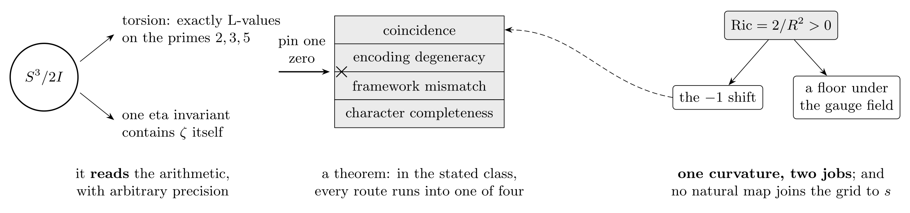

| **[`main`](https://github.com/dmobius3/mode-identity-theory/tree/main/)** | **[`framework`](/files/framework/)** | **[`bedrock`](/files/framework/files/bedrock/)** | **[`dynamics`](/files/framework/files/dynamics/)** | **[`working`](/files/framework/files/working/)** | **[`cosmos`](/files/cosmos/)** | **[`tools`](/files/tools/)** | **[🌊](/files/tools/files/openwave/)** |

---

# 🌈 Στοιχεῖα

The spectrum is the near boundary of the same finite space: $`S^3/2I`$, formed from the three-sphere by a 120-element group that also gives it a 120-position grid. MIT is a speculative framework; this page lays out what it says about fields, particles and forces, and each linked paper carries the details and caveats.

Much of it is exact mathematics. Positive curvature gives the physical gauge fluctuations a gap at the linearized level, the group allows exactly three isolated vacua, which MIT identifies with the three generations, and the torsion values behind the mass formula are exact closed forms. The same space reads the arithmetic of the primes with arbitrary precision, yet a theorem shows that no construction in a stated class can pin down a single zero of the L-functions behind them.

Where the structure meets measured numbers, the scorecard is mixed. With the electron setting the scale, the mass formula's entries land within a factor of 3 of five of the other eight charged fermions, but a pre-registered null test shows that shuffling the torsions among the entries does as well, so that count is no evidence for where they sit. The fine structure constant lands within 0.4% of its low-energy value, the strong and weak couplings follow on a ladder of grid assignments, and that ladder's one empty rung predicts that no gaugino-mediated supersymmetric force appears. Newton's constant stays measured, and dark matter is the geometry of space itself.

---

## [Yang-Mills](files/yang-mills.md)

**A Gap Is Easy Money.** The Millennium Prize asks whether pure Yang-Mills theory, the gauge framework behind the strong and weak forces with no matter included, has a mass gap, a minimum energy above the vacuum, in the full quantum theory on flat space. That one is open and hard, and this page doesn't claim it. It takes the easier cousin: the same question, linearized, on the finite, positively curved space $`S^3/2I`$, where the answer falls out of the shape. Curvature puts a floor under every physical gauge fluctuation, so a gap exists. The group allows exactly three isolated vacua, which MIT identifies with the three generations, and its structure decides which vibration levels each vacuum can use: two start at $`4/R^2`$, while the third is pushed past four empty levels to $`36/R^2`$, nine times the eigenvalue and three times the mass. The radius $`R`$ is the same one behind the vacuum reference for the cosmological constant, and it is known only to order of magnitude. Lattice simulations on this space could test the $`1/R^2`$ scaling and the ninefold split.

>
>
>*Video: [A Gap Is Easy Money: Yang-Mills on a Finite Space](https://www.youtube.com/watch?v=S60uQOs66Ys)*

---

## [Mass Spectrum](files/mass-spectrum.md)

**Seats in the Same Room.** The Higgs mechanism explains how particles acquire mass, not why the twelve matter particles have the masses they do, spread across twelve orders of magnitude. Here each mass has four pieces: a floor set by the measured cosmological constant, a seat for each representation of the 120-element group (the Kostant sunflower), a lift through orders of magnitude for its distance on the McKay graph (the McKay elevator), and a setting that shifts with its vacuum (the torsion dial). Eight representations in three vacua give 24 ranked entries, and rules built on the group give each one a charge, weak isospin and color before any mass is compared, though the isospin rule was written knowing the answers. The torsion values are exact closed forms, and an independent method reproduced the eight basic ones.

With the electron setting the scale, entries land within a factor of 3 of five of the other eight charged fermions. A pre-registered null test shows that shuffling the torsions among the entries does as well 69% of the time, so that count is no evidence for where they sit, and the up and charm quarks have no compatible entry close enough. The three neutrino entries fall in the order of the measured splittings; as absolute masses they are already excluded, so they stand as a proxy comparison, which an inverted mass ordering would falsify. Still open: why the torsion enters the way it does, why the elevator climbs at the rate it does, five surplus entries at masses where an ordinary quark would already have been seen, and the sphere's radius. Run backwards, the masses put it between about 10.5 and 20 Gpc, depending on which pair is read, instead of about 5.4 Gpc: a 3.8- to 13.4-fold miss in the corresponding vacuum reference, and the framework's largest internal tension.

>
>
>*Video: [Twelve Orders, One Lattice: The Mass Ladder on the McKay Graph](https://www.youtube.com/watch?v=HuqGPCuM-qc)*

---

## [Fine Structure](files/fine-structure.md)

**The Number Has an Address.** In 1985, Feynman described 1/137, the strength of electromagnetism, as a number that arrives without explanation. MIT gives it an address: position 13 on the 60-position grid it assigns to bosonic couplings, suppressed by one grid step of the vacuum hierarchy behind the cosmological constant. With that hierarchy fixed from the measured cosmological constant, the result lands within 0.4% of the low-energy value. Accuracy alone would prove little: of 7,200 similar combinations, 9 land that close, about as many as chance gives, but within MIT's own rules only this one does. Position 13's partner, 17, on the other grids gives the strong coupling within 1.5% and, with a twist factor $`\cos(\pi/10)`$ whose insertion isn't derived, the weak within 0.3%. The three forces fill three of the four pairings on that ladder. The empty fourth, a fermionic carrier acting on bosonic matter, is where gaugino-mediated supersymmetric forces would sit, and MIT predicts they never appear as a fundamental interaction; seeing one at any energy would kill the prediction.

>
>
>*Video: [1/137 Has an Address: Feynman's Number on a Finite Grid](https://www.youtube.com/watch?v=vTbUXsrQKi8)*

---

## [The Waltz](files/the-waltz.md)

**The Cost to Dance.** This page treats $`\Lambda`$ as a note added to Einstein's field equations. Its seed is the first positive level of the Möbius surface, $`\Lambda_\text{top} = 2/R^2`$, and a factor of 3/2 carries it to the vacuum reference $`\Lambda_\text{ref} = 3/R^2`$: the Gauss equation gives the geometric 3, and general relativity's de Sitter relation supplies the 1/2. That 3/2 belongs to the vacuum alone; two masses still attract through the ordinary $`8\pi G`$, with no 3/2. In MIT, Newton's constant is the exchange rate between the curvature and mass sectors, and it stays measured: solving the relation for $`G`$ closes a loop rather than predicting a number. Gravity joins a continuous space to a discrete 120-position domain, and quantizing either side into the other's kind would remove something one side supplies; MIT has no quantum completion that keeps both. Dark matter is the geometry of space itself: it couples to gravity but carries no gauge fields a detector could see, so decades of null searches are expected, and the Bullet Cluster's split between mass and gas follows qualitatively. How that sector maps onto the measured dark matter is still open.

>
>
>*Video: [The Waltz: Λ Note to Einstein's Field Equations](https://www.youtube.com/watch?v=aoLJwZDkNGk)*

---

## [The Mirror](files/the-mirror.md)

 0, does two jobs, a floor under the gauge field and the −1 shift behind the coincidence obstruction; and no natural map joins the grid to s">

**One Curvature, Two Jobs.** The zeros of the Riemann zeta function and its relatives, the L-functions, encode how the primes are distributed, and the Riemann hypothesis is a claim about where they lie. One hoped-for route, named for Hilbert and Pólya, looks for a spectrum that encodes those zeros. The space MIT uses reads that arithmetic with arbitrary precision: for the integer-spin representations its torsion factors exactly into L-values built on the primes 2, 3 and 5, and one of its invariants contains the zeta function itself. But a theorem shows that no natural construction in a stated class on this space can pin down an individual zero: every way one could vanish runs into one of four obstructions. In MIT the same positive curvature does two jobs, putting a floor under the gauge field and accounting for one of those four obstructions. One lemma also closes a door for the mass formula: no natural map joins the grid's positions to the spectral parameter $`s`$, so the formula can't be completed by extending this arithmetic.

>
>
>*Video: [The Perfect Mirror](https://www.youtube.com/watch?v=78nEAE8Se4o)*

---

## 🌈 Score

**Standing:** `exact` proved or structural · `anchor-free` numerical, normalization cancels · `anchored (X)` conditional on anchor X, carrying a figure where the quantity is measured · `open` unresolved.

| Observable | Standing | Result | Status |
|---|---|---|---|
| [↗](files/the-waltz.md#ii-gravity-as-the-cost-to-dance) $`\Lambda_\text{ref}/\Lambda_\text{top}`$ | `exact` | 3/2 | the ½ imported from GR |
| [↗](files/yang-mills.md#i-the-geometry) Mass gap | `exact` | $`> 0`$ | linearized, on the compact space |
| [↗](files/the-mirror.md#ii-main-theorem) Spectral isolation | `exact` | no single L-function zero pinned | within the stated class |
| [↗](files/the-waltz.md#iv-dark-matter-and-dark-energy-as-geometry) Null dark matter | `open` | no particle sector | direct-detection nulls |
| [↗](files/yang-mills.md#ii-three-vacua) Flat-vacuum count | `exact` | 3 | vs 3 generations (a reading) |
| [↗](files/mass-spectrum.md#1-color-from-faces) Color from $`Z_3`$ | `exact` | singlet / triplet | consistent (a reading) |
| [↗](files/mass-spectrum.md#2-domain-from-edges) Domain from $`Z_4`$ | `exact` | integer / half-integer | consistent (a reading) |
| [↗](files/mass-spectrum.md#4-weak-isospin-from-the-coxeter-galois-gate) Weak isospin $`T_3`$ | `exact` | 11 evaluations consistent | rule written knowing the answers |
| [↗](files/mass-spectrum.md#3-the-eta-sign-gate) Eta sign gate | `exact` | $`\eta > 0 \implies Q \leq 0`$ | all assigned entries pass |
| [↗](files/mass-spectrum.md#iii-the-24-entries) Fermion masses | `anchored (m_e, Λ)` | 5 of 8 within ×3 | null $`p = 0.690`$: no evidence |
| [↗](files/mass-spectrum.md#iii-the-24-entries) $`m_\mu`$ (muon) | `anchored (m_e, Λ)` | 0.103 vs 0.1057 GeV | ~3% |
| [↗](files/mass-spectrum.md#iii-the-24-entries) $`m_t`$ (top quark) | `anchored (m_e, Λ)` | 161.3 vs 172.7 GeV | 7% |
| [↗](files/mass-spectrum.md#v-dead-zone-targets-and-exclusions) Rank 16 entry | `open` | ~418 MeV | unobserved |
| [↗](files/mass-spectrum.md#v-dead-zone-targets-and-exclusions) Dead zone | `open` | 6 entries, sub-eV to keV | status open |
| [↗](files/mass-spectrum.md#the-neutrino-ladder) Neutrino ladder | `open` | 0.87, 7.3, 66.7 meV | ordered like the splittings; proxy only |
| [↗](files/mass-spectrum.md#1-mass-sector-floor--mu_lambda) $`\mu_\Lambda`$ mass floor | `anchored (Λ)` | 2.25 meV | derived scale |
| [↗](files/fine-structure.md#iii-the-formula) $`\alpha`$ | `anchored (Λ)` | 0.00733 vs 0.00730 | 0.4% at $`q^2 = 0`$ |
| [↗](files/fine-structure.md#alpha_s-the-strong-coupling) $`\alpha_s`$ | `anchored (Λ)` | 0.1162 vs 0.1180 | 1.5%; ladder conjecture |
| [↗](files/fine-structure.md#alpha_w-the-weak-coupling-and-the-plato-twist) $`\alpha_W`$ | `anchored (Λ)` | 0.0339 vs 0.0338 | 0.3%; ladder conjecture |
| [↗](files/fine-structure.md#alpha_s--alpha_w-pure-geometry) $`\alpha_s / \alpha_W`$ | `anchor-free` | 3.426 vs 3.490 | 1.8% |
| [↗](files/fine-structure.md#the-prediction) Force count | `exact` | 3 rungs | vs 3 forces; conditional on the ladder |
| [↗](files/fine-structure.md#the-prediction) Null SUSY | `open` | no gaugino-mediated force | none seen to date |

---

| **[`↑top`](#top)** | **[`main`](https://github.com/dmobius3/mode-identity-theory/tree/main/)** | **[`framework`](/files/framework/)** | **[`bedrock`](/files/framework/files/bedrock/)** | **[`dynamics`](/files/framework/files/dynamics/)** | **[`working`](/files/framework/files/working/)** | **[`cosmos`](/files/cosmos/)** | **[`tools`](/files/tools/)** | **[🌊](/files/tools/files/openwave/)** |
