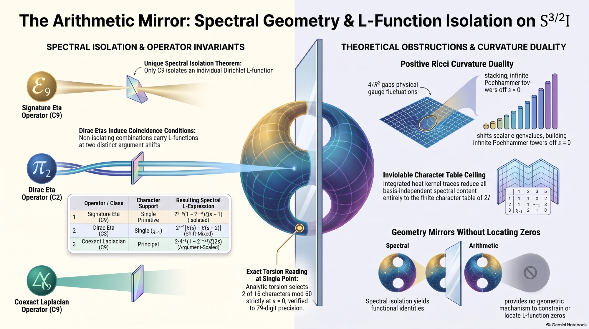
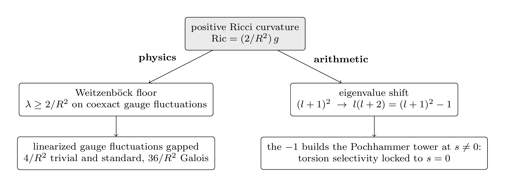

<a id="top"></a>
| **[`<back`](/files/spectrum/)** | **[`main`](https://github.com/dmobius3/mode-identity-theory/tree/main/)** | **[`framework`](/files/framework/)** | **[`bedrock`](/files/framework/files/bedrock/)** | **[`dynamics`](/files/framework/files/dynamics/)** | **[`working`](/files/framework/files/working/)** | **[`cosmos`](/files/cosmos/)** | **[`spectrum`](/files/spectrum/)** | **[`tools`](/files/tools/)** | **[🌊](/files/tools/files/openwave/)** |

---

# 🪩 The Mirror



On the Poincaré homology sphere $`S^3/2I`$, the quotient of the 3-sphere by the binary icosahedral group $`2I`$ of order 120, the torsion and the Dirac spectrum read Dirichlet L-functions exactly (Definition 3). Among the finite linear combinations of the zeta and eta functions of its admissible operators, one function and its multiples isolate an individual Dirichlet L-function (Definition 4): the equivariant eta of the odd signature operator at the elements of order 4, equal to $`2^{2-s}(1-2^{2-s})\zeta(s-1)`$. Every other combination of the Dirac functions and the signature etas carries L-functions at two different shifts, so its zeros are coincidences between L-values (Theorem 1).

## I. Definitions

**Setting.** $`2I\subset\mathrm{SU}(2)`$ is the binary icosahedral group of order 120. It acts on $`S^3=\mathrm{SU}(2)`$ by left multiplication; the quotient $`S^3/2I`$ is the Poincaré homology sphere, with the round metric of radius $`R`$, and right multiplication by $`\mathrm{SU}(2)`$ acts on it by isometries. The irreducible representations of $`2I`$ are R0 (dimension 1), R1 and R2 (2), R3 and R4 (3), R5 and R6 (4), R7 (5) and R8 (6). R0, R3, R4, R5 and R7 factor through the icosahedral group $`A_5`$ (integer spin); R1, R2, R6 and R8 are faithful (half-integer spin). Tensoring with the inclusion representation R1 gives the affine $`E_8`$ McKay graph, and McKay distance means graph distance from R0. The conjugacy classes C1 to C9 are tabulated in § III.D.

**Characters.** $`\chi_{-1}`$ is the nontrivial character mod 4, with $`\beta(s)=L(s,\chi_{-1})`$; $`\chi_3`$ is the nontrivial character mod 3; $`\chi_2`$ is the Legendre character mod 5; $`\chi_{\pm8}(m)=(\pm2/m)`$ and $`\chi_{12}=\chi_{-1}\chi_3`$; $`\chi_0^{(p)}`$ is the principal character mod $`p`$.

**Definition 1 (Admissible Operators).** The admissible operators on $`S^3/2I`$ are the following natural, self-adjoint elliptic operators on sections of natural bundles:

- Hodge Laplacians on $`p`$-forms ($`p = 0,1,2,3`$)
- The Dirac operator and odd signature operator
- Twists of the above by the flat bundles $`E_\sigma=\mathrm{SU}(2)\times_{2I}V_\sigma`$ of the representations $`\sigma`$ of $`2I`$; among them, the three flat SU(2) connections are the trivial one, the standard one (R1) and its Galois conjugate (R2)

---

**Definition 2 (Admissible Spectral Constructions).** For an admissible operator $`A`$ with nonzero eigenvalues $`\lambda`$, the zeta function is $`Z_A(s)=\sum_\lambda\lvert\lambda\rvert^{-s}`$ and the eta function is $`\eta_A(s)=\sum_\lambda\mathrm{sign}(\lambda)\lvert\lambda\rvert^{-s}`$. The admissible class $`\mathcal{F}`$ consists of the intrinsic, basis-independent constructions on $`S^3/2I`$ generated, under finite additive and multiplicative combination, by:

- the zeta and eta functions of the admissible operators on the bundles $`E_\sigma`$, and the analytic torsion $`T(E)`$ of each flat de Rham complex;
- their equivariant versions at each conjugacy class of $`2I`$ (§ III.D);
- symmetric polynomials in the eigenvalues of the representation matrices, and character-weighted spectral sums of Definition 1 operators.

$`\mathcal{L}\subset\mathcal{F}`$ is the set of finite linear combinations of these zeta and eta functions and their equivariant versions.

---

**Definition 3 (Reading).** A construction $`F\in\mathcal{F}`$ *reads* arithmetic if it decomposes finitely into Dirichlet or Hecke L-values or L-functions with coefficients determined by the group-theoretic data of $`2I`$.

---

**Definition 4 (Isolation).** A construction $`F\in\mathcal{F}`$ *isolates* the Dirichlet L-function $`L(s,\chi)`$, with $`\chi`$ primitive, if

```math
F(s)=c^{s}\,a(s)\,L(s-p,\chi)
```

for a constant $`c>0`$, an integer $`p`$ and a nonzero Dirichlet polynomial $`a(s)`$, a finite sum $`\sum_{n\le N}a_n n^{-s}`$. Away from the poles of $`L`$, the zeros of an isolating $`F`$ are those of $`L(s-p,\chi)`$ and the explicit zeros of $`a(s)`$. An equation $`\sum_k a_k(s)\,L(s-p_k,\chi_k)=0`$ among two or more distinct pairs $`(p_k,\chi_k)`$, with each $`\chi_k`$ primitive and each $`a_k(s)`$ a nonzero Dirichlet polynomial, is a *coincidence condition*; by Lemma A of § V it never reduces to a single L-function.

---

## II. Main Theorem

> **Theorem 1 (Spectral Inaccessibility on $`S^3/2I`$).** With $`R=1`$, a nonzero $`F\in\mathcal{L}`$ isolates a Dirichlet L-function if and only if it is a nonzero constant multiple of the C9 equivariant eta of the odd signature operator,
>
> ```math
> \eta^{\mathrm{sig}}([C9],s)=2^{2-s}\left(1-2^{2-s}\right)\zeta(s-1).
> ```
>
> Every other nonzero combination of the Dirac zeta and eta functions and the signature eta functions carries L-functions at two different shifts, so its vanishing condition is a coincidence condition. A finite product of elements of $`\mathcal{L}`$ vanishes only where a factor does.
>
> *Proof: § V, from Lemmas A to D.*

**Note on reading without locating.** The isolation in Theorem 1 is elementary. At C9 the signature trace at the eigenvalue $`m`$ is $`-2m\cos(m\pi/2)`$: zero for odd $`m`$, and alternating in sign over even $`m`$, so the eta is a rescaled alternating zeta series in $`s-1`$. It reads $`\zeta`$ exactly and moves its zeros to $`s=\rho+1`$ without saying where they lie. The Dirac eta at C8 reads $`\zeta(s-1)`$ as well, alongside $`L(s,\chi_3)`$ (§ III.D).

---

## III. The Reading

The spectral geometry of $`S^3/2I`$ gives the exact L-function readings below. Each result is proved and locked. Together they motivate the question that § IV and § V answer: whether this reading can isolate an individual L-function, and what isolation says about its zeros.

### A. Torsion L-Basis

The Reidemeister torsion (analytic torsion by Cheeger-Müller) for all integer-spin irreps of $`2I`$ factors exactly into four Dirichlet L-function special values, with $`E_8`$ McKay symmetries killing 12 of 16 characters mod 60. Four characters survive, at conductors 2, 3, 5, and 5: exactly the primes dividing $`\lvert 2I\rvert=120`$.

Two independent derivation paths (combinatorial Reidemeister + spectral analytic torsion via Kummer/Gauss). Verified to 79 digits. The Galois pair satisfies $`T^2(R_3)/T^2(R_4) = \varphi^{-4}`$ (exact), with the golden ratio entering through the Legendre character of $`\mathbb{Q}(\sqrt{5})`$.

| Irrep | $`T^2`$ | $`\log T^2`$ | L-basis |
|-------|---------|------------|---------|
| R3 | $`(4/5)\varphi^{-2}`$ | -1.186 | $`-4L'(0,\chi_0^{(2)}) + 2L'(0,\chi_0^{(5)}) - \sqrt{5}\cdot L(1,\chi_2)`$ |
| R7 | $`9/4`$ | +0.811 | $`4L'(0,\chi_0^{(2)}) - 4L'(0,\chi_0^{(3)})`$ |
| R5 | $`25/9`$ | +1.022 | $`4L'(0,\chi_0^{(3)}) - 4L'(0,\chi_0^{(5)})`$ |
| R4 | $`(4/5)\varphi^{2}`$ | +0.739 | $`-4L'(0,\chi_0^{(2)}) + 2L'(0,\chi_0^{(5)}) + \sqrt{5}\cdot L(1,\chi_2)`$ |

With $`L'(0,\chi_0^{(p)})=-\tfrac12\log p`$ and $`\sqrt{5}\cdot L(1,\chi_2)=2\log\varphi`$, where $`\chi_2`$ is the Legendre character mod 5, each L-basis entry is the logarithm of its closed form.

Selectivity: maximum (4 of 16 characters). Domain: $`s=0`$ only.

For half-integer irreps (R1, R2, R6, R8), the same spectral method gives exact closed forms as well: the full Ray-Singer torsion resolves to $`\varphi^{-4}/4`$, $`\varphi^{4}/4`$, $`1`$, and $`4`$ respectively, so the maximal-selectivity reading holds across both spin parities. A coexact-only truncation drops the scalar tower; with the scalar tower included, the half-integer torsions collapse to the golden-ratio closed forms above (see [the torsion correction](../../framework/files/working/files/torsion-correction.md)).

### B. Dirac Factorization

The Dirac operator on $`S^3/2I`$ has eigenvalues $`\pm(n+3/2)/R`$, linear in $`n`$ with no curvature shift. In the coprime sector $`U(120)`$, its spectral zeta factors finitely at all $`s`$ into three L-function layers: $`L(s,\chi)`$, $`L(s-1,\chi)`$, $`L(s-2,\chi)`$ for Dirichlet characters mod 120; the numerators that share a factor with 120 contribute separately. The 120-grid carries $`\phi(120)=32`$ characters; of these, 6 to 12 survive depending on the irrep, the same counts as the eta of § III.C. Each level carries one chirality: by spin parity, $`\sigma`$ enters $`m_n^+`$ or $`m_n^-`$ but never both, so the zeta's coefficients are the eta's times $`\pm\chi_{-1}(2n+3)`$ and the two keep the same number of characters for every irrep. Fitting each residue class in its period index, instead of in the numerator $`2n+3`$, spreads the same data over 28 to 30 characters for the zeta and the eta alike; only the numerator layers say which $`L(s-p,\chi)`$ appear.

Selectivity: 6 to 12 of 32 characters per irrep, in the coprime sector. Domain: all $`s`$.

The contrast with the torsion defines the landscape: four characters at a single point, or six to twelve per irrep across the full strip. § IV and § V test whether that reading can isolate an individual L-function.

### C. Eta Character Selection

The Dirac eta invariant

```math
\eta_D(\sigma,s) = \sum_{n}(m_n^+ - m_n^-)(n+3/2)^{-s}
```

with $`m_n^+=(n+2)\,N(\sigma,n)`$ and $`m_n^-=(n+1)\,N(\sigma,n+1)`$, where $`N(\sigma,j)`$ is the multiplicity of $`\sigma`$ in the $`(j+1)`$-dimensional representation of SU(2) (Bär's multiplicities), kills 20 to 26 of the 32 Dirichlet characters mod 120 in the coprime sector. A character $`\chi`$ survives when $`L(s-p,\chi)`$ appears for some $`p\in\{0,1,2\}`$:

| Irrep | dim | McKay distance | Characters surviving | Surviving conductors | $`\eta_D(\sigma,0)`$ |
|-------|-----|----------------|----------------------|----------------------|----------------------|
| R0 | 1 | 0 | 12 | 1, 3, 4, 5, 8, 12, 20 | 1079/720 |
| R1 | 2 | 1 | 10 | 1, 3, 4, 5, 12, 20 | 73/72 |
| R3 | 3 | 2 | 10 | 1, 4, 5, 8, 20 | 9/16 |
| R6 | 4 | 3 | 10 | 1, 3, 4, 5, 12, 20 | 29/180 |
| R7 | 5 | 4 | 6 | 1, 3, 4, 8, 12 | -25/144 |
| R8 | 6 | 5 | 8 | 1, 4, 5, 20 | -17/40 |
| R5 | 4 | 6 | 10 | 1, 3, 4, 5, 12, 20 | -61/180 |
| R4 | 3 | 6 | 8 | 1, 4, 5, 8, 20 | -19/80 |
| R2 | 2 | 7 | 8 | 1, 3, 4, 5, 12, 20 | -67/360 |

The principal character and $`\chi_{-1}`$ survive for every irrep, and the twenty characters of conductor 15, 24, 40, 60 or 120 die for every irrep. The rest of the killing pattern maps to the stabilizer structure of the icosahedron through $`\mathrm{CRT}(8,3,5)`$:

| Stabilizer | Killed | Which irreps |
|-----------|--------|--------------|
| Face ($`Z_3`$) | mod-3 | R3, R4, R8 (Galois pair + branch vertex) |
| Vertex ($`Z_5`$) | mod-5 | R7 only (graph center, dim 5) |
| Edge ($`Z_4`$ ref.) | mod-8 | All half-integer irreps + R5 |

The values at $`s=0`$ come from two independent paths: the Bernoulli values of the Hurwitz layers, which are exact, and Donnelly's group sum $`\eta_D(\sigma,0)=\tfrac{1}{120}\sum_{\gamma\neq e}\chi_\sigma(\gamma)/(1-\cos\alpha_\gamma)`$, with $`e^{\pm i\alpha_\gamma}`$ the eigenvalues of $`\gamma`$; the two agree to 30 digits. All denominators divide $`720=6!`$, the dimension-weighted sum vanishes, and the sign turns from positive to negative between McKay distance 3 and 4.

### D. Equivariant Eta and the C2 Closed Form

The nine conjugacy classes of $`2I`$, by the angle $`\alpha`$ of their eigenvalues $`e^{\pm i\alpha}`$ in SU(2), with the tier each falls in below:

| Class | $`\alpha/\pi`$ | Order | Size | Tier |
|-------|----------------|-------|------|------|
| C1 | 0 | 1 | 1 | identity |
| C2 | 1 | 2 | 1 | 1 |
| C3, C5 | 1/5, 3/5 | 10 | 12 each | 3 |
| C4, C6 | 2/5, 4/5 | 5 | 12 each | 3 |
| C7 | 1/3 | 6 | 20 | 2 |
| C8 | 2/3 | 3 | 20 | 2 |
| C9 | 1/2 | 4 | 30 | 2 |

The character-table rotation transforms 9 per-irrep etas (6–12 survivors each) into 8 non-trivial conjugacy-class combinations (1–4 survivors each; the identity class contributes zero by dimension-weighted cancellation). The central element $`C2=[-e]`$ carries a single character, $`\chi_{-1}`$, at the shifts $`s`$ and $`s-2`$:

```math
\eta([-e],s) = 2^{s-1}\cdot[\beta(s)-\beta(s-2)]
```

where $`\beta(s)=L(s,\chi_{-1})`$ is the Dirichlet beta function. All equivariant etas have the universal closed form:

```math
\eta_g(n) = \frac{(n+2)\sin((n+1)\alpha)-(n+1)\sin((n+2)\alpha)}{\sin\alpha}
```

Over the odd numerators $`m=2n+3`$ of the eigenvalues, $`\eta([g],s)=2^{s}\sum_m c_g(m)\,m^{-s}`$ with

```math
c_g(m)=\frac12\left[\frac{\sin(m\alpha/2)}{\sin(\alpha/2)}-m\,\frac{\cos(m\alpha/2)}{\cos(\alpha/2)}\right],
```

one periodic function of $`m`$ at each of the layers $`s`$ and $`s-1`$; at C2 the limit $`\alpha\to\pi`$ moves the second layer to $`s-2`$. The Tier 2 classes each retain 2 L-functions, one per layer:

| Class | $`\eta([g],s)`$ |
|-------|----------------|
| C7 | $`2^{s-1}[(1+3^{1-s})\beta(s)-L(s-1,\chi_{12})]`$ |
| C8 | $`2^{s-1}[(1+2^{-s})L(s,\chi_3)-(1-2^{1-s})(1-3^{2-s})\zeta(s-1)]`$ |
| C9 | $`2^{s-1}[L(s,\chi_{-8})-L(s-1,\chi_8)]`$ |

with $`\chi_{\pm8}(m)=(\pm2/m)`$ and $`\chi_{12}=\chi_{-1}\chi_3`$. $`C8`$ (order 3) involves $`\zeta(s-1)`$ directly. The factors at 2 and 3 are finite: the Dirac eigenvalues $`(2n+3)/2`$ have odd numerators, and the odd multiples of 3 carry their own coefficient. On numerators prime to 6, which include the coprime sector $`U(120)`$, the terms are those of $`L(s,\chi_3)`$ and $`\zeta(s-1)`$. The Tier 3 classes C3 to C6 retain 4 each, two per layer, with coefficients in $`\mathbb{Q}(\sqrt5,i)`$: at $`s`$, $`\chi_{-1}`$ and $`\chi_{-1}\chi_2`$ for C3 and C5, and the two quartic characters mod 5 for C4 and C6; at $`s-1`$, $`\chi_{-1}`$ times the quartic pair for C3 and C5, and the principal character with $`\chi_2`$ for C4 and C6. Each tier's count is a property of the closed-form structure. The number of Dirichlet characters with nonzero projection in the coprime sector $`U(120)`$ differs by class and is tabulated in Lemma 3.

### E. Vacuum Structure

Per-irrep twisted etas computed via fusion matrices for all three flat connections (trivial, standard, Galois). The Galois twist changes the vacuum-dependent eta pattern across the McKay graph. The antisymmetric combination $`\eta_\text{std}-\eta_\text{gal}=(2/5)\times\mathrm{integer}`$ for every irrep, with R7 in the kernel. Equivariant class selection is invariant under vacuum twist: $`\eta_\rho([g])=\chi_\rho(g)\cdot\eta([g])`$.

### Computational Record

| Computation | Result | Precision |
|------------|--------|-----------|
| Torsion L-basis | 5 int-spin irreps → 4 L-functions | 79 digits, two paths; closed forms (G10) |
| $`E_8`$ char. selection | 4 of 16 survive | Exact |
| Curvature obstruction | Pochhammer tower | Structural proof |
| Dirac factorization | 3-layer L-decomp. all $`s`$; 6–12 of 32 survive (coprime sector) | Structural; counts exact (G08) |
| $`S^1`$ bridge | Non-existence proved | 4 proofs |
| Eta multiplicities | $`9\times120`$ signed table | Integer-exact (G03) |
| Eta char. decomp. | 6–12 of 32 survive (coprime sector) | Exact (G07) |
| $`\eta(\sigma,0)`$ exact | 9 rationals, denom divides 720 | Two-path, exact (G06) |
| Equiv. eta (Type 1) | C2: 1 survivor; Tier 2: 2; Tier 3: 4 | Exact (G09) |
| C2 closed form | $`\eta([-e],s)=2^{s-1}[\beta(s)-\beta(s-2)]`$ | Algebraic + numerical (G05) |
| Tier 2 closed forms | Universal trig. formula; C8 involves $`\zeta(s-1)`$ | Exact (G04, G05) |
| Torsion $`\times`$ eta | Inherited arithmetic, no emergent structure | Exact |
| Vacuum-twisted eta | (2/5)×integer; C7, C9 twist factors | Exact (G11) |
| Higher-form Laplacians | Hodge duality; no combination factors | Structural proof |
| Signature operator | Curl traces; the C9 eta isolates $`\zeta(s-1)`$ | $`s=0`$ values match the APS defect; Ruberman–Saveliev (G13) |
| Isolation in $`\mathcal{L}`$ | Only the C9 signature eta isolates (Theorem 1) | Lemmas A to D; ranks 16, 14 and 2 (G12) |
| Type 2 equiv. eta | Uniformly worse, all 8 classes | C2: structural; non-central: mod-120 exact ($`S_1/S_0`$) |
| Selberg/Ruelle $`\zeta`$ | Finite cyclotomic product | Exact |
| Artin L-function | Brauer virtual; Hecke $`\neq`$ Dirichlet | Structural |
| Matrix coefficients | Characters exhaust content | Structural |

Gate numbers refer to [`the-mirror.test.py`](scripts/the-mirror.test.py), which rebuilds § III.B to § III.E from the McKay graph and Bär's spectrum, and checks Lemmas B and D of § V, in thirteen gates, each paired with a defect that must turn it red (`--mutation-tests`); it needs mpmath and runs in about fifteen seconds. The torsions of § III.A are recomputed from the spectrum by [`torsion-correction.test.py`](../../framework/files/working/files/scripts/torsion-correction.test.py). The Type 2 counts of Lemma 3 come from the original computation, outside both scripts, and are fitted in the period index.

---

## IV. Lemmas 1–8

The eight lemmas test specific strategies for turning the reading of § III into a hold on L-function zeros; § V proves Theorem 1. Three supporting propositions are interspersed before the lemmas they enable: Propositions 1 and 2 precede Lemma 4; Proposition 3 precedes Lemma 7.

---

**Lemma 1 (Curvature / Pochhammer Obstruction).**
**Strategy defeated:** Extend the torsion's selectivity (4 of 16 characters) from $`s=0`$ to a strip containing the critical strip.

*Proof.* The scalar Laplacian on $`S^3/2I`$ has eigenvalues $`l(l+2)=(l+1)^2-1`$. The Ricci curvature shift "-1" generates a Pochhammer expansion:

```math
Z_{0,\sigma}(s)=\sum_{k\geq0}\frac{(s)_k}{k!}\cdot\widetilde{H}_k(s)
```

At $`s=0`$: $`(0)_k=0`$ for $`k\geq1`$ collapses the tower to a single term, the mechanism that produces maximum selectivity. At general $`s`$: $`(s)_k\neq0`$, the full infinite tower activates, and no finite closed form exists. Dowker's cancellation formula confirms $`F(\gamma;0)=F'(\gamma;0)=0`$ only at $`s=0`$.

No linear combination $`a\cdot Z_0+b\cdot Z_1`$ with $`a\neq0`$ factors at general $`s`$: the Pochhammer tower from $`Z_0`$ cannot be cancelled by the unshifted $`Z_1`$. The Lichnerowicz formula $`D^2=\nabla^*\nabla+R_\text{scalar}/4`$ connects Dirac eigenvalues to scalar Laplacian eigenvalues through an additive constant shift ($`3/(2R^2)`$). This does not recreate the Pochhammer obstruction for the Dirac operator, whose spectral zeta does factor finitely at all $`s`$ (§ III.B). The obstruction here is specific to the scalar/torsion route: the curvature shift blocks the extension of torsion selectivity from $`s=0`$ to general $`s`$. The Dirac route avoids this obstruction but faces a different one: insufficient character selectivity (in the coprime sector, 6 to 12 of 32 characters survive for every irrep, so each Dirac zeta stays a combination of several L-functions).

The torsion's selectivity is a property of $`s=0`$, not a property that extends. The curvature that gives the Yang-Mills mass gap blocks the general-<i>s</i> factorization for the scalar route. $`\square`$

---

**Lemma 2 (Coincidence is Not Vanishing).**
**Strategy defeated:** Use the C2 equivariant eta's single-character selectivity at all $`s`$ to isolate $`\beta(s)`$.

*Proof.* The zeros of $`\eta([-e],s)`$ satisfy $`\beta(s)=\beta(s-2)`$. This is a coincidence condition (Definition 4): it equates two values of $`\beta`$ at shifted arguments, and by Lemma A of § V the two shifts never merge, so the C2 eta does not isolate $`\beta`$. $`\square`$

*Remark (non-load-bearing, confirmatory only).* Numerical evaluation at the first 10 nontrivial zeros of $`\beta`$ confirms $`\lvert\beta(s_0-2)\rvert`$ is far from zero in each case (values 13.98 to 341.84 at 50-digit precision). This is consistent with but not required by the proof above, which rests on Definition 4 and Lemma A.

---

**Lemma 3 (Oscillatory Weighting Degrades Selectivity).**
**Strategy defeated:** Couple the SU(2) character weight $`\chi_j(g)`$ inside the spectral sum (Type 2 equivariant eta) to achieve deeper group-theoretic constraints on the canonical Dirac eta data.

**Claim:** For the canonical equivariant Dirac eta invariant of $`S^3/2I`$, constructed from the actual Dirac spectrum without added spectral projectors or custom level filters, Type 2 weighting never reduces Dirichlet character support below the Type 1 baseline.

*Proof (C2 case, structural).* Both types reduce to the same linear combination form via the McKay decomposition identity $`\chi_j(g)=\sum_\sigma m(\sigma,j)\chi_\sigma(g)`$. The shared outer structure conceals a critical difference in the inner kernel: $`\eta_D(\sigma,s)`$ uses only the diagonal McKay kernel $`K_{\sigma\sigma}(s)`$, while $`\widetilde{\eta}_{\sigma}(s)`$ uses the full off-diagonal matrix $`K_{\sigma\sigma^\prime}(s)`$.

| | Formula |
|---|---------|
| Type 1 | $`\sum_\sigma\chi_\sigma(g)\cdot\eta_D(\sigma,s)`$ |
| Type 2 | $`\sum_\sigma\chi_\sigma(g)\cdot\widetilde{\eta}_{\sigma}(s)`$ |

For the central element $`C2=[-e]`$, the SU(2) character evaluates to $`\chi_j(-e)=-(2j+1)`$ for all half-integer $`j`$, monotone and strictly negative, with no sign variation. Type 1 achieves single-character selectivity at C2 precisely because the $`2I`$ character table produces sign alternation between bosonic irreps ($`\chi_\sigma(C2)=+\dim\sigma`$) and fermionic irreps ($`\chi_\sigma(C2)=-\dim\sigma`$). That alternation drives the cancellations that leave the single character $`\chi_{-1}`$.

Type 2 at C2 is structurally blind to this mechanism. The weights $`(2j+1)^2`$ are strictly positive for all $`j`$, introducing no sign alternation and no cancellation between bosonic and fermionic contributions. Type 2 is strictly worse than Type 1 at C2. $`\square`$

*Proof (non-central classes).* For each of the 7 non-central conjugacy classes $`g\in2I`$, the Type 2 weight on unit residues mod 120 takes the exact form $`W_{120k+r}(g)=f_r(g)\cdot(32k+B_r)`$, where $`f_r(g)=\sin(r\alpha/2)/\sin(\alpha/2)`$ is periodic with period $`2q`$, and since $`2q`$ divides 120 for each class ($`2q\in\{6,8,10,12,20\}`$), restriction to residues mod 120 captures complete periods. $`B_r`$ is the residue-class intercept determined by the McKay recurrence. The Dirichlet character projection decomposes into two independent sums:

```math
S_1(g,\chi) = \sum_{r\in U(120)} f_r(g)\cdot\bar{\chi}(r)
```
```math
S_0(g,\chi) = \sum_{r\in U(120)} B_r\cdot f_r(g)\cdot\bar{\chi}(r)
```

both finite and exact over the cyclotomic field $`\mathbb{Q}(\zeta_{2q})`$. A character survives when at least one sum is nonzero. Exact computation over the full 32-character Dirichlet basis on $`U(120)\cong U(8)\times U(3)\times U(5)`$ yields:

| Class | $`S_1`$ layer | Type 2 |
|-------|--------|--------|
| C7, C8, C9 (orders 6, 3, 4) | 1 | 12 |
| C3 to C6 (orders 10 and 5) | 2 | 16 |

The $`S_1`$ column counts the $`f_r`$ layer of the Type 2 weight. The full Type 1 eta retains two characters for C7 to C9 and four for C3 to C6 (§ III.D). In all 7 cases Type 2 strictly exceeds Type 1. The mechanism is the two-component structure: the slope term $`32\cdot S_1(g,\chi)`$ preserves the $`S_1`$ support, while the nonconstant intercept term $`S_0(g,\chi)`$ activates additional characters not present in Type 1. Type 2 is strictly worse than Type 1 for all non-central classes. $`\square`$

---

**Proposition 1 (Operator Classification).** Every admissible operator $`A`$ (Definition 1) on sections of a bundle $`E_\sigma`$ over $`S^3/2I`$ has L-function character content among the Dirichlet characters of conductor dividing 120, fixed by the multiplicities of $`\sigma`$ in the representations that carry its eigenspaces. The listed operators have different eigenvalue functions, and none of them introduces characters outside that set.

*Proof.*
*Step 1: Bundle classification.* The homogeneous bundles over $`S^3/2I`$ are $`E_\sigma=\mathrm{SU}(2)\times_{2I}V_\sigma`$, for the 9 irreps $`\sigma`$ of $`2I`$ and their sums. Definition 1 is exhaustive at the bundle level.

*Step 2: Reduction to blocks.* Lifted to $`S^3`$, any admissible operator commutes with left and right multiplication by $`\mathrm{SU}(2)`$, so its eigenspaces are sums of blocks $`V_a\boxtimes V_b`$, and $`\sigma`$ occurs in a block $`N(\sigma,a)(b+1)`$ times (Bär for spinors, Ikeda and Taniguchi for forms).

*Step 3: Characters from the multiplicities.* $`N(\sigma,a)`$ is a quasi-polynomial of degree one in $`a`$, with period dividing 60, so character orthogonality mod 120 extracts the character content, among the characters of conductor dividing 120. Which characters survive depends on the operator through its blocks: at C9 the Dirac eta keeps $`\chi_{-8}`$ and $`\chi_8`$, and the signature eta only the principal character (Lemma D of § V). $`\square`$

---

**Proposition 2 (Combination Closure).** Every construction $`F\in\mathcal{F}`$ built from Definition 1 operators by the operations of Definition 2 has L-function character content contained within the finite character algebra determined by the $`2I`$ group data. No genuinely new arithmetic source enters from finite additive or multiplicative combination.

*Proof.* Every spectral invariant built from a Definition 1 operator decomposes into the algebra generated by character-indexed L-expressions: finite linear combinations of terms $`\chi(n)\cdot f(n)`$ where $`\chi`$ ranges over Dirichlet characters mod 120 and $`f(n)`$ encodes the eigenvalue structure. Under finite addition, support on a character set $`S`$ remains on $`S`$. Under finite multiplication, products may mix within the ambient character algebra mod 120, but cannot introduce characters from outside that algebra; no new arithmetic source enters beyond what the $`2I`$ group data and McKay multiplicities already determine. Vacuum twists leave equivariant class selection invariant: $`\eta_\rho([g])=\chi_\rho(g)\cdot\eta([g])`$, confirming no new character support enters through twisting. The finite character algebra over $`U(120)`$ is the ceiling. $`\square`$

---

**Lemma 4 (Operator Completeness Inside Admissible Class).**
**Strategy tested:** Find a different natural operator on $`S^3/2I`$ that avoids the obstructions of Lemmas 1–3.

*Proof.* By Propositions 1 and 2, every $`F\in\mathcal{F}`$ has character content among the characters of conductor dividing 120. The candidates within $`\mathcal{F}`$:

- **Hodge duality:** $`p`$-form Laplacians for $`p=2,3`$ are isospectral with $`p=1,0`$. Only two independent spectral zetas exist, both already computed, and no combination of them isolates an L-function (Lemma C of § V).
- **Signature operator:** its eta comes from curl on coexact 1-forms, whose blocks differ from the Dirac operator's. At C9 it isolates $`\zeta(s-1)`$ (Lemma D of § V): the strategy's one success, and the only isolation in $`\mathcal{L}`$.
- **Vacuum twists:** Three flat connections produce three distinct per-irrep eta vectors, but equivariant class-level selection is invariant. C9 is killed by both nontrivial twists, so the isolation needs the trivial connection; C7 is perfectly vacuum-invariant.
- **Combined invariants:** Products $`T^2(\sigma)\cdot\eta(\sigma,0)`$ inherit factor arithmetic. No emergent L-basis from combining the two spectral invariants.

The survey is complete. The signature operator at C9 is the one candidate that avoids the obstructions of Lemmas 1 to 3, and its identity locates none of the zeros it carries (§ II). $`\square`$

---

**Lemma 5 (Finite-Product Collapse).**
**Strategy defeated:** Use multiplicative (Selberg/Ruelle) encoding of spectral data, exploiting positivity properties that additive encoding lacks.

*Proof.* The Ruelle zeta on $`S^3/2I`$ is a finite product over 3 geometric-primitive conjugacy classes (C3 order 10, C7 order 6, C9 order 4). The zeros are roots of unity (holonomy phases), not Laplacian eigenvalues. No functional equation of Selberg type exists. Integer-spin twists give $`\det(I-\sigma(\gamma))=0`$. The passage from sums to products is invertible for finite products and introduces no new constraints.

The Selberg zeta machinery requires Anosov (hyperbolic) dynamics. The round $`S^3`$ has periodic (Zoll) geodesic flow. Product-side zeros are holonomy/cyclotomic zeros determined by group elements, not by spectral parameters or L-function arguments. $`\square`$

---

**Lemma 6 (Framework Disconnect).**
**Strategy defeated:** Connect spectral L-functions to the icosahedral Artin L-function via Langlands/modularity, using known automorphicity (Khare-Wintenberger) to constrain the spectral side.

*Proof.* The spectral L-functions are Dirichlet L-functions over $`\mathbb{Q}`$, arising from Fourier analysis of McKay multiplicities (modulus 120). The Artin L-function $`L(s,R_1)`$ is a 2-dimensional L-function attached to a Galois representation, decomposing via Brauer induction into Hecke L-functions over intermediate number fields.

Brauer decomposition: $`R_1=\mathrm{Ind}(C_6,\lambda_6)+\mathrm{Ind}(C_{10},\lambda_{10})-\mathrm{Ind}(C_4,\lambda_4)`$. This is virtual (negative exponent), not isolable. Known icosahedral extensions have discriminants far larger than 120, making conductor overlap numerically impossible. Shared prime support $`\{2,3,5\}`$ is forced by $`\lvert 2I\rvert=120`$ and carries no analytic content.

The spectral and arithmetic L-functions attached to $`2I`$ are different mathematical objects. Modularity of the Artin L-function does not constrain the spectral Dirichlet L-functions. $`\square`$

---

**Proposition 3 (Kernel Reduction).** Let $`\sigma`$ be any irrep of $`2I`$ and $`A`$ any admissible operator on sections of $`E_\sigma`$ over $`S^3/2I`$. Then: (1) $`K_t^A(x,x)=\sum_{\gamma\in2I}\sigma(\gamma)\cdot k_t(d(x,\gamma x))`$ with $`k_t`$ scalar; (2) every spectral invariant reduces to $`\sum_{[g]\subset2I}\chi_\sigma(g)\cdot G_t([g])`$; (3) no basis-independent content of the kernel lies outside the character table of $`2I`$.

*Proof.* The right-<i>SU(2)</i> action commutes with any natural operator, so the heat kernel depends only on geodesic distance. Combined with left-<i>2I</i> equivariance:

```math
\tilde{K}_t^A(x,\gamma x) = \sigma(\gamma)\cdot k_t(d(x,\gamma x))
```

Every spectral invariant is defined via the integrated diagonal trace:

```math
\int_M\mathrm{Tr}[K_t^A(x,x)]\,dx = \sum_{\gamma\in2I}\chi_\sigma(\gamma)\cdot G_t(\gamma)
```

The matrix $`\sigma(\gamma)`$ collapses to the scalar $`\chi_\sigma(\gamma)`$ under the trace. Any basis-independent function of the residual matrix is a symmetric function of eigenvalues, expressible as characters at powers of $`\gamma`$, which land in known conjugacy classes. The character table is exhaustive. $`\square`$

---

**Lemma 7 (Character Ceiling).**
**Strategy defeated:** Go beyond character traces to matrix coefficients, exploiting intertwining structure that the trace discards.

*Proof.* Three candidates:

- **$`2I`$ representation matrices $`\sigma(g)`$:** Factor out of spectral sums as constants. $`M_{\sigma,[g]}(s)=\sigma(g)\cdot\eta_D(\sigma,s)`$. No new information beyond characters.
- **SU(2) Wigner $`D`$-matrices $`D^j(g)`$:** Diagonal for conjugacy class representatives: $`D^j(g)=\mathrm{diag}(e^{2im\alpha})`$. Off-diagonal entries are basis-dependent. $`\det D^j(g)=1`$ identically. Any basis-independent function is expressible as characters at powers of $`g`$ (Proposition 3).
- **Operator kernel:** By Proposition 3, the kernel reduces to character data. Redundant given the character ceiling.

The character table is the complete basis-independent invariant of the group action on $`S^3`$. $`\square`$

---

**Lemma 8 ($`\Theta\leftrightarrow s`$ Bridge).**
**Strategy defeated:** Construct a natural map between the phase position $`\Theta`$ (from the scaling law $`C(\Theta)=2\sin^2(\pi\Theta)`$) and the spectral parameter $`s`$, exploiting their shared $`Z_2`$ symmetry.

*Proof.* Four approaches on $`S^1`$ (heat kernel, theta function, Poisson summation, direct decomposition) prove no such map exists. Every eigenspace on $`S^1`$ with anti-periodic BC is 2-dimensional (sin and cos). $`C(\Theta)`$ depends on choosing $`\sin`$ over $`\cos`$. The spectral zeta sees only eigenvalues and multiplicities, blind to this choice. The two $`Z_2`$ symmetries, $`C(\Theta)=C(1-\Theta)`$ from spatial reflection and $`\xi(s)=\xi(1-s)`$ from Poisson/modular duality, arise from different mechanisms and are not related by a natural map.

On $`S^3/2I`$: the McKay correspondence resolves the basis ambiguity (multiplicities are canonical), but continuous geometric position drops out by Schur's lemma: the right-<i>SU(2)</i> acts transitively, forcing the twisted heat kernel to be constant on the diagonal of each fiber. $`\square`$

---

## V. The Wall

The eight lemmas of § IV sort the natural strategies into four obstruction layers. The signature operator at C9 meets none of them: it isolates $`\zeta(s-1)`$, and the identity locates none of its zeros. Lemmas A to D below prove Theorem 1.

| Layer | Obstruction | Lemmas |
|-------|------------|--------|
| Coincidence condition | A Dirac combination carries L-functions at two shifts, so its zeros are coincidences (Def. 4, Lemma B); torsion selectivity stays at $`s=0`$. | 1, 2, 3 |
| Encoding degeneracy | Multiplicative structure degenerates on finite groups. No Selberg machinery without Anosov dynamics. Spectral zeros reduce to holonomy or cyclotomic phases, not L-function zeros. | 5 |
| Framework mismatch | Spectral Dirichlet L-functions over $`\mathbb{Q}`$ $`\neq`$ Arithmetic Hecke L-functions over number fields. Modularity does not transfer. | 6 |
| Character completeness | Characters exhaust basis-independent content by Propositions 1, 2, and 3. No "beyond characters" on this manifold. | 4, 7, 8 |

**Conventions.** We take $`R=1`$. $`2I`$ acts on the left, so a block $`V_a\boxtimes V_b`$ of an eigenspace contributes $`N(\sigma,a)(b+1)`$ to the multiplicity of $`\sigma`$ and $`(b+1)\chi_a(g)`$ to the trace of a class $`g`$, where $`\chi_a(g)=\sin((a+1)\alpha)/\sin\alpha`$ for eigenvalues $`e^{\pm i\alpha}`$ of $`g`$. The Dirac eigenvalue $`+(n+3/2)`$ sits on $`V_n\boxtimes V_{n+1}`$ and $`-(n+3/2)`$ on $`V_{n+1}\boxtimes V_n`$, which gives the multiplicities $`m_n^\pm`$ of § III.C.

**Lemma A (Independence).** Let $`a_k(s)=\sum_\lambda a_{k,\lambda}\lambda^{-s}`$ be finite sums over real $`\lambda>0`$. If $`\sum_k a_k(s)L(s-p_k,\chi_k)=0`$ for distinct pairs $`(p_k,\chi_k)`$ with each $`\chi_k`$ primitive, then every $`a_k=0`$.

*Proof.* A general Dirichlet series vanishes only if its coefficients do, and the frequencies $`\lambda n`$ stay in the coset $`\lambda\mathbb{Q}_{>0}`$, so each coset gives its own identity; in each, a common denominator makes the $`a_k`$ Dirichlet polynomials, supported on $`n\le N`$ say. For a prime $`q>N`$, the coefficient of $`(dq)^{-s}`$ is $`\sum_k\chi_k(q)\,q^{p_k}B_k(d)`$, with $`B_k(d)=\sum_{e\mid d}a_{k,e}\,\chi_k(d/e)(d/e)^{p_k}`$. The largest power of $`q`$ separates the shifts, and Dirichlet's theorem with character orthogonality separates the characters at one shift, so every $`B_k(d)=0`$. Its term $`e=d`$ is $`a_{k,d}`$, and induction on $`d`$ gives $`a_k=0`$. The same count shows that a nonzero finite combination of L-functions has nonzero coefficients at $`dq`$ for some $`d`$ and infinitely many primes $`q`$. $`\square`$

**Lemma B (Dirac: two shifts).** Every nonzero finite linear combination of the Dirac zeta and eta functions, over the bundles $`E_\sigma`$, the classes and the flat twists, has L-function terms at shift 0 and at shift 1 or 2.

*Proof.* By character orthogonality the combinations are those of the class functions. Over the odd numerators $`m=2n+3`$, with $`\theta=\alpha/2`$, the class traces give

```math
\eta_g(m)=\tfrac12\left[\frac{\sin m\theta}{\sin\theta}-m\,\frac{\cos m\theta}{\cos\theta}\right],\qquad
\zeta_g(m)=\tfrac12\left[m\,\frac{\sin m\theta}{\sin\theta}-\frac{\cos m\theta}{\cos\theta}\right]
```

at the seven non-central classes. The C2 eta is $`\tfrac12(1-m^2)\chi_{-1}(m)`$, the identity zeta is $`\tfrac12(m^2-1)`$, and the identity eta and the C2 zeta vanish. Each function is $`A(m)+mB(m)+m^2C(m)`$ with $`A`$, $`B`$, $`C`$ periodic, the terms at shifts 0, 1 and 2. On odd $`m`$ the sequences $`e^{\pm im\theta}`$ are independent when the frequencies differ mod $`\pi`$, and the fourteen values $`\pm\theta`$ of the non-central classes, $`\pi/2`$ for C2 and $`0`$ for the identity, are sixteen distinct classes mod $`\pi`$. So the sixteen shift-0 parts are independent, and a combination with no shift-1 part lies in the span of the C2 eta and the identity zeta, whose shift-2 parts $`-\tfrac12\chi_{-1}`$ and $`\tfrac12`$ are independent. Lemma A keeps the shifts apart. $`\square`$

**Lemma C (Laplacians).** No nonzero finite linear combination of the Hodge Laplacians' zeta functions isolates an L-function.

*Proof.* The eigenvalues are $`l(l+2)`$ and $`(l+1)^2`$, so the zeta functions are supported on $`\{k^2-1\}\cup\{k^2\}`$. An isolating $`c^s a(s)L(s-p,\chi)`$, with $`d`$ the least element of the support of $`a`$, has the coefficient $`a_d\chi(q)q^p\neq0`$ at $`dq`$ for every prime $`q`$ above that support and prime to the conductor, and a fixed multiple of $`(k-1)(k+1)`$ or of $`k^2`$ equals $`dq`$ for only finitely many primes $`q`$. $`\square`$

**Lemma D (The odd signature operator).** The C9 equivariant eta of the odd signature operator is $`2^{2-s}(1-2^{2-s})\zeta(s-1)`$. Among the finite linear combinations of the signature zeta and eta functions, only its multiples isolate an L-function, and a combination whose integer-frequency terms all vanish is zero.

*Proof.* The exact forms pair off at $`\pm\sqrt{l(l+2)}`$ and cancel in the eta, which is that of curl on coexact 1-forms. Curl has eigenvalue $`+(l+1)`$ on $`V_{l-1}\boxtimes V_{l+1}`$ and $`-(l+1)`$ on $`V_{l+1}\boxtimes V_{l-1}`$, $`l\ge1`$ (Ikeda and Taniguchi), so with $`m=l+1`$ the class trace is

```math
\eta^{\mathrm{sig}}_g(m)=(m+1)\chi_{m-2}(g)-(m-1)\chi_m(g)=2\sin m\alpha\,\cot\alpha-2m\cos m\alpha .
```

At $`s=0`$ this gives $`\cot^2(\alpha/2)`$ at every class, Atiyah, Patodi and Singer's defect for an isoclinic rotation. The class average is $`361/180`$, and with the Dirac value $`1079/720`$ of § III.C it satisfies Ruberman and Saveliev's relation $`\tfrac12\eta_{\mathrm{Dir}}+\tfrac18\eta_{\mathrm{Sign}}=-\bar\mu=1`$, which fixes the orientation. At C9, $`\alpha=\pi/2`$: the sine term drops, odd $`m`$ give zero, and $`m=2k`$ gives $`-4k(-1)^k`$, which sums to the closed form. It isolates $`\zeta(s-1)`$ with $`c=1/2`$, $`p=1`$ and $`a(s)=4-16\cdot2^{-s}`$; at $`s=2`$ the zero of $`a`$ meets the pole of $`\zeta(s-1)`$, and the eta is $`\log2`$ there. The shift-1 parts $`-2\cos m\alpha`$ of the seven non-central etas are independent, so a combination of etas with no shift-1 part is zero; the shift-0 parts $`2\sin m\alpha\cot\alpha`$ are independent over the six classes other than C9, so a combination with no shift-0 part is a multiple of the C9 eta. A signature zeta adds the exact pairs, at the irrational frequencies $`\sqrt{l(l+2)}`$; they cancel in a combination only if $`\sum_g c_g\chi_l(g)=0`$ for every $`l\ge1`$, and the $`\chi_l`$ with $`l\ge1`$ span the class functions (for instance $`2\chi_{120}-\chi_{240}=1`$ on $`2I`$), so every zeta coefficient $`c_g`$ is zero. If instead the integer-frequency terms of a combination vanish, the identity and C2 zetas, whose terms are $`2(m^2-1)`$ and $`2(-1)^m(m^2-1)`$, drop out, and for the other classes the two layers give $`\sum_g(c_g+e_g)\chi_{m-2}(g)=0`$ and $`\sum_g(c_g-e_g)\chi_m(g)=0`$ for every $`m`$, so every coefficient is zero. $`\square`$

**Proof of Theorem 1.** The C9 eta isolates $`\zeta(s-1)`$ (Lemma D). Conversely, let a nonzero $`F\in\mathcal{L}`$ equal $`c^s a(s)L(s-p,\chi)`$, and split it into its Dirac, signature and Laplacian parts. Their frequencies are half-integers; integers together with the irrational $`\sqrt{l(l+2)}`$; and integers on the thin set of Lemma C. By Lemma A the frequencies separate by coset of $`\mathbb{Q}_{>0}`$. If $`c`$ is irrational, the right side has no rational frequencies. The Dirac part, which lives on the half-integers, then vanishes, and by Lemma B so does its combination. On the integers the signature part is a finite combination of shifted L-functions; if it cancels the Laplacian part, it is supported on the thin set of Lemma C, and the remark after Lemma A makes both vanish. Lemma D then makes every signature coefficient zero, so $`F=0`$. So $`c=u/v`$ is rational, in lowest terms; the irrational exact pairs cancel, and Lemma D removes the signature zetas. Whether a frequency $`dn/c`$ of the right side is half-integral is decided by finitely many conditions on its valuations at the primes dividing $`2u`$. Each exact-valuation filter is a difference of divisibility filters, and filtering $`c^s a(s)L(s-p,\chi)`$ by divisibility by a prime power gives $`c^s b(s)L(s-p,\chi)`$ for a Dirichlet polynomial $`b`$, or zero, because $`\chi`$ is completely multiplicative. So the half-integral part of $`F`$, which is its Dirac part, isolates or vanishes, and by Lemma B it vanishes. On the integers, $`F`$ minus its signature etas is a finite combination of L-functions supported on the thin Laplacian set, hence zero, so the Laplacian part vanishes and $`F`$ is a combination of signature etas that isolates: a constant multiple of $`\eta^{\mathrm{sig}}([C9],s)`$ (Lemma D). For a combination of Dirac functions and signature etas that is not such a multiple, Lemmas B and D give terms at two shifts, which is a coincidence condition. A finite product vanishes exactly where a factor does. $`\square`$

---

## VI. The Mechanism: Curvature Duality

<p align="center"> 0. Physics branch: the Weitzenbock floor, lambda at least 2/R^2 on coexact gauge fluctuations, so the linearized gauge fluctuations are gapped, 4/R^2 at the trivial and standard vacua and 36/R^2 at the Galois vacuum. Arithmetic branch: the eigenvalue shift from (l+1)^2 to l(l+2) = (l+1)^2 - 1, whose -1 builds the Pochhammer tower at s not 0, locking the torsion selectivity to s = 0"></p>

*The proof of Theorem 1 is complete at § V. Sections VI–IX provide the mechanism behind the scalar route, its interpretation, scope, and physics implications.*

A geometric mechanism behind the scalar route is captured by a single equation.

The Ricci curvature of $`S^3`$ is $`\mathrm{Ric}=2/R^2>0`$. This positive number does two things simultaneously:

**Physics (the mass gap):** Positive Ricci puts a Weitzenböck floor $`\lambda\geq2/R^2>0`$ under every physical coexact gauge fluctuation around the analyzed flat vacua, lifting the spectrum off zero so the mass gap exists. The exact gap is sharper than the floor: the coexact spectrum read through the McKay structure gives $`4/R^2`$ at the trivial and standard vacua and $`36/R^2`$ at the Galois vacuum, a ninefold enhancement (the [coexact gap](../../framework/files/bedrock/files/coexact-gap.md) paper). The linearized gauge fluctuations are gapped.

**Arithmetic (Pochhammer obstruction):** The scalar Laplacian eigenvalues shift from $`(l+1)^2`$ to $`l(l+2)=(l+1)^2-1`$. The "-1" generates the infinite Pochhammer tower that blocks general-<i>s</i> factorization. The torsion's maximum selectivity is locked to $`s=0`$. The shift belongs to the scalar route: on the same metric, curl and the coexact Laplacian have the unshifted eigenvalues $`\pm(l+1)`$ and $`(l+1)^2`$, and the signature operator's C9 eta isolates $`\zeta(s-1)`$ (Theorem 1).

| Step | Physics | Arithmetic |
|------|---------|-----------|
| Positive Ricci | Weitzenböck floor $`\lambda\geq2/R^2`$ | Eigenvalue shift: $`l(l+2)\neq(l+1)^2`$ |
| Consequence | Mass gap $`4/R^2`$ (McKay), $`36/R^2`$ Galois | Pochhammer tower at $`s\neq0`$ |
| Result | Linearized gauge fluctuations are gapped | Torsion selectivity confined to $`s=0`$ |

Formally dropping the $`-1`$ in the scalar spectrum makes its eigenvalues perfect squares, removes the Pochhammer tower, and lets the scalar zeta factor at all $`s`$; the coexact spectrum already has that form. The same step removes the positive-curvature lower bound on the gauge spectrum. It does not by itself establish that every Ricci-flat realization is gapless.

MIT reads this as a structural opposition: the same positive curvature puts the floor under the gauge spectrum and generates the Pochhammer shift that blocks the factorization.

*The curvature duality explains the scalar route of Lemma 1. The other strategies of § IV rest on separate mechanisms, as the table in § V records, and Theorem 1 rests on Lemmas A to D.*

---

## VII. Discussion

*The following sections interpret Theorem 1 within the structure of $`S^3/2I`$ and the Mode Identity Theory (MIT) framework. They do not extend the theorem beyond its class $`\mathcal{L}`$.*

Hurwitz's theorem establishes that $`\varphi=(1+\sqrt{5})/2`$ is the hardest irrational to approximate by rationals: its continued fraction $`[1;1,1,1,\ldots]`$ converges as slowly as possible. In the MIT framework that property does not place the matter wells ([Fibonacci Wells](../../framework/files/working/files/fibonacci-wells.md)). They continue the icosahedral branch recurrence on the 120-grid, a structural label the recurrence carries rather than a derived extremum, and why the realized positions continue it is open.

The Riemann zeros encode the distribution of primes. The primes build the integers. The integers build the grid ($`120=2^3\times3\times5`$). The grid builds the domain. The domain builds the wells. $`S^3/2I`$ gives you $`\varphi`$ through the character field $`\mathbb{Q}(\sqrt{5})`$ and gives you the L-function structure through the McKay correspondence with $`E_8`$. The manifold does not choose between them. Its geometry requires both.

Both $`\varphi`$ and the zeros are stability results: the most irrational number cannot be rationalized; the zeros are read by this manifold's spectra, once in isolation, and not located by them, which is consistent with their role as the foundation of arithmetic structure. Whether that is itself a stability requirement, a theorem rather than an observation, is an open question not addressed by the proof above.

Lemma 8 has a direct consequence for the MIT mass formula. The non-existence of a natural map between the phase position $`\Theta`$ and the spectral parameter $`s`$ means the fine structure of the mass formula cannot be completed by extending the spectral arithmetic. The bridge is not merely unbuilt; it is proved not to exist. The failed bridge therefore supplies no additional factor: the formula separates shells by the McKay distance and sets the fine structure within each shell by the torsion $`T^2(\rho \otimes \sigma)`$, each defined without reference to the spectral parameter. This is not a limitation of the framework; it is a constraint the geometry itself imposes.

### The Mirror

$`S^3/2I`$ is a perfect arithmetic mirror. It reflects:

- The primes $`\{2,3,5\}`$ dividing $`\lvert 2I\rvert=120`$
- The golden ratio $`\varphi`$ from the character field $`\mathbb{Q}(\sqrt{5})`$
- The L-function special values through torsion (79-digit precision)
- The Dirichlet characters through spectral decomposition
- A single character through the C2 eta ($`\beta`$ at $`s`$ and $`s-2`$)
- The Riemann zeta function itself, in isolation, through the signature eta at C9 (Theorem 1)

---

## VIII. Scope

**Theorem 1** is local to $`S^3/2I`$ at $`R=1`$ and to $`\mathcal{L}`$, the finite linear combinations of the admissible zeta and eta functions. Sums of products, quotients, and combinations with the Type 2 sums of Lemma 3 lie outside it.

**Reminder on scope.** Isolation (Definition 4) is an identity of functions: an isolating construction carries the zeros of one L-function, and the C9 identity says nothing about where they lie. Theorem 1 finds one isolating construction on $`S^3/2I`$ and shows that every other combination of the Dirac functions and the signature etas mixes L-functions at two shifts. It is not a claim about other manifolds, or about every approach to L-function zeros.

**Remark.** The curvature shift of § VI governs the scalar Laplacian on every round spherical space form and is not specific to $`2I`$. On the same metric, curl and the coexact Laplacian have unshifted spectra.

---

## IX. Physics Application

Theorem 1 is a negative result for the RH direction: one construction isolates $`\zeta`$, and the identity locates none of its zeros. For physics it is a resource and a constraint rather than a verdict: the same L-function structure, read without locating any zero, feeds the physical comparisons and structural readings of the MIT framework, at the statuses their own pages give them, and Lemma 8 closes one route to completing the mass formula (§ VII).

| Spectral object | Role in § III | MIT physics role |
|----------------|--------------|-----------------|
| Reidemeister torsion | L-factorization at $`s=0`$ | Fermion mass comparison ($`m_e`$ anchors the scale; 5 of 8 charged compatible within $`\times3`$, 4 after sector adjudication; the $`\times3`$ count is uninformative under the registered null, $`p_A = 0.690`$) |
| $`\varphi^{-4}`$ Galois pair | $`-2\sqrt{5}\cdot L(1,\chi_2)`$, exact to 79 digits | Exact torsion ratio; contributes to mass-shell fine structure through $`T^2`$ |
| $`h(E_8)=30`$ | McKay multiplicity period | Mass hierarchy exponent ($`\mathrm{dist}/30`$) |
| Three flat connections | Three isolated vacua, $`H^1=0`$ | MIT reads as three generations; vacuum-to-generation assignment open |
| Curvature shift $`l(l+2)`$ | Pochhammer obstruction, Lemma 1 | Mass-gap floor $`2/R^2`$; gap $`4/R^2`$ (McKay), $`36/R^2`$ Galois |
| 120/60 grid | Half-integer vs. integer char. domains | Fermionic vs. bosonic phase domain |
| Eta sign crossover | McKay graph chirality | Eta charge gate: $`\eta > 0 \implies Q \leq 0`$ |
| Vacuum sign inversion | Galois twist structure, § III.E | Vacuum-dependent eta structure; feeds the particle-identity and charge gates |
| C8 involves $`\zeta(s-1)`$ | Reads $`\zeta`$ as component, not constraint | Order-3 face stabilizer encoding |

---

*The manifold is a perfect mirror of arithmetic, but not a tool for proving the Riemann hypothesis. Mirrors show you everything. They determine nothing. That's not a failure, it's the theorem.*

---

| **[`<back`](/files/spectrum/)** | **[`↑top`](#top)** | **[`main`](https://github.com/dmobius3/mode-identity-theory/tree/main/)** | **[`framework`](/files/framework/)** | **[`bedrock`](/files/framework/files/bedrock/)** | **[`dynamics`](/files/framework/files/dynamics/)** | **[`working`](/files/framework/files/working/)** | **[`cosmos`](/files/cosmos/)** | **[`spectrum`](/files/spectrum/)** | **[`tools`](/files/tools/)** | **[🌊](/files/tools/files/openwave/)** |
