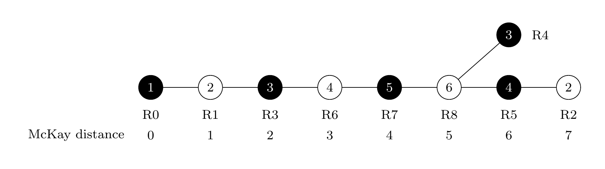
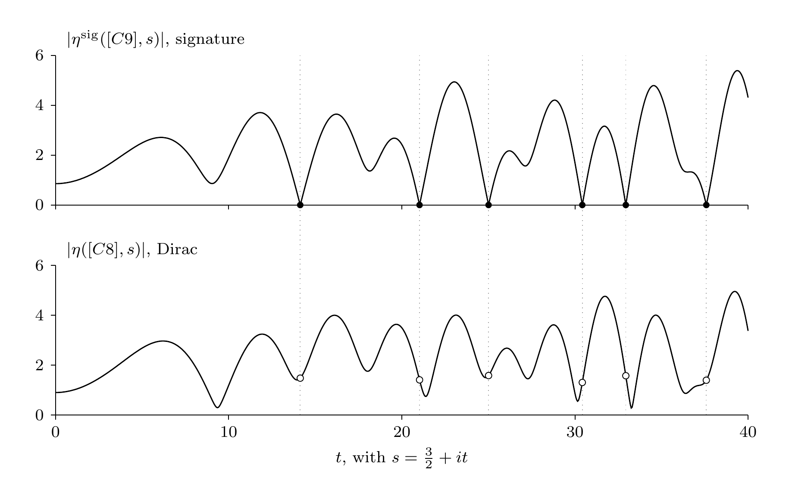

<a id="top"></a>
| **[`<back`](/files/spectrum/)** | **[`main`](https://github.com/dmobius3/mode-identity-theory/tree/main/)** | **[`framework`](/files/framework/)** | **[`bedrock`](/files/framework/files/bedrock/)** | **[`dynamics`](/files/framework/files/dynamics/)** | **[`working`](/files/framework/files/working/)** | **[`cosmos`](/files/cosmos/)** | **[`spectrum`](/files/spectrum/)** | **[`tools`](/files/tools/)** | **[🌊](/files/tools/files/openwave/)** |

---

# 🪩 The Mirror


On the Poincaré homology sphere $`S^3/2I`$, the quotient of the 3-sphere by the binary icosahedral group $`2I`$ of order 120, the torsion and the Dirac spectrum read Dirichlet L-functions exactly (Definition 3). Among the finite linear combinations of the zeta and eta functions of its admissible operators, one function and its multiples isolate an individual Dirichlet L-function (Definition 4): the equivariant eta of the odd signature operator at the elements of order 4, equal to $`2^{2-s}(1-2^{2-s})\zeta(s-1)`$. Every other combination of the Dirac functions and the signature etas carries L-functions at two different shifts, so its zeros are coincidences between L-values (Theorem 1).

## I. Definitions

**Setting.** $`2I\subset\mathrm{SU}(2)`$ is the binary icosahedral group of order 120. It acts on $`S^3=\mathrm{SU}(2)`$ by left multiplication; the quotient $`S^3/2I`$ is the Poincaré homology sphere, with the round metric of radius $`R`$, and right multiplication by $`\mathrm{SU}(2)`$ acts on it by isometries. The irreducible representations of $`2I`$ are R0 (dimension 1), R1 and R2 (2), R3 and R4 (3), R5 and R6 (4), R7 (5) and R8 (6). R0, R3, R4, R5 and R7 factor through the icosahedral group $`A_5`$ (integer spin); R1, R2, R6 and R8 are faithful (half-integer spin). Tensoring with the inclusion representation R1 gives the affine $`E_8`$ McKay graph, and McKay distance means graph distance from R0. The conjugacy classes C1 to C9 are tabulated in § III.D.

<p align="center"></p>

**Figure 1.** The McKay graph of $`2I`$, the affine $`E_8`$ diagram. Each node is an irreducible representation, marked with its dimension and set in the column of its McKay distance from R0. Filled nodes are integer spin (they factor through $`A_5`$) and open nodes half-integer spin. Tensoring with R1 moves along the edges. R1 and R2 are the standard and Galois flat SU(2) connections, and Galois conjugation exchanges R1 with R2 and R3 with R4.

**Characters.** $`\chi_{-1}`$ is the nontrivial character mod 4, with $`\beta(s)=L(s,\chi_{-1})`$; $`\chi_3`$ is the nontrivial character mod 3; $`\chi_2`$ is the Legendre character mod 5; $`\chi_{\pm8}(m)=(\pm2/m)`$ and $`\chi_{12}=\chi_{-1}\chi_3`$; $`\chi_0^{(p)}`$ is the principal character mod $`p`$. A character's conductor is the modulus of the primitive character that induces it.

**Definition 1 (Admissible Operators).** The admissible operators on $`S^3/2I`$ are the following natural, self-adjoint elliptic operators on sections of natural bundles:

- Hodge Laplacians on $`p`$-forms ($`p = 0,1,2,3`$)
- The Dirac operator and odd signature operator
- Twists of the above by the flat bundles $`E_\sigma=\mathrm{SU}(2)\times_{2I}V_\sigma`$ of the representations $`\sigma`$ of $`2I`$; among them, the three flat SU(2) connections are the trivial one, the standard one (R1) and its Galois conjugate (R2)

---

**Definition 2 (Admissible Spectral Constructions).** For an admissible operator $`A`$ with nonzero eigenvalues $`\lambda`$, the zeta function is $`Z_A(s)=\sum_\lambda\lvert\lambda\rvert^{-s}`$ and the eta function is $`\eta_A(s)=\sum_\lambda\mathrm{sign}(\lambda)\lvert\lambda\rvert^{-s}`$. The admissible class $`\mathcal{F}`$ consists of the intrinsic, basis-independent constructions on $`S^3/2I`$ generated, under finite additive and multiplicative combination, by:

- the zeta and eta functions of the admissible operators on the bundles $`E_\sigma`$, and the analytic torsion $`T(E)`$ of each flat de Rham complex;
- their equivariant versions at each conjugacy class of $`2I`$ (§ III.D);
- symmetric polynomials in the eigenvalues of the representation matrices, and character-weighted spectral sums of Definition 1 operators.

$`\mathcal{L}\subset\mathcal{F}`$ is the set of finite linear combinations of these zeta and eta functions and their equivariant versions.

---

**Definition 3 (Reading).** A construction $`F\in\mathcal{F}`$ *reads* arithmetic if it decomposes finitely into Dirichlet or Hecke L-values or L-functions with coefficients determined by the group-theoretic data of $`2I`$.

---

**Definition 4 (Isolation).** A construction $`F\in\mathcal{F}`$ *isolates* the Dirichlet L-function $`L(s,\chi)`$, with $`\chi`$ primitive, if

```math
F(s)=c^{s}\,a(s)\,L(s-p,\chi)
```

for a constant $`c>0`$, an integer $`p`$ and a nonzero Dirichlet polynomial $`a(s)`$, a finite sum $`\sum_{n\le N}a_n n^{-s}`$. Isolation reads the L-function at the argument $`s-p`$; the coexact Laplacian's C9 zeta reads $`\zeta(2s)`$ instead (after Lemma C of § V), and this definition does not count it. Away from the poles of $`L`$, the zeros of an isolating $`F`$ are those of $`L(s-p,\chi)`$ and the explicit zeros of $`a(s)`$. An equation $`\sum_k a_k(s)\,L(s-p_k,\chi_k)=0`$ among two or more distinct pairs $`(p_k,\chi_k)`$, with each $`\chi_k`$ primitive and each $`a_k(s)`$ a nonzero Dirichlet polynomial, is a *coincidence condition*; by Lemma A of § V it never reduces to a single L-function.

---

## II. Main Theorem

> **Theorem 1 (Spectral Isolation on $`S^3/2I`$).** With $`R=1`$, a nonzero $`F\in\mathcal{L}`$ isolates a Dirichlet L-function if and only if it is a nonzero constant multiple of the C9 equivariant eta of the odd signature operator,
>
> ```math
> \eta^{\mathrm{sig}}([C9],s)=2^{2-s}\left(1-2^{2-s}\right)\zeta(s-1).
> ```
>
> Every other nonzero combination of the Dirac zeta and eta functions and the signature eta functions carries L-functions at two different shifts, so its vanishing condition is a coincidence condition. A finite product of elements of $`\mathcal{L}`$ vanishes only where a factor does.
>
> *Proof: § V, from Lemmas A to D.*

**Note on reading without locating.** The isolation in Theorem 1 is elementary. At C9 the signature trace at the eigenvalue $`m`$ is $`-2m\cos(m\pi/2)`$: zero for odd $`m`$, and alternating in sign over even $`m`$, so the eta is a rescaled alternating zeta series in $`s-1`$. It reads $`\zeta`$ exactly and moves its zeros to $`s=\rho+1`$ without saying where they lie. The Dirac eta at C8 reads $`\zeta(s-1)`$ as well, alongside $`L(s,\chi_3)`$ (§ III.D).

<p align="center"></p>

**Figure 2.** Isolation and coincidence on the line $`\mathrm{Re}\,s=3/2`$, where $`\zeta(s-1)`$ has its critical line. Top: the signature eta $`2^{2-s}(1-2^{2-s})\zeta(s-1)`$ of Theorem 1 vanishes at the ordinates of the first six zeros of $`\zeta`$ (dotted lines, filled dots). Bottom: the Dirac eta at C8 carries $`\zeta(s-1)`$ alongside $`L(s,\chi_3)`$ (§ III.D). At $`s=\rho+1`$, for every nontrivial zero $`\rho`$ of $`\zeta`$, it equals $`2^{s-1}(1+2^{-s})L(s,\chi_3)`$, which is nonzero since $`\mathrm{Re}\,s>1`$ (open dots, at the first six). Numerically, its smallest modulus on this segment is about 0.273, near $`t=33.27`$; any zeros it has are coincidences between its two terms.

---

## III. The Reading

The spectral geometry of $`S^3/2I`$ gives the exact L-function readings below. Each result is proved and locked. Together they motivate the question that § IV and § V answer: whether this reading can isolate an individual L-function, and what isolation says about its zeros.

### A. Torsion L-Basis

By Cheeger and Müller, the Reidemeister torsion $`T`$ equals the analytic torsion, normalized as in Ray and Singer: $`\log T=\tfrac12\sum_q(-1)^q q\,\zeta_q'(0)`$. On $`E_\sigma`$ this gives $`\log T^2=(Z_1^{\mathrm{coex}})'(0)-2Z_{0,\sigma}'(0)`$ in the notation of Lemma 1. For the four nontrivial integer-spin irreps of $`2I`$, $`\log T^2`$ is an integer combination of four special values: $`L'(0,\chi_0^{(p)})=-\tfrac12\log p`$ for the primes $`p=2,3,5`$ dividing $`\lvert 2I\rvert=120`$, and $`\sqrt{5}\cdot L(1,\chi_2)=2\log\varphi`$, with $`\varphi=(1+\sqrt5)/2`$. The first follows from $`L(s,\chi_0^{(p)})=(1-p^{-s})\zeta(s)`$ and $`\zeta(0)=-\tfrac12`$, the second from the class number formula for $`\mathbb{Q}(\sqrt5)`$, with class number 1 and fundamental unit $`\varphi`$. Two primitive characters appear: the trivial character, through the Euler factors of $`\zeta`$ at 2, 3 and 5, and $`\chi_2`$. Among the 16 characters mod 60 they are the principal one and the one induced by $`\chi_2`$.

Two independent derivation paths (combinatorial Reidemeister + spectral analytic torsion via Kummer/Gauss). Verified to 79 digits. Dowker and Chang computed these torsions (arXiv:0904.0744, eq. (45)): in their labels $`T(3')=1-1/\sqrt5`$, $`T(3)=1+1/\sqrt5`$, $`T(4)=5/3`$ and $`T(5)=3/2`$, whose squares are the $`T^2`$ of R3, R4, R5 and R7 in the table. The Galois pair satisfies $`T^2(R_3)/T^2(R_4) = \varphi^{-4}`$ (exact), with the golden ratio entering through the Legendre character of $`\mathbb{Q}(\sqrt{5})`$.

| Irrep | $`T^2`$ | $`\log T^2`$ | L-basis |
|-------|---------|------------|---------|
| R3 | $`(4/5)\varphi^{-2}`$ | -1.186 | $`-4L'(0,\chi_0^{(2)}) + 2L'(0,\chi_0^{(5)}) - \sqrt{5}\cdot L(1,\chi_2)`$ |
| R7 | $`9/4`$ | +0.811 | $`4L'(0,\chi_0^{(2)}) - 4L'(0,\chi_0^{(3)})`$ |
| R5 | $`25/9`$ | +1.022 | $`4L'(0,\chi_0^{(3)}) - 4L'(0,\chi_0^{(5)})`$ |
| R4 | $`(4/5)\varphi^{2}`$ | +0.739 | $`-4L'(0,\chi_0^{(2)}) + 2L'(0,\chi_0^{(5)}) + \sqrt{5}\cdot L(1,\chi_2)`$ |

By the two special-value identities, each L-basis entry is the logarithm of its closed form. The table omits the trivial irrep R0: $`T^2(R_0)=1`$ in the canonical integral-cohomology normalization, so $`\log T^2(R_0)=0`$; in Ray and Singer's normalization, with orthonormal harmonic forms, it is $`\mathrm{vol}(S^3/2I)^2`$, which is $`(\pi^2/60)^2`$ at $`R=1`$, the square of Dowker and Chang's $`T=\lvert S^3\rvert/120`$ (arXiv:0904.0744, eq. (44)).

Selectivity: 2 of 16 characters mod 60, through four special values. Domain: $`s=0`$ only.

For the half-integer irreps R1, R2, R6 and R8, the same spectral method gives $`T^2=\varphi^{-4}/4`$, $`\varphi^{4}/4`$, $`1`$ and $`4`$ (computed in [the torsion correction](../../framework/files/working/files/torsion-correction.md)), the squares of Dowker and Chang's $`T(2_s)=(3-\sqrt5)/4`$, $`T(2'_s)=(3+\sqrt5)/4`$, $`T(4_s)=1`$ and $`T(6_s)=2`$ (their eq. (45)). So the same two characters carry both spin parities.

### B. Dirac Factorization

The Dirac operator on $`S^3/2I`$ has eigenvalues $`\pm(n+3/2)/R`$, linear in $`n`$ with no curvature shift. On the numerators $`2n+3`$ prime to 120, whose classes form $`U(120)=(\mathbb{Z}/120\mathbb{Z})^\times`$ (the coprime sector), its spectral zeta decomposes at every $`s`$ into three layers of L-functions, $`L(s,\chi)`$, $`L(s-1,\chi)`$ and $`L(s-2,\chi)`$ for Dirichlet characters $`\chi`$ mod 120; the numerators divisible by 3 or 5 add L-functions with finite factors at those primes, as the factor at 3 in the C8 form of § III.D shows. Of the 32 characters mod 120, 6 to 12 survive depending on the irrep, the same counts as the eta of § III.C. Each level carries one sign of eigenvalue: by spin parity, $`\sigma`$ enters $`m_n^+`$ or $`m_n^-`$ but never both, so the zeta's coefficients are the eta's times $`\pm\chi_{-1}(2n+3)`$, and the two keep the same number of characters for every irrep.

Selectivity: 6 to 12 of 32 characters per irrep, in the coprime sector. Domain: all $`s`$.

### C. Eta Character Selection

The Dirac eta function is

```math
\eta_D(\sigma,s) = \sum_{n}(m_n^+ - m_n^-)(n+3/2)^{-s}
```

with $`m_n^+=(n+2)\,N(\sigma,n)`$ and $`m_n^-=(n+1)\,N(\sigma,n+1)`$, where $`N(\sigma,j)`$ is the multiplicity of $`\sigma`$ in the $`(j+1)`$-dimensional representation of SU(2) (from Bär's spectrum of the untwisted operator, with the twist by $`\sigma`$ counted by Frobenius reciprocity). It keeps 6 to 12 of the 32 Dirichlet characters mod 120 in the coprime sector. A character $`\chi`$ survives when $`L(s-p,\chi)`$ appears for some $`p\in\{0,1,2\}`$:

| Irrep | dim | McKay distance | Characters surviving | Surviving conductors | $`\eta_D(\sigma,0)`$ |
|-------|-----|----------------|----------------------|----------------------|----------------------|
| R0 | 1 | 0 | 12 | 1, 3, 4, 5, 8, 12, 20 | 1079/720 |
| R1 | 2 | 1 | 10 | 1, 3, 4, 5, 12, 20 | 73/72 |
| R3 | 3 | 2 | 10 | 1, 4, 5, 8, 20 | 9/16 |
| R6 | 4 | 3 | 10 | 1, 3, 4, 5, 12, 20 | 29/180 |
| R7 | 5 | 4 | 6 | 1, 3, 4, 8, 12 | -25/144 |
| R8 | 6 | 5 | 8 | 1, 4, 5, 20 | -17/40 |
| R5 | 4 | 6 | 10 | 1, 3, 4, 5, 12, 20 | -61/180 |
| R4 | 3 | 6 | 8 | 1, 4, 5, 8, 20 | -19/80 |
| R2 | 2 | 7 | 8 | 1, 3, 4, 5, 12, 20 | -67/360 |

The principal character and $`\chi_{-1}`$ survive for every irrep, and the twenty characters of conductor 15, 24, 40, 60 or 120 appear for no irrep. The rest of the pattern follows the decomposition $`U(120)\cong U(8)\times U(3)\times U(5)`$ and matches the stabilizers of the icosahedron, lifted to $`2I`$:

| Stabilizer | Absent | Which irreps |
|-----------|--------|--------------|
| Face ($`Z_6`$) | mod-3 | R3, R4, R8 (Galois pair + branch vertex) |
| Vertex ($`Z_{10}`$) | mod-5 | R7 only (a central vertex, dim 5) |
| Edge ($`Z_4`$) | mod-8 | All half-integer irreps + R5 |

The values at $`s=0`$ come from two independent paths: the Bernoulli values of the Hurwitz layers, which are exact, and Donnelly's group sum $`\eta_D(\sigma,0)=\tfrac{1}{120}\sum_{\gamma\neq e}\chi_\sigma(\gamma)/(1-\cos\alpha_\gamma)`$, with $`e^{\pm i\alpha_\gamma}`$ the eigenvalues of $`\gamma`$; the two agree to 30 digits. All denominators divide $`720=6!`$, the dimension-weighted sum vanishes, and the sign turns from positive to negative between McKay distance 3 and 4. The untwisted value $`1079/720`$ is in Dowker (arXiv:hep-th/0404093, Section 11), who finds that it agrees with Gibbons, Pope and Römer (1979). Eta invariants of spherical space forms go back to Atiyah, Patodi and Singer and were studied systematically by Gilkey (1984). Cisneros-Molina (2001) treats those of the twisted Dirac operators of $`S^3/\Gamma`$, and Marcolli, Pierpaoli and Teh (2011) give the untwisted Dirac spectrum of the Poincaré sphere with generating functions for its multiplicities.

### D. Equivariant Eta and the C2 Closed Form

The table gives the nine conjugacy classes of $`2I`$ by the angle $`\alpha`$ of their eigenvalues $`e^{\pm i\alpha}`$ in SU(2), with their tiers (the etas of Tiers 1, 2 and 3 keep 1, 2 and 4 characters):

| Class | $`\alpha/\pi`$ | Order | Size | Tier |
|-------|----------------|-------|------|------|
| C1 | 0 | 1 | 1 | identity |
| C2 | 1 | 2 | 1 | 1 |
| C3, C5 | 1/5, 3/5 | 10 | 12 each | 3 |
| C4, C6 | 2/5, 4/5 | 5 | 12 each | 3 |
| C7 | 1/3 | 6 | 20 | 2 |
| C8 | 2/3 | 3 | 20 | 2 |
| C9 | 1/2 | 4 | 30 | 2 |

Weighting by the characters of $`2I`$ turns the 9 per-irrep etas (6–12 survivors each) into 8 class etas (1–4 survivors each; the identity class gives zero, since the dimension-weighted sum cancels). The central element $`C2=[-e]`$ carries a single character, $`\chi_{-1}`$, at the shifts $`s`$ and $`s-2`$:

```math
\eta([-e],s) = 2^{s-1}\cdot[\beta(s)-\beta(s-2)]
```

At a class with angle $`\alpha`$, the signed Dirac trace at level $`n`$ is:

```math
\eta_g(n) = \frac{(n+2)\sin((n+1)\alpha)-(n+1)\sin((n+2)\alpha)}{\sin\alpha}
```

Over the odd numerators $`m=2n+3`$ of the eigenvalues, $`\eta([g],s)=2^{s}\sum_m c_g(m)\,m^{-s}`$ with

```math
c_g(m)=\frac12\left[\frac{\sin(m\alpha/2)}{\sin(\alpha/2)}-m\,\frac{\cos(m\alpha/2)}{\cos(\alpha/2)}\right],
```

one periodic function of $`m`$ at each of the layers $`s`$ and $`s-1`$; at C2 the limit $`\alpha\to\pi`$ moves the second layer to $`s-2`$. The Tier 2 classes each retain 2 L-functions, one per layer:

| Class | $`\eta([g],s)`$ |
|-------|----------------|
| C7 | $`2^{s-1}[(1+3^{1-s})\beta(s)-L(s-1,\chi_{12})]`$ |
| C8 | $`2^{s-1}[(1+2^{-s})L(s,\chi_3)-(1-2^{1-s})(1-3^{2-s})\zeta(s-1)]`$ |
| C9 | $`2^{s-1}[L(s,\chi_{-8})-L(s-1,\chi_8)]`$ |

$`C8`$ (order 3) involves $`\zeta(s-1)`$ directly. The factors at 2 and 3 are finite: the Dirac eigenvalues $`(2n+3)/2`$ have odd numerators, and the odd multiples of 3 carry their own coefficient. On numerators prime to 6, which include the coprime sector $`U(120)`$, the terms are those of $`L(s,\chi_3)`$ and $`\zeta(s-1)`$. The Tier 3 classes C3 to C6 retain 4 each, two per layer, with coefficients in $`\mathbb{Q}(\sqrt5,i)`$: at $`s`$, $`\chi_{-1}`$ and $`\chi_{-1}\chi_2`$ for C3 and C5, and the two quartic characters mod 5 for C4 and C6; at $`s-1`$, $`\chi_{-1}`$ times the quartic pair for C3 and C5, and the principal character with $`\chi_2`$ for C4 and C6.

### E. Vacuum Structure

The per-irrep etas twisted by each of the three flat connections (trivial, standard, Galois) come from the tensor-product multiplicities of $`2I`$. At $`s=0`$, the difference $`\eta_\text{std}-\eta_\text{gal}`$ is $`2/5`$ times an integer for every irrep and zero at R7. Twisting multiplies each class eta by the twist's character: $`\eta_\rho([g])=\chi_\rho(g)\cdot\eta([g])`$.

---

## IV. Lemmas 1–8

The eight lemmas test whether the readings of § III can constrain L-function zeros. Propositions 1 and 2 support Lemma 4, and Proposition 3 supports Lemma 7.

---

**Lemma 1 (Curvature / Pochhammer Obstruction).**
**Strategy defeated:** Extend the torsion's selectivity (2 of 16 characters mod 60) from $`s=0`$ to a strip containing the critical strip.

**Claim:** The scalar zeta $`Z_{0,\sigma}`$ is not a finite combination of the $`L(s-p,\chi)`$, and its Pochhammer tower contributes to $`Z_{0,\sigma}'(0)`$.

*Proof.* The scalar Laplacian on $`S^3/2I`$ has eigenvalues $`l(l+2)=(l+1)^2-1`$, the squares $`(l+1)^2`$ shifted down by the curvature. Expanding $`(l(l+2))^{-s}=(l+1)^{-2s}\left(1-(l+1)^{-2}\right)^{-s}`$ binomially gives the Pochhammer tower

```math
Z_{0,\sigma}(s)=\sum_{k\geq0}\frac{(s)_k}{k!}\cdot\widetilde{H}_k(s)
```

with $`\widetilde{H}_k(s)=\sum_{l\geq1}m_l(\sigma)\,(l+1)^{-2s-2k}`$, where $`m_l(\sigma)=N(\sigma,l)(l+1)`$ is the multiplicity of $`\sigma`$ at $`l(l+2)`$ (the block $`V_l\boxtimes V_l`$).

The torsion is built from $`Z_{0,\sigma}'(0)`$. At $`s=0`$ the factor $`(s)_k/k!`$ vanishes for $`k\geq1`$, but its derivative $`1/k`$ does not, so the tower stays in $`Z_{0,\sigma}'(0)`$; its share $`\sum_{k\ge1}\widetilde{H}_k(0)/k`$ is nonzero at every irrep (G14). Reading the value and the derivative term by term needs each $`\widetilde{H}_k`$ to be regular at $`s=0`$, and it is: $`N(\sigma,l)=u(l)(l+1)+v(l)`$ with $`u`$ periodic, from C1 and C2, and $`v`$ periodic with mean zero, from the other classes, so the part of $`\widetilde{H}_k`$ from $`u`$ has its only pole at $`s=\tfrac32-k`$ and the part from $`v`$ is entire. Let $`Z_\mp`$ have the multiplicities $`m_l(\sigma)`$ and the eigenvalues $`l^2`$ and $`(l+2)^2`$, whose logarithms average to $`\log l(l+2)`$. Dowker and Chang's cancellation function, $`F(s)=Z_-(s)+Z_+(s)-2Z_{0,\sigma}(s)`$, vanishes at $`s=0`$ with its derivative (arXiv:0904.0744, Section 4 and Appendix 1), so there the scalar zeta has the value and derivative of $`\tfrac12(Z_-+Z_+)`$, whose eigenvalues are perfect squares, and that gives the torsion's closed forms. At other $`s`$, $`F`$ is not identically zero, and off the nonpositive integers $`(s)_k\neq0`$ for every $`k`$, so the tower does not terminate.

Write $`Z_1^{\mathrm{coex}}`$ for the zeta function of the Laplacian on coexact 1-forms, whose eigenvalues $`(l+1)^2`$ are unshifted; the exact 1-forms repeat the nonzero scalar spectrum, so the full 1-form zeta is $`Z_0+Z_1^{\mathrm{coex}}`$. No nonzero linear combination $`a\cdot Z_0+b\cdot Z_1^{\mathrm{coex}}`$ is a finite combination of the $`L(s-p,\chi)`$: both spectra lie in the thin set $`\{k^2-1\}\cup\{k^2\}`$ (the last sentence of Lemma A's proof, and the count in Lemma C, of § V). The Lichnerowicz formula $`D^2=\nabla^*\nabla+R_\text{scalar}/4`$ shifts the spinor Laplacian $`\nabla^*\nabla`$ by the constant $`3/(2R^2)`$, but the Dirac eigenvalues $`\pm(n+3/2)/R`$ themselves are unshifted, and the Dirac zeta factors finitely at all $`s`$ (§ III.B). The obstruction here is specific to the scalar/torsion route: the curvature shift blocks the extension of torsion selectivity from $`s=0`$ to general $`s`$. The Dirac route avoids this obstruction but faces a different one: insufficient character selectivity (in the coprime sector, 6 to 12 of 32 characters survive for every irrep, so each Dirac zeta stays a combination of several L-functions). $`\square`$

---

**Lemma 2 (Coincidence is Not Vanishing).**
**Strategy defeated:** Use the C2 equivariant eta's single-character selectivity at all $`s`$ to isolate $`\beta(s)`$.

**Claim:** The zeros of the C2 eta are the coincidences $`\beta(s)=\beta(s-2)`$, and the eta is nonzero at $`s_0`$ and at $`s_0+2`$ for every nontrivial zero $`s_0`$ of $`\beta`$.

*Proof.* The zeros of $`\eta([-e],s)`$ satisfy $`\beta(s)=\beta(s-2)`$. This is a coincidence condition (Definition 4): it equates two values of $`\beta`$ at shifted arguments, and by Lemma A of § V the two shifts never merge, so the C2 eta does not isolate $`\beta`$. Nor does it vanish at a nontrivial zero of $`\beta`$. Let $`\beta(s_0)=0`$ with $`0<\mathrm{Re}\,s_0<1`$. Then $`\mathrm{Re}(s_0-2)`$ lies in $`(-2,-1)`$, where $`\beta`$ has no zeros: by the functional equation, its zeros with negative real part are the trivial zeros $`-1,-3,-5,\ldots`$. So $`\eta([-e],s_0)=-2^{s_0-1}\beta(s_0-2)\neq0`$, and at $`s_0+2`$ the C2 eta is $`2^{s_0+1}\beta(s_0+2)`$, which the Euler product keeps nonzero. $`\square`$

---

**Lemma 3 (Oscillatory Weighting Degrades Selectivity).**
**Strategy defeated:** Couple the SU(2) character weight $`\chi_j(g)`$ inside the spectral sum (Type 2 equivariant eta) to achieve deeper group-theoretic constraints on the canonical Dirac eta data.

**Claim:** For the canonical equivariant Dirac eta function of $`S^3/2I`$, Type 2 weighting never reduces Dirichlet character support below the Type 1 baseline.

*Proof (C2 case, structural).* Both types reduce to the same linear combination form via the McKay decomposition identity $`\chi_j(g)=\sum_\sigma m(\sigma,j)\chi_\sigma(g)`$. Type 1 applies the characters of $`2I`$ after the spectral sum; Type 2 puts the SU(2) character $`\chi_j(g)`$ of each level $`j`$ inside it, and $`\widetilde{\eta}_{\sigma}(s)`$ is the part of the Type 2 sum that the decomposition assigns to $`\sigma`$.

| | Formula |
|---|---------|
| Type 1 | $`\sum_\sigma\chi_\sigma(g)\cdot\eta_D(\sigma,s)`$ |
| Type 2 | $`\sum_\sigma\chi_\sigma(g)\cdot\widetilde{\eta}_{\sigma}(s)`$ |

For the central element $`C2=[-e]`$, the SU(2) character evaluates to $`\chi_j(-e)=-(2j+1)`$ for all half-integer $`j`$, monotone and strictly negative. Type 1 achieves single-character selectivity at C2 because the $`2I`$ character table alternates in sign between integer-spin irreps ($`\chi_\sigma(C2)=+\dim\sigma`$) and half-integer-spin irreps ($`\chi_\sigma(C2)=-\dim\sigma`$). That alternation drives the cancellations that leave the single character $`\chi_{-1}`$.

Type 2 at C2, with the weight $`\chi_j(-e)(2j+1)=-(2j+1)^2`$ at the Dirac eigenvalue $`j+1`$, has no such alternation. Its sum is $`-2^{s}\left[\lambda(s-2)-2\lambda(s-1)+\lambda(s)\right]`$, with $`\lambda(s)=(1-2^{-s})\zeta(s)`$: one character, the principal one, at three shifts, against $`\chi_{-1}`$ at two shifts for Type 1. Type 2 keeps the Type 1 count at C2 and adds a shift. This weight differs from the weight $`W`$ of the non-central classes below: at C2, the factor $`f_r`$ of $`W`$ would be $`\chi_{-1}(r)`$. $`\square`$

*Proof (non-central classes).* For each of the 7 non-central conjugacy classes $`g\in2I`$, the original computation's Type 2 weight on unit residues mod 120 takes the exact form $`W_{120k+r}(g)=f_r(g)\cdot(32k+B_r)`$, where $`f_r(g)=\sin(r\alpha/2)/\sin(\alpha/2)`$ is periodic with period $`2q`$, and since $`2q`$ divides 120 for each class ($`2q\in\{6,8,10,12,20\}`$), restriction to residues mod 120 captures complete periods. $`B_r`$ is the residue-class intercept determined by the McKay recurrence. The Dirichlet character projection decomposes into two independent sums:

```math
S_1(g,\chi) = \sum_{r\in U(120)} f_r(g)\cdot\bar{\chi}(r)
```
```math
S_0(g,\chi) = \sum_{r\in U(120)} B_r\cdot f_r(g)\cdot\bar{\chi}(r)
```

both finite and exact over the cyclotomic field $`\mathbb{Q}(\zeta_{2q})`$. A character survives when at least one sum is nonzero. Exact computation over the full 32-character Dirichlet basis on $`U(120)\cong U(8)\times U(3)\times U(5)`$ yields:

| Class | $`S_1`$ layer | Type 2 |
|-------|--------|--------|
| C7, C8, C9 (orders 6, 3, 4) | 1 | 12 |
| C3 to C6 (orders 10 and 5) | 2 | 16 |

The $`S_1`$ column counts the $`f_r`$ layer of the Type 2 weight. The Type 2 counts come from the original computation: $`B_r`$ is the intercept in the period index $`k`$, so they are fitted in $`k`$ rather than in the numerator $`120k+r`$, and no gate rebuilds them; G09 rebuilds the $`S_1`$ column. The full Type 1 eta retains two characters for C7 to C9 and four for C3 to C6 (§ III.D). In all 7 cases Type 2 strictly exceeds Type 1. The mechanism is the two-component structure: the slope term $`32\cdot S_1(g,\chi)`$ preserves the $`S_1`$ support, while the nonconstant intercept term $`S_0(g,\chi)`$ activates additional characters not present in Type 1. $`\square`$

---

**Proposition 1 (Operator Classification).** The character content of an operator $`A`$ is the set of Dirichlet characters that appear when the periodic coefficients of its multiplicity quasi-polynomials are expanded over residue classes mod 120. Every admissible operator $`A`$ (Definition 1) on sections of a bundle $`E_\sigma`$ over $`S^3/2I`$ has character content among the Dirichlet characters of conductor dividing 120, fixed by the multiplicities of $`\sigma`$ in the representations that carry its eigenspaces. The listed operators have different eigenvalue functions, and none of them introduces characters outside that set.

*Proof.*
*Step 1: Bundle classification.* The homogeneous bundles over $`S^3/2I`$ are $`E_\sigma=\mathrm{SU}(2)\times_{2I}V_\sigma`$, for the 9 irreps $`\sigma`$ of $`2I`$ and their sums. Definition 1 is exhaustive at the bundle level.

*Step 2: Reduction to blocks.* Lifted to $`S^3`$, any admissible operator commutes with left and right multiplication by $`\mathrm{SU}(2)`$, so its eigenspaces are sums of blocks $`V_a\boxtimes V_b`$, and $`\sigma`$ occurs in a block $`N(\sigma,a)(b+1)`$ times (Bär for spinors, Ikeda and Taniguchi for forms).

*Step 3: Characters from the multiplicities.* $`N(\sigma,a)`$ is a quasi-polynomial of degree one in $`a`$, with period dividing 60, so character orthogonality mod 120 extracts the character content, among the characters of conductor dividing 120. Which characters survive depends on the operator through its blocks: at C9 the Dirac eta keeps $`\chi_{-8}`$ and $`\chi_8`$, and the signature eta only the principal character (Lemma D of § V). $`\square`$

---

**Proposition 2 (Combination Closure).** Every construction $`F\in\mathcal{L}`$ has character content contained within the finite character algebra determined by the $`2I`$ group data. No new arithmetic source enters from finite linear combination or from twisting by a flat connection.

*Proof.* Every zeta and eta function of a Definition 1 operator, and each of their equivariant versions, decomposes into the algebra generated by character-indexed L-expressions: finite linear combinations of terms $`\chi(n)\cdot f(n)`$ where $`\chi`$ ranges over Dirichlet characters mod 120 and $`f(n)`$ encodes the eigenvalue structure. Under finite addition, support on a character set $`S`$ remains on $`S`$. Twisting by a flat connection multiplies each class eta by a character value, $`\eta_\rho([g])=\chi_\rho(g)\cdot\eta([g])`$, so no new character support enters. The finite character algebra over $`U(120)`$ is the ceiling. Products lie outside this count: multiplying Dirichlet series convolves their coefficients, which then need not be periodic, as the square of the C9 signature eta, a multiple of $`\zeta(s-1)^2`$, shows. $`\square`$

---

**Lemma 4 (Operator Completeness Inside Admissible Class).**
**Strategy tested:** Find a different natural operator on $`S^3/2I`$ that avoids the obstructions of Lemmas 1–3.

**Claim:** Within $`\mathcal{L}`$, only the signature operator gives an isolating construction, its C9 eta (Theorem 1).

*Proof.* By Propositions 1 and 2, every $`F\in\mathcal{L}`$ has character content among the characters of conductor dividing 120. The candidates within $`\mathcal{F}`$:

- **Hodge duality:** the $`p`$-form Laplacians for $`p=2,3`$ are isospectral with $`p=1,0`$, and the exact 1-forms repeat the scalar spectrum, so the independent zetas are $`Z_0`$ and $`Z_1^{\mathrm{coex}}`$ of Lemma 1. No combination of them isolates an L-function (Lemma C of § V).
- **Signature operator:** its eta comes from curl on coexact 1-forms, whose blocks differ from the Dirac operator's. At C9 it isolates $`\zeta(s-1)`$ (Lemma D of § V): the strategy's one success.
- **Flat twists:** the three flat connections give three distinct per-irrep eta vectors, but twisting multiplies each class eta by a character value (§ III.E). Both nontrivial twists vanish at C9, where $`\chi_{R1}`$ and $`\chi_{R2}`$ are zero, so the isolation needs the trivial connection; at C7 both characters equal 1, and the eta is unchanged.
- **Combined invariants:** a product $`T^2(\sigma)\cdot\eta(\sigma,0)`$ carries only the arithmetic of its two factors, so combining the two invariants gives no new L-basis.

Within $`\mathcal{L}`$, the C9 signature eta is the only isolating construction (Theorem 1). $`\square`$

---

**Lemma 5 (Finite-Product Collapse).**
**Strategy defeated:** Use multiplicative (Selberg/Ruelle) encoding of spectral data, exploiting positivity properties that additive encoding lacks.

**Claim:** The geodesic flow of $`S^3/2I`$ is periodic and its closed geodesics come in continuous families, so the Selberg and Ruelle products do not apply.

*Proof.* The round metric on $`S^3/2I`$ is Besse: every geodesic closes by length $`\pi R`$, since $`-e\in2I`$, and those along the axes of the elements of orders 10, 6 and 4 close sooner, at $`\pi R/5`$, $`\pi R/3`$ and $`\pi R/2`$. The closed geodesics come in continuous families, so the Selberg and Ruelle Euler products, taken over the isolated closed orbits of an Anosov flow, do not apply, and choosing one factor per family does not define a canonical product. This route supplies no Selberg-type constraint on zeros. $`\square`$

---

**Lemma 6 (Framework Disconnect).**
**Strategy defeated:** Connect spectral L-functions to an icosahedral Artin L-function via Langlands/modularity, using its conjectured automorphy to constrain the spectral side.

**Claim:** An icosahedral Artin L-function $`L(s,R_1)`$ is a quotient of Hecke L-functions, not a spectral Dirichlet L-function of $`S^3/2I`$.

*Proof.* The spectral L-functions are Dirichlet L-functions over $`\mathbb{Q}`$, arising from Fourier analysis of McKay multiplicities (modulus 120). An icosahedral Artin L-function $`L(s,R_1)`$, for a Galois extension of $`\mathbb{Q}`$ with group $`2I`$, is a 2-dimensional L-function, decomposing via Brauer induction into Hecke L-functions over intermediate number fields.

Brauer decomposition: $`R_1=\mathrm{Ind}_{Z_6}^{2I}\lambda_6+\mathrm{Ind}_{Z_{10}}^{2I}\lambda_{10}-\mathrm{Ind}_{Z_4}^{2I}\lambda_4`$, where $`Z_n\subset2I`$ is cyclic of order $`n`$ and $`\lambda_n`$ is the character by which $`Z_n`$ acts on an eigenline of $`R_1`$; with $`\lambda_{10}^3`$ in place of $`\lambda_{10}`$ the right side is $`R_2`$. The decomposition is virtual, so $`L(s,R_1)`$ is a quotient of Hecke L-functions. It is not a Dirichlet L-function: at a prime that splits completely in the extension (there are infinitely many, by Chebotarev), its coefficient of $`p^{-s}`$ is $`\mathrm{tr}\,R_1(e)=2`$, while a Dirichlet L-function's is $`\chi(p)`$, of modulus at most 1. The moduli of the spectral Dirichlet characters divide $`\lvert 2I\rvert=120`$, whose prime divisors are 2, 3 and 5. The primes ramified in an icosahedral Galois extension depend on the extension, and a common prime alone gives no correspondence between the L-functions.

The spectral and arithmetic L-functions attached to $`2I`$ are different mathematical objects. The Artin L-function's automorphy, open for every representation with image $`2I`$, all of which are even (Calegari, Section 12), would not constrain the spectral Dirichlet L-functions. $`\square`$

---

**Proposition 3 (Kernel Reduction).** Let $`\sigma`$ be any irrep of $`2I`$ and $`A`$ any admissible operator on sections of $`E_\sigma`$ over $`S^3/2I`$. Here $`K_t^A`$ is the kernel of $`e^{-tA}`$ for a nonnegative Laplacian, and for a first-order operator the kernel of $`e^{-tA^2}`$ for the zeta function and of $`Ae^{-tA^2}`$ for the eta function. Then: (1) $`K_t^A([x],[x])=\sum_{\gamma\in2I}U_\gamma\,\widetilde{K}_t^A(x,\gamma x)`$, where $`\widetilde{K}_t^A`$ is the heat kernel of the lifted operator on $`S^3`$ and $`U_\gamma`$ identifies the fibers by the deck transformation $`\gamma`$, including the twist $`\sigma(\gamma)`$; (2) the integrated heat trace, from which the zeta and eta functions of $`A`$ come, reduces to $`\sum_{[g]\subset2I}\chi_\sigma(g)\cdot G_t([g])`$, with $`G_t([g])=\sum_{\gamma\in[g]}G_t(\gamma)`$ as in the proof; (3) the dependence of these traces on the group is exhausted by the class functions of $`2I`$.

*Proof.* The heat kernel of the quotient is the sum of the lifted kernel over the deck transformations, which is (1). The zeta and eta functions are defined via the integrated diagonal trace:

```math
\int_M\mathrm{Tr}[K_t^A(x,x)]\,dx = \sum_{\gamma\in2I}\chi_\sigma(\gamma)\cdot G_t(\gamma)
```

Here $`G_t(\gamma)=\tfrac1{120}\int_{S^3}\mathrm{tr}\,\widetilde{K}_t^A(x,\gamma x)\,dx`$, an average over the whole of $`S^3`$. The matrix $`\sigma(\gamma)`$ collapses to the scalar $`\chi_\sigma(\gamma)`$ under the trace, and conjugation by any $`h\in\mathrm{SU}(2)`$ is an isometry of $`S^3`$ that commutes with the lifted operator, so $`G_t(\gamma)`$ depends only on the class of $`\gamma`$. Any basis-independent function of the matrix $`\sigma(\gamma)`$ is a symmetric function of its eigenvalues, expressible as characters at powers of $`\gamma`$, which land in known conjugacy classes. The character table is exhaustive. $`\square`$

---

**Lemma 7 (Character Ceiling).**
**Strategy defeated:** Go beyond character traces to matrix coefficients, exploiting intertwining structure that the trace discards.

**Claim:** The class-indexed traces of Proposition 3 are class functions on $`2I`$, so its irreducible characters span them.

*Proof.* Three candidates:

- **$`2I`$ representation matrices $`\sigma(g)`$:** Factor out of spectral sums as constants. $`M_{\sigma,[g]}(s)=\sigma(g)\cdot\eta_D(\sigma,s)`$. No new information beyond characters.
- **SU(2) representation matrices $`D^j(g)`$:** Diagonal for conjugacy class representatives: $`D^j(g)=\mathrm{diag}(e^{2im\alpha})`$. Off-diagonal entries are basis-dependent. $`\det D^j(g)=1`$ identically. Any basis-independent function is expressible as characters at powers of $`g`$ (Proposition 3).
- **Operator kernel:** By Proposition 3, the kernel's integrated traces reduce to character data. Redundant given the character ceiling. $`\square`$

---

**Lemma 8 ($`\Theta\leftrightarrow s`$ Bridge).**
**Strategy defeated:** Construct a natural map between the phase position $`\Theta`$ of the scaling law of Mode Identity Theory (MIT) and the spectral parameter $`s`$, exploiting their shared $`Z_2`$ symmetry. In the scaling law, $`C(\Theta)=2\sin^2(\pi\Theta)`$ is the intensity of the first positive mode on the unit interval, normalized to unit mean ([One Law](../../framework/README.md#one-law)).

**Claim:** The spectral zeta cannot recover a distinguished phase position $`\Theta`$: on $`S^1`$ it is unchanged by the rotations that change $`C(\Theta)`$, and on $`S^3/2I`$ the trace of the twisted heat kernel on the diagonal is the same at every point.

*Proof.* On $`S^1`$ with anti-periodic boundary conditions every eigenspace is two-dimensional, spanned by $`\sin`$ and $`\cos`$, and rotating $`S^1`$ mixes the two. $`C(\Theta)`$ depends on choosing $`\sin`$ over $`\cos`$, so a rotation changes it, while the spectral zeta, which sees only eigenvalues and multiplicities, does not change. Thus the spectral zeta alone cannot recover a distinguished $`\Theta`$, and each of the four routes on $`S^1`$ (heat kernel, theta function, Poisson summation, direct decomposition) meets this. The two $`Z_2`$ symmetries, $`C(\Theta)=C(1-\Theta)`$ from spatial reflection and $`\xi(s)=\xi(1-s)`$ from Poisson/modular duality, arise from different mechanisms, and their shared symmetry alone supplies no phase-to-spectrum map.

On $`S^3/2I`$: the McKay correspondence resolves the basis ambiguity (multiplicities are canonical), but continuous geometric position drops out: right multiplication by $`\mathrm{SU}(2)`$ acts transitively, by isometries that commute with every natural operator, so the trace of the twisted heat kernel on the diagonal is the same at every point. $`\square`$

---

## V. The Wall

The eight lemmas of § IV sort the natural strategies into four obstruction layers. The signature operator and the coexact Laplacian at C9 meet none of them: the first isolates $`\zeta(s-1)`$ and the second reads $`\zeta(2s)`$ (after Lemma C). Lemmas A to D below prove Theorem 1.

| Layer | Obstruction | Lemmas |
|-------|------------|--------|
| Coincidence condition | A Dirac combination carries L-functions at two shifts, so its zeros are coincidences (Def. 4, Lemma B); torsion selectivity stays at $`s=0`$. | 1, 2, 3 |
| Encoding degeneracy | The geodesic flow is Besse: closed geodesics come in families, and the Selberg and Ruelle products, built on the isolated orbits of Anosov flows, do not apply. | 5 |
| Framework mismatch | Spectral Dirichlet L-functions over $`\mathbb{Q}`$ $`\neq`$ Hecke L-functions over number fields. Automorphy, open for image $`2I`$, would not transfer. | 6 |
| Character completeness | The class-indexed spectral traces are class functions, which the characters span (Propositions 1 to 3), and continuous position drops out (Lemma 8). | 4, 7, 8 |

**Conventions.** We take $`R=1`$. $`2I`$ acts on the left, so a block $`V_a\boxtimes V_b`$ of an eigenspace contributes $`N(\sigma,a)(b+1)`$ to the multiplicity of $`\sigma`$ and $`(b+1)\chi_a(g)`$ to the trace of a class $`g`$, where $`\chi_a(g)=\sin((a+1)\alpha)/\sin\alpha`$ for eigenvalues $`e^{\pm i\alpha}`$ of $`g`$ is the character of the $`(a+1)`$-dimensional representation $`V_a`$ of SU(2), not one of the Dirichlet characters of § I (Lemmas 3 and 7 label $`V_a`$ by its spin $`j=a/2`$, and Lemma 3's $`m(\sigma,j)`$ is $`N(\sigma,2j)`$). The Dirac eigenvalue $`+(n+3/2)`$ sits on $`V_n\boxtimes V_{n+1}`$ and $`-(n+3/2)`$ on $`V_{n+1}\boxtimes V_n`$, which gives the multiplicities $`m_n^\pm`$ of § III.C.

**Lemma A (Independence).** Let $`a_k(s)=\sum_\lambda a_{k,\lambda}\lambda^{-s}`$ be finite sums over real $`\lambda>0`$. If $`\sum_k a_k(s)L(s-p_k,\chi_k)=0`$ for distinct pairs $`(p_k,\chi_k)`$ with each $`\chi_k`$ primitive, then every $`a_k=0`$.

*Proof.* A general Dirichlet series vanishes only if its coefficients do, and the frequencies $`\lambda n`$ stay in the coset $`\lambda\mathbb{Q}_{>0}`$, so each coset gives its own identity; in each, taking out a factor $`(\lambda_0/D)^{-s}`$, with $`\lambda_0`$ in the coset and $`D`$ a common denominator, makes the $`a_k`$ Dirichlet polynomials, supported on $`n\le N`$ say. For a prime $`q>N`$, the coefficient of $`(dq)^{-s}`$ is $`\sum_k\chi_k(q)\,q^{p_k}B_k(d)`$, with $`B_k(d)=\sum_{e\mid d}a_{k,e}\,\chi_k(d/e)(d/e)^{p_k}`$. The largest power of $`q`$ separates the shifts, and Dirichlet's theorem with character orthogonality separates the characters at one shift, so every $`B_k(d)=0`$. Its term $`e=d`$ is $`a_{k,d}`$, and induction on $`d`$ gives $`a_k=0`$. The same count shows that a nonzero finite combination of L-functions has nonzero coefficients at $`dq`$ for some $`d`$ and infinitely many primes $`q`$. $`\square`$

**Lemma B (Dirac: two shifts).** Every nonzero finite linear combination of the Dirac zeta and eta functions, over the bundles $`E_\sigma`$, the classes and the flat twists, has L-function terms at shift 0 and at shift 1 or 2.

*Proof.* By character orthogonality the combinations are those of the class functions. Over the odd numerators $`m=2n+3`$, with $`\theta=\alpha/2`$, the class traces give

```math
\eta_g(m)=\tfrac12\left[\frac{\sin m\theta}{\sin\theta}-m\,\frac{\cos m\theta}{\cos\theta}\right],\qquad
\zeta_g(m)=\tfrac12\left[m\,\frac{\sin m\theta}{\sin\theta}-\frac{\cos m\theta}{\cos\theta}\right]
```

at the seven non-central classes; this $`\eta_g(m)`$ is the $`c_g(m)`$ of § III.D. The C2 eta is $`\tfrac12(1-m^2)\chi_{-1}(m)`$, the identity zeta is $`\tfrac12(m^2-1)`$, and the identity eta and the C2 zeta vanish. Each function is $`A(m)+mB(m)+m^2C(m)`$ with $`A`$, $`B`$, $`C`$ periodic, the terms at shifts 0, 1 and 2. On odd $`m`$ the sequences $`e^{\pm im\theta}`$ are independent when the frequencies differ mod $`\pi`$, and the fourteen values $`\pm\theta`$ of the non-central classes, $`\pi/2`$ for C2 and $`0`$ for the identity, are sixteen distinct classes mod $`\pi`$. So the sixteen shift-0 parts are independent, and a combination with no shift-1 part lies in the span of the C2 eta and the identity zeta, whose shift-2 parts $`-\tfrac12\chi_{-1}`$ and $`\tfrac12`$ are independent. Lemma A keeps the shifts apart. $`\square`$

**Lemma C (Laplacians).** No nonzero finite linear combination of the Hodge Laplacians' zeta functions isolates an L-function.

*Proof.* The eigenvalues are $`l(l+2)`$ and $`(l+1)^2`$, so the zeta functions are supported on $`\{k^2-1\}\cup\{k^2\}`$. An isolating $`c^s a(s)L(s-p,\chi)`$, with $`d`$ the least element of the support of $`a`$, has the coefficient $`a_d\chi(q)q^p\neq0`$ at the frequency $`dq/c`$ for every prime $`q`$ above that support and prime to the conductor, and a fixed multiple of $`(k-1)(k+1)`$ or of $`k^2`$ equals $`dq`$ for only finitely many primes $`q`$. $`\square`$

The coexact zeta alone reads $`\zeta`$ at the argument $`2s`$. At C9 its trace at the eigenvalue $`m^2`$ is $`2(-1)^{k+1}`$ for $`m=2k`$ and zero for odd $`m`$, so $`Z_1^{\mathrm{coex}}([C9],s)=2\cdot4^{-s}\left(1-2^{1-2s}\right)\zeta(2s)`$ (G15), whose zeros include those of $`\zeta`$, at $`\rho/2`$. Definition 4 reads the L-function at $`s-p`$, so this is not an isolation in its sense.

**Lemma D (The odd signature operator).** The C9 equivariant eta of the odd signature operator is $`2^{2-s}(1-2^{2-s})\zeta(s-1)`$. Among the finite linear combinations of the signature zeta and eta functions, only its multiples isolate an L-function, and a combination whose integer-frequency terms all vanish is zero.

*Proof.* The exact forms pair off at $`\pm\sqrt{l(l+2)}`$ and cancel in the eta, which is that of curl on coexact 1-forms. Curl has eigenvalue $`+(l+1)`$ on $`V_{l-1}\boxtimes V_{l+1}`$ and $`-(l+1)`$ on $`V_{l+1}\boxtimes V_{l-1}`$, $`l\ge1`$; the blocks are Ikeda and Taniguchi's, and curl acts on each by a scalar, so with $`m=l+1`$ the class trace is

```math
\eta^{\mathrm{sig}}_g(m)=(m+1)\chi_{m-2}(g)-(m-1)\chi_m(g)=2\sin m\alpha\,\cot\alpha-2m\cos m\alpha .
```

Katase computed this eta function for every rotation of $`S^3`$ directly from its eigenforms (Proc. Japan Acad. 57A (1981), 233–237); at an isoclinic rotation by $`\alpha`$ his Proposition is the trace above. At $`s=0`$ this gives Atiyah, Patodi and Singer's defect $`\cot^2(\alpha/2)`$ for an isoclinic rotation at every class other than the identity, where the eta vanishes. The average over $`2I`$, $`\tfrac1{120}\sum_{g\neq e}\cot^2(\alpha_g/2)`$, is $`361/180`$, Kirby and Melvin's signature defect $`722/3`$ of the Poincaré sphere divided by 120 (arXiv:math/9903056, Example B.3). With the Dirac value $`1079/720`$ of § III.C it satisfies Ruberman and Saveliev's relation $`\tfrac12\eta_{\mathrm{Dir}}+\tfrac18\eta_{\mathrm{Sign}}=-\bar\mu`$, whose left side is 1. The relation holds in either orientation; the value picks the orientation of the link of $`z_1^2+z_2^3+z_3^5=0`$, which bounds the negative definite $`E_8`$ plumbing, so that $`\bar\mu=-1`$. For a plumbing $`X`$ with integral Wu class $`w`$, Neumann's invariant is $`\bar\mu=\tfrac18(\mathrm{sign}\,X-w\cdot w)`$, as Ruberman and Saveliev write it; the $`E_8`$ form is even, so $`w=0`$, and its signature is $`-8`$. At C9, $`\alpha=\pi/2`$: the sine term drops, odd $`m`$ give zero, and $`m=2k`$ gives $`-4k(-1)^k`$, which sums to the closed form. It isolates $`\zeta(s-1)`$ with $`c=1/2`$, $`p=1`$ and $`a(s)=4-16\cdot2^{-s}`$; at $`s=2`$ the zero of $`a`$ meets the pole of $`\zeta(s-1)`$, and the eta is $`\log2`$ there. The shift-1 parts $`-2\cos m\alpha`$ of the seven non-central etas are independent, so a combination of etas with no shift-1 part is zero; the shift-0 parts $`2\sin m\alpha\cot\alpha`$ are independent over the six classes other than C9, so a combination with no shift-0 part is a multiple of the C9 eta. A signature zeta adds the exact pairs, at the irrational frequencies $`\sqrt{l(l+2)}`$; they cancel in a combination only if $`\sum_g c_g\chi_l(g)=0`$ for every $`l\ge1`$, and the $`\chi_l`$ with $`l\ge1`$ span the class functions (for instance $`2\chi_{120}-\chi_{240}=1`$ on $`2I`$), so every zeta coefficient $`c_g`$ is zero. If instead the integer-frequency terms of a combination vanish, the identity and C2 zetas, whose terms are $`2(m^2-1)`$ and $`2(-1)^m(m^2-1)`$, drop out, and for the other classes the two layers give $`\sum_g(c_g+e_g)\chi_{m-2}(g)=0`$ and $`\sum_g(c_g-e_g)\chi_m(g)=0`$ for every $`m`$, so every coefficient is zero. $`\square`$

**Proof of Theorem 1.** The C9 eta isolates $`\zeta(s-1)`$ (Lemma D). Conversely, let a nonzero $`F\in\mathcal{L}`$ equal $`c^s a(s)L(s-p,\chi)`$, and split it into its Dirac, signature and Laplacian parts. Their frequencies are half-integers; integers together with the irrational $`\sqrt{l(l+2)}`$; and integers on the thin set of Lemma C. By Lemma A the frequencies separate by coset of $`\mathbb{Q}_{>0}`$. If $`c`$ is irrational, the right side has no rational frequencies. The Dirac part, which lives on the half-integers, then vanishes, and by Lemma B so does its combination. On the integers the signature part is a finite combination of shifted L-functions; if it cancels the Laplacian part, it is supported on the thin set of Lemma C, and the last sentence of Lemma A's proof makes both vanish. Lemma D then makes every signature coefficient zero, so $`F=0`$. So $`c=u/v`$ is rational, in lowest terms; the irrational exact pairs cancel, and Lemma D removes the signature zetas. Whether a frequency $`dn/c`$ of the right side is half-integral is decided by finitely many conditions on its valuations at the primes dividing $`2u`$. Each exact-valuation filter is a difference of divisibility filters, and filtering $`c^s a(s)L(s-p,\chi)`$ by divisibility by a prime power gives $`c^s b(s)L(s-p,\chi)`$ for a Dirichlet polynomial $`b`$, or zero, because $`\chi`$ is completely multiplicative. So the half-integral part of $`F`$, which is its Dirac part, isolates or vanishes, and by Lemma B it vanishes. On the integers, $`F`$ minus its signature etas is a finite combination of L-functions supported on the thin Laplacian set, hence zero, so the Laplacian part vanishes and $`F`$ is a combination of signature etas that isolates: a constant multiple of $`\eta^{\mathrm{sig}}([C9],s)`$ (Lemma D). For a combination of Dirac functions and signature etas that is not such a multiple, Lemmas B and D give terms at two shifts, which is a coincidence condition. A finite product vanishes only where a factor does. $`\square`$

---

## VI. The Mechanism: Curvature Duality

<p align="center"></p>

**Figure 3.** Curvature duality. The one positive number $`2/R^2`$ in $`\mathrm{Ric}=(2/R^2)\,g`$ puts a Weitzenböck floor under the coexact gauge spectrum and shifts the scalar spectrum down by $`1/R^2`$, which builds the Pochhammer tower away from $`s=0`$ (Lemma 1).

*The proof of Theorem 1 is complete at § V. Sections VI to IX give a mechanism behind the scalar route, an interpretation, the scope and a physics application; they do not extend the theorem beyond its class $`\mathcal{L}`$.*

The round $`S^3`$ is Einstein, $`\mathrm{Ric}=(2/R^2)\,g`$, and this one positive number does two things:

**Physics (the coexact gap):** Positive Ricci puts a Weitzenböck floor $`\lambda\geq2/R^2>0`$ under every physical coexact gauge fluctuation around the three flat vacua, since $`\Delta=\nabla^*\nabla+\mathrm{Ric}`$ on 1-forms, lifting the linearized spectrum off zero. The exact gap is sharper than the floor: the coexact spectrum read through the McKay structure gives $`4/R^2`$ at the trivial and standard vacua and $`36/R^2`$ at the Galois vacuum, a ninefold enhancement (the [coexact gap](../../framework/files/bedrock/files/coexact-gap.md) paper).

**Arithmetic (Pochhammer obstruction):** The scalar Laplacian eigenvalues shift from $`(l+1)^2`$ to $`l(l+2)=(l+1)^2-1`$. The "-1" generates the infinite Pochhammer tower that blocks general-<i>s</i> factorization; at $`s=0`$, Dowker and Chang's cancellation $`F(0)=F'(0)=0`$ gives the torsion's closed forms, even though the tower contributes to $`Z_{0,\sigma}'(0)`$ (Lemma 1). The shift belongs to the scalar route: on the same metric, curl and the coexact Laplacian have the unshifted eigenvalues $`\pm(l+1)`$ and $`(l+1)^2`$, the signature operator's C9 eta isolates $`\zeta(s-1)`$ (Theorem 1), and the coexact Laplacian's C9 zeta reads $`\zeta(2s)`$ (after Lemma C).

| Step | Physics | Arithmetic |
|------|---------|-----------|
| Positive Ricci | Weitzenböck floor $`\lambda\geq2/R^2`$ | Eigenvalue shift: $`l(l+2)\neq(l+1)^2`$ |
| Consequence | Coexact gap $`4/R^2`$ (McKay), $`36/R^2`$ Galois | Pochhammer tower at $`s\neq0`$ |
| Result | Linearized gauge fluctuations are gapped | Torsion selectivity confined to $`s=0`$ |

Formally dropping the $`-1`$ in the scalar spectrum makes its eigenvalues perfect squares, removes the Pochhammer tower, and lets the scalar zeta factor at all $`s`$; the coexact spectrum already has that form. This formal change of the scalar eigenvalues leaves the metric, and so the gauge Weitzenböck floor, unchanged.

MIT reads this as a structural opposition: the same positive curvature puts the floor under the gauge spectrum and generates the Pochhammer shift that blocks the factorization.

---

## VII. Discussion

Hurwitz's theorem establishes that $`\varphi=(1+\sqrt{5})/2`$ is the hardest irrational to approximate by rationals: every irrational $`\xi`$ has infinitely many $`p/q`$ with $`\lvert\xi-p/q\rvert<1/(\sqrt5\,q^2)`$, and for $`\varphi`$ no constant larger than $`\sqrt5`$ works. Its continued fraction $`[1;1,1,1,\ldots]`$ converges as slowly as possible. In the MIT framework that property does not place the matter wells ([Fibonacci Wells](../../framework/files/working/files/fibonacci-wells.md)). They continue the icosahedral branch recurrence on the grid of phase positions $`\Theta=k/120`$, a structural label the recurrence carries rather than a derived extremum, and why the realized positions continue it is open.

The Riemann zeros encode the distribution of primes. The primes build the integers. The integers build the grid ($`120=2^3\times3\times5`$). The grid builds the domain. The domain builds the wells. $`S^3/2I`$ gives you $`\varphi`$ through the character field $`\mathbb{Q}(\sqrt{5})`$ and gives you the L-function structure through the McKay correspondence with $`E_8`$. The manifold does not choose between them. Its geometry requires both.

MIT reads both $`\varphi`$ and the zeros as stability results: $`\varphi`$ attains Hurwitz's bound; the zeros are read by this manifold's spectra, once in isolation, and not located by them, which is consistent with their role as the foundation of arithmetic structure. Whether that is itself a stability requirement, a theorem rather than an observation, is an open question not addressed by the proof above.

Lemma 8 has a direct consequence for the MIT mass formula. The spectral zeta cannot recover a distinguished phase position $`\Theta`$, so this route cannot fix the phase-dependent part of the mass formula or supply an additional factor: the formula separates shells by the McKay distance and sets the fine structure within each shell by the torsion $`T^2(\rho \otimes \sigma)`$, each defined without reference to the spectral parameter.

### The Mirror

$`S^3/2I`$ is a perfect arithmetic mirror. It reflects:

- The primes $`\{2,3,5\}`$ dividing $`\lvert 2I\rvert=120`$
- The golden ratio $`\varphi`$ from the character field $`\mathbb{Q}(\sqrt{5})`$
- The L-function special values through torsion (79-digit precision)
- The Dirichlet characters through spectral decomposition
- A single character through the C2 eta ($`\beta`$ at $`s`$ and $`s-2`$)
- The Riemann zeta function itself, in isolation, through the signature eta at C9 (Theorem 1)
- The Riemann zeta function again, at the argument $`2s`$, through the coexact Laplacian at C9 (after Lemma C)

---

## VIII. Scope

**Theorem 1** is local to $`S^3/2I`$ at $`R=1`$ and to $`\mathcal{L}`$, the finite linear combinations of the admissible zeta and eta functions, with isolation read at the argument $`s-p`$ (Definition 4). Sums of products, quotients, and combinations with the Type 2 sums of Lemma 3 lie outside it.

**Remark.** The curvature shift of § VI governs the scalar Laplacian on every round spherical space form and is not specific to $`2I`$.

---

## IX. Physics Application

Theorem 1 is a negative result for this route to the Riemann hypothesis: one construction isolates $`\zeta`$, and the identity locates none of its zeros. For physics it is a resource and a constraint rather than a verdict: the same L-function structure feeds the physical comparisons and structural readings of the MIT framework, at the statuses their own pages give them, and Lemma 8 closes one route to completing the mass formula (§ VII).

| Spectral object | Role in § III | MIT physics role |
|----------------|--------------|-----------------|
| Reidemeister torsion | L-factorization at $`s=0`$ | Fermion mass comparison ($`m_e`$ anchors the scale; 5 of 8 charged compatible within $`\times3`$, 4 after sector adjudication; the $`\times3`$ count is uninformative under the registered null, $`p_A = 0.690`$) |
| $`\varphi^{-4}`$ Galois pair | $`\log\varphi^{-4}=-2\sqrt{5}\cdot L(1,\chi_2)`$, exact to 79 digits | Exact torsion ratio; contributes to mass-shell fine structure through $`T^2`$ |
| $`h(E_8)=30`$ | Coxeter number; the multiplicities are degree-one quasi-polynomials of period dividing $`2h=60`$ (Proposition 1) | Mass hierarchy exponent ($`\mathrm{dist}/30`$) |
| Three flat connections | Three isolated vacua, $`H^1=0`$ | MIT reads as three generations; vacuum-to-generation assignment open |
| Curvature shift $`l(l+2)`$ | Pochhammer obstruction, Lemma 1 | Coexact-gap floor $`2/R^2`$; coexact gap $`4/R^2`$ (McKay), $`36/R^2`$ Galois |
| 120/60 grid | Dirac numerators mod 120 (§ III.B), torsion characters mod 60 (§ III.A) | Fermionic vs. bosonic phase domain |
| Galois-twisted eta | At $`s=0`$, $`\eta_\text{std}-\eta_\text{gal}`$ is $`2/5`$ times an integer (§ III.E) | Vacuum-dependent eta structure |
| C8 involves $`\zeta(s-1)`$ | Reads $`\zeta`$ as component, not constraint | Order-3 face stabilizer encoding |

---

## Computational Record

| Computation | Result | Precision |
|------------|--------|-----------|
| Torsion L-basis | 5 int-spin irreps → 4 special values | 79 digits, two paths; closed forms (G10) |
| Torsion characters | 2 of 16 mod 60, through four special values | Exact; closed forms (G10) |
| Curvature obstruction | Pochhammer tower at $`s\neq0`$; at $`s=0`$, Dowker and Chang's cancellation | Structural proof; cancellation at all nine classes (G14) |
| Dirac factorization | 3-layer L-decomp. all $`s`$; 6–12 of 32 survive (coprime sector) | Structural; counts exact (G08) |
| $`S^1`$ bridge | The spectral zeta cannot recover a phase position (Lemma 8) | Invariance argument |
| Eta multiplicities | $`9\times120`$ signed table | Integer-exact (G03) |
| Eta char. decomp. | 6–12 of 32 survive (coprime sector) | Exact (G07) |
| $`\eta(\sigma,0)`$ exact | 9 rationals, denom divides 720 | Two-path, exact (G06) |
| Equiv. eta (Type 1) | C2: 1 survivor; Tier 2: 2; Tier 3: 4 | Exact (G09) |
| C2 closed form | $`\eta([-e],s)=2^{s-1}[\beta(s)-\beta(s-2)]`$ | Algebraic + numerical (G05) |
| Tier 2 closed forms | The Dirac trig. formula; C8 involves $`\zeta(s-1)`$ | Exact (G04, G05) |
| Torsion $`\times`$ eta | Products of the closed forms of § III.A and § III.C: inherited arithmetic | Exact |
| Twisted eta | (2/5)×integer at $`s=0`$; C7, C9 twist factors | Exact (G11) |
| Higher-form Laplacians | Hodge duality: the scalar and coexact zetas; no combination isolates (Lemma C) | Structural proof |
| Coexact zeta at C9 | $`2\cdot4^{-s}(1-2^{1-2s})\zeta(2s)`$: $`\zeta`$ at the argument $`2s`$ | Exact (G15) |
| Signature operator | Curl traces; the C9 eta isolates $`\zeta(s-1)`$ | $`s=0`$ values match the APS defect; Ruberman–Saveliev (G13) |
| Isolation in $`\mathcal{L}`$ | Only the C9 signature eta isolates (Theorem 1) | Lemmas A to D; ranks 16, 14 and 2 (G12) |
| Type 2 equiv. eta | No better than Type 1: at C2 one character, as for Type 1, at three shifts; more characters at the 7 non-central classes | C2: closed form; non-central: the original computation, in the period index (Lemma 3) |
| Selberg/Ruelle $`\zeta`$ | Besse flow: closed geodesics in families; standard Anosov products do not apply | Structural |
| Artin L-function | Brauer virtual; Hecke $`\neq`$ Dirichlet | Structural |
| Matrix coefficients | The class-indexed traces are class functions (Lemma 7) | Structural |

Gate numbers refer to [`the-mirror.test.py`](scripts/the-mirror.test.py), which rebuilds § III.B to § III.E from the McKay graph and Bär's spectrum, and checks Lemma 1's cancellation at $`s=0`$, Lemmas B and D of § V and the coexact zeta after Lemma C, in fifteen gates, each paired with a defect that must turn it red (`--mutation-tests`); it needs mpmath and runs in about twenty seconds. The torsions of § III.A are recomputed from the spectrum by [`torsion-correction.test.py`](../../framework/files/working/files/scripts/torsion-correction.test.py).

---

*The manifold is a perfect mirror of arithmetic, but not a tool for proving the Riemann hypothesis. Mirrors show you everything. They locate nothing. That's not a failure, it's the theorem.*

---

| **[`<back`](/files/spectrum/)** | **[`↑top`](#top)** | **[`main`](https://github.com/dmobius3/mode-identity-theory/tree/main/)** | **[`framework`](/files/framework/)** | **[`bedrock`](/files/framework/files/bedrock/)** | **[`dynamics`](/files/framework/files/dynamics/)** | **[`working`](/files/framework/files/working/)** | **[`cosmos`](/files/cosmos/)** | **[`spectrum`](/files/spectrum/)** | **[`tools`](/files/tools/)** | **[🌊](/files/tools/files/openwave/)** |
