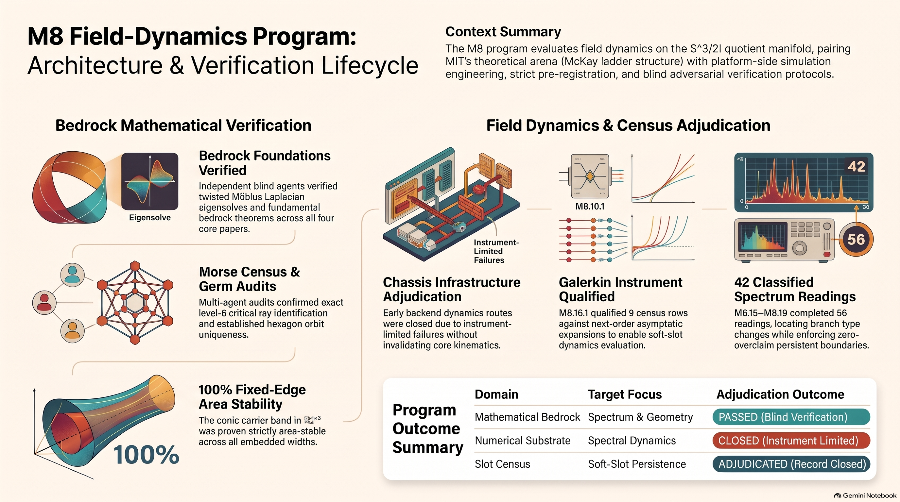

| **[`main`](https://github.com/dmobius3/mode-identity-theory/tree/main/)** | **[`framework`](/files/framework/)** | **[`bedrock`](/files/framework/files/bedrock/)** | **[`dynamics`](/files/framework/files/dynamics/)** | **[`working`](/files/framework/files/working/)** | **[`cosmos`](/files/cosmos/)** | **[`spectrum`](/files/spectrum/)** | **[`tools`](/files/tools/)** |

---

# 🏄‍♂️ M8 on OpenWave

[OpenWave](https://github.com/openwave-labs/openwave) is an open-source physics simulator built as an arena: candidate field theories run side by side in a shared computational environment and are judged against the same falsifiable criteria. It has no house model and no stake in which theory succeeds. Every result is backed by a runnable script or research record, and its coverage matrix scores each model against the same 31 criteria, from charge quantization to cosmic acceleration.

**M8** is MIT's column. Its tasks fall into two categories: blind reproductions of MIT's papers, where independent solvers recompute frozen claims from an evidence packet while an audit attempts to refute them; and forward tests of what MIT's geometry supports once wave content is allowed to evolve. Every run is pre-registered, frozen before execution, and reviewed in public. This page maps each task to its OpenWave record, tracks MIT's column of the coverage matrix, and serves as the archive for task files and results.

## Completed Tasks

| Task | What it asked | Outcome | MIT's side |
|---|---|---|---|
| [M8.1](https://github.com/openwave-labs/openwave/blob/main/openwave/xperiments/m8_mit/research/tasks/m8_1_task_details.md) | A blind eigensolve of the twisted Möbius Laplacian: the certification gate | ✅ Passed: all five claims confirmed by two independent blind solvers, audited | [First Eigenvalue](/files/framework/files/bedrock/files/first-eigenvalue.md) |
| [M8.1.1](https://github.com/openwave-labs/openwave/blob/main/openwave/xperiments/m8_mit/research/tasks/m8_1_1_task_details.md) | A blind run on the coexact gap and the Galois pair | ✅ Both papers verify: 18 claims confirmed blind, two audits refuting nothing; ⚠️ the conversion identity is algebraically forced, a platform-side overclaim corrected at review | [Coexact Gap](/files/framework/files/bedrock/files/coexact-gap.md), [Galois Pair](/files/framework/files/bedrock/files/galois-pair.md) |
| [M8.1.2](https://github.com/openwave-labs/openwave/blob/main/openwave/xperiments/m8_mit/research/tasks/m8_1_2_task_details.md) | A blind run on the Surviving Ray | ✅ All 21 frozen claims reproduce, blind and audited; ⚠️ the packet's `w_K` wording was loose, the paper's is not | [Surviving Ray](/files/framework/files/bedrock/files/surviving-ray.md), its [first version](https://doi.org/10.5281/zenodo.22681502) |
| [M8.1.3](https://github.com/openwave-labs/openwave/blob/main/openwave/xperiments/m8_mit/research/tasks/m8_1_3_task_details.md) | A blind run on the Standing-Wave Branches | ✅ Every frozen claim reproduces, blind and audited, in all five blocks; ⚠️ the packet's and the paper's Sp(1) wording was loose: the rooms read the continuous group, as the claims file has it | [Standing-Wave Branches](/files/framework/files/dynamics/files/standing-wave-branches.md), its [pinned version](https://doi.org/10.5281/zenodo.24224845), and [M8.1.3's page](/files/tools/files/openwave/files/m8-1-3/README.md) |
| [M8.2](https://github.com/openwave-labs/openwave/blob/main/openwave/xperiments/m8_mit/research/tasks/m8_2_task_details.md) | The pre-registration lock for the field-dynamics program | ✅ Locked, author-contributed ([#350](https://github.com/openwave-labs/openwave/pull/350)) | on OpenWave |
| [M8.3](https://github.com/openwave-labs/openwave/blob/main/openwave/xperiments/m8_mit/research/tasks/m8_3_task_details.md) | A reproducer script for the mass formula | ✅ Complete, author-contributed ([#362](https://github.com/openwave-labs/openwave/pull/362)); it found a defect in the published page, since corrected | [Mass Spectrum](/files/spectrum/files/mass-spectrum.md) |
| [M8.4](https://github.com/openwave-labs/openwave/blob/main/openwave/xperiments/m8_mit/research/tasks/m8_4_task_details.md) | A survey of Lagrangian families on S³/2I | ❌ Closed unresolved: no target configuration ran; not a verdict on MIT dynamics | on OpenWave |
| [M8.5](https://github.com/openwave-labs/openwave/blob/main/openwave/xperiments/m8_mit/research/tasks/m8_5_task_details.md) | Simulation engineering on the quotient | ✅ Closed: the grid backend certified for its own target | on OpenWave |
| [M8.5-C](https://github.com/openwave-labs/openwave/blob/main/openwave/xperiments/m8_mit/research/tasks/m8_5_task_details.md) | A spectral dynamics substrate for S³/2I | ❌ `M8.5-C2-FAILED`, attributed to the instrument | on OpenWave |
| [M8.6](https://github.com/openwave-labs/openwave/blob/main/openwave/xperiments/m8_mit/research/tasks/m8_6_task_details.md) | A comparison with M5's lepton hierarchy | ❌ Closed without running: permanently inadmissible as instrumented | [Mass Spectrum](/files/spectrum/files/mass-spectrum.md) |
| [M8.7](https://github.com/openwave-labs/openwave/blob/main/openwave/xperiments/m8_mit/research/tasks/m8_7_task_details.md) | The 3D rendering port | Held behind its gate: field dynamics validated in-platform, through a future program nothing currently authorizes | none yet |
| [M8.8](https://github.com/openwave-labs/openwave/blob/main/openwave/xperiments/m8_mit/research/tasks/m8_8_task_details.md) | An independent-method reproduction of M8.3's torsion closed forms | ✅ Reproduced, under the protocol's convention-difference category; a first attempt's structural failure stays on record | [Mass Spectrum](/files/spectrum/files/mass-spectrum.md) |
| [M8.9](https://github.com/openwave-labs/openwave/blob/main/openwave/xperiments/m8_mit/research/tasks/m8_9_task_details.md) | Localizing a discrete-spectrum source | ✅ Adjudicated `S1b-SPECTRAL`: instrument defect, source not separated | on OpenWave |
| [M8.10](https://github.com/openwave-labs/openwave/blob/main/openwave/xperiments/m8_mit/research/tasks/m8_10_task_details.md) | The first correction at the level-6 critical rays | ✅ All frozen claims reproduce, blind; ⚠️ four solver checks could not fail, and the block cubic's `M_K` form is not unique; no value moves | §8 of the Surviving Ray's [second version](https://doi.org/10.5281/zenodo.24145098) |
| [M8.11](https://github.com/openwave-labs/openwave/blob/main/openwave/xperiments/m8_mit/research/tasks/m8_11_task_details.md) | Local branch germs at the level-6 critical rays | ✅ Every value reproduces blind; existence passes as an audited argument, for local germs at small amplitude, with no radius or stability; ⚠️ the `λ₄` lemma's sign step rests on M8.10's level sets | §8 of the Surviving Ray's [second version](https://doi.org/10.5281/zenodo.24145098) |
| [M8.12](https://github.com/openwave-labs/openwave/blob/main/openwave/xperiments/m8_mit/research/tasks/m8_12_task_details.md) | The reduced Morse census of the level-6 quartic | ✅ Every frozen claim reproduces; one uniqueness clause left to M8.13; no stability claim, no radius | [Surviving Ray](/files/framework/files/bedrock/files/surviving-ray.md), §7.2, and its [certification scripts](/files/framework/files/bedrock/files/scripts/surviving-ray-v2/README.md) |
| [M8.13](https://github.com/openwave-labs/openwave/blob/main/openwave/xperiments/m8_mit/research/tasks/m8_13_task_details.md) | The uniqueness of the top-multipole maximum | ✅ Audited argument: the hexagon is the only maximizer; no stability claim | [Surviving Ray](/files/framework/files/bedrock/files/surviving-ray.md), §7.3 |
| [M8.14](https://github.com/openwave-labs/openwave/blob/main/openwave/xperiments/m8_mit/research/tasks/m8_14_task_details.md) | Fixed-edge stability of the conic carrier | ✅ Reproduced blind: strictly stable with the edge held fixed, at every embedded width; surface only, twist-blind | [The Fixed-Edge Stability Check](/files/framework/files/working/files/fixed-edge-check.md) |
| [M8.15](https://github.com/openwave-labs/openwave/blob/main/openwave/xperiments/m8_mit/research/tasks/m8_15_task_details.md) | The soft-slot branches at finite amplitude | ✅ Adjudicated per branch: five scored, two turning Hyperbolic within bracketed intervals; all eight persistence tests Persist; T1 INVALID and T4 Not reached in both slots, instrument outcomes | [run record](/files/framework/files/working/files/scripts/soft-slot-dynamics/RECORD.md); [The Soft-Slot Branches](/files/framework/files/working/files/soft-slot-branches.md) |
| [M8.15.1](https://github.com/openwave-labs/openwave/blob/main/openwave/xperiments/m8_mit/research/tasks/m8_15_1_task_details.md) | Locating the two changes of type | ✅ Adjudicated: no change of type located | [run record](/files/framework/files/working/files/scripts/soft-slot-dynamics-m8-15x-target1/RECORD.md) |
| [M8.15.2](https://github.com/openwave-labs/openwave/blob/main/openwave/xperiments/m8_mit/research/tasks/m8_15_2_task_details.md) | Locating them through the avoided crossing | ✅ Adjudicated: T3/R5's change of type located, under clause 3's qualifier; none located on T2/R4 | [run record](/files/framework/files/working/files/scripts/soft-slot-dynamics-m8-15-2/RECORD.md) |
| [M8.16](https://github.com/openwave-labs/openwave/blob/main/openwave/xperiments/m8_mit/research/tasks/m8_16_task_details.md) | Qualifying a stationary harmonic Galerkin instrument | ❌ Not qualified: the pyramid's quartet 5.78% from leading order, over the 5% bar; the five controls pass, and no census row ran | [run record](/files/framework/files/working/files/scripts/soft-slot-dynamics-m8-16/RECORD.md) |
| [M8.16.1](https://github.com/openwave-labs/openwave/blob/main/openwave/xperiments/m8_mit/research/tasks/m8_16_1_task_details.md) | That instrument's second and last qualification | ✅ Qualified: the instrument and nine rows; T5's second member not qualified | [run record](/files/framework/files/working/files/scripts/soft-slot-dynamics-m8-16-1/RECORD.md) |
| [M8.17](https://github.com/openwave-labs/openwave/blob/main/openwave/xperiments/m8_mit/research/tasks/m8_17_task_details.md) | The census run | ✅ Adjudicated as recorded: four rows meet an S4 completion condition, and five are not settled by the run | [run record](/files/framework/files/working/files/scripts/soft-slot-dynamics-m8-17/RECORD.md) |
| [M8.18](https://github.com/openwave-labs/openwave/blob/main/openwave/xperiments/m8_mit/research/tasks/m8_18_task_details.md) | The census's two remedies | ✅ Adjudicated as recorded: T4/R5's change of type located; the items left open close instrument-limited | [run record](/files/framework/files/working/files/scripts/soft-slot-dynamics-m8-18/RECORD.md) |
| [M8.19](https://github.com/openwave-labs/openwave/blob/main/openwave/xperiments/m8_mit/research/tasks/m8_19_task_details.md) | The census's persistence tests (S5) | ✅ Adjudicated, the record as filed: the coherent row in R5 Persists at 32; T1's and T4's stretches end untested | [run record](/files/framework/files/working/files/scripts/soft-slot-dynamics-m8-19/RECORD.md) |

## Work in Progress

Nothing is in progress.

Next comes the dynamics of the branches, which the [Standing-Wave Branches](/files/framework/files/dynamics/files/standing-wave-branches.md#62-what-stays-open) leaves to a sequel: the response to perturbations over several directions, amplitudes and durations, time integration that keeps the continuous symmetry, and evolution near the bracketed changes of type. It needs a new discretization first, since the Galerkin instrument was qualified without time integration. The same section of the paper lists what else stays open.

## The Criteria

MIT's column from the [coverage matrix](https://github.com/openwave-labs/openwave/blob/main/MODELS.md#summary-status). The [simplest test per criterion](https://github.com/openwave-labs/openwave/blob/main/MODELS.md#simplest-test-per-criterion) names what would settle each row.

✅ validated in-platform (0/31) · ⚠️ partial / with caveats (1/31) · ❌ honest negative (0/31) · 🚧 planned / not tested (30/31)

| # | Criteria | Summary |
|---|---|---|
| | **PARTICLE - ELECTRON** | |
| 1 | Charge quantization | 🚧 Group-theoretic assignment from the 2I stabilizer structure (Z₃ face stabilizers: color triplet vs singlet), not an integrated winding; the in-platform comparison with a winding-type charge rode the M8.4 lineage, which closed unresolved 2026-08-26 with no target configuration executed |
| 2 | Electron rest energy (mass) | 🚧 m_e is the mass-sector calibration anchor (benchmark input, not a prediction): entering the calibration loop from measured Λ reproduces m_e to ~2%. The corrected 24-entry analytic spectrum is now reproduced in-platform (M8.3 ✅, 23/23 gates, mutation-tested); 5 of 8 remaining charged fermions compatible within ×3 |
| 3 | de Broglie clock (Zitterbewegung) | 🚧 The Waltz clock dt/dτ_H = S^(−1/2) is not derived from the postulate: its exponent enters through the GR correspondence and is empirically unique in its family (Δχ² > 60); deriving a clock from dynamics on the arena is part of the M8 program |
| 4 | Particle stability (Derrick escape) | 🚧 Under the frozen slot action, localized standing waves vanish in flat space (Pohozaev), so no lump much smaller than R is expected; curvature-scale states remain open. M8.4 closed unresolved 2026-08-26, successor chassis M8.5-C2-FAILED 2026-08-31; no authorized route currently exists |
| 5 | Magnetic moment μ (g ≈ 2, magnetostatics) | 🚧 Not addressed |
| 6 | Angular momentum J (spin ℏ/2) | 🚧 Not addressed (no native dynamics to carry angular momentum) |
| 7 | Spin-½ statistics (720° double cover) | 🚧 2I ⊂ SU(2) carries the ordinary spinor sign: its central −I acts as −1 on half-integer-spin representations, distinct from the Möbius orientation sign. On MIT's projective carrier one loop carries both, making the spin sign geometric; this derives neither spin-statistics nor anticommutation. No field realization yet |
| | | |
| | **PARTICLE - FULL SPECTRUM** | |
| 8 | Antimatter + annihilation | 🚧 Not addressed (no native dynamics to annihilate with) |
| 9 | Neutrinos (neutral states) | 🚧 The R1 sector is an ordered ladder (0.87/7.3/66.7 meV) in qualitative resemblance to the lightest/solar/atmospheric scales, not a hard per-generation assignment; as absolute masses the NuFIT 6.0 splittings exclude it. Falsified if a global fit favors inverted ordering at χ²_NO − χ²_IO ≥ 9. Analytic only |
| 10 | Neutrino oscillations (PMNS) | 🚧 Not addressed in-platform; the analytic ladder carries the mass side only |
| 11 | Lepton mass spectrum (μ, τ) | 🚧 The McKay-distance ladder is a candidate mechanism for the hierarchy origin M5 leaves open, but the M8.6 cross-check closed on the M5 side (2026-08-07). Both leptons are adjudicated hits in-platform (M8.3: μ 1.03×, τ 2.74×, within ×3), but the pre-registered null gives p_A = 0.690, capping the ×3 count as uninformative |
| 12 | Quarks | 🚧 Color from the Z₃ face stabilizers (structural). The down quark's 3.22× residual is unchanged and remains the standing miss; top quark now a 0.93× hit at its corrected address; up quark's former ~6% hit was a torsion-computation artifact and is now unassigned; charm remains unplaced |
| 13 | Baryons: bound state (p, n) | 🚧 Not addressed |
| 14 | Baryons: mass ordering + charge profile | 🚧 Not addressed |
| 15 | Baryons: exact masses | 🚧 Not addressed |
| 16 | Deuteron (binding + quadrupole) | 🚧 Not addressed |
| 17 | Nuclear structure (levels, halos) | 🚧 Not addressed |
| 18 | Mesons (π, K) | 🚧 Not addressed |
| 19 | Dark matter candidate | 🚧 MIT reads dark matter as gravitational geometry of S³, with its assignment open; the present construction has no particle dark-matter sector. Rank 16 (~418 MeV) defaults to a structural residual; the 6 dead-zone states (eV-keV) carry an "unassigned" escape hatch |
| | | |
| | **FORCES** | |
| 20 | Electric force (Coulomb 1/r, electrostatics) | 🚧 α read from the first Fibonacci well is input-and-output (the author's Cycle 2: a consistency check, not a prediction); no force-level computation |
| 21 | Lorentz covariance (+ Coulomb = EM) | 🚧 No native field dynamics to be covariant; supplying a field equation on S³/2I was the M8.4 program, closed unresolved 2026-08-26. Successor chassis M8.5-C2-FAILED 2026-08-31. No authorized route currently exists |
| 22 | Strong force: confinement | 🚧 The analytic 4/R² adjoint gap on S³/2I is verified in-platform (M8.1.1: blind, adversarially audited, with the single 36/R² exception across the whole ADE family). Icon stays 🚧 deliberately: that is a spectral gap at a flat connection, not the linear inter-charge potential this row tests |
| 23 | Running coupling | 🚧 Not addressed; α itself is read from the first Fibonacci well (input-and-output) |
| 24 | Weak force: muon decay | 🚧 Not addressed |
| 25 | Weak force: beta decay (n → p) | 🚧 Not addressed |
| 26 | Gravity: Newton limit (GEM) | 🚧 Einstein's equations are imported unchanged, so the Newton limit is inherited rather than earned in-platform |
| 27 | Gravity: local metric phenomena | 🚧 No MIT-specific calculation of light bending, gravitational time dilation or Shapiro delay. MIT imports Einstein's equations unchanged, but importing field equations is not importing a solution: sources, boundary conditions and the local metric are still required |
| 28 | Cosmology: Λ / cosmic acceleration | ⚠️ Spectral seed validated: M8.1 (blind two-agent eigensolve, audited 6/6) confirmed 2/R² at 10-digit precision. Under the stated Gauss lift, 6/R²; with the de Sitter ½ imported, ΛR² = 3. Two gaps: scale R (two routes, 1.7-3.2× apart) and physical identification, gated on an undetermined stress tensor. Test: Λ_obs R_ind² = 3; >5σ falsifies |
| | | |
| | **WAVES + QUANTUM EMERGENCE** | |
| 29 | EM waves (Maxwell) | 🚧 No field model of radiation (photon massless at the edge-only layer level, a structural label) |
| 30 | Quantum wave equation (Klein-Gordon) | 🚧 No native field equation exists; supplying one on S³/2I remains the M8 program's central goal. M8.4 closed unresolved 2026-08-26 with no target configuration executed |
| 31 | Orbital quantization (atomic structure) | 🚧 Not addressed |

## Where the Files Are

The author's runs, M8.15 to M8.19, keep their folders beside the census, in `working/files/scripts/`, where their records pin them; the M8.15.x instrument that M8.15.1, M8.15.2 and M8.19 ran on is [`soft-slot-dynamics-m8-15x`](/files/framework/files/working/files/scripts/soft-slot-dynamics-m8-15x/REPRODUCE.md). Before M8.15 the runs and their records are on OpenWave, the author's two contributions, M8.2 and M8.3, among them; MIT holds the papers and the checks they reproduced.

From the next M8 task on, each task's files live here, under `files/`, in a folder named for its ID with hyphens for dots, such as `files/m8-20/` or `files/m8-19-1/`:

| File | What it holds |
|---|---|
| `README.md` | the question, the links to the terms, the go, the method note and the adjudication, the outcome, and the page that carries it |
| `terms/` | a copy of the filed terms, byte for byte, with their hash and a link to the original |
| `<task>_claims.json` | the claims file, where a task's designer takes it from this repository: the answer key, which no room reads |
| `run/` | the frozen code, its pins and its outputs |
| `RECORD.md` | the run record, built from the outputs |
| `DEVLOG.md` | the log from the build to the record |
| `POST_RUN.md` | what follows the run: the link to the adjudication, the author's records on both repositories, and dated notes |
| `tools/` | the scripts that build and check the record |
| `SHA256SUMS` | hashes of the task files, excluding this manifest |

---

| **[`↑top`](#top)** | **[`main`](https://github.com/dmobius3/mode-identity-theory/tree/main/)** | **[`framework`](/files/framework/)** | **[`bedrock`](/files/framework/files/bedrock/)** | **[`dynamics`](/files/framework/files/dynamics/)** | **[`working`](/files/framework/files/working/)** | **[`cosmos`](/files/cosmos/)** | **[`spectrum`](/files/spectrum/)** | **[`tools`](/files/tools/)** |
